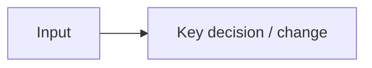

# Plan: <Title>

> **Task ID:** `<task_slug>` (= this file name) · **Issues:** ISS-NNN, ISS-NNN (chosen by the user) · **Spec:** <docs/features/... · Notion link · —>
> **Conflict verdict:** <PARALLEL-SAFE | NEEDS-SEQUENCING | BLOCKED> · **Status:** Draft | Approved (YY-MM-DD) | In progress (M<n>) | Done (YY-MM-DD)

## 1. Context (facts)
- <current behavior with `path:line`>
- <root cause for bugs>

## 2. Goal, scope verdict & non-goals
- **Goal:** <one sentence, verifiable>
- **Scope:** OK | TOO-BROAD → <proposed issue split> | TOO-SMALL → <issues proposed to merge in>
- **Non-goals / omitted:** <what is deliberately not done>
- **Assumptions:** <explicit assumptions; open questions go to §8>

## 2.5 Design & Approach (user reviews this section)
### Diagram(s)
<!-- Required for multi-layer, workflow, state-machine, or schema tasks (include as many Mermaid diagrams as needed to make the design clear); write `—` for small/local fixes. -->

### Key decisions & contracts
| Area | Decision / Contract | Rationale / Notes |
|---|---|---|
| API / RBAC | `<endpoint, payload, permission & PROJECT/OWN scope>` | |
| Data / Schema | `<tables, columns, metadata JSON, or —>` | |
| Config / Env | `<USFDS_* vars & defaults, or —>` | |

### Edge cases, concurrency & failure handling
- <timeout, idempotency, race condition, fallback, or backward-compatibility rule — or `—`>

## 3. Files
| Action | File | Milestone | Note |
|---|---|---|---|
| create | `<path>` | M1 | |
| modify | `<path>` | M2 | append-only if hot-spot |
| migration | `.../migrations/versions/<rev>_<slug>.py` | M1 | or — |

## 4. Dependencies & conflicts (with other tasks on BOARD)
| # | Check | Answer |
|---|---|---|
| D1 | Needs unfinished task? | No / Yes: <task> |
| D2 | Needed by unfinished task? | No / Yes: <task> |
| C1 | Modified files owned by in-progress task? | No / Yes: <file → task> |
| C2 | Hot-spot files touched | — / <files> (append-only) |
| C3 | Schema change | No / Yes: <tables/columns> |
| C4 | Public contract change | No / Yes: <endpoint/payload> → consumers: <...> |
| C5 | Shared UI shell change | No / Yes: <file> |

## 4.5 System Invariant & Blast-Radius Impact (user reviews this section)
<!-- Check against docs/arch/03-system-invariants.md (all P-NN and INV-NNN) and docs/arch/02-data-and-lifecycle-flows.md (C1–C5). -->
| Check | Touched? | How invariant / contract is preserved (or N/A) |
|---|---|---|
| Auth / Project / `OWN` scope (`INV-001..003`) | No / Yes | <routes, permission codes, `project_id`, `owner_id` checks> |
| File I/O / Sandbox / Remote Creds (`INV-004`) | No / Yes | <presigned URL, upload cap, AST/timeout, zero-cred> |
| Principles (`P-NN`) | No / Yes | <values in system metadata, port + registry, computation as job, no concrete engine in core> |
| Layering / PG Compat / Large Data / No pandas (`INV-005..007,016`) | No / Yes | <Alembic rev, DuckDB bounded, no core→infra import, no new pandas> |
| Queue / Delete / Concurrency (`INV-008,011,012`) | No / Yes | <idempotency, in-use 409/400, orphan cleanup, `expected_version`> |
| Shared Contracts (`C1–C5`) & Formulas (`INV-009,010,013`) | No / Yes | <producers & consumers checked; fail-fast; metric math> |
| Architecture Doc-Sync (`INV-015`) | No / Yes | <`docs/arch/*` files to update at PR time, or `—`> |

## 5. Acceptance tests (user reviews this section)
| Milestone | Test | Given | When | Then | Covers |
|---|---|---|---|---|---|
| M1 | `test_<behavior_sentence>` (`<test file>`) | <state> | <action> | <observable result> | <ISS/SUC/BR> |

## 6. Milestones & to-do (checkpoints, not stop points: all tests green at each)
The agent ticks items as it works. This is the task's only to-do list (`TODO.md` is no longer used for new work).

- [ ] **M1 — <name>** (<packages>): <what exists after this checkpoint>
  - [ ] [tests] Write the M1 tests from §5; confirm they fail for the right reason
  - [ ] [core] ...
  - [ ] [infra] ...
  - [ ] [verify] `./scripts/test.sh <pkgs>`
- [ ] **M2 — <name>** (<packages>): ...
  - [ ] [tests] ...
  - [ ] [server] ...
  - [ ] [verify] ...

Checkpoint log (the agent appends one line per finished milestone):
- <YY-MM-DD> M1 done: <test summary line>; notes: <deviations or —>

## 7. Review hotspots (filled in after implementation)
- `<path:line>`: <why this logic matters / what could go wrong> (M<n>)

## 8. Open questions
- <question for the user, or —>

## 9. Manual E2E verification (post-merge)
- [ ] <scenario the user verifies on real PostgreSQL / BullMQ / S3 / external provider, or `—`>
