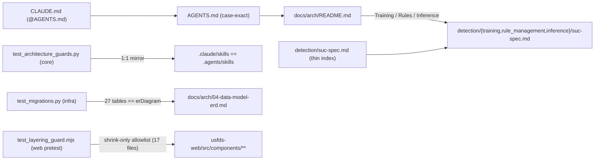

# Plan: Tinh chỉnh AI Agent Context, Design System As-Built & Tier-1 Fitness Guards

> **Task ID:** `agent_context_and_guard_refinement` · **Issues:** ISS-059 (mới, tạo trong task này; hỗ trợ một phần ISS-032, ISS-034) · **Spec:** `docs/arch/README.md`, `docs/arch/03-system-invariants.md`, `docs/design-system.md`
> **Conflict verdict:** PARALLEL-SAFE · **Status:** Done (26-11-28)

## 1. Context (facts)
- **Bẫy điều hướng đặc tả Detection & Plan cũ:**
	- `docs/features/detection/suc-spec.md:1-397` (bản cũ) trùng lặp toàn bộ `SUC-08..17` với 3 đặc tả con chuẩn hóa (`docs/features/detection/training/suc-spec.md`, `docs/features/detection/rule_management/suc-spec.md`, `docs/features/detection/inference/suc-spec.md`), nhưng chứa thuật ngữ đã lệch code (`status = 'succeeded' | 'queued' | 'registered' | 'validated'`, bảng `rule_execution_logs`, CLI `--input --output` tại `docs/features/detection/suc-spec.md:44,68,131,347`).
	- `docs/arch/README.md:26-27`, `docs/arch/modules/training-and-models.md:60` và `docs/arch/modules/detection-and-rules.md:47` vẫn trỏ agent vào `detection/suc-spec.md` bản cũ.
	- Hai file plan đang gắn `Planned` cho `ISS-038` / `ISS-039` (`.plan/training_evaluation_metrics.md:29`, `.plan/automl_training_integration.md:1-38`) được viết trước chuẩn template v2; riêng `.plan/training_evaluation_metrics.md:29` yêu cầu comment-out code bằng `DEPRECATED` — ngược trực tiếp với `AGENTs.md:82` và thiếu kiểm tra `INV-016` (cấm `pandas`).
	- Link gãy còn sót: `docs/issues/README.md:93` trỏ `../bugs.md` (không tồn tại); `docs/features/critical_changes.md:6,65` trỏ `docs/usecase/suc-module-1-2.md` (không tồn tại); `.plan/remote_compute_multi_workload.md:3` trỏ `docs/research/high-level-design.md` (đã xóa trên working tree `main`).
- **`docs/design-system.md` lệch khỏi implementation thực tế của `usfds-web`:**
	- `docs/design-system.md:223-233` định nghĩa bảng Type Scale gồm `text-display`, `text-heading-lg`, `text-heading-md`, `text-body`, `text-caption`, `text-code` — xuất hiện `0` lần trong `usfds-web/src` và không tồn tại trong `usfds-web/tailwind.config.js:1-147` hay `usfds-web/src/index.css:1-262`.
	- Ngược lại, `usfds-web` dùng hệ class Tailwind dựa trên biến kênh RGB `--tw-*` tự đảo màu Dark/Light (`bg-dark-950..800`, `border-dark-700`, `text-slate-100..500`, `brand`, `fraud`, `legit`, `alarm` tại `usfds-web/tailwind.config.js:11-127`, `usfds-web/src/index.css:52-215`), `useTheme().chartTokens` (`usfds-web/src/hooks/useTheme.tsx:8-45`), và quy tắc Light Mode không dùng `text-white` trên nền card/panel (dùng `text-slate-100`, chỉ giữ `text-white` trên nút đặc như `usfds-web/src/components/common/Button.tsx:33`).
	- `docs/design-system.md:272,277` còn ghi luồng cũ `RAW -> MAPPED -> PRE_PROCESSED` (thiếu `FEATURE_ENGINEERED`) và dùng emoji `🌿` trái với chính quy tắc cấm emoji ở `docs/design-system.md:25`.
- **Đa nền tảng Agent & khoảng trống Tier-1 Fitness Guards:**
	- Git đang lưu tên file gốc là `AGENTs.md` (chữ `s` thường) trong khi nội dung bên trong ghi `AGENTS.md` (`AGENTs.md:105`); repo có `.claude/skills/` nhưng thiếu `CLAUDE.md` ở gốc cho Claude Code. Hai skill `.claude/skills/{usfds-plan,usfds-task-workflow}/SKILL.md` (và bản mirror `.agents/skills/`) vẫn ghi `AGENTs.md`.
	- `docs/arch/03-system-invariants.md:144-147` (`INV-014`) chưa có Tier-1 guard chặn component mới trong `usfds-web/src/components/**` import trực tiếp `src/api/**` (hiện có 17 file component legacy chưa tính `*.test.*` và `docs_dashboard/*`).
	- `docs/arch/04-data-model-erd.md` chưa có drift test đối chiếu 2 chiều với 27 bảng trong `Base.metadata.tables` (`usfds-infra/src/usfds_infra/database/{models,case_models}.py`).
	- Đồng bộ `.claude/skills/` và `.agents/skills/` chưa có guard tự động trong `./scripts/test.sh`.

## 2. Goal, scope verdict & non-goals
- **Goal:** Loại bỏ các điểm mâu thuẫn/lỗi thời trong `docs/features/detection/suc-spec.md` và 2 file `.plan/` `Planned`, đồng bộ `docs/design-system.md` khớp 100% với Tailwind/Theme thực tế của `usfds-web`, chuẩn hóa `AGENTS.md` + `CLAUDE.md`, và khóa tự động 3 quy tắc (`INV-014` FE layering, `INV-015` ERD-to-ORM sync, skill mirror sync) trong `./scripts/test.sh`.
- **Scope:** OK (3 hạng mục độc lập với logic nghiệp vụ runtime, không đổi DB schema hay REST API).
- **Non-goals / omitted:**
	- **Không chạm `DocsDashboardPage.tsx`, `viteDocsPlugin.ts` và `usfds-web/src/components/modules/docs_dashboard/**`** (user tự thực hiện riêng).
	- Không refactor 17 component legacy đang gọi trực tiếp `api/*` (`ISS-032`) — chỉ đóng băng trong shrink-only allowlist.
	- Không đánh lại mã `SUC-NN` bị trùng xuyên phân hệ (`ISS-034` đang chờ đổi trên Notion trước).
	- Không viết lại nội dung nghiệp vụ chi tiết của `ISS-038` / `ISS-039` — chỉ gắn cảnh báo bắt buộc replan theo `template.md` v2 + `INV-016` trước khi thực thi.
- **Assumptions:** Các chỉnh sửa chưa commit hiện có của user trên `main` (`AGENTs.md`, `docs/arch/01-context-and-runtime.md`, `docs/arch/README.md`, xóa `docs/research/high-level-design.md`) là chủ đích của user và được giữ nguyên khi tạo nhánh `task/agent_context_and_guard_refinement`.

## 2.5 Design & Approach (user reviews this section)
### Diagram(s)


### Key decisions & contracts
| Area | Decision / Contract | Rationale / Notes |
|---|---|---|
| API / RBAC | — | Không thay đổi endpoint, schema hay permission. |
| Data / Schema | — | Không thay đổi ORM model hay Alembic migration. |
| Config / Env | — | Không thêm biến môi trường. |
| Spec & Plan Hygiene (Mục 1) | Chuyển `docs/features/detection/suc-spec.md` thành trang mục lục mỏng dẫn tới 3 file con (`training`, `rule_management`, `inference`) để không làm gãy các link cũ từ `project_management/*` và `model_plugin/design.md`; cập nhật `docs/arch/README.md` và `modules/{training-and-models,detection-and-rules}.md` trỏ thẳng tới file con tương ứng; gắn banner `[NEEDS-REPLAN: template v2 + INV-016]` đầu `.plan/{training_evaluation_metrics,automl_training_integration}.md`; dọn 3 link hỏng (`critical_changes.md`, `remote_compute_multi_workload.md`, và `docs/issues/README.md` lúc merge). | Triệt tiêu nguồn hướng dẫn sai enum/status/DEPRECATED mà vẫn bảo toàn toàn bộ inbound links. |
| Design System Sync (Mục 2) | Cập nhật `docs/design-system.md` mục §2–§3 và §5.1 theo đúng `tailwind.config.js` + `src/index.css` + `useTheme.tsx`: bổ sung bảng semantic Tailwind classes (`bg-dark-950..800`, `border-dark-700`, `text-slate-100..500`, `brand`, `fraud`, `legit`, `alarm`), quy tắc Light Mode (cấm `text-white` trên nền card/panel, chỉ dùng trên solid buttons; chart lấy màu từ `useTheme().chartTokens`), thay bảng `text-heading-*` giả định bằng tổ hợp utility thực tế (`PageHeader`, `Card`, `Badge`, `tabular-nums`), bỏ emoji `🌿`, sửa luồng stepper thành `RAW -> MAPPED -> FEATURE_ENGINEERED [-> PRE_PROCESSED]`. | Ngăn FE agent sinh class không tồn tại hoặc làm hỏng giao diện Light Mode. |
| Entrypoints & Tier-1 Guards (Mục 3) | 1) `git mv` hai bước `AGENTs.md` → `AGENTS.md` + tạo `CLAUDE.md` (`@AGENTS.md`) + cập nhật tham chiếu trong skills.<br>2) `usfds-core/tests/test_architecture_guards.py`: kiểm tra tập file và nội dung byte-for-byte giữa `.claude/skills/` và `.agents/skills/`.<br>3) `usfds-infra/tests/test_migrations.py`: nạp cả `usfds_infra.database.models` và `case_models`, parse các khối `erDiagram` trong `docs/arch/04-data-model-erd.md`, assert `set(Base.metadata.tables) == erd_tables`.<br>4) `usfds-web/tests/test_layering_guard.mjs`: quét `src/components/**/*.{ts,tsx}` (loại trừ `*.test.*` và `src/components/modules/docs_dashboard/**`), chặn mọi import `api/*` ngoài `COMPONENT_API_IMPORT_ALLOWLIST` (17 file, shrink-only). | Tất cả chạy tự động trong `./scripts/test.sh` mà không xung đột với việc user sửa riêng `DocsDashboard`. |

### Edge cases, concurrency & failure handling
- **Case-insensitive filesystem trên macOS (APFS):** `git mv AGENTs.md AGENTS.md` trực tiếp có thể bị git bỏ qua hoặc lỗi trên một số cấu hình; dùng `git mv AGENTs.md AGENTS.tmp.md && git mv AGENTS.tmp.md AGENTS.md` để ghi nhận chính xác trên git index cho Linux/CI.
- **Cô lập với `DocsDashboard` của user:** `test_layering_guard.mjs` loại trừ tường minh thư mục `src/components/modules/docs_dashboard/` để mọi thay đổi song song của user trên `DocsDashboard` không bao giờ chạm allowlist hay gây đỏ test.
- **Parser `erDiagram` trong `04-data-model-erd.md`:** Các bảng nối (`user_sessions`, `role_permissions`, `feature_set_items`, ...) chỉ xuất hiện ở dòng quan hệ `A ||--o{ B : "..."` chứ không mở khối `table { ... }`; hàm parse trích xuất cả hai vế của dòng quan hệ lẫn tiêu đề khối `table {` bên trong fence ` ```mermaid erDiagram ` để khớp chính xác 27/27 bảng.

## 3. Files
| Action | File | Milestone | Note |
|---|---|---|---|
| create | `usfds-web/tests/test_layering_guard.mjs` | M1 | Tier-1 guard `INV-014` (chạy qua `npm test` -> `pretest`) |
| modify | `usfds-core/tests/test_architecture_guards.py` | M1 | thêm guard `.claude/skills` == `.agents/skills` (append-only) |
| modify | `usfds-infra/tests/test_migrations.py` | M1 | thêm guard 27 bảng ORM == `04-data-model-erd.md` (append-only) |
| modify | `docs/issues/11-28-2026.md` | M1 | thêm `ISS-059` |
| rename + modify | `AGENTs.md` → `AGENTS.md` | M2 | chuẩn hóa tên hoa `AGENTS.md` trên git index, giữ chỉnh sửa của user |
| create | `CLAUDE.md` | M2 | 1 dòng `@AGENTS.md` cho Claude Code |
| modify | `.claude/skills/usfds-plan/SKILL.md`, `.claude/skills/usfds-task-workflow/SKILL.md` (+ mirror `.agents/skills/**`) | M2 | đổi `AGENTs.md` → `AGENTS.md` |
| modify | `docs/features/detection/suc-spec.md` | M2 | thu gọn thành mục lục trỏ sang 3 file `training/`, `rule_management/`, `inference/` (`[26-11-28]`) |
| modify | `docs/features/critical_changes.md` | M2 | sửa link gãy `docs/usecase/suc-module-1-2.md` (`[26-11-28]`) |
| modify | `docs/arch/README.md`, `docs/arch/03-system-invariants.md`, `docs/arch/modules/training-and-models.md`, `docs/arch/modules/detection-and-rules.md` | M2 | trỏ đúng 3 sub-spec Detection; cập nhật cột Guard của `INV-014`, `INV-015` (`[26-11-28]`) |
| modify | `.plan/training_evaluation_metrics.md`, `.plan/automl_training_integration.md`, `.plan/remote_compute_multi_workload.md` | M2 | gắn cảnh báo replan theo template v2 + `INV-016`; gỡ link `high-level-design.md` đã xóa |
| modify | `docs/design-system.md` | M3 | đồng bộ Tailwind RGB tokens, Light Mode rules, Type Scale thực tế & Stepper flow (`[26-11-28]`) |
| at merge | `CHANGELOG.md`, `.plan/BOARD.md`, `docs/issues/README.md` | — | cập nhật trạng thái `ISS-059` + gỡ dòng link gãy `../bugs.md` ở `docs/issues/README.md:93` |

## 4. Dependencies & conflicts (with other tasks on BOARD)
| # | Check | Answer |
|---|---|---|
| D1 | Needs unfinished task? | No |
| D2 | Needed by unfinished task? | No (`ISS-038`, `ISS-039` chỉ được gắn nhãn cảnh báo replan trước khi chạy) |
| C1 | Modified files owned by in-progress task? | No (không có task `In progress` trên `BOARD.md`; phần `DocsDashboard` của user đã được loại trừ hoàn toàn khỏi scope và khỏi `test_layering_guard.mjs`) |
| C2 | Hot-spot files touched | `docs/issues/` status, `CHANGELOG.md`, `.plan/BOARD.md` (chỉ cập nhật ở bước 5 khi merge) |
| C3 | Schema change | No |
| C4 | Public contract change | No (đổi tên `AGENTs.md` → `AGENTS.md` đi kèm cập nhật toàn bộ live references trong skills) |
| C5 | Shared UI shell change | No |

## 4.5 System Invariant & Blast-Radius Impact (user reviews this section)
<!-- Check against docs/arch/03-system-invariants.md (all P-NN and INV-NNN) and docs/arch/02-data-and-lifecycle-flows.md (C1–C5). -->
| Check | Touched? | How invariant / contract is preserved (or N/A) |
|---|---|---|
| Auth / Project / `OWN` scope (`INV-001..003`) | No | N/A — không chạm router hay auth logic. |
| File I/O / Sandbox / Remote Creds (`INV-004`) | No | N/A |
| Principles (`P-NN`) | No | N/A — giữ nguyên `P-01..P-04`. |
| Layering / PG Compat / Large Data / No pandas (`INV-005..007,016`) | Yes (tests) | Guard mới trong `usfds-core` chỉ dùng thư viện chuẩn (`pathlib`), không import `usfds_infra` hay `pandas`; guard ERD đặt đúng ở `usfds-infra/tests/test_migrations.py` để tuân thủ `INV-005`. |
| Queue / Delete / Concurrency (`INV-008,011,012`) | No | N/A |
| Shared Contracts (`C1–C5`) & Formulas (`INV-009,010,013`) | No | N/A — không đổi nội dung contract `C1–C5`. |
| Frontend Layering & Doc-Sync (`INV-014,015`) | Yes | Nâng `INV-014` (FE `component -> api`) và một phần `INV-015` (ORM ↔ `04-data-model-erd.md`, skill mirror) từ kiểm tra thủ công Tier 3 lên Tier-1 automated guard; cập nhật bảng Guardrail Matrix trong `03-system-invariants.md`. |

## 5. Acceptance tests (user reviews this section)
| Milestone | Test | Given | When | Then | Covers |
|---|---|---|---|---|---|
| M1 | `test_claude_and_agents_skills_stay_identical` (`usfds-core/tests/test_architecture_guards.py`) | hai thư mục `.claude/skills` và `.agents/skills` | có file bị thiếu hoặc lệch nội dung giữa hai bên | test fail và chỉ rõ đường dẫn file lệch | ISS-059 |
| M1 | `test_every_orm_table_is_documented_in_arch_erd` (`usfds-infra/tests/test_migrations.py`) | 27 bảng đăng ký trên `Base.metadata` (`models` + `case_models`) và `docs/arch/04-data-model-erd.md` | thêm bảng ORM mới chưa có trong `erDiagram` hoặc còn tên bảng thừa trong ERD | test fail liệt kê `missing_in_erd` / `stale_in_erd` | INV-015, ISS-059 |
| M1 | `component API layering guard (INV-014)` (`usfds-web/tests/test_layering_guard.mjs`) | allowlist đóng băng 17 component legacy (bỏ qua `*.test.*` và `docs_dashboard/**`) | một component mới import `@/api/*` hoặc `../api/*`, hoặc một file trong allowlist đã bỏ import `api/*` mà chưa gỡ khỏi allowlist | `npm test` (`pretest`) fail và in danh sách file vi phạm / stale | INV-014, ISS-032, ISS-059 |
| M2 | Kiểm tra git index & relative links (`git ls-files AGENTS.md CLAUDE.md` + script kiểm tra link `.md`) | repo sau khi đổi tên `AGENTS.md` và thu gọn `detection/suc-spec.md` | chạy kiểm tra trên nhánh task | `AGENTS.md` (chữ `S` hoa) và `CLAUDE.md` có trên git index, `AGENTs.md` không còn trên git index, `0` relative link bị đứt trong `docs/`, `AGENTS.md`, `CLAUDE.md`, `.claude/skills/` | ISS-059, ISS-034 |
| M3 | Kiểm tra đồng bộ `docs/design-system.md` vs `usfds-web` | `docs/design-system.md` sau cập nhật | quét các pseudo-token cũ (`text-heading-lg`, `text-display`, emoji `🌿`) và kiểm tra sự hiện diện của `bg-dark-900`, `text-slate-100`, `useTheme` | `0` pseudo-token/emoji cũ; đầy đủ quy tắc Dark/Light Tailwind thực tế và không còn ký tự tiếng Việt ngoài ví dụ copy UI | ISS-059 |

## 6. Milestones & to-do (checkpoints, not stop points: all tests green at each)
The agent ticks items as it works. This is the task's only to-do list (`TODO.md` is no longer used for new work).

- [x] **M1 — Tier-1 Fitness Guards & Issue Tracking** (`core`, `infra`, `web`, `docs/issues`)
	- [x] [docs] Ghi nhận `ISS-059` trong `docs/issues/11-28-2026.md`
	- [x] [tests] Thêm `test_claude_and_agents_skills_stay_identical` vào `usfds-core/tests/test_architecture_guards.py` (kiểm chứng đỏ khi giả lập lệch, xanh trên repo hiện tại)
	- [x] [tests] Thêm `test_every_orm_table_is_documented_in_arch_erd` vào `usfds-infra/tests/test_migrations.py` (kiểm chứng đỏ khi giả lập thiếu bảng, xanh với 27 bảng hiện tại)
	- [x] [tests] Tạo `usfds-web/tests/test_layering_guard.mjs` kiểm tra shrink-only allowlist cho import `api/*` trong `src/components/**` (loại trừ `*.test.*` và `docs_dashboard/**`)
	- [x] [verify] `./scripts/test.sh core infra web`
- [x] **M2 — Chuẩn hóa `AGENTS.md` / `CLAUDE.md`, Routing Detection Specs & Cảnh báo Plan cũ** (`root`, `skills`, `docs/arch`, `docs/features`, `.plan`)
	- [x] [docs] `git mv` hai bước `AGENTs.md` → `AGENTS.md`; tạo `CLAUDE.md` (`@AGENTS.md`); đổi tham chiếu `AGENTs.md` → `AGENTS.md` trong `.claude/skills/{usfds-plan,usfds-task-workflow}/SKILL.md` và đồng bộ sang `.agents/skills/`
	- [x] [docs] Thu gọn `docs/features/detection/suc-spec.md` thành trang mục lục trỏ sang `training/suc-spec.md`, `rule_management/suc-spec.md`, `inference/suc-spec.md`; sửa link gãy trong `docs/features/critical_changes.md`
	- [x] [docs] Cập nhật `docs/arch/README.md`, `docs/arch/modules/{training-and-models,detection-and-rules}.md` trỏ đúng sub-spec; cập nhật Guardrail Matrix (`INV-014`, `INV-015`) trong `docs/arch/03-system-invariants.md`
	- [x] [docs] Gắn callout `NEEDS-REPLAN (template v2 + INV-016)` vào `.plan/training_evaluation_metrics.md` và `.plan/automl_training_integration.md`; gỡ link `docs/research/high-level-design.md` trong `.plan/remote_compute_multi_workload.md`
	- [x] [verify] `./scripts/test.sh core infra` + kiểm tra `git ls-files` và `0` broken relative links
- [x] **M3 — Đồng bộ `docs/design-system.md` As-Built** (`docs`)
	- [x] [docs] Cập nhật `docs/design-system.md` (§2 Token Architecture với bảng Tailwind RGB `bg-dark-*` / `text-slate-*` / `brand|fraud|legit|alarm` + quy tắc Light Mode & `useTheme().chartTokens`, §3 Type Scale theo utility thực tế, §5.1 Stepper `RAW -> MAPPED -> FEATURE_ENGINEERED` không dùng emoji)
	- [x] [verify] Kiểm tra Mermaid/link/English-only rule trên `docs/design-system.md` + chạy `./scripts/test.sh core infra web`

Checkpoint log (the agent appends one line per finished milestone):
- 26-11-28 M1 done: `core` 217 passed, 15 skipped · `infra` 56 passed · `web` pretest 3 passed + vitest 28 files / 62 passed; notes: extended FE layering guard after `usfds-review` to scan both `src/components/` and `src/pages/` (19 frozen legacy files; excludes `docs_dashboard/**` and `DocsDashboardPage.tsx`), handle inline `import { type ... }` and `export ... from`; `test_every_orm_table_is_documented_in_arch_erd` tracks `in_mermaid_fence` and compares `Base.metadata.tables - test_only_tables`.
- 26-11-28 M2 done: `core` 217 passed, 15 skipped · `infra` 56 passed; `git ls-files AGENTS.md` verified (`AGENTs.md` removed from git index), `CLAUDE.md` created, `0` broken relative links across `AGENTS.md`, `CLAUDE.md`, `README.md`, `docs/arch/**`, `docs/design-system.md`, `docs/features/{detection/suc-spec,critical_changes}.md`, skills.
- 26-11-28 M3 done: `core` 217 passed, 15 skipped · `infra` 56 passed · `web` pretest 3 passed + vitest 28 files / 62 passed + `npm run build` & `npm run lint` exit 0; `docs/design-system.md` passed zero-pseudo-token, zero-emoji, English-only checks (exact per-palette adaptive shades verified against `tailwind.config.js`).

## 7. Review hotspots (filled in after implementation)
- `usfds-web/tests/test_layering_guard.mjs:10-44,64-112` (M1): shrink-only `COMPONENT_API_IMPORT_ALLOWLIST` (19 legacy files across `src/components/` and `src/pages/`) and regex detector distinguishing value imports / re-exports vs `import type` / inline `import { type ... }`, while excluding `docs_dashboard/**` and `DocsDashboardPage.tsx`. Any later addition to the allowlist silently bypasses `INV-014`.
- `usfds-infra/tests/test_migrations.py:216-286` (M1): `_extract_erd_tables` parses both entity blocks and relation edges strictly inside ` ```mermaid ` `erDiagram` fences, and diffs `Base.metadata.tables - test_only_tables` against `04-data-model-erd.md` (catches both mapped ORM classes and unmapped Core `Table` definitions).
- `usfds-core/tests/test_architecture_guards.py:303-332` (M1): `test_claude_and_agents_skills_stay_identical` compares file tree and raw bytes between `.claude/skills/` and `.agents/skills/`.
- `docs/design-system.md:214-265` (M3): new as-built Tailwind RGB utility & Light Mode contract (`text-slate-100` vs `text-white`, exact per-palette adaptive shades, `useTheme().chartTokens`) that guides all future frontend tasks.

## 8. Open questions
- —

## 9. Manual E2E verification (post-merge)
- [ ] Mở một phiên Claude Code / Cursor mới trên nhánh đã merge để xác nhận `CLAUDE.md` → `AGENTS.md` được tự động nhận diện trên cả macOS và môi trường Linux/Cloud Agent.
