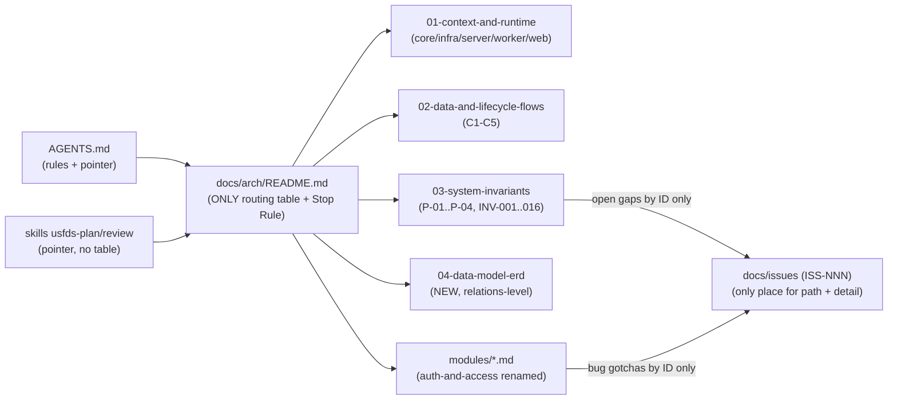

# Plan: Architecture docs — dedupe, principles, ERD, English rewrite

> **Task ID:** `arch_docs_principles_english` · **Issues:** ISS-054 (new, this task); raises ISS-055..058 (conformance gaps, not fixed here) · **Spec:** user review 26-11-28 (9 points) · —
> **Conflict verdict:** PARALLEL-SAFE · **Status:** Approved (26-11-28)

## 1. Context (facts)
- Routing info is written 3 times: `AGENTS.md` §0, `usfds-plan` SKILL step 1, `docs/arch/README.md` §2.
- `README.md:12-18` lists `usfds-cli`, `usfds-agent`, omits `usfds-worker`, and says SQLite only. `docs/arch/01-context-and-runtime.md:38-52` documents cli/agent; `AGENTS.md:90,93` lists `usfds-cli`.
- "Tenancy" wording: `03-system-invariants.md:13`, `modules/auth-and-tenancy.md:1` (file name), `usfds-review` SKILL:22. The system has no tenants: one organization, `Project` is a workspace isolation boundary.
- `docs/arch` contains 12 `file.py:NNN` references (already drifting, e.g. `inference/executor.py:643`), and open bugs are copied 3× (03 WARNING block, module "Gotchas", `docs/issues/`).
- `docs/arch/high-level-design.md` (22KB) describes K8s/MinIO/Apache AGE research, not as-built.
- No ERD in `docs/arch`; 27 ORM tables; `docs/diagram/usfds_erd.drawio` exists (unverified vs code).
- `docs/arch/*` and `docs/design-system.md` are Vietnamese; `AGENTS.md`, `README.md`, skills are English.
- Conformance of the new rules today:
  - **No pandas:** 39 source files import pandas by AST (`usfds-core` 35, `usfds-server` 3 routers, `usfds-worker` 1; earlier grep count 42 included pandas inside plugin template strings). Only full-file readers are guarded (`test_architecture_guards.py:99`).
  - **Pluggable / isolated compute:** `IRemoteComputeProvider` (`services/training/providers/base_provider.py:11`) has one adapter (Modal) and serves training only; batch inference has `IBatchInferenceDispatcher` (local/queue) but no remote provider; no K8s adapter.
  - **Dependency inversion:** repositories, `IFileStorage`, dispatchers, notifiers are ports. `ProjectWarehouse` (`warehouse/project_warehouse.py:122`) and graph/analytics engines import `duckdb`/`ladybug` directly in `usfds-core` (8 modules) with no port.
  - **Configurable:** `create_bounded_duckdb_connection` defaults `threads=2, memory_limit="512MB"` (`project_warehouse.py:96-98`), `MAX_EXPAND_NEIGHBORS = 50` (`network_graph.py:28`), `_MAX_DISTINCT_VALUES = 20` (`profiling.py:17`) are hardcoded.

## 2. Goal, scope verdict & non-goals
- **Goal:** `docs/arch` + `AGENTS.md` + `README.md` + `docs/design-system.md` are English, single-sourced, free of line numbers and multi-tenant / cli / agent content, include 4 architecture principles + a no-pandas invariant (guarded by a shrinking allowlist) + a relations-level ERD.
- **Scope:** OK (docs + one guard test; conformance fixes are raised as issues, not done).
- **Non-goals / omitted:**
  - Refactoring code to satisfy P-01..P-04 or removing pandas (→ ISS-055..058).
  - Translating `docs/features/**` (Notion-synced) and `docs/issues/**`.
  - Archiving `.plan/*` done files (breaks many links; separate task if wanted, §8).
  - Deleting `usfds-cli` / `usfds-agent` code; ISS-033 stays as is.
  - Updating `docs/diagram/usfds_erd.drawio`.
- **Assumptions:** "No multi-tenant" = single organization; project isolation (`INV-002`) and RBAC stay unchanged, only wording/framing changes. UI copy examples in `design-system.md` stay Vietnamese (UI language is Vietnamese).

## 2.5 Design & Approach
### Diagram — target doc structure (single source per fact)

### Key decisions & contracts
| Area | Decision | Rationale |
|---|---|---|
| Single source | Routing table lives only in `docs/arch/README.md`. `AGENTS.md` §0 keeps rows for non-arch sources (design system, specs, issues, board, testing) + 1 row "architecture → `docs/arch/README.md`". `usfds-plan` step 1 points to it. | Removes 2 of 3 copies. |
| AGENTS.md "MANDATORY" | Collapse to items not already in skills (README/no-API-key-UI/no-delete-this-file/Notion). Workflow steps replaced by "follow `usfds-plan` → `usfds-task-workflow` → `usfds-review`". | Removes duplicate workflow text. |
| Bugs in arch docs | Only `ISS-NNN` IDs + one-line architectural meaning; no `path:line`. The 03 WARNING block is deleted (gaps already in the Guardrail Matrix "open gap" column). Module "Gotchas" keep architectural traps (e.g. legacy Deployment flow); transient bugs become `ISS-NNN` one-liners. | Stop Rule; 1 copy of each bug. |
| Principles | New section in `03-system-invariants.md` (name kept, Q1). Each: rule, current conformance, known gaps by ISS ID, enforcement tier. <!-- [26-11-28] refined with user --> **P-01 Configurable:** business-significant values (thresholds, limits, column roles, label mappings, compute routing) live in **system metadata** — an extensible registry (`SystemColumnMetadata` is the first kind), editable via UI, with defaults. `USFDS_*` env is only for deployment infrastructure & secrets. Agents never hardcode business values. Tier 3. **P-02 Pluggable:** variants (trainers, model plugins, feature scripts, compute providers, storage, queue, engines) are added by implementing a port + registering, never by editing `if/else` at call sites. Mature in model management; target for other modules. Tier 3. **P-03 Compute-isolated:** API runs only business logic (validate, authorize, persist, dispatch). All computation runs as a self-contained job: payload DTO in → `IFileStorage`/presigned URLs → result notifier out; may use only allowed services (ideally none); no DB, no credentials. The same job runs in-process, on a dedicated worker, on K8s, or a third-party provider, selected via system metadata (P-01) + provider registry (P-02). Each job pulls only its own dependencies. Exception: bounded interactive reads (pagination, graph expand, preview) stay in API behind a port (§8 Q3). Tier 3 + existing `INV-005` executor guard. **P-04 Dependency inversion:** `usfds-core` depends only on ports; concrete adapters live in `usfds-infra` and are wired at composition roots. Sole exception: job executors may import compute libraries directly. Stateful engines (warehouse, graph DB) are always behind a port. Tier 1 via `INV-005` + shrinking allowlist for `duckdb`/`ladybug` in core. | User rules 4–7 + review 26-11-28. Read on every task because 03 is mandatory. |
| Pandas | **INV-016 No pandas for data processing.** Replacement: DuckDB (bounded, `INV-007`) / PyArrow. Tier 1 guard with a frozen allowlist of the current 39 files; new imports fail; an allowlisted file that no longer imports pandas also fails (allowlist must shrink). | User rule 8, option "target + shrinking allowlist". |
| Tenancy | Rename `modules/auth-and-tenancy.md` → `modules/auth-and-access.md`; Group A title "Security, Authorization & Project Isolation"; 01 states "single-organization deployment; Project = workspace isolation boundary, not a tenant". Update all inbound links. | User rule 1. |
| cli / agent | Removed from `README.md`, `AGENTS.md`, `01` (diagram + table). | User rule 2. |
| ERD | New `docs/arch/04-data-model-erd.md`: one Mermaid `erDiagram` per module (6), tables + PK/FK + cardinality + only contract columns (`project_id`, `user_id`/`owner_id`, `status`, `version`, artifact URIs). All 27 `__tablename__` appear exactly in one module diagram. States "columns: see ORM in `usfds-infra/.../tables`". | User rule 3; relations-level fits Stop Rule. |
| Language | English for all files in scope; English is also more token-efficient. Size budget: `docs/arch` total excluding `04` ≤ current (~83KB excl. `high-level-design.md`). | User rule 9; context concern. |
| Research doc | Move `docs/arch/high-level-design.md` → `docs/research/high-level-design.md` unchanged (Vietnamese, labelled historical). | Not as-built; keeps agents from reading it as truth. |
| Config / Env | — | |

### Edge cases & risks
- Translation drift: meaning changes while translating. Mitigation: translate section-by-section, keep every INV rule and contract bullet 1:1; reviewer diff check in `usfds-review`.
- INV count `001..015` → `001..016` is referenced in skills, template, `AGENTS.md`. Update live references; leave historical `.plan/*` and dated issue files untouched. File name `03-system-invariants.md` is kept (Q1).
- Skills exist in `.claude/skills` and `.agents/skills`; both must change identically.

## 3. Files
| Action | File | Milestone | Note |
|---|---|---|---|
| modify | `usfds-core/tests/test_architecture_guards.py` | M1 | add pandas allowlist guard (append) |
| create | `docs/issues/11-28-2026.md` | M1 | ISS-054..058 |
| modify | `docs/arch/README.md`, `01-context-and-runtime.md`, `02-data-and-lifecycle-flows.md`, `03-system-invariants.md`, `modules/*.md` (5) | M2 | English rewrite + dedupe |
| rename | `docs/arch/modules/auth-and-tenancy.md` → `auth-and-access.md` | M2 | |
| create | `docs/arch/04-data-model-erd.md` | M2 | |
| move | `docs/arch/high-level-design.md` → `docs/research/high-level-design.md` | M2 | content unchanged |
| modify | `AGENTS.md`, `README.md`, `docs/design-system.md` | M3 | |
| modify | `.claude/skills/{usfds-plan/SKILL.md,usfds-plan/template.md,usfds-review/SKILL.md,usfds-task-workflow/SKILL.md}` + `.agents/skills/` mirror | M3 | references only |
| at merge | `CHANGELOG.md`, `.plan/BOARD.md`, `docs/issues/README.md` | — | process files |

## 4. Dependencies & conflicts
| # | Check | Answer |
|---|---|---|
| D1 | Needs unfinished task? | No |
| D2 | Needed by unfinished task? | No (Planned tasks `training_evaluation_metrics`, `automl_training_integration` only read docs) |
| C1 | Files owned by in-progress task? | No (no task In progress on BOARD) |
| C2 | Hot-spot files | `docs/issues/` status (at merge only) |
| C3 | Schema change | No |
| C4 | Public contract change | No (doc paths of `03`/module file change → skills updated in same PR) |
| C5 | Shared UI shell | No |

## 4.5 System Invariant & Blast-Radius Impact
| Check | Touched? | How preserved |
|---|---|---|
| `INV-001..003` | Docs wording only | Rules unchanged; "tenancy" → "project isolation". |
| `INV-004` | No | — |
| `INV-005..007` | Yes (docs + new INV-016 guard) | INV-016 guard is additive; current code passes via allowlist. |
| `INV-008,011,012` | No | — |
| `C1–C5`, `INV-009,010,013` | Translation only | Contract bullets kept 1:1. |
| `INV-015` | Yes | This task *is* the doc sync; skills updated for new INV range / file names. |

## 5. Acceptance tests
| M | Test / check | Given | When | Then | Covers |
|---|---|---|---|---|---|
| M1 | `test_pandas_imports_limited_to_allowlist` (`usfds-core/tests/test_architecture_guards.py`) | allowlist of 39 files | a non-allowlisted `src` file in core/infra/server/worker imports pandas | test fails naming the file | INV-016 |
| M1 | `test_pandas_allowlist_has_no_stale_entries` (same) | allowlisted file | it no longer imports pandas | test fails asking to remove the entry | INV-016 (shrink-only) |
| M1 | `test_core_engine_imports_limited_to_allowlist` (same) | frozen allowlist of current core files importing `duckdb` / `ladybug` | a new core file imports either, or an allowlisted file stops importing | test fails | P-04 |
| M2 | check: `grep -rnE '\.(py\|ts\|tsx):[0-9]+' docs/arch` | — | run | empty | Stop Rule |
| M2 | check: `grep -rniE 'multi-?tenan\|tenancy\|usfds-(cli\|agent)' docs/arch AGENTS.md README.md .claude/skills .agents/skills` | — | run | empty, except the explicit "not multi-tenant" statement and the rename-history comment | rules 1, 2 |
| M2 | check: every ORM `__tablename__` appears in `04-data-model-erd.md` (inline script) | 27 tables | run | 0 missing | rule 3 |
| M2 | check: no Vietnamese diacritics in `docs/arch/**`, `AGENTS.md`, `README.md`; in `design-system.md` only inside code spans/UI copy examples | — | run | empty | rule 9 |
| M2 | check: `wc -c docs/arch/{README,0[1-3]*}.md docs/arch/modules/*.md` | — | run | ≤ current total | context budget |
| M3 | check: all relative `.md` links in `docs/arch`, `AGENTS.md`, `README.md`, skills resolve (inline script) | — | run | 0 broken | rename safety |
| M3 | check: routing table exists only in `docs/arch/README.md` (grep for a row text, e.g. `ProjectWarehouse (DuckDB), Insight`) | — | run | 1 match | dedupe |
| M3 | `diff -r .claude/skills .agents/skills` | — | run | empty | skill sync |

## 6. Milestones & to-do
- [x] **M1 — Guard + issues** (core, docs)
  - [x] [tests] Write the 3 guard tests (pandas repo-wide; duckdb/ladybug in core); confirm red without allowlist, green with it
  - [x] [docs] `docs/issues/11-28-2026.md`: ISS-054 (this task), ISS-055 pandas removal (39 files), ISS-056 compute isolation: move computation out of API into jobs, remote/K8s providers for all job types (not only training), per-job dependency packaging, ISS-057 DI gaps (`ProjectWarehouse`, `network_graph` ladybug impl, API-called duckdb services → ports + infra adapters), ISS-058 hardcoded business values → system metadata (generalize beyond `SystemColumnMetadata`, incl. compute routing & limits, UI)
  - [x] [verify] `./scripts/test.sh core`
- [x] **M2 — Arch docs rewrite** (docs)
  - [x] [docs] `README.md` (arch): English, keep routing + Stop Rule + Doc-Sync, add 04, point research doc
  - [x] [docs] `01`: English, remove cli/agent, single-org statement
  - [x] [docs] `02`: English, keep C1–C5 1:1
  - [x] [docs] `03`: English, Principles P-01..P-04, INV-016, Group A rename, remove WARNING block and `path:line`
  - [x] [docs] `modules/*`: English, rename auth module, gotchas → ISS IDs
  - [x] [docs] `04-data-model-erd.md` from ORM tables
  - [x] [docs] move `high-level-design.md` to `docs/research/`
  - [x] [verify] M2 checks in §5
- [ ] **M3 — Entry points & skills** (docs, skills)
  - [ ] [docs] `AGENTS.md` dedupe + cli removal; `README.md` package list (+worker, −cli/agent, SQLite/PostgreSQL); `design-system.md` English
  - [ ] [docs] skills: INV range, file names, "Tenancy" heading, plan step 1 pointer; mirror to `.agents/skills`
  - [ ] [verify] M3 checks + `./scripts/test.sh core`

Checkpoint log:
- 26-11-28 M2 done: 0 `path:line` refs, 0 Vietnamese chars, 27/27 tables in ERD, 16/16 Mermaid diagrams parse (mermaid 12.3), 0 broken links, size 65.5KB vs 77.0KB before (+7.3KB ERD); notes: `docs/arch/modules/training-and-models.md` spec link adds `detection/training/suc-spec.md`; 2 intentional "tenant" mentions (negation + rename history).
- 26-11-28 M1 done: core `216 passed, 15 skipped`; guards red first (2 failed listing 39 + 8 files), green after allowlists; notes: pandas count 39 not 42 (AST vs grep).

## 7. Review hotspots
- (after implementation)

## 8. Open questions
1. ~~Rename 03?~~ → **Keep `03-system-invariants.md`** (user, 26-11-28).
2. ~~Archive Done plans?~~ → **No, keep as is** (user, 26-11-28).
3. **Agreed** (user, 26-11-28): P-03 exception: bounded interactive reads (pagination of `predictions.parquet`, graph neighbor expand, dataset preview/profiling) stay in API behind a port, while full-dataset computation always runs as a job — agreed?

## 9. Manual E2E verification
- [ ] Start a fresh agent session on an open issue (e.g. ISS-049) and confirm it plans using only the new routing without reading `docs/research/`.
