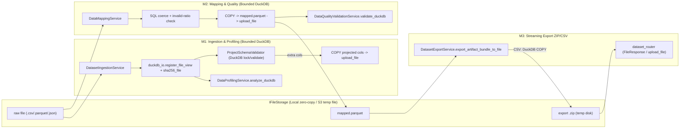

# Plan: Data Management Pipeline on Bounded DuckDB

> **Task ID:** `data_management_duckdb` · **Issues:** ISS-044 · **Spec:** `docs/features/data_management/gap.md`, `docs/issues/11-21-2026.md` (`ISS-044`)
> **Conflict verdict:** PARALLEL-SAFE · **Status:** Review

## 1. Context (facts)
- **Ingestion nạp toàn bộ tệp vào pandas + RAM bytes:**
  - `usfds-core/src/usfds_core/services/data_management/ingestion.py:167-238`: `DatasetIngestionService.import_dataset` gọi `self.file_storage.read_bytes(storage_dest)` và `_load_dataframe_from_bytes` (`pd.read_csv` / `pd.read_parquet` / `pd.read_json`) toàn bộ tập dữ liệu chỉ để kiểm tra rỗng, khóa/kiểm tra `ProjectRawSchema`, cắt cột dư (`df[expected_cols]` → ghi ra `io.BytesIO()` rồi `save_bytes`), tính SHA-256 trên `raw_bytes`, và chạy profiling.
  - `usfds-core/src/usfds_core/services/project_management/schema_validator.py:38-167`: `extract_raw_schema` và `validate_dataframe` chỉ nhận `pd.DataFrame`.
- **Profiling lặp từng cột trên pandas:**
  - `usfds-core/src/usfds_core/services/data_management/profiling.py:13-60`: `DataProfilingService.analyze` lặp từng cột trên DataFrame để tính `isna().sum()` và `nunique(dropna=True)`.
- **Schema Mapping & Quality Validation biến đổi và kiểm tra toàn bộ DataFrame trong RAM:**
  - `usfds-core/src/usfds_core/services/data_management/mapping.py:48-180,270-350`: `DataMappingService.map_dataset` đọc toàn bộ tệp nguồn vào pandas, chạy `pd.to_datetime`, `pd.to_numeric`, `.map(_parse_bool)` theo từng dòng Python, ghi `mapped.parquet` vào `io.BytesIO()` trong RAM rồi mới gọi `save_bytes`.
  - `usfds-core/src/usfds_core/services/data_management/validation.py:67-283`: `DataQualityValidationService.validate` lặp từng cột tính null/blank, `nunique`, `df.duplicated()`, `df[event_id].duplicated()`, `amount <= 0`, `timestamp > now_utc`, `quantile(0.999)` và Z-score trên pandas DataFrame.
- **Export giữ cả CSV và ZIP trong RAM:**
  - `usfds-core/src/usfds_core/services/data_management/export.py:49-111`: `DatasetExportService.export_artifact_bundle` tạo `zipfile.ZipFile(io.BytesIO())`, gọi `read_bytes()`, nạp Parquet vào pandas và `df.to_csv(io.StringIO())` khi xuất CSV.
  - `usfds-server/src/usfds_server/routers/dataset_router.py:391-435`: `export_normalized_dataset` nhận toàn bộ `zip_bytes` rồi trả `Response(content=zip_bytes)` hoặc `storage.save_bytes(...)` (khác với `detection_router.py:303-332` đã chuyển sang file tạm + `FileResponse`/`upload_file` ở ISS-012).
- **Velocity Feature Engineering (ngoài phạm vi theo quyết định người dùng):** `CompiledFeaturePipeline` mới từ ISS-040 (`usfds-core/src/usfds_core/services/features/compiler.py:181-278`) đã chạy Velocity bằng DuckDB khóa trần trong Feature Management; legacy `VelocityFeatureEngineer` không nằm trong phạm vi chuyển đổi của task này.
- **Hạ tầng sẵn có từ ISS-012:** `create_bounded_duckdb_connection(threads=2, memory_limit="512MB", temp_directory=...)` (`usfds-core/src/usfds_core/services/warehouse/project_warehouse.py:92-105`), `IFileStorage.open_local_path` & `IFileStorage.upload_file` (`usfds-core/src/usfds_core/storage/base_storage.py:38-53`, đã override trên `LocalFileStorage` và `S3FileStorage`), DuckDB `1.5.5`.

## 2. Goal, scope verdict & non-goals
- **Goal:** Chuyển toàn bộ các bước Data Management (Ingestion, Project RAW Schema Lock/Validation, Profiling, Schema Mapping, Quality Validation, Export ZIP/CSV) sang DuckDB khóa trần tài nguyên (`threads=2`, `memory_limit="512MB"`, spill ra đĩa tạm) với streaming file trên đĩa (`open_local_path` / `upload_file` / `FileResponse`), loại bỏ việc nạp toàn bộ tập dữ liệu vào pandas DataFrame trong các bước này.
- **Scope:** OK
- **Non-goals / omitted:**
  - Không chuyển đổi `VelocityFeatureEngineer` (legacy) vì Feature Management (`ISS-040`, `CompiledFeaturePipeline`) đã quản lý và thực thi đặc trưng Velocity bằng DuckDB riêng (user xác nhận 26-11-25).
  - Giữ `pandas`/`scikit-learn` ở bước ML preprocessing (`PRE_PROCESSED`, `PreprocessingExecutionService`), `StandardDataCleanser`, `TemporalDataSplitter`, và các bước huấn luyện mô hình (đúng định hướng ISS-044).
  - Không thay đổi `CompiledFeaturePipeline` (đã chạy DuckDB khóa trần ở ISS-040) hay giao diện `usfds-web`.
  - Không thay đổi DB schema (không cần Alembic migration), không thay đổi URL/envelope của REST API hay cấu trúc JSON của `validation_report` / `schema_snapshot`.
  - Không thêm biến môi trường mới; dùng mặc định `threads=2`, `memory_limit="512MB"` từ `create_bounded_duckdb_connection`.
- **Assumptions:**
  - Giữ nguyên tương thích ngược cho các phương thức nhận `pd.DataFrame` (`ProjectSchemaValidator.extract_raw_schema`, `validate_dataframe`, `DataProfilingService.analyze`, `DataQualityValidationService.validate`) và `DatasetExportService.export_artifact_bundle(...) -> tuple[bytes, str]` để không phá vỡ caller/unit test hiện có.
  - Mọi kết nối DuckDB của Data Management đặt `SET TimeZone = 'UTC'` để chuẩn hóa timestamp (`epoch_s`, `epoch_ms`, `ISO8601`, `auto`, custom `strftime`) nhất quán theo UTC bất kể múi giờ hệ điều hành.
  - Cấu hình trần tài nguyên DuckDB dùng mặc định `threads=2, memory_limit="512MB"` từ `create_bounded_duckdb_connection` (user xác nhận 26-11-25).

## 2.5 Design & Approach (user reviews this section)
### Diagram(s)

### Key decisions & contracts
| Area | Decision / Contract | Rationale / Notes |
|---|---|---|
| Shared DuckDB I/O | Tạo module nội bộ `usfds-core/src/usfds_core/services/data_management/duckdb_io.py` cung cấp `create_utc_bounded_duckdb_connection`, `register_file_view`, `copy_view_to_file`, `sha256_file` (chunk 1MB), `duckdb_type_to_logical_type`, `duckdb_type_to_physical_dtype`. | Dùng chung 1 nguồn đọc/ghi Parquet/CSV/JSON + ánh xạ kiểu + hash streaming cho Ingestion, Profiling, Mapping, Validation, Export. |
| Ingestion & Schema Lock | `ProjectSchemaValidator` thêm `extract_raw_schema_from_duckdb(conn, view_name, source_dataset_id)` và `validate_duckdb_view(conn, view_name, raw_schema, allow_missing_target=True)`. Cắt cột dư ghi qua `COPY (...) TO tmp` + `upload_file` thay vì `df[expected_cols]`. | Không đọc `raw_bytes` vào RAM; vẫn giữ nguyên thông báo lỗi, quy tắc superset tolerance, all-null compatibility, `DATETIME<->STRING` và `{BOOLEAN, NUMERIC}` binary (`0/1`). |
| Profiling & Quality Validation | `DataProfilingService.analyze_duckdb(conn, view)` (1 pass SQL theo lô 50 cột); `DataQualityValidationService.validate_duckdb(conn, view)` tính null/blank, `COUNT(DISTINCT)`, duplicate rows/event_id (`total - COUNT(DISTINCT *)`), `amount <= 0`, `timestamp > now_utc`, `quantile_cont(0.999)` + `STDDEV_SAMP`, `LIMIT 5` samples/cột và `LIMIT 10` preview rows. | Giữ nguyên 100% công thức điểm chất lượng 0–100, ngưỡng rating, thông báo tiếng Việt và cấu trúc `validation_report`. |
| Schema Mapping | `DataMappingService.map_dataset` kiểm tra tỷ lệ giá trị lỗi (`max_invalid_ratio_allowed`) cho `timestamp`, `amount`, và cột `DOMAIN` (`NUMERIC`/`DATETIME`/`BOOLEAN`) bằng 1 truy vấn tổng hợp SQL, rồi `COPY (SELECT ...) TO tmp/mapped.parquet (FORMAT PARQUET)` + `upload_file` + gọi `validate_duckdb` trên cùng connection. | Loại bỏ hoàn toàn `pd.to_datetime`, `pd.to_numeric`, `.map(_parse_bool)` và `io.BytesIO()`. `SET TimeZone = 'UTC'` bảo đảm nhất quán UTC trên Windows/Linux. |
| Export & API | `DatasetExportService.export_artifact_bundle_to_file(artifact, dest_path, ...)` ghi ZIP trực tiếp ra đĩa (chuyển Parquet→CSV qua DuckDB `COPY` ra tệp tạm rồi `zf.write`); `dataset_router.export_normalized_dataset` trả `FileResponse` + `BackgroundTask(shutil.rmtree, tmp_dir)` hoặc `storage.upload_file` khi `presigned=True`. | Khớp mẫu `detection_router.py:303-332` (ISS-012); `export_artifact_bundle` trả `bytes` giữ lại làm wrapper tương thích ngược. |
| API / RBAC / Schema | Không đổi endpoint, payload, quyền RBAC hay schema DB. | — |
| Config / Env | Dùng lại mặc định `threads=2`, `memory_limit="512MB"` của `create_bounded_duckdb_connection`. | — |

### Edge cases, concurrency & failure handling
- **Tệp hỏng / định dạng lỗi:** `register_file_view` bọc mọi lỗi đọc của DuckDB thành `ValueError("Failed to parse tabular data from ...")` và `DatasetIngestionService` vẫn xóa `storage_dest` + `datasets/{dataset_id}` khi parse/schema fail.
- **CSV có chuỗi rỗng / khoảng trắng:** Trong `DataQualityValidationService.validate_duckdb`, cột kiểu chuỗi (`VARCHAR`) đếm cả `NULL` và `trim(col) = ''` là missing (khớp `validation.py:106`). Trong `DataMappingService`, chuỗi rỗng không bị tính là giá trị invalid khi kiểm tra `max_invalid_ratio_allowed` (khớp `mapping.py:99,113,136,167`).
- **Duplicate `event_id` có `NULL`:** Dùng `total_rows - (SELECT COUNT(*) FROM (SELECT DISTINCT "event_id" FROM view))` thay vì `COUNT(DISTINCT "event_id")` để 2 dòng `NULL` vẫn được tính trùng lặp đúng như `df["event_id"].duplicated().sum()`.
- **Outliers khi `std == 0` hoặc `1` dòng (`STDDEV_SAMP IS NULL`):** Điều kiện Z-score chỉ kích hoạt khi `std IS NOT NULL AND std > 0 AND NOT isnan(std)` để tránh chia cho 0 hoặc `NaN`.
- **Custom `strftime` và `AUTO` timestamp:** `AUTO`/`ISO8601` dùng `COALESCE(TRY_CAST(... AS TIMESTAMPTZ), TRY_CAST(... AS TIMESTAMP), try_strptime(..., [<danh sách format phổ biến>]))`; custom format dùng `try_strptime(CAST(... AS VARCHAR), <fmt>)`. Nếu `time_format` không hợp lệ trong DuckDB, bắt lỗi và ném `ValueError("Cột nguồn thời gian không tương thích...")`.
- **Cột `event_id`/`user_id` có `NULL` khi mapping:** `CAST(col AS VARCHAR)` giữ `NULL` sạch sẽ thay vì chuỗi `'nan'`, đồng thời giữ nguyên giá trị chuỗi cho mọi dòng hợp lệ.
- **Dọn tệp tạm:** Mọi thư mục tạm trong Ingestion/Mapping/Export dùng `tempfile.TemporaryDirectory()` hoặc `try/finally` + `BackgroundTask(shutil.rmtree, tmp_dir, ignore_errors=True)` (khi trả `FileResponse`), không rò rỉ đĩa khi lỗi.
- **Worker / Queue mode:** `usfds-worker/src/usfds_worker/handlers.py` gọi trực tiếp `DataManagementService.import_dataset`, `map_schema`, `execute_feature_engineering` nên tự động hưởng lợi không cần sửa handler.

## 3. Files
| Action | File | Milestone | Note |
|---|---|---|---|
| create | `usfds-core/src/usfds_core/services/data_management/duckdb_io.py` | M1 | Helper nội bộ: UTC bounded DuckDB, `register_file_view`, `copy_view_to_file`, `sha256_file`, type mapping |
| modify | `usfds-core/src/usfds_core/services/project_management/schema_validator.py` | M1 | Thêm `extract_raw_schema_from_duckdb`, `validate_duckdb_view` (giữ hàm DataFrame cũ) |
| modify | `usfds-core/src/usfds_core/services/data_management/profiling.py` | M1 | Thêm `analyze_duckdb`, `analyze_file` (giữ `analyze(df)`) |
| modify | `usfds-core/src/usfds_core/services/data_management/ingestion.py` | M1 | Chuyển `import_dataset` sang DuckDB + streaming hash/filter/upload |
| modify | `usfds-core/src/usfds_core/services/data_management/validation.py` | M2 | Thêm `validate_duckdb`, `validate_file` (giữ `validate(df)`) |
| modify | `usfds-core/src/usfds_core/services/data_management/mapping.py` | M2 | Chuyển `map_dataset` sang DuckDB SQL + `COPY PARQUET` + `validate_duckdb` |
| modify | `usfds-core/src/usfds_core/services/data_management/export.py` | M3 | Thêm `export_artifact_bundle_to_file` (ZIP trên đĩa + DuckDB Parquet→CSV); giữ wrapper `export_artifact_bundle` |
| modify | `usfds-core/src/usfds_core/services/data_management/service.py` | M3 | Thêm `export_dataset_to_file` |
| modify | `usfds-server/src/usfds_server/routers/dataset_router.py` | M3 | Dùng `export_dataset_to_file` + `FileResponse` / `storage.upload_file` + dọn thư mục tạm |
| create | `usfds-core/tests/test_data_management_duckdb.py` | M1, M2, M3 | Acceptance tests chặn `pd.read_csv`/`pd.read_parquet`/`pd.read_json`/`df.to_csv` & kiểm tra parity |
| modify | `usfds-server/tests/test_dataset_api.py` | M3 | Acceptance test streaming export CSV/Parquet & presigned S3 không nạp pandas |
| migration | — | — | Không đổi schema |

## 4. Dependencies & conflicts (with other tasks on BOARD)
| # | Check | Answer |
|---|---|---|
| D1 | Needs unfinished task? | No — `large_data_analytics_duckdb`, `system_metadata_management`, `feature_management` đều đã `Done` trên `main` |
| D2 | Needed by unfinished task? | No |
| C1 | Modified files owned by in-progress task? | No — không có task `In progress` trên `.plan/BOARD.md` |
| C2 | Hot-spot files touched | — (không sửa file hot-spot nào) |
| C3 | Schema change | No |
| C4 | Public contract change | No — giữ nguyên REST endpoint/response, cấu trúc `validation_report` và chữ ký hàm core cũ |
| C5 | Shared UI shell change | No |

## 5. Acceptance tests (user reviews this section)
| Milestone | Test | Given | When | Then | Covers |
|---|---|---|---|---|---|
| M1 | `test_ingestion_schema_lock_strip_extra_and_profiling_use_duckdb_without_pandas` (`usfds-core/tests/test_data_management_duckdb.py`) | Project chưa khóa schema; 2 tệp CSV/Parquet (tệp 2 khuyết 1 cột nhãn, có 1 cột dư và cột toàn NULL); monkeypatch `pd.read_csv`/`pd.read_parquet`/`pd.read_json` ném `AssertionError` | Gọi `DatasetIngestionService.import_dataset` cho tệp 1 rồi tệp 2 (và 1 tệp sai kiểu) | Tệp 1 khóa `raw_schema` + tính đúng SHA-256 & profiling; tệp 2 cắt cột dư ghi lại qua DuckDB + `ValidationStatus.WARNING` + đúng `column_count`; tệp sai kiểu bị từ chối với `ValueError` và xóa rác storage | ISS-044 |
| M2 | `test_mapping_and_quality_validation_use_duckdb_without_pandas` (`usfds-core/tests/test_data_management_duckdb.py`) | RAW CSV/Parquet có timestamp (`auto`, `epoch_s`, `epoch_ms`, custom `%d/%m/%Y %H:%M`), cột DOMAIN (`NUMERIC`, `DATETIME`, `BOOLEAN`, `STRING`), bản ghi trùng `event_id`, `amount <= 0`, timestamp tương lai và outlier; monkeypatch `pd.read_csv`/`pd.read_parquet` ném `AssertionError` | Gọi `DataMappingService.map_dataset` (và kiểm tra case vượt `max_invalid_ratio_allowed`) | Sinh `mapped.parquet` hợp lệ không gọi pandas; `DataQualityReport` khớp kết quả `DataQualityValidationService.validate(df)` (score, rating, duplicate counts, non-positive amount, future timestamp, `amount_q999`, outliers, sample records); case lỗi vượt ngưỡng ném `ValueError` tiếng Việt đúng chuẩn | ISS-044 |
| M3 | `test_export_artifact_bundle_to_file_converts_parquet_to_csv_without_pandas` (`usfds-core/tests/test_data_management_duckdb.py`) | Artifact `FEATURE_ENGINEERED` có `train.parquet`, `test.parquet`, `pipeline.joblib`; monkeypatch `pd.read_parquet` và `pd.DataFrame.to_csv` ném `AssertionError` | Gọi `DatasetExportService.export_artifact_bundle_to_file(..., file_format="csv")` | Tạo tệp ZIP hợp lệ trên đĩa chứa `train.csv`, `test.csv`, `pipeline.joblib`, `schema_metadata.json` với đầy đủ nội dung chuẩn CSV mà không gọi pandas | ISS-044 |
| M3 | `test_export_dataset_api_streams_zip_and_presigned_upload_without_pandas` (`usfds-server/tests/test_dataset_api.py`) | Dataset đã qua `MAPPED` trong `LocalFileStorage` và `S3FileStorage` (moto); monkeypatch `pd.read_parquet` ném `AssertionError` | Gọi `POST /api/v1/datasets/{id}/artifacts/{aid}/export` với `file_format="csv"` (cả `presigned=false` và `presigned=true`) | `presigned=false` trả `200 application/zip` hợp lệ chứa `train.csv` + `schema_metadata.json`; `presigned=true` upload ZIP lên S3 và trả `download_url`; không gọi pandas và không để sót thư mục tạm | ISS-044 |

## 6. Milestones & to-do (checkpoints, not stop points: all tests green at each)
The agent ticks items as it works. This is the task's only to-do list (`TODO.md` is no longer used for new work).

- [x] **M1 — DuckDB I/O, Ingestion, Schema Governance & Profiling** (`usfds-core`): nạp raw, khóa/kiểm tra `ProjectRawSchema`, cắt cột dư, hash streaming và profiling hoàn toàn bằng DuckDB khóa trần.
  - [x] [tests] Viết acceptance test M1 trong `usfds-core/tests/test_data_management_duckdb.py`; xác nhận fail đúng lý do
  - [x] [core] Tạo `usfds-core/src/usfds_core/services/data_management/duckdb_io.py`
  - [x] [core] Bổ sung `extract_raw_schema_from_duckdb` và `validate_duckdb_view` vào `schema_validator.py`
  - [x] [core] Bổ sung `analyze_duckdb` và `analyze_file` vào `profiling.py`
  - [x] [core] Chuyển `DatasetIngestionService.import_dataset` sang DuckDB + `open_local_path` + `upload_file` + `sha256_file`
  - [x] [verify] `./scripts/test.sh core`
- [x] **M2 — Schema Mapping & Data Quality Validation trên DuckDB** (`usfds-core`): ánh xạ 5 cột chuẩn + cột `DOMAIN`, ghi `mapped.parquet` ra đĩa và chấm điểm chất lượng hoàn toàn bằng DuckDB.
  - [x] [tests] Viết acceptance test M2 trong `usfds-core/tests/test_data_management_duckdb.py`; xác nhận fail đúng lý do
  - [x] [core] Bổ sung `validate_duckdb` và `validate_file` vào `validation.py` (khớp tuyệt đối công thức điểm & cảnh báo)
  - [x] [core] Chuyển `DataMappingService.map_dataset` sang DuckDB SQL + `COPY PARQUET` + `upload_file` + `validate_duckdb`
  - [x] [verify] `./scripts/test.sh core`
- [x] **M3 — Streaming Export ZIP/CSV** (`usfds-core`, `usfds-server`): xuất ZIP streaming không giữ RAM.
  - [x] [tests] Viết các acceptance test M3 trong `usfds-core/tests/test_data_management_duckdb.py` và `usfds-server/tests/test_dataset_api.py`; xác nhận fail đúng lý do
  - [x] [core] Bổ sung `export_artifact_bundle_to_file` vào `export.py` và `export_dataset_to_file` vào `service.py`
  - [x] [server] Cập nhật `dataset_router.py` dùng `export_dataset_to_file` + `FileResponse` / `storage.upload_file` + dọn thư mục tạm
  - [x] [verify] `./scripts/test.sh core infra server worker`

Checkpoint log (the agent appends one line per finished milestone):
- 26-11-25 M1 done: usfds-core 189 passed, 9 skipped (pre-existing); notes: —
- 26-11-25 M2 done: usfds-core 190 passed, 9 skipped (pre-existing); notes: exact parity verified between validate_duckdb and validate(df)
- 26-11-25 M3 done: core 191 passed (9 skipped) · infra 52 passed · server 57 passed · worker 10 passed; notes: —

## 7. Review hotspots (filled in after implementation)
- `usfds-core/src/usfds_core/services/data_management/ingestion.py:166-266` (M1): Đọc raw qua `open_local_path` + DuckDB khóa trần, đóng connection trước khi `upload_file` ghi đè `storage_dest` khi cắt cột dư (tránh khóa file trên Windows), và dọn storage khi parse/schema fail; test: `test_ingestion_schema_lock_strip_extra_and_profiling_use_duckdb_without_pandas`.
- `usfds-core/src/usfds_core/services/project_management/schema_validator.py:256-311` (M1): Kiểm tra tương thích kiểu theo lô bằng SQL (`COUNT(col) == 0` cho cột toàn NULL, `DATETIME <-> STRING`, `{BOOLEAN, NUMERIC}` nhị phân `0/1`); sai điều kiện ở đây có thể chặn hợp lệ hoặc lọt sai kiểu; test: `test_ingestion_schema_lock_strip_extra_and_profiling_use_duckdb_without_pandas` & `test_project_management.py`.
- `usfds-core/src/usfds_core/services/data_management/mapping.py:249-393` (M2): Coerce SQL (`AUTO`/`ISO8601`/`epoch_s`/`epoch_ms`/custom `strftime` theo UTC, `NUMERIC`, `BOOLEAN`), gom kiểm tra tỷ lệ lỗi `max_invalid_ratio_allowed` vào 1 truy vấn tổng hợp, ghi `mapped.parquet` ra đĩa tạm rồi `validate_duckdb` trên cùng connection và `DROP VIEW` trước khi thoát `TemporaryDirectory`; test: `test_mapping_and_quality_validation_use_duckdb_without_pandas`, `test_mapping_service.py`, `test_system_metadata.py`.
- `usfds-core/src/usfds_core/services/data_management/validation.py:370-555` (M2): Chấm điểm chất lượng bằng DuckDB (`NULL`/chuỗi rỗng/`NaN`, `SELECT DISTINCT` để đếm trùng `NULL` khớp pandas, `quantile_cont(0.999)` + `STDDEV_SAMP` chống chia 0/`NaN`); lệch công thức sẽ làm sai `quality_score`; test: `test_mapping_and_quality_validation_use_duckdb_without_pandas`.
- `usfds-core/src/usfds_core/services/data_management/export.py:23-125` & `usfds-server/src/usfds_server/routers/dataset_router.py:413-446` (M3): Tạo ZIP trực tiếp trên đĩa tạm (Parquet→CSV qua DuckDB `COPY`), trả `FileResponse` + `BackgroundTask(shutil.rmtree, tmp_dir)` hoặc `storage.upload_file` cho `presigned=True`, luôn dọn `tmp_dir` khi lỗi; test: `test_export_artifact_bundle_to_file_converts_parquet_to_csv_without_pandas` & `test_export_dataset_api_streams_zip_and_presigned_upload_without_pandas`.

## 8. Open questions
- —

## 9. Manual E2E verification (post-merge)
- [ ] Chạy stack Docker (`usfds-server` + `usfds-worker` + PostgreSQL + S3/RustFS + Redis/BullMQ): import tệp CSV lớn (~100–500 MB), map schema, và export ZIP định dạng CSV với `presigned=true` và `presigned=false`; xác nhận RSS của `usfds-server` và `usfds-worker` giữ ổn định dưới ngưỡng khóa trần và không sót thư mục tạm trong `/tmp`.
