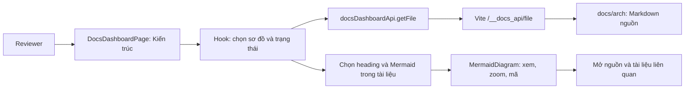

# Plan: Review kiến trúc trong Docs Dashboard

> **Task ID:** `docs_dashboard_architecture_review` · **Issues:** — (yêu cầu trực tiếp của user) · **Spec:** yêu cầu trong hội thoại; `docs/arch/README.md`, `docs/arch/01-context-and-runtime.md`, `docs/arch/02-data-and-lifecycle-flows.md`, `docs/arch/04-data-model-erd.md`
> **Conflict verdict:** PARALLEL-SAFE · **Status:** In progress (M2)

## 1. Context (facts)
- `usfds-web/src/pages/DocsDashboardPage.tsx:42` có Board, Plans, Issues và Đặc tả & Kiến trúc; `:53-55` chọn mặc định `docs/arch/high-level-design.md`, hiện không tồn tại. `:1293-1379` hiển thị danh sách file phẳng và nội dung Markdown.
- `usfds-web/viteDocsPlugin.ts:844-917` cung cấp overview và danh sách file qua Vite dev server; `:922-995` đọc file theo đường dẫn. User xác nhận dashboard chỉ cần chạy trong môi trường phát triển và không có đặc tả chức năng riêng.
- `usfds-web/src/components/modules/docs_dashboard/RichDocRenderer.tsx:298-318` render Mermaid từ Markdown; `MermaidDiagram.tsx:100-281` đã có xem mã, copy, phóng to và báo lỗi. SVG hiện bị giới hạn chiều rộng, chưa có điều khiển zoom.
- `docs/arch/README.md:4-20` là routing và nguồn kiến trúc as-built; `01-context-and-runtime.md:7-32,68-81`, `02-data-and-lifecycle-flows.md:7-42` và `04-data-model-erd.md:12-15` chứa các diagram cần review. `02-data-and-lifecycle-flows.md:45-55` định nghĩa C1–C5.
- `RichDocRenderer.tsx:111-190` không có ngữ cảnh file nguồn khi xử lý liên kết Markdown tương đối; không thể giả định các link kiến trúc hiện tại đã dẫn đúng tài liệu.

## 2. Goal, scope verdict & non-goals
- **Goal:** Review các diagram kiến trúc chính, nguồn và contracts/invariants liên quan từ dashboard nội bộ mà không tạo bản sao Mermaid.
- **Scope:** OK — một workflow review nội bộ, sử dụng API và dữ liệu hiện có.
- **Non-goals / omitted:** Không triển khai dashboard trong production/Electron build; không thay đổi tài liệu `docs/`, API nghiệp vụ, bảo mật hoặc schema; không tự suy diễn quan hệ task–contract; không thay thế Board, Plans, Issues hoặc tính năng sửa tài liệu.
- **Assumptions:** User review trên Vite dev server. Không tạo issue mới nếu chưa được user chọn. User cho phép triển khai theo tài liệu đã commit và kiểm tra lại với tài liệu mới sau khi task kia đồng bộ.

## 2.5 Design & Approach (user reviews this section)
### Diagram(s)

### Key decisions & contracts
| Area | Decision / Contract | Rationale / Notes |
|---|---|---|
| Điều hướng | Thêm mục Kiến trúc riêng; giữ Board, Plans, Issues và trình đọc/sửa tài liệu hiện tại. Mặc định tài liệu hiện hữu là `docs/arch/README.md`. | Review diagram là luồng chính, không phá chức năng cũ. |
| Diagram | Danh mục nhỏ theo nhóm: system context/packages/runtime, training, inference → investigation → insight, ERD theo module. Mỗi mục định danh file và heading nguồn; trích Mermaid từ file thực tế, không chép mã sơ đồ vào TS. | Giữ `docs/arch/` là nguồn duy nhất; link tới nguồn được chọn. |
| Review context | Mỗi mục có link tới mục nguồn và tài liệu contracts/invariants liên quan; link tương đối trong tài liệu kiến trúc được giải quyết theo file hiện hành, không nhầm file `.md` với plan. Từ plan/issue giữ điều hướng sẵn có, không tự gán quan hệ chưa có bằng chứng. | Reviewer kiểm tra được ngữ cảnh, không tạo contract thứ hai. |
| Diagram viewer | Tái dùng `MermaidDiagram`; bổ sung zoom có nút tăng/giảm/reset và cuộn khi lớn, phù hợp bàn phím, hai theme. Giữ fallback lỗi/mã và chế độ phóng to. | ERD lớn không bị co đến mức khó đọc. |
| API / RBAC | Tái dùng `GET /__docs_api/overview` và `GET /__docs_api/file`; không thêm endpoint hoặc quyền, giữ phạm vi dev-only. | Không mở rộng ranh giới deploy hiện tại. |
| Data / Schema / Config | Không thay đổi schema, migration hay env. Hook mới quản lý tải/chọn/trạng thái; component không gọi API trực tiếp (`INV-014`). | |

### Edge cases, concurrency & failure handling
- Tài liệu thiếu, lỗi đọc, heading/diagram không tìm thấy hoặc không duy nhất: hiển thị lỗi rõ ràng và đường dẫn nguồn, không âm thầm hiển thị diagram khác. Lỗi Mermaid giữ mã nguồn để kiểm tra.
- Chuyển lựa chọn nhanh không được để response cũ ghi đè diagram mới; hiển thị trạng thái tải, hỗ trợ thử lại và giữ thông tin nguồn chính xác.
- Đóng viewer bằng Escape, quản lý focus và trả focus về nút mở; zoom không làm mất khả năng cuộn, dùng bàn phím và đọc nội dung thay thế/link nguồn.
- Link Markdown tương đối và fragment được resolve theo file nguồn; nếu đích không tồn tại, báo lỗi thay vì định tuyến thành plan. Không đổi cách xử lý các link plan/issue hiện hữu.
- Không sửa/xóa hoặc sao chép thay đổi chưa commit của session khác. Làm việc trên tài liệu đã commit; sau khi task kia đồng bộ, đối chiếu lại danh mục, link và diagram trước khi merge.

## 3. Files
| Action | File | Milestone | Note |
|---|---|---|---|
| modify | `usfds-web/src/pages/DocsDashboardPage.tsx` | M1 | Mục Kiến trúc và default document; giữ section cũ |
| create | `usfds-web/src/hooks/useDocsArchitecture.ts` | M1 | Tải, chọn, báo lỗi và tránh race |
| create | `usfds-web/src/components/modules/docs_dashboard/ArchitectureReviewView.tsx` | M1 | Danh mục và review context |
| create | `usfds-web/src/utils/docsArchitecture.ts` | M1 | Danh mục và trích nội dung theo file/heading |
| modify | `usfds-web/src/components/modules/docs_dashboard/RichDocRenderer.tsx`, `ContextInspectorPane.tsx` | M1 | Ngữ cảnh đường dẫn, mở và định vị fragment tài liệu |
| modify | `usfds-web/src/components/modules/docs_dashboard/MermaidDiagram.tsx` | M2 | Zoom, scroll, focus và giữ lỗi/mã |
| create/modify | `usfds-web/src/components/modules/docs_dashboard/*.test.tsx`, `usfds-web/src/utils/docsArchitecture.test.ts` | M1–M2 | Test hành vi có mục tiêu |
| modify | `usfds-web/src/hooks/index.ts` | M1 | Chỉ append export nếu cần |
| — | `docs/arch/**`, `viteDocsPlugin.ts`, schema | — | Chỉ đọc; không thay đổi |

## 4. Dependencies & conflicts (with other tasks on BOARD)
| # | Check | Answer |
|---|---|---|
| D1 | Needs unfinished task? | Không cần code task khác; user cho phép dùng bản tài liệu đã commit, sau đó đối chiếu phiên bản mới trước khi merge. |
| D2 | Needed by unfinished task? | Không thấy phụ thuộc trên BOARD. |
| C1 | Modified files owned by in-progress task? | Không theo BOARD. `.plan/agent_context_and_guard_refinement.md` đang In progress dù chưa có hàng trên BOARD; plan đó loại trừ tường minh dashboard, nhưng đang sửa các tài liệu nguồn cần phối hợp. |
| C2 | Hot-spot files touched | `src/hooks/index.ts` chỉ append nếu cần; không sửa các shell khác. |
| C3 | Schema change | Không. |
| C4 | Public contract change | Không; giữ nguyên response và endpoint Vite nội bộ. |
| C5 | Shared UI shell change | Không; chỉ nội dung dashboard đã có route. |

## 4.5 System Invariant & Blast-Radius Impact (user reviews this section)
| Check | Touched? | How invariant / contract is preserved (or N/A) |
|---|---|---|
| Auth / Project / `OWN` (`INV-001..003`) | Không | Không thay đổi API nghiệp vụ hoặc quyền; dashboard chỉ dev. |
| File I/O / Sandbox / Remote Creds (`INV-004`) | Không | Tái dùng truy cập file dev hiện có, không thêm đường đọc/ghi hay secrets. |
| Principles (`P-01..04`) | Không | Không thay đổi business config, plugin, workload hoặc dependency backend. |
| Layering / PG / Large Data / No pandas (`INV-005..007,016`) | Không | Không thay đổi backend, DB, dữ liệu nghiệp vụ hoặc Python. |
| Queue / Delete / Concurrency (`INV-008,011,012`) | Không | Không thay đổi job, vòng đời tài nguyên hay concurrency dữ liệu nghiệp vụ. |
| Shared Contracts (`C1–C5`) & Formulas (`INV-009,010,013`) | Chỉ đọc | Liên kết tới nguồn, không sao chép hoặc thay đổi contract hay công thức. |
| Frontend layering (`INV-014`) | Có | Hook sở hữu fetching/state, component chỉ render; giữ xử lý lỗi rõ ràng. |
| Doc-sync (`INV-015`) | Không | Không thay đổi kiến trúc hệ thống, contract, state machine, schema hay tài liệu kiến trúc. |

## 5. Acceptance tests (user reviews this section)
| Milestone | Test | Given | When | Then | Covers |
|---|---|---|---|---|---|
| M1 | `shows_core_architecture_diagrams_from_source` (`ArchitectureReviewView.test.tsx`) | Markdown nguồn có các Mermaid tương ứng | Mở từng nhóm diagram | Hiển thị diagram đúng từ source cùng tên và file nguồn | Review kiến trúc |
| M1 | `reports_missing_or_ambiguous_diagram` (`docsArchitecture.test.ts`) | Thiếu hoặc trùng heading/diagram | Chọn diagram | Thông báo lỗi xác định, không chọn nhầm | Độ tin cậy |
| M1 | `ignores_stale_diagram_response` (`ArchitectureReviewView.test.tsx`) | Hai request hoàn thành ngược thứ tự | Chuyển nhanh diagram | Nội dung, tiêu đề và nguồn khớp lựa chọn cuối | Concurrency |
| M1 | `opens_architecture_source_and_relative_links` (`RichDocRenderer.test.tsx`) | Link `.md` tương đối và fragment trong tài liệu kiến trúc | Mở link | Đến đúng file/mục; không chuyển sang plan sai | Truy vết |
| M1 | `preserves_dashboard_sections_and_default_document` (`DocsDashboardPage.test.tsx`) | Overview có dữ liệu | Mở các mục cũ và Đặc tả | Board/Plans/Issues vẫn truy cập được; default trỏ file tồn tại | Tương thích |
| M1 | `shows_file_load_error_and_allows_retry` (`ArchitectureReviewView.test.tsx`) | File nguồn tải lỗi | Chọn rồi thử lại | Hiển thị lỗi; lần thành công hiển thị diagram đúng | Error handling |
| M2 | `zooms_and_resets_large_diagram` (`MermaidDiagram.test.tsx`) | Diagram lớn đã render | Phóng to, thu nhỏ, reset | Zoom thay đổi và reset; vùng lớn có thể cuộn | Đọc ERD |
| M2 | `closes_viewer_and_restores_focus` (`MermaidDiagram.test.tsx`) | Viewer đang mở | Nhấn Escape | Đóng viewer, focus trở về nút mở | Accessibility |
| M2 | `preserves_mermaid_error_and_source` (`PlanReviewView.test.tsx`) | Mermaid lỗi cú pháp | Render | Báo lỗi và mã gốc, không làm mất chức năng xem plan | Tương thích |

## 6. Milestones & to-do (checkpoints, not stop points: all tests green at each)
- [x] **M1 — Review kiến trúc từ nguồn** (web): danh mục, điều hướng, lỗi và truy vết.
  - [x] [tests] Viết test M1, xác nhận fail đúng lý do.
  - [x] [web] Hook, trích diagram và view; bảo toàn navigation cũ.
  - [x] [verify] Chạy test web liên quan, build và lint.
- [x] **M2 — Đọc diagram lớn** (web): zoom và keyboard/focus.
  - [x] [tests] Viết test M2, xác nhận fail đúng lý do.
  - [x] [web] Mở rộng MermaidDiagram mà không phá plan.
  - [x] [verify] `./scripts/test.sh web`; build và lint; kiểm tra trực quan.

Checkpoint log (the agent appends one line per finished milestone):
- 26-11-28 M1 done: 9 test web liên quan pass; build và lint exit 0. Test giao diện đặt tại `DocsDashboardPage.test.tsx`; thêm inspector để định vị fragment.
- 26-11-28 M2 done: `./scripts/test.sh web` 32 files / 76 tests pass; build và lint exit 0; kiểm tra browser 10 diagram, zoom, source link, desktop và mobile. Review bổ sung xử lý link ngoài repo và cuộn bằng bàn phím.

## 7. Review hotspots (filled in after implementation)
- `usfds-web/src/utils/docsArchitecture.ts:38`: trích đúng một Mermaid từ heading nguồn; báo lỗi khi tài liệu đổi hoặc không duy nhất (M1).
- `usfds-web/src/hooks/useDocsArchitecture.ts:12`: hủy kết quả request cũ khi đổi diagram hoặc thử lại (M1).
- `usfds-web/src/components/modules/docs_dashboard/ContextInspectorPane.tsx:105`: định vị fragment trong file nguồn và báo mục không tồn tại (M1).
- `usfds-web/src/components/modules/docs_dashboard/MermaidDiagram.tsx:82`: focus, keyboard và zoom trong viewer (M2).

## 8. Open questions
- — (user xác nhận dev-only và không có đặc tả riêng).

## 9. Manual E2E verification (post-merge)
- [ ] Trong Vite dev server, mở diagram runtime, training, inference và ERD; kiểm tra nguồn, contracts, lỗi, zoom/scroll và dark/light ở desktop và màn hình hẹp.
- [ ] Mở lại Board, một plan Mermaid, issue và trình đọc/sửa tài liệu; xác nhận các thao tác cũ không đổi.
- [ ] Đối chiếu lại diagram và link với tài liệu mới sau khi task cập nhật kiến trúc được đồng bộ.
