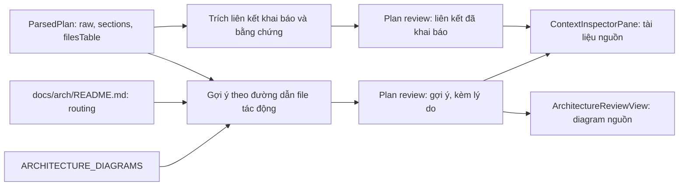

# Plan: Redesign dashboard review Plan và tài liệu

> **Task ID:** `docs_dashboard_review_redesign` · **Issues:** — (yêu cầu trực tiếp của user) · **Spec:** yêu cầu trong hội thoại; `docs/design-system.md`, `docs/arch/README.md`
> **Conflict verdict:** NEEDS-SEQUENCING (ownership confirmed released by user) · **Status:** Done (26-11-28)

## 1. Context (facts)
- `usfds-web/src/pages/DocsDashboardPage.tsx:42` có Board, Plans, Issues, Kiến trúc và Đặc tả; dữ liệu, bộ lọc và trạng thái xem/sửa hiện được quản lý trong page.
- `usfds-web/src/components/modules/docs_dashboard/PlanReviewView.tsx:127` chia review, agent spec, toàn văn và sửa Markdown; các mục review mặc định thu gọn, chưa có tổng hợp liên kết Plan ↔ kiến trúc.
- `usfds-web/src/utils/docsArchitecture.ts:14` chọn diagram từ tài liệu nguồn theo file và heading; `ArchitectureReviewView.tsx:43` mở nguồn trong inspector.
- `docs/arch/README.md:4` là nguồn điều hướng kiến trúc; `docs/arch/02-data-and-lifecycle-flows.md:45` chứa bảng shared contracts. C1–C5 trong bảng xung đột của plan là kiểm tra xung đột, không phải các shared contracts cùng tên.
- `.plan/BOARD.md:37` còn ghi task dashboard trước In progress và sở hữu các file sẽ sửa; commit của task đó đã nằm trên `main` qua PR #31. File plan cũ có thay đổi chưa commit; không sửa hoặc hoàn tác thay đổi đó.
- User xác nhận đây là công cụ review nội bộ chạy bằng Vite, không có đặc tả chức năng riêng; chọn có gợi ý kiến trúc và giữ các thao tác chỉnh sửa.

## 2. Goal, scope verdict & non-goals
- **Goal:** Review và chuyển giữa Board, Plan, Issue, diagram và tài liệu kiến trúc trong một dashboard nhất quán; thấy rõ liên kết có căn cứ của từng Plan với kiến trúc.
- **Scope:** OK — một workflow review nội bộ, không đổi hệ thống nghiệp vụ.
- **Non-goals / omitted:** Không đưa dashboard vào production; không sửa nội dung `docs/`, plan khác hoặc BOARD; không tạo issue; không dùng AI/network để đoán quan hệ; không thay schema, nghiệp vụ hoặc API Vite.
- **Assumptions:** Dùng tài liệu as-built hiện tại; các gợi ý chỉ hỗ trợ review, không xác nhận tác động thật. Triển khai trong worktree và nhánh task riêng sau duyệt; giữ nguyên thay đổi chưa commit trên `main`.

## 2.5 Design & Approach (user reviews this section)
### Diagram(s)

### Key decisions & contracts
| Area | Decision / Contract | Rationale / Notes |
|---|---|---|
| Bố cục | Thiết kế lại cả năm mục theo ngữ cảnh làm việc: điều hướng rõ, danh sách có phân cấp và vùng nội dung tập trung; Plan ưu tiên mục tiêu, quyết định/diagram, liên kết kiến trúc, test và rủi ro. Giữ tiếp cận toàn văn và các mục chi tiết. | UI mật độ vừa đủ, tiếng Việt, token của design system, dark/light, mobile và bàn phím. |
| Liên kết khai báo | Trích tham chiếu thực sự trong nội dung Plan: đường dẫn `docs/arch/`, invariant `INV-NNN` và shared contract được nêu trong ngữ cảnh shared contract/§4.5; hiện loại, đoạn hoặc mục nguồn và đích. Không coi C1–C5 của ma trận xung đột là shared contract. Link invariant đến heading thực; contract đến bảng nguồn vì mỗi dòng không có heading riêng. | Phân biệt bằng chứng được ghi với ảnh hưởng đã được xác nhận; deduplicate và không tự đánh dấu liên quan khi ghi “Không/N/A”. |
| Gợi ý | Quy tắc xác định, có thể kiểm thử: ánh xạ đường dẫn cụ thể trong bảng file Plan tới module theo routing kiến trúc, sau đó tới diagram tương ứng trong catalog hiện có. Mỗi gợi ý ghi file làm bằng chứng và nhãn “Gợi ý”; không gợi ý từ tên chung hay suy đoán contract. Không tự ghi gợi ý vào Markdown. | Có thể kiểm tra và tránh nhầm gợi ý với khai báo. Không ánh xạ được thì hiện trạng thái rỗng rõ ràng. |
| Điều hướng | Mở tài liệu/fragment qua inspector hiện hữu; mở diagram được gợi ý tại mục Kiến trúc với đúng diagram đã chọn. Tài liệu gốc là nguồn duy nhất; không sao chép Mermaid hoặc nội dung contract. | Reviewer có thể đối chiếu trực tiếp; lỗi nguồn hoặc fragment hiển thị rõ. |
| Chỉnh sửa | Giữ sửa Markdown, trạng thái Plan/Issue, checkbox, câu hỏi, tìm kiếm/bộ lọc, inspector và khả năng xem/sửa docs. Báo lỗi lưu; không làm mất bản nháp chưa lưu khi đổi lựa chọn mà không cảnh báo. | Không làm mất chức năng hoặc dữ liệu đang sửa. |
| API / data | Tái dùng các endpoint `/__docs_api/*` và model `ParsedPlan` hiện tại, không đổi payload, quyền, schema hay env. Tách state/fetch/mutation trong page và component được sửa sang hook; logic liên kết thuần vào util (`INV-014`). | Phạm vi dev-only như hiện tại; không thêm quyền truy cập file. |

### Edge cases, concurrency & failure handling
- Plan legacy, thiếu bảng file, chỉ có template hoặc không có nguồn liên quan: không dựng quan hệ; vẫn đọc toàn văn và hiện giải thích trống.
- Đường dẫn tương đối, fragment và ID không tồn tại/trùng phải được kiểm tra dựa trên nội dung nguồn; không đoán một đích khác, nêu lỗi cho người dùng. Không nhận đường dẫn ngoài repo; dùng ranh giới Vite hiện có.
- Không gọi shared-contract C1–C5 khi đó là kiểm tra conflict C1–C5; xử lý dải ID chỉ khi ngữ cảnh rõ; các mục “không tác động/N/A” không trở thành khẳng định tác động.
- Chuyển Plan/diagram nhanh không để kết quả tải cũ ghi đè lựa chọn mới. Tải/lưu lỗi có trạng thái rõ và thao tác thử lại; giữ bản nháp khi lưu thất bại.
- Trạng thái phụ thuộc màu phải có nhãn; điều hướng, inspector, diagram và sửa file dùng được bằng bàn phím; màn hình hẹp không che nội dung hoặc mất thao tác.

## 3. Files
| Action | File | Milestone | Note |
|---|---|---|---|
| modify | `usfds-web/src/pages/DocsDashboardPage.tsx` | M1–M2 | Bố cục, điều hướng toàn dashboard |
| modify | `usfds-web/src/components/modules/docs_dashboard/PlanReviewView.tsx` | M1–M2 | Review plan, ngữ cảnh và chỉnh sửa |
| modify | `usfds-web/src/components/modules/docs_dashboard/ArchitectureReviewView.tsx` | M1–M2 | Bố cục và chọn diagram từ plan |
| modify | `usfds-web/src/components/modules/docs_dashboard/ContextInspectorPane.tsx` | M1–M2 | Bố cục, trạng thái và bảo toàn chỉnh sửa |
| modify | `usfds-web/src/components/modules/docs_dashboard/MermaidDiagram.tsx` | M2 | Phân biệt lỗi tải thư viện với lỗi render sau phản hồi của user |
| modify | `usfds-web/src/hooks/useDocsArchitecture.ts`, `usfds-web/src/utils/docsArchitecture.ts` | M2 | Điều hướng diagram và tái dùng catalog/trích nguồn |
| create | `usfds-web/src/hooks/useDocsDashboard.ts`, `usfds-web/src/hooks/usePlanReview.ts`, `usfds-web/src/hooks/useDocsInspector.ts` | M1–M2 | State, dữ liệu và mutation cho các component được sửa |
| create | `usfds-web/src/utils/planArchitectureLinks.ts` | M2 | Trích khai báo và gợi ý có bằng chứng |
| create | `usfds-web/src/hooks/usePlanArchitectureLinks.ts` | M2 | Resolve invariant và chặn kết quả điều hướng cũ |
| create/modify | `usfds-web/src/pages/DocsDashboardPage.test.tsx`, `usfds-web/src/components/modules/docs_dashboard/PlanReviewView.test.tsx`, `usfds-web/src/components/modules/docs_dashboard/ContextInspectorPane.test.tsx`, `usfds-web/src/utils/planArchitectureLinks.test.ts` | M1–M2 | Acceptance tests |
| — | `docs/**`, `viteDocsPlugin.ts`, schema, shell công khai | — | Chỉ đọc; không thay đổi |

## 4. Dependencies & conflicts (with other tasks on BOARD)
| # | Check | Answer |
|---|---|---|
| D1 | Needs unfinished task? | Không; code task trước đã merge vào `main`. |
| D2 | Needed by unfinished task? | Không thấy phụ thuộc trên BOARD. |
| C1 | Modified files owned by in-progress task? | Có: `DocsDashboardPage.tsx`, `components/modules/docs_dashboard/**`, `useDocsArchitecture.ts`, `docsArchitecture*` → `docs_dashboard_architecture_review`. PR #31 đã merge nhưng BOARD còn In progress; user xác nhận task cũ đã kết thúc và không còn agent sửa các file này. |
| C2 | Hot-spot files touched | Không; nếu cần export hook qua `src/hooks/index.ts` thì chỉ append. |
| C3 | Schema change | Không. |
| C4 | Public contract change | Không. |
| C5 | Shared UI shell change | Không; chỉ dashboard nội bộ, không sửa route/sidebar ứng dụng. |

## 4.5 System Invariant & Blast-Radius Impact (user reviews this section)
| Check | Touched? | How invariant / contract is preserved (or N/A) |
|---|---|---|
| Auth / Project / `OWN` (`INV-001..003`) | Không | Không đổi API nghiệp vụ, phân quyền hay project. |
| File I/O / Sandbox / Remote Creds (`INV-004`) | Không | Giữ Vite API và sandbox đường dẫn sẵn có, không thêm endpoint hoặc secrets. |
| Principles (`P-01..04`) | Không | Không đổi business config, plugin, workload hoặc dependency backend. |
| Layering / PG / Large Data / No pandas (`INV-005..007,016`) | Không | Không đổi backend, DB, migration, dữ liệu nghiệp vụ hoặc Python. |
| Queue / Delete / Concurrency (`INV-008,011,012`) | Không | Không đổi queue hoặc lifecycle nghiệp vụ; riêng UI cần chặn response cũ và giữ bản nháp. |
| Shared Contracts (`C1–C5`) & Formulas (`INV-009,010,013`) | Chỉ đọc | Điều hướng tới nguồn; không đổi producer, consumer, dữ liệu hay công thức. |
| Frontend layering (`INV-014`) | Có | Hook sở hữu fetching/state/mutation của component được sửa; lỗi hiện rõ, không mở rộng allowlist. |
| Architecture Doc-Sync (`INV-015`) | Không | Không đổi contract, state machine, module, schema hay invariant; không cần sửa `docs/arch/`. |

## 5. Acceptance tests (user reviews this section)
| Milestone | Test | Given | When | Then | Covers |
|---|---|---|---|---|---|
| M1 | `navigates_all_dashboard_sections` (`DocsDashboardPage.test.tsx`) | Overview có Board, Plan, Issue và tài liệu | Mở từng mục | Từng mục có nội dung đúng, liên kết Plan/Issue vẫn hoạt động | Điều hướng |
| M1 | `preserves_dashboard_edit_actions` (`DocsDashboardPage.test.tsx`, `PlanReviewView.test.tsx`, `ContextInspectorPane.test.tsx`) | Các bản ghi có thể sửa | Đổi trạng thái, checkbox, thêm câu hỏi và sửa Markdown | API nhận dữ liệu đúng; view cập nhật; thao tác cũ vẫn khả dụng | Tương thích |
| M1 | `keeps_unsaved_edits_and_reports_save_failure` (`PlanReviewView.test.tsx`, `ContextInspectorPane.test.tsx`) | Có bản nháp và lưu thất bại | Lưu hoặc đổi lựa chọn | Hiện lỗi/cảnh báo; không âm thầm mất bản nháp | An toàn dữ liệu |
| M2 | `distinguishes_declared_architecture_references_from_suggestions` (`planArchitectureLinks.test.ts`) | Plan có đường dẫn kiến trúc và file thuộc module đã biết | Tính liên kết | Kết quả tách khai báo/gợi ý, có nguồn bằng chứng, không trùng | Truy vết |
| M2 | `does_not_confuse_conflict_ids_and_shared_contracts` (`planArchitectureLinks.test.ts`) | Plan có ma trận conflict C1–C5 và mục §4.5 | Tính liên kết | Không gán conflict ID thành shared contract; chỉ thể hiện khai báo đúng ngữ cảnh, không gán tác động khi N/A | Tính đúng |
| M2 | `handles_legacy_missing_and_unknown_architecture_references` (`planArchitectureLinks.test.ts`, `PlanReviewView.test.tsx`) | Plan legacy, không có liên kết hoặc đích thiếu/trùng | Xem liên kết | Hiện trạng thái trống/lỗi cụ thể, không chọn đích khác; vẫn đọc toàn văn | Trường hợp biên |
| M2 | `opens_linked_architecture_source_and_diagram` (`DocsDashboardPage.test.tsx`) | Plan có tham chiếu và gợi ý hợp lệ | Chọn nguồn và diagram | Inspector mở đúng file/fragment; mục Kiến trúc chọn đúng diagram nguồn | Luồng review |
| M2 | `ignores_stale_architecture_response` (`DocsDashboardPage.test.tsx`) | Hai lần chọn tải xong ngược thứ tự | Chuyển Plan/diagram nhanh | Nội dung, tiêu đề và nguồn vẫn thuộc lựa chọn cuối | Concurrency |

## 6. Milestones & to-do (checkpoints, not stop points: all tests green at each)
- [x] **M1 — Dashboard review nhất quán** (web): bố cục năm mục, thao tác cũ và bảo vệ bản nháp.
  - [x] [tests] Viết test M1 từ §5 và xác nhận fail đúng lý do.
  - [x] [web] Redesign navigation, Board, Plans, Issues, Kiến trúc, tài liệu và inspector; chuyển state/fetch/mutation của component được sửa vào hook.
  - [x] [verify] Chạy test web liên quan, build và lint.
- [x] **M2 — Plan ↔ kiến trúc** (web): liên kết khai báo, gợi ý có căn cứ và điều hướng tới nguồn/diagram.
  - [x] [tests] Viết test M2 từ §5 và xác nhận fail đúng lý do.
  - [x] [web] Tính liên kết, hiển thị bằng chứng/trạng thái và kết nối inspector, diagram nguồn.
  - [x] [verify] `./scripts/test.sh web`; `npm run build`, `npm run lint`; kiểm tra UI thật desktop/mobile, light/dark.

Checkpoint log:
- 26-11-28 M1 done: web 33 files / 81 tests passed; build và lint thành công (lint warnings); sửa lỗi lưu và giữ bản nháp.
- 26-11-28 M2 done: web 34 files / 103 tests passed; build và lint thành công (warnings); bổ sung khóa ghi giữa editor và inspector, đồng bộ lại nguồn sau mutation và kiểm thử race theo review.
- 26-11-28 sửa theo phản hồi: web 34 files / 105 tests passed; build và lint thành công (warnings). Thu gọn badge Scope, bảo vệ bố cục header, phân biệt lỗi tải Mermaid và thêm thử lại khi tải tài liệu thất bại.
- 26-11-28 review độc lập các sửa cuối: PASS, không phát hiện lỗi đáng kể; user duyệt.

## 7. Review hotspots (filled in after implementation)
- `usfds-web/src/hooks/useDocsDashboard.ts:24`, `usfds-web/src/pages/DocsDashboardPage.tsx:817` (M1): phối hợp bản nháp/lưu giữa editor và inspector, reload dữ liệu sau mutation; test `serializes_plan_mutations_and_blocks_document_edits_while_saving`, `blocks_plan_mutations_while_an_inspector_draft_exists`, `blocks_inspector_editing_while_a_dashboard_draft_exists`, `reloads_the_inspected_file_after_another_dashboard_write`.
- `usfds-web/src/hooks/useDocsInspector.ts:54` (M1): kết quả lưu cũ không được thay thế target mới; test `does_not_replace_a_new_target_when_an_older_save_finishes`.
- `usfds-web/src/utils/planArchitectureLinks.ts:22` (M2): phân biệt shared contract và mã xung đột, mở rộng dải/list invariant và gợi ý có bằng chứng; `planArchitectureLinks.test.ts`.
- `usfds-web/src/hooks/usePlanArchitectureLinks.ts:17` (M2): chặn điều hướng invariant cũ ghi đè lựa chọn mới; test `ignores_stale_architecture_response`, `does_not_override_a_newer_inspector_selection`.
- `usfds-web/src/components/modules/docs_dashboard/PlanReviewView.tsx` (M2): header Scope thu gọn verdict đã biết nhưng giữ chi tiết trong nội dung; test `shows_a_compact_scope_verdict_without_hiding_details`.
- `usfds-web/src/components/modules/docs_dashboard/MermaidDiagram.tsx` và `usfds-web/src/hooks/useDocsDashboard.ts` (M2): thông báo lỗi tải thư viện và thử lại tải tài liệu; test lỗi tải tài liệu trong `DocsDashboardPage.test.tsx`.

## 8. Open questions
- —

## 9. Manual E2E verification (post-merge)
- [ ] Trên Vite dev server, mở Plan có liên kết kiến trúc, đối chiếu khai báo/gợi ý với nguồn và mở diagram đúng; thử Plan legacy.
- [ ] Kiểm tra Board, Issues, chỉnh sửa Markdown, checkbox và điều hướng bằng bàn phím trên desktop/mobile, light/dark.
