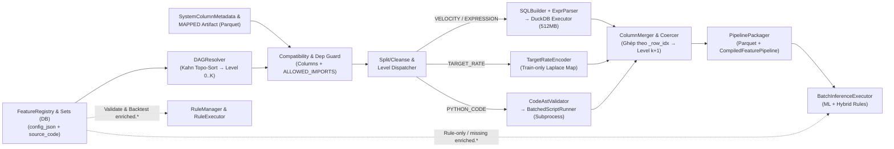
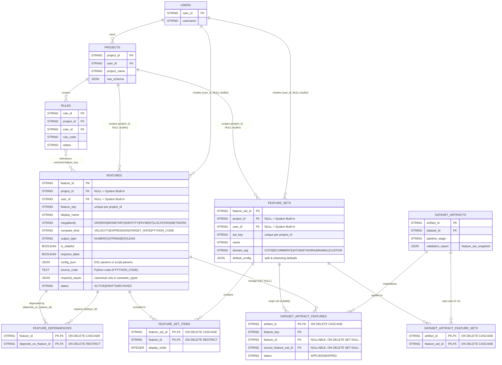
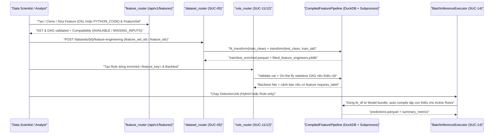

# Plan: Quản lý Đặc trưng & Nền tảng Kỹ nghệ Đặc trưng Động (Feature Management)

> **Task ID:** `feature_management` (= this file name) · **Issues:** ISS-040 (chosen by the user) · **Spec:** `docs/features/feature_management/context-modeling.md`, `docs/features/data_management/user-flow-and-ui-design.md`, `docs/features/critical_changes.md`, `docs/features/project_management/design.md`, Google Docs refs (DataVisor §4, AWS Fraud Detector FE, Ravelin §2.2)
> **Conflict verdict:** PARALLEL-SAFE · **Status:** Ready for review

## 1. Context (facts)
- `.plan/feature_management.md:1-4` và `docs/issues/11-17-2026.md:23-30`: `ISS-040` hiện chưa có đặc tả hay cài đặt cho phân hệ Quản lý Đặc trưng (Feature Management).
- `usfds-core/src/usfds_core/services/preprocessing/feature_engineering_service.py:187-230` và `usfds-core/src/usfds_core/domain/schemas/preprocessing_config.py:193-221`: Bước `FEATURE_ENGINEERED` (`SUC-05`) chỉ hardcode đúng 2 bộ sinh đặc trưng (`CreditCardFeatureEngineer`: `hour_of_day`, `amount_to_mean_ratio`; `VelocityFeatureEngineer`: `tx_freq_last_{w}h`, `tx_sum_last_{w}h` chỉ gom theo `user_id`), chạy hoàn toàn trên pandas `groupby().rolling()` (`velocity_engineer.py:118-158`, gắn với nút thắt RAM/CPU ở `ISS-044`).
- `usfds-core/src/usfds_core/domain/schemas/system_metadata.py:71-156`: Bảng `system_column_metadata` (`ISS-007`) hiện mới seed 5 cột `CORE` (`event_id`, `timestamp`, `amount`, `user_id`, `label`) và 2 cột `DOMAIN` (`merchant`, `category`), chưa bao phủ các trường ngữ cảnh phổ biến xuất hiện trong `ccfd-sample-datasets/` (`device_id`, `ip_address`, `email`, `phone_number`, `card_id`, `card_bin`, `country`, `bin_country`, `currency`, `channel`, `lat`, `long`, `merch_lat`, `merch_long`, `billing_zip`, `user_agent`).
- `usfds-core/src/usfds_core/services/data_management/mapping.py:290-331` và `usfds-web/src/components/modules/data_management/SchemaMappingWorkspace.tsx:361-387`: `DataMappingService` chỉ giữ các cột được ánh xạ tường minh (`5 CORE` + `optional_columns`) là đúng hành vi mong đợi (explicit opt-in), nhưng UI `SchemaMappingWorkspace` hiện chỉ cho bấm *"Thêm thuộc tính tùy chọn"* từng dòng một, gây bất tiện lớn với các dataset có nhiều cột như `creditcard.csv` (`V1..V28`), `ieee-fraud-detection` (394 cột) hay `paysim` / `e-commerce`.
- `usfds-core/src/usfds_core/services/project_management/schema_validator.py:217-219`, `usfds-core/src/usfds_core/services/rule_engine/manager.py:65-70` và `usfds-web/src/utils/jsonLogicParser.ts:104-120`: `RuleExecutionContext` (`rule_engine/executor.py:363-372`) và `BatchInferenceExecutor` (`inference/executor.py:375-386`) đã truyền namespace `enriched` / `enriched_features` cho `JsonLogicEvaluator`, nhưng `ProjectSchemaValidator.validate_rule_condition` đang bỏ qua (`continue`) kiểm tra biến `enriched.*`, và `RuleWorkspace.tsx:50-53` mới chỉ gợi ý cột từ `project.raw_schema`, chưa nạp được danh sách đặc trưng của Project.
- `usfds-web/src/components/layout/Sidebar.tsx:41-84`, `usfds-web/src/types/navigation.ts:1-8`, `usfds-web/src/App.tsx:23-31,119-165` và `usfds-infra/src/usfds_infra/database/seed_rbac.py:19-74`: Chưa có module cấp 1 `feature-management` (`/features`) trên Sidebar và chưa có nhóm quyền `feature:*`.
- `usfds-core/src/usfds_core/services/inference/executor.py:156-241` và `usfds-server/src/usfds_server/dependencies.py:34-79`: Mô hình `BUILTIN` hiện tách đôi metadata DB với code hardcode trong `usfds-core` (dễ bị lệch); trong khi đó `ScriptPluginTrainer` / `execute_plugin_bundle_inference` đã chứng minh mẫu thực thi script Python cô lập qua subprocess có timeout (`ISS-022`) và kiểm định tĩnh (`ISS-016`).

## 2. Goal, scope verdict & non-goals
- **Goal:** Xây dựng hoàn chỉnh phân hệ **Quản lý Đặc trưng (Feature Management)** theo kiến trúc **Dynamic 2 tầng tự chứa hoàn toàn trong DB (không hardcode `OPERATOR_REGISTRY`)**: (1) Đặc trưng khai báo `VELOCITY` / `EXPRESSION` / `TARGET_RATE` lưu trọn vẹn cấu hình DSL trong `config_json` và biên dịch động sang **DuckDB bounded (512MB)**; (2) Toàn bộ đặc trưng phi-SQL (kể cả Built-in IP/Email/Geo/Address/UA/Graph lẫn Custom Code) lưu trực tiếp `source_code` trong bảng `features`, kiểm định AST whitelist và thực thi trong **subprocess cô lập theo lô có timeout**. Chuẩn hóa quan hệ phụ thuộc (`feature_dependencies`), thành viên gói (`feature_set_items`), và liên kết N–N tới artifact (`dataset_artifact_feature_sets`, `dataset_artifact_features` hỗ trợ 0, 1 hoặc nhiều gói + chọn lẻ mà không sửa bảng `dataset_artifacts`), tổ chức theo **5 Megafamilies + Stacked DAG + Feature Sets**, đóng gói thành `CompiledFeaturePipeline` (đồng nhất 100% Train ↔ Inference ↔ Rule-only), dựng module độc lập `/features` trên Sidebar với RBAC riêng `feature:*`, nâng cấp **Bulk Column Picker** ở `SchemaMappingWorkspace`, và tái sử dụng liền mạch tại Step 3 FE và Rule Studio / Backtest / Detection.
- **Scope:** OK (toàn bộ thiết kế động 2 tầng, chuẩn hóa DB và biên độ `ISS-040` đã được thống nhất chi tiết).
- **Non-goals / omitted:**
  - **Không** giữ `OPERATOR_REGISTRY` hardcode trong `usfds-core`: mọi logic của cả Built-in lẫn Custom feature đều tự chứa 100% trong DB (`config_json` hoặc `source_code`), không bị lệch giữa DB và source repo.
  - **Không** thêm cờ `retain_unmapped_columns` vào `DataMappingConfig`: giữ nguyên hành vi explicit opt-in của `DataMappingService`; giải quyết bài toán dataset nhiều cột thuần túy bằng Bulk Column Picker trên `SchemaMappingWorkspace`.
  - **Không** triển khai bộ sinh đặc trưng dựa trên HMM/ARIMA per-user (thuộc nhóm Representation Learning / Model Training trong `context-modeling.md`), không gọi API enrichment bên thứ 3 trả phí, không tích hợp AI Co-Pilot LLM sinh code.
  - **Không** triển khai hạ tầng Online Feature Store thời gian thực (Redis/Kafka/Flink); giữ kiến trúc batch + model-bundle stateless phù hợp USFDS.
  - **Không** tạo bảng `FeatureVersion` bất biến riêng cho từng lần sửa công thức và không sửa cấu trúc bảng `dataset_artifacts` hiện có (thay vào đó lưu liên kết N–N qua `dataset_artifact_feature_sets` / `dataset_artifact_features` + `feature_set_snapshot` bất biến có hash SHA-256 tính tại thời điểm chụp vào `DatasetArtifact.validation_report` và `CompiledFeaturePipeline` trong `fitted_feature_engineers.joblib`).
  - **Không** thay thế hoàn toàn `ISS-044` ở các bước Ingestion/Profiling/Validation/Mapping/Export (chỉ áp dụng DuckDB bounded cho động cơ thực thi Feature Engineering mới).
- **Assumptions:**
  - Toàn bộ 16 cột `DOMAIN` bổ sung vào seed `SystemColumnMetadata` đều đặt `is_required=False` để không làm gián đoạn bất kỳ dataset hay test hiện có nào; Feature Management tự đối chiếu `project.raw_schema` và `MAPPED` artifact `schema_snapshot` / `column_mapping` để phân loại *Khả dụng* vs *Thiếu cột*.
  - Các file `.py` mẫu trong `usfds-core/.../features/builtin_scripts/` **chỉ dùng cho bước seed ban đầu** (`seed_feature_catalog`); khi chạy thực tế, `FeatureCompiler` luôn đọc duy nhất `feature.source_code` từ DB (hoặc từ snapshot đã đóng gói trong `CompiledFeaturePipeline`), tuyệt đối không import ngược `builtin_scripts/`.
  - Built-in Feature và Built-in Feature Set được nhận diện duy nhất bằng `project_id IS NULL` (không lưu cột thừa trong DB; `@property is_builtin` tính động `self.project_id is None` trên entity/DTO).
  - Mọi `DatasetArtifact` ở stage `FEATURE_ENGINEERED` vẫn tuân thủ tuyệt đối `BR-DM-07` (`docs/features/critical_changes.md`): bảo lưu nguyên vẹn `event_id`, `timestamp`, `amount`, `user_id`, `label` để hỗ trợ cả Tabular, Sequence, CNN và GNN trainers.
  - `BatchInferenceExecutor` và `InferenceService` giữ 100% tương thích ngược với các `fitted_feature_engineers.joblib` cũ dạng `dict` (`{"cleanser": ..., "credit_card_engineer": ..., "velocity_engineer": ...}`).

## 2.5 Design & Approach (user reviews this section)
### Diagram(s)

### Kiến trúc Dynamic 2 tầng (Zero Hardcoded Registry), 5 Megafamilies & Built-in Catalog
1. **4 loại thực thi tự chứa hoàn toàn trong DB (`FeatureComputeKind`):**
   - **Tầng 1 — Khai báo biên dịch sang DuckDB bounded (`512MB` RAM, `2` threads):**
     - `VELOCITY`: cửa sổ trượt & hành vi theo thời gian từ `config_json` (`{entity_key, secondary_group_by?, metric_col?, agg_fn: COUNT|SUM|AVG|STD|MIN|MAX|NUNIQUE|LAG_SECONDS|IS_FIRST|SEQ_NUM, window: 5m|1h|6h|24h|7d|30d|90d|same_day|lifetime, include_current?: bool}`). Bao phủ toàn bộ `CC-REF-18/39` & AWS FD (`time_since_last_tx`, `tx_seq_num_user`, `tx_freq_last_1h/24h/7d`, `tx_sum_last_1h/24h/7d`, `user_avg_amount_30d`, `user_std_amount_30d`, `tx_sum_same_day`, `tx_freq_same_day`, `user_merchant_freq_30d`, `user_category_freq_30d`, `user_country_freq_24h`, `user_device_freq_24h`, `is_first_merchant_for_user`, `is_first_country_for_user`, `is_first_device_for_user`).
     - `EXPRESSION`: biểu thức an toàn lưu trong `config_json["expr"]`, parse bằng AST whitelist (`+`, `-`, `*`, `/`, `abs`, `log1p`, `sin`, `cos`, `clip`, `coalesce`, `extract_hour`, `day_of_week`, `==`, `!=`, `>`, `>=`, `<`, `<=`, `if_else`) → biên dịch thẳng sang DuckDB SQL. Bao phủ các đặc trưng thời gian (`hour_of_day`, `hour_sin`, `hour_cos`, `day_of_week`, `is_weekend`, `is_night`), monetary/stacked (`log_amount`, `amount_to_user_avg_30d`, `amount_zscore_user_30d`), đối chiếu nhanh (`country_bin_mismatch`, `zip_mismatch`) và custom expressions của người dùng (vd `oldbalanceOrg - amount - newbalanceOrig` cho `paysim`).
     - `TARGET_RATE` (`is_stateful=True, requires_label=True`): tỷ lệ gian lận lịch sử theo `config_json` (`{group_col, smoothing_m: 10}`) — fit thuần trên tập `train` theo công thức Laplace/m-estimate `(fraud_sum + m * prior) / (count + m)`, lưu bảng tra cứu JSON-serializable (`prior` + `rates` map). Built-in: `merchant_hist_fraud_rate`, `category_hist_fraud_rate`, `country_hist_fraud_rate`, `bin_hist_fraud_rate`.
   - **Tầng 2 — Dynamic Python Script tự chứa trong DB (`PYTHON_CODE`):**
     - Mọi đặc trưng có logic xác định ngoài SQL — **kể cả toàn bộ Built-in** (`amount_to_mean_ratio`, `email_domain`, `email_digit_ratio`, `is_free_email`, `ip_prefix_24`, `ip_is_private`, `ua_is_mobile`, `ua_is_bot`, `phone_area_code`, `card_bin_prefix_6`, `geo_distance_km`, `geo_travel_speed_kmh`, `address_similarity`, `device_distinct_users`, `ip_distinct_users`, `card_distinct_users`, `merchant_distinct_users`, `community_size`, `community_fraud_ratio`) lẫn Custom Script do Data Scientist tự viết hoặc clone-và-sửa — đều lưu trực tiếp mã Python trong `features.source_code`.
     - **Hợp đồng hàm chuẩn:**
       - Stateless (`is_stateful=False`): `def compute(df: pd.DataFrame, params: dict) -> pd.Series`
       - Stateful (`is_stateful=True`): `def fit(train_df: pd.DataFrame, params: dict) -> dict` (trả `dict` JSON-serializable, không pickle hàm/class!) + `def compute(df: pd.DataFrame, params: dict, state: dict) -> pd.Series`.
     - **An toàn, Thư viện ngoài & Tốc độ:** Kiểm định AST whitelist (`code_validator.py`: mặc định cho import stdlib an toàn như `math`, `re`, `ipaddress`, `hashlib`, `datetime`, `collections`, `itertools`, `functools`, `statistics`, `json` cùng `numpy`, `pandas`; mở rộng qua allowlist `USFDS_FEATURE_ALLOWED_IMPORTS`; cấm tuyệt đối `os`, `sys`, `subprocess`, `socket`, `open`, `eval`, `exec`, `__import__`, truy cập dunder `__subclasses__`/`__globals__`; trần `64 KB`) và chạy gom lô theo tầng DAG trong **1 subprocess cô lập có timeout** (`script_runner.py`, mẫu `_usfds_runner.py` của `ScriptPluginTrainer`). Với thư viện bên ngoài (vd `phonenumbers`, `geoip2`), **tuyệt đối không `pip install` động lúc runtime**: feature khai báo tùy chọn `required_packages: list[str]` trong `config_json`, và `FeatureCompatibilityService` kiểm tra `ALLOWED_IMPORTS` + `importlib.util.find_spec(pkg)` để gắn cờ `MISSING_DEPENDENCY` nếu môi trường chưa cài sẵn.
2. **Phân nhóm theo 5 Megafamilies (Ravelin §2.2) + Monetary & 5 Built-in Domain Packages (DataVisor §4.1):**
   - Megafamilies: `ORDERS`, `MONETARY`, `IDENTITY`, `PAYMENT`, `LOCATIONS`, `NETWORK`.
   - 5 Domain Feature Sets Built-in: `pkg_ccfd_standard`, `pkg_ecommerce_cnp`, `pkg_geo_behavioral`, `pkg_network_ring`, `pkg_minimal_anonymized`.
3. **Mở rộng `SystemColumnMetadata` seed (`is_required=False` cho toàn bộ 16 cột `DOMAIN` mới):**
   - Giữ nguyên 5 cột `CORE` bất biến + `merchant`, `category`.
   - Bổ sung 16 cột `DOMAIN` tùy chọn (`device_id`, `ip_address`, `email`, `phone_number`, `card_id`, `card_bin`, `country`, `bin_country`, `currency`, `channel`, `lat`, `long`, `merch_lat`, `merch_long`, `billing_zip`, `user_agent`) kèm `aliases` phủ `ccfd-sample-datasets/` và đồng bộ `ProjectWarehouse`. Các cột định danh thô (`device_id`, `ip_address`, `email`, `phone_number`, `card_id`, `user_agent`) đặt `ml_role=IDENTIFIER` để giữ nguyên cho Feature Compiler trích xuất đặc trưng rồi tự động bị `PreprocessingPipelineBuilder` loại bỏ trước khi One-Hot Encode / Train ML.

### Luồng gắn logic Feature vào Dataset (Materialization)
1. **Đọc ngữ cảnh `MAPPED` & Feature Registry:** `DataManagementService` đọc `mapped.parquet`, `schema_snapshot`, `column_mapping` từ `MAPPED` artifact và tải danh sách `Feature` (hợp nhất & khử trùng lặp từ 0, 1 hoặc nhiều `feature_set_ids` — hỗ trợ alias tương thích ngược `feature_set_id` — cộng `feature_ids` chọn lẻ, kèm các bản ghi phụ thuộc qua `feature_dependencies` / `feature_set_items`).
2. **Giải DAG & Kiểm tra tương thích:** `DAGResolver` duyệt ngược quan hệ phụ thuộc và sắp xếp topo (Kahn) thành các tầng `[Level 0..K]` (mỗi feature trùng giữa nhiều gói chỉ tính đúng 1 lần); `FeatureCompatibilityService` kiểm tra cột nguồn (`required_inputs`) và thư viện ngoài (`required_packages` vs `USFDS_FEATURE_ALLOWED_IMPORTS` + `importlib.util.find_spec`) để tách `applicable_features` và `skipped_features` (`MISSING_INPUTS` / `MISSING_DEPENDENCY`).
3. **Chia tập theo thời gian & Làm sạch:** `TemporalDataSplitter` tách `mapped.parquet` theo `timestamp` tăng dần thành `train_df` / `test_df`; `StandardDataCleanser` fit trên `train_df` → `train_clean` và áp dụng lên `test_df` → `test_clean`.
4. **`fit_transform` trên `train_clean`:** Gắn `_row_idx`, duyệt tuần tự `Level 0 → Level K`:
   - `VELOCITY` / `EXPRESSION` → `SQLBuilder` + `ExpressionParser` chạy trên DuckDB bounded (`512MB`).
   - `TARGET_RATE` → `TargetRateEncoder` tính bảng Laplace trên cột `label`.
   - `PYTHON_CODE` → gom lô toàn bộ node cùng `Level k`, kiểm tra lại AST, chạy 1 subprocess `BatchedFeatureScriptRunner --mode fit_transform` (gọi `fit` + `compute`).
   - `ColumnMerger` ghép cột mới theo `_row_idx` để tầng `k+1` dùng tiếp; sau tầng cuối lưu `train_history_tail`.
5. **`transform` trên `test_clean` (dùng chung cho `BatchInferenceExecutor`):** Nối `[train_history_tail, test_clean]` (cờ `_is_target = 0/1`), chạy lại `Level 0 → Level K` (DuckDB rolling cắt giữ `_is_target = 1`; `TARGET_RATE` chỉ tra `fitted_states`; `PYTHON_CODE` chạy `--mode transform` với `fitted_states`, không gọi `fit()`, không cần cột `label`).
6. **`PipelinePackager`:** Xuất `train_enriched.parquet` / `test_enriched.parquet` (giữ nguyên 5 cột `CORE` theo `BR-DM-07`), đóng gói `CompiledFeaturePipeline` (thuần dữ liệu: `pinned_specs` + `fitted_states` + `train_history_tail` + `cleanser`) vào `fitted_feature_engineers.joblib`, và lưu `DatasetArtifact` (`FEATURE_ENGINEERED`) kèm ghi 2 bảng liên kết `dataset_artifact_feature_sets` (0..N gói) & `dataset_artifact_features` (`APPLIED | SKIPPED` kèm `source_feature_set_id`), đồng thời lưu `feature_set_snapshot` (tính SHA-256 của từng `source_code` tại thời điểm chụp), `engineered_features`, `skipped_features` vào `validation_report`.

### Key decisions & contracts
| Area | Decision / Contract | Rationale / Notes |
|---|---|---|
| API / RBAC | **Features (`/api/v1/features`):** `GET /api/v1/features?project_id=&megafamily=&include_builtin=true`, `GET /api/v1/features/compatibility?project_id=&dataset_id=&artifact_id=`, `POST /api/v1/features`, `GET /api/v1/features/{id}?project_id=`, `PATCH /api/v1/features/{id}?project_id=`, `DELETE /api/v1/features/{id}?project_id=`, `POST /api/v1/features/{id}/clone?project_id=`, `POST /api/v1/features/preview` (chạy thử tối đa 200 dòng trên artifact `MAPPED`, timeout 15s, không lưu DB). **Feature Sets (`/api/v1/feature-sets`):** `GET /api/v1/feature-sets?project_id=&include_builtin=true`, `POST /api/v1/feature-sets`, `PATCH /api/v1/feature-sets/{id}?project_id=`, `DELETE /api/v1/feature-sets/{id}?project_id=`. **RBAC (`seed_rbac.py` & `feature-policy.ts`):** Thêm 4 quyền `feature:read`, `feature:create`, `feature:update`, `feature:delete` (`system_admin` full `SYSTEM`; `project_admin` `read/delete` `PROJECT`; `data_scientist` `read` `PROJECT` + `create/update/delete` `OWN`; `fraud_analyst` `read` `PROJECT`). | Tách ranh giới tài nguyên rõ ràng ngang cấp `rules`/`models`/`datasets`, enforce `project_id` + `GrantScope.OWN` + chặn sửa trên Project `ARCHIVED` nhất quán với `ISS-042` & `ISS-043`. |
| Data / Schema | 6 bảng mới qua 1 Alembic revision (không thay đổi bảng `dataset_artifacts` hiện có): • `features` (`project_id` nullable FK `-> projects`, `user_id` nullable FK `-> users`, `source_code Text`, `is_stateful Boolean`, `requires_label Boolean`, unique `(project_id, feature_key)` + partial unique index `WHERE project_id IS NULL` cho Built-in). • `feature_dependencies` (`feature_id` FK `ON DELETE CASCADE`, `depends_on_feature_id` FK `ON DELETE RESTRICT`, check `feature_id != depends_on_feature_id`). • `feature_sets` (`project_id` nullable FK `-> projects`, `user_id` nullable FK `-> users`, unique `(project_id, set_key)` + partial unique index `WHERE project_id IS NULL`). • `feature_set_items` (`feature_set_id` FK `ON DELETE CASCADE`, `feature_id` FK `ON DELETE RESTRICT`, `display_order Integer`). • `dataset_artifact_feature_sets` (`artifact_id` PK,FK `-> dataset_artifacts ON DELETE CASCADE`; `feature_set_id` PK,FK `-> feature_sets ON DELETE CASCADE`). • `dataset_artifact_features` (`artifact_id` PK,FK `-> dataset_artifacts ON DELETE CASCADE`; `feature_key` PK; `feature_id` nullable FK `-> features ON DELETE SET NULL`; `source_feature_set_id` nullable FK `-> feature_sets ON DELETE SET NULL`; `status` `APPLIED|SKIPPED`). Không lưu cột `is_builtin` (tính từ `project_id IS NULL`) và không lưu cột `code_sha256` trong DB. Seed idempotent `seed_feature_catalog(session)` nạp ~28 Built-in Features + 5 Built-in Feature Sets (`project_id=None, user_id=None`). `DataMappingConfig` thêm `column_semantic_types: Dict[str, str] = {}`. | DB chuẩn hóa quan hệ 3NF tường minh cho DAG, FeatureSet và liên kết N–N tới DatasetArtifact (hỗ trợ 0, 1 hoặc nhiều gói + chọn lẻ); toàn vẹn tham chiếu bằng FK; không đụng bảng `dataset_artifacts` cũ; không dư thừa thuộc tính dẫn xuất (`is_builtin`, `code_sha256`). |
| Execution & Parity | `CompiledFeaturePipeline` (`compiler.py`): chia đồ thị phụ thuộc thành các tầng topo (topological levels); tầng DuckDB (`VELOCITY`/`EXPRESSION`) chạy trên `create_bounded_duckdb_connection(512MB, 2 threads)`; tầng `TARGET_RATE` dùng map Laplace fit thuần trên Train; tầng `PYTHON_CODE` chạy gom lô 1 lần qua `BatchedFeatureScriptRunner` (subprocess cô lập + AST re-check + timeout). Khi serialize vào `fitted_feature_engineers.joblib` và `feature_set_snapshot`, chỉ lưu cấu trúc thuần dữ liệu (`pinned_specs` gồm `source_code` và `snapshot_sha256` tính lúc đóng gói, `fitted_states` dạng dict JSON-serializable, `train_history_tail` giới hạn `USFDS_FEATURE_HISTORY_TAIL_ROWS=200000`) — **không pickle code Python**. `apply_domain_feature_engineers` giữ tương thích ngược với legacy `dict`. | Chống data leakage 100%, đồng nhất tuyệt đối Train ↔ Test ↔ Inference, an toàn bảo mật và miễn nhiễm lỗi pickle khi nâng cấp môi trường. |
| Rule Engine & Detection | `ProjectSchemaValidator.validate_rule_condition(..., active_features=...)` kiểm tra tồn tại và kiểu dữ liệu của biến `enriched.<feature_key>`. `BatchInferencePayload` thêm `rule_feature_definitions: List[Dict[str, Any]] = []` (tập con DAG tối thiểu kèm `config_json`/`source_code` được `active_rules` tham chiếu). Trong `BatchInferenceExecutor` và `RuleExecutor.backtest_dataframe`: tái dùng cột có sẵn trong `fe_df`; với cột thiếu, biên dịch on-the-fly các feature `requires_label=False` (cả DuckDB lẫn `PYTHON_CODE` stateless); các feature `requires_label=True` trả `null` kèm danh sách `feature_warnings`. | Luật dùng `enriched.*` chạy nhất quán ở cả Hybrid, Rule-only lẫn Dry-Run Backtest mà worker vẫn 100% stateless. |
| Frontend UI & UX | **Module cấp 1 mới (`/features` — `Quản lý đặc trưng`):** thêm `'feature-management'` vào `AppModule`, `Sidebar.tsx`, `App.tsx`, `feature-policy.ts`. Trang `FeatureManagementPage` gồm 3 tab: (1) **Danh mục đặc trưng** (lọc theo 5 Megafamilies, xem trạng thái *Khả dụng / Thiếu cột*, mở drawer xem **mã nguồn Python hoặc SQL biên dịch**, nút **Clone & Sửa** / Preview), (2) **Trình tạo đặc trưng** (hỗ trợ cả **No-code Builder** cho `VELOCITY`/`EXPRESSION`/`TARGET_RATE` và **Code Editor** cho `PYTHON_CODE` kèm template `compute`/`fit`, báo lỗi AST ngay lập tức và nút Chạy thử Preview), (3) **Gói đặc trưng (Feature Sets)**. **Tích hợp chéo:** (a) `SchemaMappingWorkspace.tsx` bổ sung **Bulk Column Picker** (tìm kiếm, lọc `LogicalDataType`, chọn hàng loạt, 1-click thêm/gỡ, badge `Giữ X / Y cột nguồn`), (b) `FeatureEngineeringWorkspace.tsx` chọn Feature Set / Feature từ Kho đặc trưng kèm badge *Khả dụng / Thiếu cột*, (c) `RuleWorkspace.tsx` & `RuleStudioWorkspace.tsx` bổ sung nhóm `Đặc trưng làm giàu (enriched.*)` và banner cảnh báo cho `requires_label=True`. | Khớp tuyệt đối yêu cầu module độc lập ngang cấp trên Sidebar, xem/sửa được code động trực tiếp và tái sử dụng liền mạch sang Data Management + Rule Engine. |
| Config / Env | Append vào `usfds-server/src/usfds_server/config.py` và `deploy/.env.example`: `USFDS_FEATURE_DUCKDB_MEMORY_MB=512`, `USFDS_FEATURE_HISTORY_TAIL_ROWS=200000`, `USFDS_FEATURE_PREVIEW_MAX_ROWS=200`, `USFDS_FEATURE_SCRIPT_TIMEOUT_SECONDS=60`, `USFDS_FEATURE_SCRIPT_MAX_BYTES=65536`, `USFDS_FEATURE_ALLOWED_IMPORTS="math,re,ipaddress,hashlib,datetime,collections,itertools,functools,statistics,json,numpy,pandas"`. | Khóa trần RAM DuckDB, kiểm soát thư viện ngoài (`ALLOWED_IMPORTS`), giới hạn kích thước script, timeout subprocess và kích thước `.joblib`. |

### Edge cases, concurrency & failure handling
- **An toàn thực thi `PYTHON_CODE` (Defense-in-depth):** Kiểm định AST whitelist ở cả lúc lưu (`POST`/`PATCH`) lẫn ngay trước khi chạy subprocess (phòng trường hợp DB bị chỉnh sửa ngoài API); ép timeout cứng (`60s` cho FE/Inference, `15s` cho Preview) và dọn sạch thư mục tạm workspace trong khối `finally`. Không chạy `exec()` trong tiến trình chính.
- **Đảm bảo tính nhất quán index & kiểu dữ liệu trả về của `PYTHON_CODE`:** Runner kiểm tra `compute()` trả `pd.Series` (hoặc 1D array) có đúng độ dài `len(df)`, căn chỉnh index theo `df.index`, và ép kiểu khớp `output_type` (`NUMERIC` → `float64`, `BOOLEAN` → `bool`, `STRING` → `object`); nếu script ném lỗi hoặc sai shape → báo lỗi rõ `FeatureExecutionError` kèm `feature_key` và dòng lỗi.
- **Phát hiện chu trình & khóa DAG (`ValueError`):** Khi tạo/sửa feature tham chiếu feature khác (`depends_on_feature_ids`), chạy Kahn's topo-sort chặn chu trình (cùng `CheckConstraint("feature_id != depends_on_feature_id")` ở DB) và kiểm tra mọi dependency đang `ACTIVE` trong cùng Project hoặc Built-in (`project_id IS NULL`); chặn lưu với HTTP `400`.
- **Biểu thức `EXPRESSION` an toàn:** AST whitelist parser dịch trực tiếp sang DuckDB SQL có quote định danh (`"col"`); từ chối SQL injection (`;`, `--`, subquery) hoặc hàm ngoài whitelist với HTTP `400`.
- **Thiếu cột đầu vào khi chạy Feature Set (Partial Applicability):** `FeatureCompatibilityService` tách rõ `applicable_features` và `skipped_features` (kèm danh sách cột thiếu, lan truyền dọc DAG nếu nút cha thiếu cột). Khi chạy `SUC-05`, mặc định chạy tập khả dụng và ghi `skipped_features` vào `validation_report` (trả `400` nếu 0 đặc trưng khả dụng hoặc `strict=True`).
- **Bảo vệ xóa tài nguyên đang sử dụng (In-use Protection):** Cấm xóa Built-in Feature / Built-in Feature Set (`project_id IS NULL`, trả `400`). Cấm xóa Custom Feature của Project nếu: (a) có bản ghi trỏ tới trong `feature_dependencies`, (b) có bản ghi trỏ tới trong `feature_set_items` (được bảo vệ kép bằng FK `ON DELETE RESTRICT` + kiểm tra ở tầng service để trả thông báo rõ tên tài nguyên phụ thuộc), hoặc (c) đang được `ACTIVE` Rule tham chiếu qua `enriched.<key>` — trả `400`.
- **Bảo toàn artifact & model cũ (Immutable Snapshot + Backward Compat):** Sửa `source_code`/`config_json` hoặc xóa Custom Feature/FeatureSet không ảnh hưởng artifact/model cũ nhờ chụp trọn vẹn `feature_set_snapshot` (gồm `source_code` + `snapshot_sha256`) vào `validation_report` và `CompiledFeaturePipeline` trong `fitted_feature_engineers.joblib` (`dataset_artifact_feature_sets` dùng `ON DELETE CASCADE`, `dataset_artifact_features` dùng `ON DELETE SET NULL` vẫn giữ nguyên `feature_key` và `status`).
- **Chống rò rỉ dữ liệu & Cô lập Project:** Mọi cửa sổ trượt DuckDB chỉ nhìn quá khứ (`<= t`), nối `train_history_tail` qua biên Train→Test, mọi feature `is_stateful=True` / `requires_label=True` fit thuần trên `train_df`. Mọi API yêu cầu `project_id: UUID`, enforce `GrantScope.OWN` (`403`), cô lập chéo project (`404`) và chặn ghi trên Project `ARCHIVED` (`400`).

## 3. Files
| Action | File | Milestone | Note |
|---|---|---|---|
| modify | `usfds-core/src/usfds_core/domain/entities/enums.py` | M1 | append-only hot spot (`FeatureMegafamily`, `FeatureComputeKind`, `FeatureStatus`, `SemanticColumnType`) |
| create | `usfds-core/src/usfds_core/domain/entities/feature.py` | M1 | `Feature` (có `source_code`, `is_stateful`, `depends_on_feature_ids`, `@property is_builtin`), `FeatureSet` (`items` theo thứ tự, `@property is_builtin`) |
| create | `usfds-core/src/usfds_core/domain/schemas/feature_schemas.py` | M1 | DSL configs (`VelocitySpec`, `ExpressionSpec`, `TargetRateSpec`, `PythonCodeSpec`), `FeatureCompatibilityItem`, `FeaturePreviewResult` |
| modify | `usfds-core/src/usfds_core/domain/schemas/system_metadata.py` | M1 | mở rộng `DEFAULT_SYSTEM_COLUMN_SPECS` thêm 16 cột `DOMAIN` tùy chọn (`is_required=False`, các cột định danh đặt `ml_role=IDENTIFIER`) |
| modify | `usfds-core/src/usfds_core/domain/schemas/preprocessing_config.py` | M1 | bổ sung `column_semantic_types` trong `DataMappingConfig` và `feature_set_ids` (kèm alias `feature_set_id`), `feature_ids`, `feature_definitions` trong `FeatureEngineeringConfig` |
| modify | `usfds-core/src/usfds_core/domain/schemas/inference_payload.py` | M1 | thêm `rule_feature_definitions` tùy chọn vào `BatchInferencePayload` |
| create | `usfds-core/src/usfds_core/repositories/base_feature_repo.py` | M1 | `IFeatureRepository`, `IFeatureSetRepository` ports |
| create | `usfds-core/src/usfds_core/services/features/__init__.py` | M1 | package exports |
| create | `usfds-core/src/usfds_core/services/features/builtin_scripts/__init__.py` | M1 | thư mục template `.py` chỉ dùng để seed `source_code` vào DB (IP/Email/UA/Phone/BIN/Geo/Address/Graph/AmountMean) |
| create | `usfds-core/src/usfds_core/services/features/builtin_scripts/identity.py` | M1 | template scripts cho `email_domain`, `email_digit_ratio`, `is_free_email`, `ip_prefix_24`, `ip_is_private`, `ua_is_mobile`, `ua_is_bot`, `phone_area_code` |
| create | `usfds-core/src/usfds_core/services/features/builtin_scripts/payment_geo.py` | M1 | template scripts cho `card_bin_prefix_6`, `amount_to_mean_ratio` (stateful), `geo_distance_km`, `geo_travel_speed_kmh`, `address_similarity` |
| create | `usfds-core/src/usfds_core/services/features/builtin_scripts/network.py` | M1 | template scripts cho `device_distinct_users`, `ip_distinct_users`, `card_distinct_users`, `merchant_distinct_users`, `community_size`, `community_fraud_ratio` (stateful + `requires_label`) |
| create | `usfds-core/src/usfds_core/services/features/builtin_catalog.py` | M1 | xây danh sách seed ~28 Built-in `Feature` (đọc `source_code` từ `builtin_scripts`, `project_id=None`) + 5 Built-in Domain `FeatureSet` |
| create | `usfds-core/src/usfds_core/services/features/expression_parser.py` | M1 | AST whitelist parser → safe DuckDB SQL expression + dependency extractor |
| create | `usfds-core/src/usfds_core/services/features/code_validator.py` | M1 | AST security validator cho `PYTHON_CODE` (whitelist imports, cấm dangerous builtins/dunders, kiểm tra chữ ký `compute`/`fit`, max bytes) |
| create | `usfds-core/src/usfds_core/services/features/script_runner.py` | M1 | `BatchedFeatureScriptRunner` chạy gom lô các nút `PYTHON_CODE` cùng tầng DAG trong 1 subprocess cô lập qua Parquet + JSON state + timeout |
| create | `usfds-core/src/usfds_core/services/features/compatibility.py` | M1 | `FeatureCompatibilityService` (đối chiếu `project.raw_schema` + `MAPPED` artifact + `SystemColumnMetadata` + `ALLOWED_IMPORTS` + lan truyền dọc DAG) |
| create | `usfds-core/src/usfds_core/services/features/compiler.py` | M1 | `FeatureCompiler` + `CompiledFeaturePipeline` (DAG topo-levels, DuckDB bounded velocity/expr, Laplace target rate, `BatchedFeatureScriptRunner`, bounded train tail, zero-pickle serialization) |
| create | `usfds-core/src/usfds_core/services/features/feature_service.py` | M1 | `FeatureManagementService` (CRUD, clone-to-project, AST & DAG validation, in-use protection, preview) |
| modify | `usfds-core/src/usfds_core/services/data_management/mapping.py` | M1 | lưu `column_semantic_types` vào `validation_report` của `MAPPED` artifact |
| modify | `usfds-core/src/usfds_core/services/preprocessing/feature_engineering_service.py` | M1 | tích hợp `CompiledFeaturePipeline`, lưu `feature_set_snapshot` (kèm danh sách `applied`/`skipped` features) & giữ tương thích ngược |
| modify | `usfds-core/src/usfds_core/services/data_management/service.py` | M1 | nhận `feature_repo`/`feature_set_repo` để hợp nhất `feature_set_ids`/`feature_ids` trước khi chạy `fe_service.execute` và ghi `dataset_artifact_feature_sets` + `dataset_artifact_features` |
| modify | `usfds-core/src/usfds_core/services/project_management/schema_validator.py` | M1 | `validate_rule_condition` kiểm tra biến `enriched.<feature_key>` theo danh sách active features |
| modify | `usfds-core/src/usfds_core/services/rule_engine/manager.py` | M1 | truyền project active features vào `validate_rule_condition` + helper `list_active_rules_referencing_feature` |
| modify | `usfds-core/src/usfds_core/services/rule_engine/executor.py` | M1 | tự động biên dịch tập con `enriched.*` bị thiếu trong `backtest_dataframe` + ghi `feature_warnings` |
| modify | `usfds-core/src/usfds_core/services/inference/executor.py` | M1 | `apply_domain_feature_engineers` hỗ trợ `CompiledFeaturePipeline`; tự biên dịch tập con `rule_feature_definitions` bị thiếu cho Active Rules trong Rule-only / cross-FeatureSet mode |
| modify | `usfds-core/src/usfds_core/services/inference/inference_service.py` | M1 | đóng gói `rule_feature_definitions` (kèm `source_code`) vào `BatchInferencePayload` |
| create | `usfds-core/tests/test_feature_management.py` | M1 | unit & integration tests cho 2-tier dynamic engine, 5 Megafamilies, DAG, AST security & timeout, external package guard, dynamic code edit/clone, anti-leakage, multi-dataset compatibility, in-use protection & Rule-only execution |
| create | `usfds-infra/src/usfds_infra/database/tables/feature.py` | M2 | `FeatureModel`, `FeatureDependencyModel`, `FeatureSetModel`, `FeatureSetItemModel`, `DatasetArtifactFeatureSetModel`, `DatasetArtifactFeatureModel` ORM tables |
| modify | `usfds-infra/src/usfds_infra/database/models.py` | M2 | append-only hot spot |
| create | `usfds-infra/src/usfds_infra/database/repos/feature.py` | M2 | `SqlFeatureRepository`, `SqlFeatureSetRepository` (quản lý join tables `feature_dependencies`, `feature_set_items`, `dataset_artifact_feature_sets`, `dataset_artifact_features`) |
| modify | `usfds-infra/src/usfds_infra/database/repositories.py` | M2 | append-only hot spot |
| modify | `usfds-infra/src/usfds_infra/database/__init__.py` | M2 | append-only hot spot |
| create | `usfds-infra/src/usfds_infra/database/seed_features.py` | M2 | `seed_feature_catalog(session)` idempotent (nạp ~28 Built-in gồm cả `source_code` + 5 Feature Sets với `project_id=None`) |
| modify | `usfds-infra/src/usfds_infra/database/seed_rbac.py` | M2 | append-only hot spot: thêm 4 quyền `feature:read/create/update/delete` và gán role grants |
| migration | `usfds-infra/src/usfds_infra/database/migrations/versions/<rev>_add_feature_management.py` | M2 | tạo 6 bảng (`features`, `feature_dependencies`, `feature_sets`, `feature_set_items`, `dataset_artifact_feature_sets`, `dataset_artifact_features`) + partial unique indexes (không đụng `dataset_artifacts`) |
| modify | `usfds-server/src/usfds_server/config.py` | M2 | append-only hot spot: `feature_duckdb_memory_mb`, `feature_history_tail_rows`, `feature_preview_max_rows`, `feature_script_timeout_seconds`, `feature_script_max_bytes`, `feature_allowed_imports` |
| modify | `deploy/.env.example` | M2 | append-only hot spot: thêm biến `USFDS_FEATURE_*` (gồm `USFDS_FEATURE_ALLOWED_IMPORTS`) |
| modify | `usfds-server/src/usfds_server/providers/repos.py` | M2 | append-only hot spot (`get_feature_repo`, `get_feature_set_repo`) |
| create | `usfds-server/src/usfds_server/providers/feature.py` | M2 | `get_feature_management_service` |
| modify | `usfds-server/src/usfds_server/providers/data.py` | M2 | truyền feature repos vào `DataManagementService` |
| modify | `usfds-server/src/usfds_server/providers/rule.py` | M2 | truyền `feature_repo` vào `RuleManager` |
| modify | `usfds-server/src/usfds_server/providers/detection.py` | M2 | truyền `feature_repo` vào `InferenceService` |
| modify | `usfds-server/src/usfds_server/dependencies.py` | M2 | append-only hot spot: gọi `seed_feature_catalog(session)` trong `setup_infrastructure()` |
| create | `usfds-server/src/usfds_server/schemas/feature_api_schemas.py` | M2 | Pydantic request/response DTOs cho `/api/v1/features` & `/api/v1/feature-sets` (`is_builtin` computed từ `project_id is None`) |
| create | `usfds-server/src/usfds_server/routers/feature_router.py` | M2 | REST API `/api/v1/features/*` và `/api/v1/feature-sets/*` |
| modify | `usfds-server/src/usfds_server/routers/rule_router.py` | M2 | truyền `feature_definitions` khi backtest Rule (cả inline và queue mode) |
| modify | `usfds-server/src/usfds_server/api.py` | M2 | append-only hot spot (`include_router(feature_router.router)` & `feature_set_router`) |
| modify | `usfds-worker/src/usfds_worker/handlers.py` | M2 | truyền `SqlFeatureRepository`/`SqlFeatureSetRepository` trong `_build_data_management_service`, `handle_batch_inference` và `handle_rule_backtest` |
| create | `usfds-infra/tests/test_feature_repositories.py` | M2 | repo CRUD, `feature_dependencies` / `feature_set_items` FK restrict, `dataset_artifact_feature_sets` (`CASCADE`) & `dataset_artifact_features` (`SET NULL`), partial unique indexes, seed idempotency & migration tests |
| create | `usfds-server/tests/test_feature_api.py` | M2 | API tests cho CRUD, clone + edit `source_code`, AST rejection (`400`), RBAC (`feature:*`, `OWN`, `ARCHIVED`, cross-project), compatibility, preview, FE execution (multi-set + chọn lẻ) & Rule backtest with `enriched.*` |
| create | `usfds-web/src/types/feature.ts` | M3 | TypeScript types cho Feature (`source_code`, `is_stateful`, `depends_on_feature_ids`, `is_builtin`), FeatureSet, DSL specs, Compatibility, Preview |
| modify | `usfds-web/src/types/navigation.ts` | M3 | append-only hot spot: thêm `'feature-management'` vào `AppModule` |
| modify | `usfds-web/src/types/dataset.ts` | M3 | bổ sung `column_semantic_types`, `feature_set_ids` (`feature_set_id`), `feature_ids` |
| modify | `usfds-web/src/types/index.ts` | M3 | append-only hot spot |
| create | `usfds-web/src/api/featureApi.ts` | M3 | HTTP client cho `/v1/features` và `/v1/feature-sets` |
| modify | `usfds-web/src/api/index.ts` | M3 | append-only hot spot |
| create | `usfds-web/src/hooks/useFeatures.ts` | M3 | react-query hooks (`useFeatureCatalog`, `useFeatureCompatibility`, `useFeatureSets`, mutations + preview) |
| modify | `usfds-web/src/hooks/index.ts` | M3 | append-only hot spot |
| modify | `usfds-web/src/lib/feature-policy.ts` | M3 | append-only hot spot: thêm `featureManagement`, `createFeature`, `updateFeature`, `deleteFeature` và map `'feature-management'` |
| create | `usfds-web/src/components/modules/feature_management/FeatureCatalogTab.tsx` | M3 | danh mục đặc trưng theo 5 Megafamilies, badge Khả dụng/Thiếu cột, drawer xem `source_code`/SQL, nút Clone & Preview |
| create | `usfds-web/src/components/modules/feature_management/FeatureBuilderTab.tsx` | M3 | Trình tạo 2 chế độ: No-code (`VELOCITY`/`EXPRESSION`/`TARGET_RATE`) & Python Code Editor (`PYTHON_CODE` kèm template `compute`/`fit` + AST error display + Preview) |
| create | `usfds-web/src/components/modules/feature_management/FeatureSetsTab.tsx` | M3 | quản lý 5 gói Built-in + tạo/sửa/xóa Feature Set của Project |
| create | `usfds-web/src/components/modules/feature_management/FeatureManagementModule.tsx` | M3 | vỏ điều phối 3 tab & bộ chọn ngữ cảnh Dataset/Artifact để kiểm tra tương thích |
| create | `usfds-web/src/pages/FeatureManagementPage.tsx` | M3 | trang route `/features/*` |
| modify | `usfds-web/src/pages/index.ts` | M3 | append-only hot spot |
| modify | `usfds-web/src/components/layout/Sidebar.tsx` | M3 | append-only hot spot: thêm mục `Quản lý đặc trưng` ngang cấp `Quản lý dữ liệu` |
| modify | `usfds-web/src/App.tsx` | M3 | append-only hot spot: đăng ký route `/features/*` với `FeatureRouteGuard` |
| create | `usfds-web/src/components/modules/feature_management/FeatureManagement.test.tsx` | M3 | Vitest + MSW tests cho Catalog 5 Megafamilies, xem/clone `source_code`, No-code & Python Code Builder, Feature Sets & Sidebar RBAC |
| modify | `usfds-web/src/components/modules/data_management/SchemaMappingWorkspace.tsx` | M4 | nâng cấp UX **Bulk Column Picker** (tìm kiếm, lọc `LogicalDataType`, chọn hàng loạt, gắn `semantic_type` tùy chọn, badge `Giữ X / Y cột nguồn`) |
| modify | `usfds-web/src/components/modules/data_management/FeatureEngineeringWorkspace.tsx` | M4 | tích hợp chọn 0..N Feature Set + chọn lẻ Feature khả dụng từ Kho đặc trưng (hiển thị rõ Khả dụng / Thiếu cột / Skipped), giữ fallback mượt |
| modify | `usfds-web/src/components/modules/data_management/DataPipelineWorkspace.tsx` | M4 | truyền `datasetId`, `projectId` xuống `FeatureEngineeringWorkspace` |
| modify | `usfds-web/src/utils/jsonLogicParser.ts` | M4 | bổ sung `buildAvailableFieldsWithEnrichedFeatures(rawSchema, activeFeatures)` gom nhóm `raw` + `enriched.<feature_key>` |
| modify | `usfds-web/src/components/modules/rule/RuleWorkspace.tsx` | M4 | nạp project active features qua `useFeatureCatalog` và truyền vào `RuleStudioWorkspace` / `RuleDryRunWorkspace` |
| modify | `usfds-web/src/components/modules/rule/RuleDryRunWorkspace.tsx` | M4 | hiển thị banner `feature_warnings` khi backtest luật dùng đặc trưng `requires_label=True` trên tập chưa có model |
| modify | `usfds-web/src/components/modules/detection/DetectionJobWizardView.tsx` | M4 | hiển thị cảnh báo nhẹ khi chạy Rule-only mà có Active Rule tham chiếu đặc trưng `requires_label=True` |
| create | `usfds-web/src/components/modules/data_management/BulkSchemaMappingAndFE.test.tsx` | M4 | Vitest + MSW tests cho Bulk Column Picker, Step 3 FE chọn Feature Set & Rule Studio `enriched.*` picker |

## 4. Dependencies & conflicts (with other tasks on BOARD)
| # | Check | Answer |
|---|---|---|
| D1 | Needs unfinished task? | No (tất cả task phụ thuộc `system_metadata_management`, `own_scope_access_control`, `large_data_analytics_duckdb`, `graph_exploration` đều đã `Done` trên `.plan/BOARD.md`) |
| D2 | Needed by unfinished task? | No |
| C1 | Modified files owned by in-progress task? | No (không có task nào đang ở trạng thái `In progress` trên `.plan/BOARD.md`) |
| C2 | Hot-spot files touched | `enums.py`, `models.py`, `repositories.py`, `database/__init__.py`, `seed_rbac.py`, `config.py`, `deploy/.env.example`, `providers/repos.py`, `dependencies.py`, `api.py`, `App.tsx`, `Sidebar.tsx`, `types/navigation.ts`, `feature-policy.ts`, các file barrel `index.ts` (tất cả sửa theo quy tắc append-only) |
| C3 | Schema change | Yes: 6 bảng mới (`features`, `feature_dependencies`, `feature_sets`, `feature_set_items`, `dataset_artifact_feature_sets`, `dataset_artifact_features`) qua 1 Alembic revision riêng (`<rev>_add_feature_management.py`); không sửa bảng `dataset_artifacts` hiện có |
| C4 | Public contract change | Yes: thêm `/api/v1/features/*`, `/api/v1/feature-sets/*`; bổ sung trường tùy chọn tương thích ngược trên `DataMappingConfig`, `FeatureEngineeringConfig`, `BatchInferencePayload` → consumers: `usfds-web`, `usfds-worker` |
| C5 | Shared UI shell change | Yes: thêm module cấp 1 `feature-management` (`/features`) vào `App.tsx`, `Sidebar.tsx`, `types/navigation.ts`, `lib/feature-policy.ts` (append-only; không có task `In progress` xung đột) |

## 5. Acceptance tests (user reviews this section)
| Milestone | Test | Given | When | Then | Covers |
|---|---|---|---|---|---|
| M1 | `test_builtin_catalog_and_compatibility_across_heterogeneous_datasets` (`usfds-core/tests/test_feature_management.py`) | Catalog Built-in 5 Megafamilies (gồm các đặc trưng `PYTHON_CODE` đã nạp `source_code`) và 3 schema mô phỏng từ `ccfd-sample-datasets`: (1) `creditcard.csv`, (2) `sparkov`, (3) `aws-samples/e-commerce` | Gọi `FeatureCompatibilityService.evaluate` cho từng dataset | Dataset (1) đánh dấu khả dụng đúng nhóm `CORE`/Velocity/Expression/Monetary và báo `MISSING_INPUTS` rõ tên cột thiếu cho Geo/Identity/Network; dataset (2) mở khóa thêm `geo_distance_km` & `user_merchant_freq_30d`; dataset (3) mở khóa thêm `email_digit_ratio`, `country_bin_mismatch`, `device_distinct_users` | ISS-040 |
| M1 | `test_compiled_pipeline_duckdb_velocity_stacked_dag_and_anti_leakage` (`usfds-core/tests/test_feature_management.py`) | Dataset có thứ tự thời gian chia Train (80%) / Test (20%) gồm `user_id`, `timestamp`, `amount`, `merchant`, `label` và FeatureSet chứa `user_avg_amount_30d` (`VELOCITY`) + `amount_to_user_avg_30d` (`EXPRESSION` stacked) + `merchant_hist_fraud_rate` (`TARGET_RATE`) | Chạy `CompiledFeaturePipeline.fit_transform(train)` rồi `transform(test)`, serialize qua `joblib` (không pickle hàm user) và chạy lại trên batch inference không có cột `label` | Giá trị cửa sổ trượt ở mọi dòng chỉ dùng lịch sử quá khứ (`<= t`), dòng đầu tập `test` nối liên tục với `train_history_tail`, `merchant_hist_fraud_rate` fit thuần từ nhãn `train` (không rò rỉ nhãn `test`), và kết quả sau reload `.joblib` khớp 100% | ISS-040, BR-DM-07 |
| M1 | `test_dynamic_python_code_enrichments_geo_graph_and_live_edit_without_repo_change` (`usfds-core/tests/test_feature_management.py`) | Tập giao dịch mẫu có `email`, `ip_address`, `card_bin`, `country`, `bin_country`, `lat/long`, `merch_lat/merch_long`, `device_id` (2 user chung 1 `device_id`, 1 user `label=1` trong train); clone 1 built-in `PYTHON_CODE` (`is_free_email`) vào Project và sửa trực tiếp `source_code` trong DB thêm domain tùy chỉnh `customcorp.vn` | Chạy `CompiledFeaturePipeline` qua `BatchedFeatureScriptRunner` cho các đặc trưng `IDENTITY`, `PAYMENT`, `LOCATIONS`, `NETWORK` và bản clone đã sửa | Tính chính xác `email_digit_ratio`, `geo_distance_km` (Haversine `<1%`), `device_distinct_users == 2`, `community_size >= 2`, `community_fraud_ratio` thuần từ train; bản clone nhận diện ngay `customcorp.vn` thuần từ `source_code` trong DB mà không sửa code repo | ISS-040 |
| M1 | `test_code_validator_and_expression_parser_block_unsafe_code_and_cycles` (`usfds-core/tests/test_feature_management.py`) | `FeatureManagementService` trên Project đang hoạt động | (a) Tạo chu trình DAG A↔B; (b) Tạo `EXPRESSION` chứa `"; DROP TABLE ..."`; (c) Tạo `PYTHON_CODE` import `os`/`subprocess` hoặc gọi `open()`/`eval()`/`__subclasses__`; (d) Tạo/kiểm tra `PYTHON_CODE` khai báo `required_packages` chưa cài hoặc ngoài `USFDS_FEATURE_ALLOWED_IMPORTS`; (e) Chạy `PYTHON_CODE` vòng lặp vô hạn với timeout ngắn (`1s`) | (a)(b)(c) bị chặn ngay với `ValueError` nêu rõ lý do; (d) bị từ chối với `ValueError` khi lưu nếu ngoài `ALLOWED_IMPORTS` và được đánh dấu `MISSING_DEPENDENCY` trong `FeatureCompatibilityService` khi thiếu package cài đặt; (e) bị `BatchedFeatureScriptRunner` ngắt đúng hạn và ném `TimeoutError` / `RuntimeError`; expression hợp lệ `oldbalanceOrg - amount - newbalanceOrig` và script hợp lệ chạy đúng | ISS-040, ISS-022 |
| M1 | `test_in_use_protection_blocks_deleting_referenced_feature` (`usfds-core/tests/test_feature_management.py`) | Custom feature `f_base` thuộc một `FeatureSet` (`feature_set_items`), được stacked feature `f_ratio` phụ thuộc (`feature_dependencies`), hoặc đang được `ACTIVE` Rule tham chiếu qua `enriched.f_base` | Gọi `FeatureManagementService.delete_feature` trên từng trường hợp và thử xóa Built-in feature (`project_id=None`) | Từ chối bằng `ValueError` nêu rõ tài nguyên đang phụ thuộc; sau khi gỡ liên kết thì xóa thành công | ISS-040 |
| M1 | `test_rule_only_detection_and_backtest_auto_compile_missing_enriched_features` (`usfds-core/tests/test_feature_management.py`) | `ACTIVE` Rule dùng `enriched.tx_freq_last_1h >= 2` và `enriched.ip_is_private == true` (`PYTHON_CODE` stateless), cùng 1 Rule dùng `enriched.merchant_hist_fraud_rate > 0.5`; chạy `BatchInferenceExecutor` ở chế độ Rule-only (`has_model=False`) và `RuleExecutor.backtest_dataframe` | Chạy `BatchInferenceExecutor.run` và `RuleExecutor.backtest_dataframe` | Đặc trưng không phụ thuộc nhãn (`tx_freq_last_1h`, `ip_is_private`) tự biên dịch on-the-fly và kích hoạt đúng Rule; đặc trưng `requires_label=True` trả `null` (không crash) kèm cảnh báo trong `summary_metrics["feature_warnings"]` / `backtest_result.feature_warnings` | ISS-040 |
| M2 | `test_feature_catalog_seed_migration_and_repositories` (`usfds-infra/tests/test_feature_repositories.py`) | SQLite DB trống chạy Alembic migration tới `head` và gọi `seed_feature_catalog` 2 lần liên tiếp | Kiểm tra số lượng bản ghi Built-in (`project_id IS NULL`), FK `feature_dependencies` / `feature_set_items` (`ON DELETE RESTRICT`), FK `dataset_artifact_feature_sets` (`ON DELETE CASCADE`) & `dataset_artifact_features` (`ON DELETE SET NULL`), partial unique indexes và CRUD custom feature/set | Migration chạy sạch; seed idempotent tạo đủ ~28 Built-in Features + 5 Feature Sets; chèn trùng `(project_id, feature_key)` hoặc xóa feature còn liên kết bị chặn ở tầng DB; xóa FeatureSet vẫn giữ nguyên `dataset_artifact_features.feature_key` (`feature_id` / `source_feature_set_id = NULL`) | ISS-040 |
| M2 | `test_feature_api_crud_rbac_own_scope_and_project_isolation` (`usfds-server/tests/test_feature_api.py`) | Seed RBAC mới (`feature:*`) với `data_scientist` (A và B), `fraud_analyst`, `project_admin`, và 2 Project (P1 ACTIVE, P2 ARCHIVED) | Gọi CRUD `/api/v1/features` (gồm tạo `PYTHON_CODE` hợp lệ & không hợp lệ), `/api/v1/feature-sets`, `/compatibility`, `/preview`, `/clone` từ từng vai trò | `fraud_analyst` đọc được `200` nhưng tạo/sửa nhận `403`; `data_scientist` B sửa/xóa feature của A bị `403` (`GrantScope.OWN`); script nguy hiểm nhận `400`; truy cập chéo project trả `404`; ghi trên Project `ARCHIVED` trả `400`; `POST /preview` trả bảng xem trước thực tế | ISS-040, ISS-042, ISS-043 |
| M2 | `test_dataset_fe_and_rule_backtest_end_to_end_via_api` (`usfds-server/tests/test_feature_api.py`) | Dataset đã qua `RAW -> MAPPED` có cột `merchant`, `lat`, `long`, `merch_lat`, `merch_long`; Project tạo custom `PYTHON_CODE` feature + FeatureSet | Gọi `POST /api/v1/datasets/{id}/feature-engineering` kết hợp nhiều `feature_set_ids` + `feature_ids` chọn lẻ (và trường hợp chỉ chọn `feature_ids`), sau đó tạo `ACTIVE` Rule dùng `enriched.<feature>` và gọi `POST /api/v1/rules/backtest` | `FEATURE_ENGINEERED` artifact sinh đủ cột mới (khử trùng lặp feature giữa các gói) + ghi `dataset_artifact_feature_sets` (0..N gói) & `dataset_artifact_features` (`APPLIED`/`SKIPPED`) + `feature_set_snapshot` (gồm `source_code` & `snapshot_sha256`) trong `validation_report` + `fitted_feature_engineers.joblib`; Rule `ACTIVE` qua validation (`201`) và backtest khớp đúng giao dịch | ISS-040 |
| M3 | `test_feature_management_module_sidebar_catalog_builder_and_sets` (`usfds-web/src/components/modules/feature_management/FeatureManagement.test.tsx`) | User có quyền `feature:read/create/update/delete` (và case `fraud_analyst` chỉ có `feature:read`) | Kiểm tra Sidebar hiển thị `Quản lý đặc trưng` (`/features`), duyệt 5 Megafamilies, mở xem `source_code` của 1 Built-in feature, tạo Custom `VELOCITY` & Custom `PYTHON_CODE` qua Builder, tạo Feature Set | Sidebar hiển thị đúng theo RBAC `feature:*`; Catalog hiển thị badge *Khả dụng / Thiếu cột* và `source_code`; Builder gửi đúng payload `POST /v1/features` cho cả DSL lẫn `PYTHON_CODE` và ẩn nút ghi với `fraud_analyst` | ISS-040 |
| M4 | `test_bulk_schema_mapping_picker_fe_feature_set_and_rule_enriched_picker` (`usfds-web/src/components/modules/data_management/BulkSchemaMappingAndFE.test.tsx`) | (1) `RAW` artifact có 30 cột (`V1..V25` + 5 cột core); (2) `FeatureEngineeringWorkspace` với danh sách Feature Sets + Features lẻ + compatibility; (3) `RuleWorkspace` với active features của Project | (1) Mở Bulk Column Picker, lọc `V` + `NUMERIC`, chọn tất cả và thêm 1-click; (2) Chọn nhiều Feature Set (`feature_set_ids`) + 1 feature lẻ (`feature_ids`) tại Step 3 FE; (3) Chọn trường `enriched.tx_freq_last_1h` trong `RuleStudioWorkspace` | (1) `optional_columns` cập nhật hàng loạt 25 cột và badge hiển thị `Giữ 30 / 30 cột nguồn`; (2) `FeatureEngineeringConfig` gửi đúng `feature_set_ids` + `feature_ids` kèm danh sách feature khả dụng; (3) `RuleStudioWorkspace` hiển thị nhóm `Đặc trưng làm giàu` và sinh JsonLogic `{"var": "enriched.tx_freq_last_1h"}` | ISS-040 |

## 6. Milestones & to-do (checkpoints, not stop points: all tests green at each)
The agent ticks items as it works. This is the task's only to-do list (`TODO.md` is no longer used for new work).

- [x] **M1 — Core Dynamic 2-Tier Feature Engine, Built-in Templates, Subprocess Runner & Cross-Service Parity** (`usfds-core`): hoàn chỉnh domain entities (`Feature`, `FeatureSet`, `source_code`, `is_stateful`, `@property is_builtin`), 4 `FeatureComputeKind`, Built-in Catalog (5 Megafamilies + 5 Domain Packages), AST `code_validator.py`, `expression_parser.py`, `BatchedFeatureScriptRunner`, DuckDB bounded `CompiledFeaturePipeline`, hợp nhất `feature_set_ids` + `feature_ids`, mở rộng 16 cột `DOMAIN` tùy chọn trong `SystemColumnMetadata`, tích hợp `FeatureEngineeringExecutionService`, `RuleManager`/`RuleExecutor` và `BatchInferenceExecutor`.
  - [x] [tests] Viết toàn bộ unit/integration tests M1 trong `usfds-core/tests/test_feature_management.py`; chạy thử để xác nhận fail đúng lý do
  - [x] [core] Bổ sung enums (`enums.py`), entities (`feature.py`), schemas (`feature_schemas.py`, cập nhật `system_metadata.py`, `preprocessing_config.py`, `inference_payload.py`) và ports (`base_feature_repo.py`)
  - [x] [core] Cài đặt `builtin_scripts/{identity,payment_geo,network}.py`, `builtin_catalog.py`, `expression_parser.py`, `code_validator.py`, `script_runner.py`, `compatibility.py`, `compiler.py` và `feature_service.py`
  - [x] [core] Tích hợp vào `DataMappingService`, `FeatureEngineeringExecutionService`, `DataManagementService`, `ProjectSchemaValidator`, `RuleManager`, `RuleExecutor`, `BatchInferenceExecutor` và `InferenceService`
  - [x] [verify] `./scripts/test.sh core`
- [x] **M2 — Persistence, Alembic Migration, Seed RBAC/Catalog, REST API & Worker Wiring** (`usfds-infra`, `usfds-server`, `usfds-worker`): lưu trữ 6 bảng (`features`, `feature_dependencies`, `feature_sets`, `feature_set_items`, `dataset_artifact_feature_sets`, `dataset_artifact_features`), seed Built-in Catalog & 4 quyền `feature:*`, dựng `/api/v1/features/*` & `/api/v1/feature-sets/*` và nối worker handlers.
  - [x] [tests] Viết tests M2 trong `usfds-infra/tests/test_feature_repositories.py` và `usfds-server/tests/test_feature_api.py`
  - [x] [infra] Tạo `tables/feature.py`, `repos/feature.py`, `seed_features.py`; cập nhật append-only `models.py`, `repositories.py`, `database/__init__.py`, `seed_rbac.py`; sinh 1 Alembic migration revision (không sửa `dataset_artifacts`)
  - [x] [server] Tạo `feature_api_schemas.py`, `feature_router.py`, `providers/feature.py`; cập nhật `config.py`, `deploy/.env.example`, `providers/{repos,data,rule,detection}.py`, `dependencies.py`, `rule_router.py`, `api.py`
  - [x] [worker] Cập nhật `usfds-worker/src/usfds_worker/handlers.py` truyền feature repos vào Data Management, Batch Inference và Rule Backtest handlers
  - [x] [verify] `./scripts/test.sh core infra server worker`
- [x] **M3 — Standalone Feature Management Module UI (`/features`)** (`usfds-web`): thêm module cấp 1 `Quản lý đặc trưng` trên Sidebar với 3 tab (Catalog 5 Megafamilies + xem `source_code`/SQL + Clone, Builder 2 chế độ No-code & Python Code Editor + Preview, Feature Sets) và RBAC `feature:*`.
  - [x] [tests] Viết component tests M3 với MSW trong `usfds-web/src/components/modules/feature_management/FeatureManagement.test.tsx`
  - [x] [web] Tạo `types/feature.ts`, `api/featureApi.ts`, `hooks/useFeatures.ts`; cập nhật append-only `types/navigation.ts`, `types/dataset.ts`, `lib/feature-policy.ts`, `Sidebar.tsx`, `App.tsx`, barrel `index.ts`
  - [x] [web] Xây dựng `FeatureCatalogTab.tsx`, `FeatureBuilderTab.tsx`, `FeatureSetsTab.tsx`, `FeatureManagementModule.tsx` và `FeatureManagementPage.tsx` (tuân thủ `docs/design-system.md` & tiếng Việt)
  - [x] [verify] `./scripts/test.sh web`
- [x] **M4 — Cross-Module UI Integration (Bulk Schema Mapping, Step 3 FE, Rule Studio & Detection Warning)** (`usfds-web`): nâng cấp trải nghiệm chọn cột hàng loạt trên `SchemaMappingWorkspace`, nối Kho đặc trưng vào Step 3 `FeatureEngineeringWorkspace`, bổ sung `enriched.*` vào `RuleStudioWorkspace` và hiển thị cảnh báo đặc trưng cần nhãn trên `RuleDryRunWorkspace` / `DetectionJobWizardView`.
  - [x] [tests] Viết component tests M4 trong `usfds-web/src/components/modules/data_management/BulkSchemaMappingAndFE.test.tsx`
  - [x] [web] Nâng cấp `SchemaMappingWorkspace.tsx` (Bulk Column Picker), `FeatureEngineeringWorkspace.tsx` + `DataPipelineWorkspace.tsx` (chọn Feature Set & compatibility), `jsonLogicParser.ts` + `RuleWorkspace.tsx` + `RuleDryRunWorkspace.tsx` (`enriched.*` & warning), `DetectionJobWizardView.tsx`
  - [x] [verify] `./scripts/test.sh` (toàn bộ 6 package + `npm run build` & `npm run lint` trong `usfds-web`)

Checkpoint log (the agent appends one line per finished milestone):
- M1 done (26-11-24): `./scripts/test.sh core` — 182 passed, 15 skipped (dynamic 2-tier engine, subprocess runner, DuckDB velocity/expression DAG, 16 optional DOMAIN metadata columns, Rule/Inference parity).
- M2 done (26-11-24): `./scripts/test.sh infra` (52 passed), `./scripts/test.sh server` (55 passed), `./scripts/test.sh worker` (10 passed) — 6 ORM tables + `15b917605e94_add_feature_management.py`, idempotent catalog + RBAC `feature:*` seed, `/api/v1/features/*` & `/api/v1/feature-sets/*`, worker wiring.
- M3 done (26-11-24): `./scripts/test.sh web` — 25 test files, 56 passed (Sidebar `/features`, Catalog + Compatibility + Preview/Clone, 2-Tier Builder No-code & Python AST, Feature Sets, RBAC).
- M4 done (26-11-24): `npm run build && npm run lint` (0 errors) + full `./scripts/test.sh` — `core` (182 passed, 15 skipped), `infra` (52 passed), `server` (55 passed), `worker` (10 passed), `cli` (5 passed), `web` (26 files, 57 passed).

## 7. Review hotspots
- **Acceptance tests:** `usfds-core/tests/test_feature_management.py`, `usfds-infra/tests/test_feature_repositories.py`, `usfds-server/tests/test_feature_api.py`, `usfds-web/src/components/modules/feature_management/FeatureManagement.test.tsx`, `usfds-web/src/components/modules/data_management/BulkSchemaMappingAndFE.test.tsx`.
- **Dynamic 2-Tier compiler, AST sandbox & subprocess isolation:** `usfds-core/src/usfds_core/services/features/compiler.py` (`DAGResolver`, `TargetRateEncoder`, `CompiledFeaturePipeline`, `materialize_rule_enriched_features`), `code_validator.py` (AST whitelist + package check), `script_runner.py` (`BatchedFeatureScriptRunner` timeout).
- **Schema normalization & Alembic migration (6 tables):** `usfds-infra/src/usfds_infra/database/tables/feature.py`, `repos/feature.py`, `migrations/versions/15b917605e94_add_feature_management.py` (`if_not_exists=True`, partial unique indexes `project_id IS NULL`, FK `ON DELETE RESTRICT/CASCADE/SET NULL`), `seed_features.py`, `seed_rbac.py`.
- **Server endpoints & Worker parity:** `usfds-server/src/usfds_server/routers/feature_router.py` (RBAC `OWN`/`PROJECT`, ARCHIVED project write guard, in-use protection), `usfds-worker/src/usfds_worker/handlers.py`.
- **Cross-module UI integrations:** `usfds-web/src/components/modules/feature_management/*`, `SchemaMappingWorkspace.tsx` (Bulk Column Picker), `FeatureEngineeringWorkspace.tsx` (`feature_set_ids` + `feature_ids`), `RuleWorkspace.tsx` / `RuleDryRunWorkspace.tsx` / `DetectionJobWizardView.tsx` (`enriched.*` & `requires_label` warnings).

## 8. Open questions
- —

## 9. Manual E2E verification (post-merge)
- [ ] Chạy thử nghiệm luồng đầy đủ trên 3 tập dữ liệu thực tế khác nhau trong `ccfd-sample-datasets/`:
  1. `2. european-credit-card-fraud/creditcard.csv`: dùng **Bulk Column Picker** chọn `V1..V28` bằng 1 click, kiểm tra gói `pkg_minimal_anonymized` chạy thành công và các đặc trưng Geo/Identity báo *Thiếu cột*.
  2. `9. credit-card-fraud/fraud_data.csv` (hoặc `3. sparkov-simulator`): kiểm tra auto-match `merchant`, `category`, `lat`, `long`, `merch_lat`, `merch_long`, chạy `pkg_geo_behavioral` + `pkg_ccfd_standard`, clone & chỉnh sửa `source_code` của `geo_distance_km` trực tiếp trên `/features`, huấn luyện XGBoost và chạy Batch Inference khớp 100% cột.
  3. `19. e-commerce-fraud-detection/E-Commerce Fraud Detection Dataset.csv` + `5. paysim`: tạo Custom Expression (`balance_diff`) và Custom `PYTHON_CODE` trong `/features`, gắn vào `ACTIVE` Rule (`enriched.tx_freq_last_1h >= 3`), xác nhận cả **Rule Backtest** lẫn **Rule-only Detection Job** trên PostgreSQL + BullMQ + MinIO hoạt động chính xác và hiện cảnh báo đúng khi luật tham chiếu đặc trưng `requires_label=True`.
