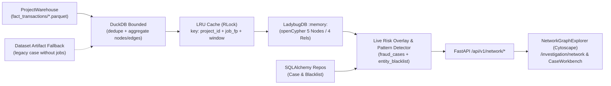
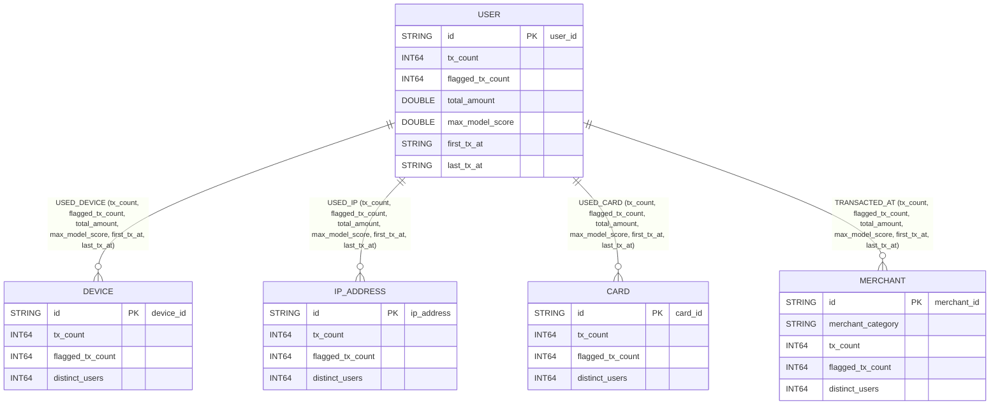
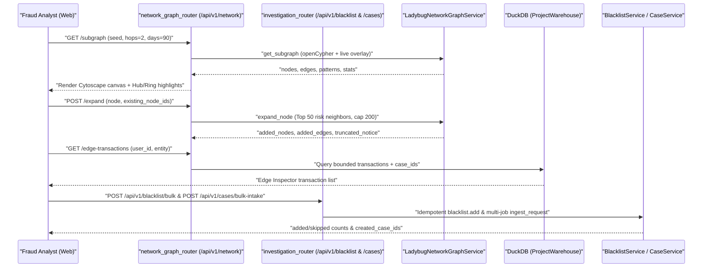

# Plan: Graph Exploration & Fraud Ring Link Analysis (SUC-19)

> **Task ID:** `graph_exploration` · **Issues:** ISS-041 (chosen by the user) · **Spec:** `docs/features/investigation/suc-spec.md` (SUC-19 — cập nhật sang LadybugDB khi triển khai)
> **Conflict verdict:** PARALLEL-SAFE · **Status:** Done (26-11-24)

## 1. Context (facts)
- `.plan/graph_exploration.md:1-4` và `docs/issues/11-17-2026.md:32-39`: `ISS-041` chưa có đặc tả triển khai, chưa có service, API hay UI khám phá đồ thị.
- `docs/features/investigation/suc-spec.md:173-232`: `SUC-19 (Investigate network)` yêu cầu khám phá đồ thị liên kết đa thực thể (`User`, `Device`, `IP`, `Merchant`, `Card`) theo độ sâu 1-hop / 2-hop, mở rộng `+1 hop` giới hạn Top 50 láng giềng rủi ro cao nhất (`4a`), trần 200 nút hiển thị đồng thời (`BR-IV-05`), tự động tô sáng mẫu hình gian lận (`Device/IP Hub`, `Merchant Ring`), xem giao dịch chi tiết của cạnh (`Edge Inspector`) và xử lý hàng loạt trên cụm nút.
- `usfds-core/src/usfds_core/services/warehouse/project_warehouse.py:35-50, 186-255`: `ProjectWarehouse` đã ghi mỗi `DetectionJob` `COMPLETED` thành `warehouse/{project_id}/fact_transactions/job_{job_id}.parquet` kèm 5 cột thực thể phụ (`device_id`, `ip_address`, `card_id`, `merchant_id`, `merchant_category`) và khử trùng lặp `event_id` lúc đọc. Tuy nhiên `project_warehouse.py:192` chỉ gọi `resolve_canonical_column(columns, col)` không có alias phụ (`merchant`, `ip`, `device`, `cc_num`...), dẫn đến dữ liệu thực tế có thể bị null các cột thực thể khi tên cột khác chuẩn.
- `usfds-core/src/usfds_core/domain/entities/case.py:18-64`: `BlacklistEntityType` hỗ trợ đúng 5 loại thực thể (`USER_ID`, `CARD_ID`, `DEVICE_ID`, `IP_ADDRESS`, `MERCHANT_ID`); mỗi `Case` gắn 1-1 với 1 `event_id` (`unique(project_id, event_id)`), chưa có bảng `case_transactions`.
- `usfds-server/src/usfds_server/routers/detection_router.py:343-395` và `investigation_router.py:110-143`: `send_to_investigation` trích xuất `TransactionSnapshot` từ `predictions.parquet` qua DuckDB (`fetch_prediction_events`) rồi gọi `ingest_request`.
- `usfds-web/src/components/modules/InvestigationModule.tsx:33-105` và `CaseWorkbenchView.tsx:182-199`: phân hệ Điều tra hiện có 2 tab (`Hàng đợi hồ sơ`, `Chính sách & danh sách theo dõi`) và Workbench 3 cột; `usfds-web/package.json:20-30` chưa có thư viện trực quan hóa đồ thị tương tác.
- `deploy/docker-compose.yml:28-31` & `deploy/initdb/10-usfds-graph.sql`: Docker chạy PostgreSQL 17 + Apache AGE, nhưng chế độ Desktop dùng SQLite và bộ test `./scripts/test.sh` chạy không cần Docker. Qua trao đổi thiết kế, người dùng chọn chuyển sang in-memory Graph DB **LadybugDB (`ladybug>=0.22`)** chạy đồng nhất cả Desktop lẫn Server.

## 2. Goal, scope verdict & non-goals
- **Goal:** Xây dựng hoàn chỉnh chức năng Khám phá đồ thị mạng lưới gian lận (`SUC-19`) gồm: động cơ đồ thị nhúng **LadybugDB (`:memory:`)** chạy openCypher nạp on-demand từ `ProjectWarehouse` qua DuckDB có LRU cache trong `usfds-server`, 4 endpoint đọc đồ thị `/api/v1/network/*` (`hubs`, `subgraph`, `expand`, `edge-transactions`) và 2 endpoint ghi hàng loạt đặt đúng ranh giới tài nguyên tại `investigation_router.py` (`POST /api/v1/blacklist/bulk` và `POST /api/v1/cases/bulk-intake`), cùng giao diện `cytoscape` dùng chung tại tab `/investigation/network` lẫn tab trong `CaseWorkbenchView`.
- **Scope:** OK
- **Non-goals / omitted:**
  - Không đồng bộ hay truy vấn Apache AGE (`usfds_graph`); giữ nguyên `deploy/docker-compose.yml` và `deploy/initdb/10-usfds-graph.sql`.
  - Không triển khai GNN Node/Subgraph Risk Overlay (`SUC-19 3a`) vì hệ thống chưa có mô hình GNN.
  - Không bổ sung `recipient_id`, không đổi mô hình `Case` từ 1-event/case sang đa giao dịch (`case_transactions`), không tự động đóng hàng loạt `RESOLVED_FRAUD` từ màn hình đồ thị.
  - Không đẩy truy vấn đồ thị qua `QUEUE_ANALYTICS` worker và không thêm quyền RBAC mới trong `seed_rbac.py`.
  - Không cho chỉnh ngưỡng Hub/Super-node trực tiếp trên thanh công cụ UI (dùng ngưỡng cấu hình mặc định chuẩn).
- **Assumptions:**
  - Dùng PyPI package `ladybug>=0.22.0` (import `ladybug`, fork cộng đồng tiếp nối KùzuDB, có wheel Python 3.12 sẵn cho Windows `win_amd64` và Linux `manylinux_2_27_x86_64`), khai báo trong `usfds-core/pyproject.toml`.
  - Đồ thị lưỡng phân xoay quanh `User` với đúng 5 loại đỉnh khớp `BlacklistEntityType`: `User`, `Device`, `IpAddress`, `Card`, `Merchant` (`merchant_category` là thuộc tính của `Merchant`) và 4 loại cạnh tổng hợp (`USED_DEVICE`, `USED_IP`, `USED_CARD`, `TRANSACTED_AT`).
  - Trạng thái rủi ro nút (`BLOCKED` / `RESOLVED_FRAUD` đỏ, `OPEN`/`IN_PROGRESS`/`PENDING_CUSTOMER` hoặc `flagged_tx_count > 0` cam, `NORMAL` xám/xanh) luôn được overlay trực tiếp từ `SqliteCaseRepository` và `SqliteBlacklistRepository` trên từng truy vấn để đảm bảo dữ liệu tức thời dù đồ thị đang nằm trong LRU cache.
  - Case cũ tạo trực tiếp từ `dataset_artifact_id` khi project chưa có `DetectionJob` `COMPLETED` sẽ fallback nạp đồ thị từ file artifact qua DuckDB (đồng nhất với `ISS-045` Workbench).
  - Người dùng đã đồng ý cập nhật mục `SUC-19` trong `docs/features/investigation/suc-spec.md` cho khớp LadybugDB và luồng hành động thực tế (gắn comment `[26-11-23]`).

## 2.5 Design & Approach (user reviews this section)
### Diagram(s)

### Graph Data Model & Overlay Design
1. **Cấu trúc lưỡng phân & quy tắc ánh xạ từ `fact_transactions`:**
   - Mọi cạnh có hướng `User -> {Device, IpAddress, Card, Merchant}` (đồ thị lưỡng phân tránh bùng nổ cạnh $O(k^2)$ giữa các `User`).
   - Trước khi aggregate bằng DuckDB, khử trùng lặp `event_id` theo `scanned_at DESC, job_id DESC` trong cửa sổ `days` (mặc định `90` ngày tính theo `tx_timestamp` so với mốc mới nhất).
   - Bỏ qua giá trị thực thể phụ `NULL` hoặc chuỗi rỗng sau `TRIM`, không tạo node giả.
   - Nhiều giao dịch giữa cùng cặp `(user_id, entity_id)` gộp thành **1 cạnh tổng hợp** mang `tx_count`, `flagged_tx_count`, `total_amount`, `max_model_score`, `first_tx_at`, `last_tx_at`.
   - Node `Merchant` lưu thêm `merchant_category` (giá trị non-null phổ biến nhất); 4 node thực thể phụ lưu sẵn `distinct_users` (bậc kết nối) để lọc Super-node và phát hiện Hub không cần quét lại toàn đồ thị.
   - Định danh nút trả về API/UI dùng namespace `"{entity_type}:{entity_value}"` (ví dụ `USER_ID:u_123`, `DEVICE_ID:dev_9`) để tránh trùng ID giữa các loại thực thể.
2. **Phân tách dữ liệu tĩnh (Cached in LadybugDB) vs động (Live SQL Overlay):**
   - **Cached in LadybugDB (`:memory:`):** 5 bảng node + 4 bảng cạnh tổng hợp, lưu theo khóa LRU `(project_id, source_fingerprint, window_days)`.
   - **Live SQL Overlay (ghép trên mỗi truy vấn từ `SqliteCaseRepository` & `SqliteBlacklistRepository`):** `is_blacklisted` (`ACTIVE` khớp `(entity_type, entity_value)`), `open_case_count`, `resolved_fraud_count`, `case_ids` (cho `User`).
   - **Quy tắc trạng thái / màu nút (`risk_status`):** `CRITICAL` (đỏ) khi `is_blacklisted=True` hoặc `resolved_fraud_count > 0`; `WARNING` (cam) khi `open_case_count > 0` hoặc `flagged_tx_count > 0`; `NORMAL` (xám/xanh) các trường hợp còn lại.
3. **Quy tắc duyệt (Traversal), xếp hạng cắt ngưỡng & phát hiện mẫu hình:**
   - `1-hop`: từ `User` lấy các thực thể liên kết; từ thực thể phụ lấy tối đa 50 `User` rủi ro nhất. `2-hop`: từ `User` đi qua thực thể dùng chung sang các `User` đồng phạm khác.
   - Thứ tự xếp hạng ưu tiên khi cắt Top 50 (`MAX_EXPAND_NEIGHBORS=50`, `SUC-19 4a`) hoặc chạm trần 200 nút (`MAX_CANVAS_NODES=200`, `BR-IV-05`): `(risk_status == CRITICAL DESC, open_case_count > 0 DESC, flagged_tx_count DESC, max_model_score DESC, tx_count DESC, id ASC)`.
   - Super-node: nút thực thể phụ có `distinct_users > SUPER_NODE_DEGREE_THRESHOLD` (mặc định `50`) gắn `is_super_node=True`; khi `hide_super_nodes=True`, bỏ qua khi duyệt 2-hop và ẩn khỏi kết quả (trừ khi chính nó là `seed`).
   - Mẫu hình cảnh báo: `DEVICE_IP_CARD_HUB` (`distinct_users >= 2` và `flagged_users >= 1`, hoặc `distinct_users >= 3` và `max_model_score >= 0.7`); `MERCHANT_RING` (`flagged_users >= 3`, hoặc `flagged_tx_count >= 3` và `flagged_tx_count / tx_count >= 0.30`).

### Key decisions & contracts
| Area | Decision / Contract | Rationale / Notes |
|---|---|---|
| API / RBAC | **Network (chỉ đọc, `network_graph_router.py`):** `GET /api/v1/network/hubs`, `GET /api/v1/network/subgraph`, `POST /api/v1/network/expand`, `GET /api/v1/network/edge-transactions` (`case:read`, scope `PROJECT`). **Blacklist (`investigation_router.py` → `blacklist_router`):** `POST /api/v1/blacklist/bulk` (`blacklist:manage`, writable project, payload `{project_id, entities: [{entity_type, entity_value}], reason (>=10 chars), source_case_id?}`, idempotent). **Investigation (`investigation_router.py` → `router`):** `POST /api/v1/cases/bulk-intake` (`case:create`, writable project, payload `{project_id, items: [{detection_job_id, event_id}], analyst_notes?}`, nhóm theo `detection_job_id`, tái dùng helper snapshot chung với `detection_router.send_to_investigation` + `ingest_request`, idempotent). | Đặt hành động ghi đúng ranh giới tài nguyên `blacklist` & `cases` để dùng chung được ngoài màn hình đồ thị; `/api/v1/network/*` thuần đọc; tái dùng trọn bộ RBAC cấp `PROJECT` hiện có, không đổi `seed_rbac.py` hay `feature-policy.ts`. |
| Graph Engine & Schema | Port `INetworkGraphService` + `LadybugNetworkGraphService` dùng `ladybug.Database(":memory:", buffer_pool_size=...)` với 5 node tables (`User`, `Device`, `IpAddress`, `Card`, `Merchant`) và 4 rel tables (`USED_DEVICE`, `USED_IP`, `USED_CARD`, `TRANSACTED_AT`) như mục **Graph Data Model & Overlay Design**. | 1-hop thấy thực thể của User, 2-hop vạch trần ngay User đồng phạm dùng chung Device/IP/Card/Merchant; giao dịch chi tiết của cạnh đọc on-demand bằng DuckDB. |
| Warehouse Aliases | Bổ sung `OPTIONAL_ENTITY_ALIASES` trong `project_warehouse.py` (`device_id`, `ip_address`, `card_id`, `merchant_id`, `merchant_category`) và tái dùng ở artifact fallback. | Đảm bảo dataset có cột `merchant`, `ip`, `device`, `cc_num`... được chuẩn hóa vào warehouse. |
| Patterns & Limits | `MAX_EXPAND_NEIGHBORS = 50` (`SUC-19 4a`), `MAX_CANVAS_NODES = 200` (`BR-IV-05`), `SUPER_NODE_DEGREE_THRESHOLD = 50` cùng quy tắc xếp hạng & ngưỡng phát hiện `DEVICE_IP_CARD_HUB` / `MERCHANT_RING` ở mục **Graph Data Model & Overlay Design**. | Khớp trực tiếp `SUC-19` và `BR-IV-05`. |
| Config / Env | Append vào `usfds-server/src/usfds_server/config.py` & `deploy/.env.example`: `USFDS_GRAPH_CACHE_MAX_ENTRIES=4`, `USFDS_GRAPH_CACHE_TTL_SECONDS=600`, `USFDS_GRAPH_BUFFER_POOL_MB=256`, `USFDS_GRAPH_SUPER_NODE_DEGREE=50`. | Khóa trần RAM cho LadybugDB trong `usfds-server` tương tự trần DuckDB 512MB. |
| Frontend UI | `cytoscape` + `@types/cytoscape` với wrapper mỏng `CytoscapeCanvas.tsx` + `NetworkGraphExplorer.tsx` dùng chung ở `/investigation/network` và tab cột giữa `CaseWorkbenchView.tsx`. | Không xung đột React 19; hỗ trợ layout `cose`, box-select nhiều nút, pan/zoom, double-click expand, dark/light theme qua `useTheme`, fallback headless + danh sách truy cập (accessibility) khi chạy Vitest/jsdom. |

### Edge cases, concurrency & failure handling
- **Thread-safety & eviction của LRU cache:** Cache dùng `OrderedDict` bọc `threading.RLock`; mỗi truy vấn tạo `ladybug.Connection(entry.db)` cục bộ và đóng connection trong `finally`. Entry lưu `source_fingerprint` gồm danh sách `(job_id, output_path, updated_at)` để tự vô hiệu hóa ngay khi có `DetectionJob` mới hoàn tất hoặc quá TTL.
- **Thiếu cột thực thể phụ (`SUC-19 2a`):** Khi warehouse/artifact không có giá trị non-null nào ở 4 cột `device_id`, `ip_address`, `card_id`, `merchant_id`, API trả `200` với `available: false` và thông báo hướng dẫn tiếng Việt (không trả 500).
- **Super-node explosion (`SUC-19 4a`) & giới hạn Canvas (`BR-IV-05`):** Nếu một nút có `N > 50` láng giềng hoặc tổng số nút vượt `200`, backend cắt theo thứ tự rủi ro giảm dần và trả `truncated_neighbors`, `total_neighbors`, `canvas_limit_reached`, `notice` để UI hiện cảnh báo rõ ràng.
- **Idempotency cho hành động hàng loạt:** `POST /api/v1/blacklist/bulk` duyệt từng thực thể qua `BlacklistService.add`, bỏ qua thực thể đã `ACTIVE` trong blacklist thay vì hủy cả batch; `POST /api/v1/cases/bulk-intake` nhóm `(detection_job_id, event_id)` theo `detection_job_id`, trích snapshot qua helper dùng chung với `detection_router.send_to_investigation`, bỏ qua `event_id` đã có Case.
- **Project `ARCHIVED` & cô lập project:** Mọi endpoint kiểm tra `project_id` qua `_project` + `authz.require_project_permission`; các endpoint ghi (`POST /api/v1/blacklist/bulk`, `POST /api/v1/cases/bulk-intake`) chặn `400` khi project ở trạng thái `ARCHIVED` và từ chối nếu `detection_job_id` hoặc `source_case_id` thuộc project khác.
- **Tương thích ngược `predictions.parquet` & artifact cũ:** Nếu `ProjectWarehouse` chưa có file fact của job `COMPLETED`, tự gọi `sync_missing_jobs(completed_jobs)`; nếu project chưa có job `COMPLETED` nhưng có `case_id` gắn `dataset_artifact_id`, fallback đọc file artifact bằng DuckDB bounded.

## 3. Files
| Action | File | Milestone | Note |
|---|---|---|---|
| modify | `usfds-core/pyproject.toml` | M1 | Thêm `ladybug>=0.22.0` vào dependencies (cả `[project]` và `[tool.poetry.dependencies]`) |
| modify | `usfds-core/src/usfds_core/services/warehouse/project_warehouse.py` | M1 | Bổ sung `OPTIONAL_ENTITY_ALIASES` để nhận diện cột thực thể phổ biến (`merchant`, `ip`, `device`, `cc_num`...) |
| create | `usfds-core/src/usfds_core/services/investigation/network_graph.py` | M1 | Port `INetworkGraphService`, `LadybugNetworkGraphService` (`:memory:` + LRU cache + openCypher + pattern detector + DuckDB edge transactions & artifact fallback) |
| modify | `usfds-core/src/usfds_core/services/investigation/__init__.py` | M1 | Append-only export `INetworkGraphService`, `LadybugNetworkGraphService` |
| modify | `usfds-core/tests/test_project_warehouse.py` | M1 | Test alias nhận diện cột thực thể phụ |
| create | `usfds-core/tests/test_network_graph.py` | M1 | Unit/integration tests M1 cho LadybugDB, pattern detection, caps 50/200, super-node, LRU cache, edge transactions & artifact fallback |
| create | `usfds-server/src/usfds_server/schemas/network_graph_schemas.py` | M2 | Pydantic schemas cho 4 endpoint đọc `/api/v1/network/*` |
| create | `usfds-server/src/usfds_server/routers/network_graph_router.py` | M2 | 4 endpoint đọc `/api/v1/network/*` + live Case/Blacklist overlay |
| modify | `usfds-server/src/usfds_server/schemas/investigation_api_schemas.py` | M2 | Thêm `BulkBlacklistRequest`, `BulkCaseIntakeItem`, `BulkCaseIntakeRequest` |
| modify | `usfds-server/src/usfds_server/routers/investigation_router.py` | M2 | Thêm `POST /api/v1/blacklist/bulk` (trên `blacklist_router`) và `POST /api/v1/cases/bulk-intake` (trên `router`) |
| modify | `usfds-server/src/usfds_server/routers/detection_router.py` | M2 | Tách helper xây `CaseIntakeRequest` từ `job_id` + `event_ids` để dùng chung với `investigation_router.py` (không đổi hành vi `send_to_investigation`) |
| modify | `usfds-server/src/usfds_server/api.py` | M2 | Append-only đăng ký `network_graph_router` |
| modify | `usfds-server/src/usfds_server/config.py` | M2 | Append-only 4 biến cấu hình `graph_cache_*` / `graph_buffer_pool_mb` / `graph_super_node_degree` |
| modify | `deploy/.env.example` | M2 | Append-only 4 biến `USFDS_GRAPH_*` |
| create | `usfds-server/tests/test_network_graph_api.py` | M2 | API tests M2 cho 4 endpoint `/api/v1/network/*` (`hubs`, `subgraph`, `expand`, `edge-transactions`, live overlay, RBAC, project isolation) |
| modify | `usfds-server/tests/test_investigation_api.py` | M2 | API tests M2 cho `POST /api/v1/blacklist/bulk` và `POST /api/v1/cases/bulk-intake` (idempotent, multi-job intake, RBAC, archived guard, project isolation) |
| modify | `usfds-web/package.json` | M3 | Thêm `cytoscape` và `@types/cytoscape` |
| modify | `usfds-web/src/types/investigation.ts` | M3 | Thêm types cho Network Graph (nodes, edges, patterns, hubs, edge transactions, bulk actions) |
| modify | `usfds-web/src/api/investigationApi.ts` | M3 | Thêm các hàm gọi `/v1/network/*`, `POST /v1/blacklist/bulk`, `POST /v1/cases/bulk-intake` |
| create | `usfds-web/src/components/modules/investigation/CytoscapeCanvas.tsx` | M3 | Wrapper React mỏng cho `cytoscape` (`cose`, box-select, pan/zoom, double-click expand, dark/light theme, jsdom headless fallback) |
| create | `usfds-web/src/components/modules/investigation/NetworkGraphExplorer.tsx` | M3 | Thành phần dùng chung (thanh lọc, Top hubs, canvas, Edge/Node Inspector, Bulk Blacklist & Create Cases) |
| modify | `usfds-web/src/components/modules/investigation/InvestigationViews.tsx` | M3 | Export `NetworkGraphExplorer` |
| modify | `usfds-web/src/components/modules/InvestigationModule.tsx` | M3 | Thêm tab thứ 3 "Khám phá mạng lưới" & route `/investigation/network` |
| modify | `usfds-web/src/components/modules/investigation/CaseWorkbenchView.tsx` | M3 | Thêm chuyển đổi tab cột giữa (`Bằng chứng & dòng thời gian` / `Đồ thị mạng lưới`) + nút mở toàn màn hình |
| create | `usfds-web/src/components/modules/investigation/NetworkGraphExplorer.test.tsx` | M3 | Vitest + MSW tests cho `NetworkGraphExplorer`, `CaseWorkbenchView` tab và route `/investigation/network` |
| modify | `docs/features/investigation/suc-spec.md` | M3 | Cập nhật mục `SUC-19` sang LadybugDB + `ProjectWarehouse` + hành động thực tế (gắn `[26-11-23]`) |
| migration | — | — | Không đổi lược đồ SQLAlchemy |

## 4. Dependencies & conflicts (with other tasks on BOARD)
| # | Check | Answer |
|---|---|---|
| D1 | Needs unfinished task? | No — `large_data_analytics_duckdb` (`ISS-012`) và `investigation_redesign` (`ISS-045`) đã `Done (26-11-22)` và merge vào `origin/main` |
| D2 | Needed by unfinished task? | No |
| C1 | Modified files owned by in-progress task? | No — `.plan/BOARD.md` không có task `In progress` |
| C2 | Hot-spot files touched | `usfds-core/src/usfds_core/services/investigation/__init__.py`, `usfds-server/src/usfds_server/api.py`, `usfds-server/src/usfds_server/config.py`, `deploy/.env.example` (append-only) |
| C3 | Schema change | No |
| C4 | Public contract change | Yes (chỉ mở rộng tương thích ngược — thêm 4 endpoint đọc `/api/v1/network/*`, `POST /api/v1/blacklist/bulk` và `POST /api/v1/cases/bulk-intake`, không sửa hợp đồng endpoint hiện có) → consumers: `usfds-web` (cập nhật trong M3) |
| C5 | Shared UI shell change | No (chỉ thêm route con nội bộ `/investigation/network` trong `InvestigationModule.tsx`) |

## 5. Acceptance tests (user reviews this section)
| Milestone | Test | Given | When | Then | Covers |
|---|---|---|---|---|---|
| M1 | `test_warehouse_resolves_optional_entity_column_aliases` (`usfds-core/tests/test_project_warehouse.py`) | `DetectionJob` có cột đặt tên dạng alias (`merchant`, `ip`, `device`, `cc_num`, `category`) | Gọi `write_job_facts` và `load_fact_table` | 5 cột chuẩn (`merchant_id`, `ip_address`, `device_id`, `card_id`, `merchant_category`) được nạp đầy đủ giá trị | ISS-041 |
| M1 | `test_ladybug_graph_builds_1hop_2hop_and_detects_hub_and_merchant_ring` (`usfds-core/tests/test_network_graph.py`) | `ProjectWarehouse` có 3 user dùng chung 1 `device_id` (1 user flagged) và 3 user bị gắn cờ cùng giao dịch tại 1 `merchant_id` | Gọi `get_subgraph(hops=1)` rồi `get_subgraph(hops=2)` và `list_hubs()` | `1-hop` chỉ gồm thực thể gắn với user hạt giống; `2-hop` mở ra các user đồng phạm; `patterns` gắn nhãn đúng `DEVICE_IP_CARD_HUB` và `MERCHANT_RING`; không gọi `pd.read_parquet` | ISS-041, SUC-19 |
| M1 | `test_ladybug_graph_enforces_top50_expand_cap_200_canvas_limit_and_super_node_filter` (`usfds-core/tests/test_network_graph.py`) | Một `merchant_id` kết nối 80 user (có các user rủi ro cao/thấp khác nhau) và tập `existing_node_ids` gần trần 200 | Gọi `expand_node` với `hide_super_nodes=False` và `get_subgraph` với `hide_super_nodes=True` | `expand_node` trả tối đa 50 láng giềng có rủi ro cao nhất kèm `truncated_neighbors=True`, `total_neighbors=80`, không vượt 200 tổng nút trên Canvas; `hide_super_nodes=True` ẩn nút có bậc > 50 | ISS-041, SUC-19 4a, BR-IV-05 |
| M1 | `test_ladybug_graph_handles_missing_entity_columns_and_lru_cache_invalidation` (`usfds-core/tests/test_network_graph.py`) | (a) Warehouse chỉ có 4 cột lõi, không có thực thể phụ; (b) Warehouse có dữ liệu rồi xuất hiện `DetectionJob` mới | Gọi `get_subgraph` lần 1, lần 2 cùng fingerprint, rồi sau khi thêm job mới | (a) Trả `available=False` với thông điệp hướng dẫn (`2a`); (b) Lần 2 hit LRU cache (không rebuild LadybugDB), sau khi có job mới fingerprint đổi và cache tự rebuild chứa nút mới | ISS-041, SUC-19 2a |
| M1 | `test_ladybug_graph_edge_transactions_and_artifact_fallback` (`usfds-core/tests/test_network_graph.py`) | (a) Cạnh `(user_id, device_id)` có nhiều giao dịch trong warehouse; (b) Case cũ chỉ có `dataset_artifact_id` chưa có `DetectionJob` | Gọi `get_edge_transactions` và `get_subgraph` với `artifact_path` fallback | Trả danh sách giao dịch chi tiết chính xác theo khung thời gian (đã dedupe `event_id`), kèm `job_id`; fallback đọc trực tiếp file artifact bằng DuckDB và dựng đồ thị LadybugDB thành công | ISS-041, SUC-19 |
| M2 | `test_network_api_hubs_subgraph_expand_and_edge_transactions_with_live_overlay` (`usfds-server/tests/test_network_graph_api.py`) | Project có `DetectionJob` `COMPLETED`, 1 user bị `BLACKLIST`, 1 user có Case `OPEN` | Gọi `GET /api/v1/network/hubs`, `GET /subgraph`, `POST /expand`, `GET /edge-transactions` | Các nút nhận đúng màu/trạng thái sống (`CRITICAL`/`WARNING`/`NORMAL`) từ Case & Blacklist hiện tại ngay cả khi cache hit; `edge-transactions` gắn đúng `case_id` cho giao dịch đã có Case | ISS-041, SUC-19 |
| M2 | `test_bulk_blacklist_and_bulk_case_intake_idempotent_with_rbac` (`usfds-server/tests/test_investigation_api.py`) | Cụm gồm 1 thực thể đã bị blacklist + 2 thực thể mới; 2 giao dịch flagged thuộc 2 `DetectionJob` khác nhau (1 đã có Case, 1 chưa có Case) | Gọi `POST /api/v1/blacklist/bulk` và `POST /api/v1/cases/bulk-intake` bằng `fraud_analyst` và thử bằng user thiếu quyền | `fraud_analyst`: chặn 2 mới / bỏ qua 1 trùng (ghi `AuditLog`), tạo 1 Case mới / bỏ qua 1 trùng; user thiếu `blacklist:manage` hoặc `case:create` nhận `403` | ISS-041, SUC-19 |
| M2 | `test_network_and_bulk_api_project_isolation_and_archived_guard` (`usfds-server/tests/test_network_graph_api.py`, `usfds-server/tests/test_investigation_api.py`) | 2 project A & B và 1 project `ARCHIVED` | Truy vấn/ghi chéo project trên `/api/v1/network/*` hoặc gọi `POST /api/v1/blacklist/bulk` / `POST /api/v1/cases/bulk-intake` trên project `ARCHIVED` | Từ chối `403`/`404` khi truy cập chéo project; trả `400` cho thao tác ghi trên project `ARCHIVED` trong khi đọc đồ thị vẫn trả `200` | ISS-041 |
| M3 | `NetworkGraphExplorer: renders subgraph, expands node, inspects edge transactions, and runs bulk actions` (`usfds-web/src/components/modules/investigation/NetworkGraphExplorer.test.tsx`) | MSW trả hubs, subgraph (có pattern Hub), expand (có cảnh báo truncated), edge transactions, `/api/v1/blacklist/bulk` và `/api/v1/cases/bulk-intake` | Mở `NetworkGraphExplorer`, tìm hạt giống, bấm mở rộng nút, chọn cạnh xem giao dịch, chọn nhiều nút rồi bấm Chặn hàng loạt & Tạo Case | Hiển thị đúng nút/cạnh, badge cảnh báo mẫu hình, thông báo cắt Top 50, bảng giao dịch cạnh, gửi đúng payload `POST /api/v1/blacklist/bulk` (yêu cầu lý do >= 10 ký tự) và `POST /api/v1/cases/bulk-intake`, ẩn nút hành động khi thiếu quyền RBAC | ISS-041, SUC-19, BR-IV-05 |
| M3 | `CaseWorkbenchView & InvestigationModule: integrates Network Graph tab and standalone /investigation/network route` (`usfds-web/src/components/modules/investigation/NetworkGraphExplorer.test.tsx`) | MSW trả dữ liệu Workbench của Case và Network subgraph | (1) Chuyển tab "Đồ thị mạng lưới" trong `CaseWorkbenchView`; (2) Điều hướng sang tab "Khám phá mạng lưới" (`/investigation/network`) | Workbench nạp đồ thị theo `case.user_id` + hiển thị liên kết mở toàn màn hình; `/investigation/network` hiển thị thanh tìm kiếm hạt giống & danh sách Top hubs | ISS-041, SUC-19 |

## 6. Milestones & to-do (checkpoints, not stop points: all tests green at each)
The agent ticks items as it works. This is the task's only to-do list (`TODO.md` is no longer used for new work).

- [x] **M1 — LadybugDB Embedded Graph Engine & Warehouse Aliases** (`usfds-core`): cài đặt `ladybug>=0.22.0`, bổ sung alias cột thực thể cho `ProjectWarehouse`, xây dựng `INetworkGraphService` + `LadybugNetworkGraphService` (`:memory:`, LRU cache, openCypher 1/2-hop, expand Top 50 / cap 200, phát hiện Hub & Merchant Ring, soi giao dịch cạnh qua DuckDB, artifact fallback).
  - [x] [core] Thêm `ladybug>=0.22.0` vào `usfds-core/pyproject.toml` và cập nhật môi trường Poetry
  - [x] [tests] Viết các test M1 trong §5 (`test_project_warehouse.py`, `test_network_graph.py`); xác nhận fail đúng lý do
  - [x] [core] Cập nhật `project_warehouse.py` (`OPTIONAL_ENTITY_ALIASES`)
  - [x] [core] Tạo `usfds-core/src/usfds_core/services/investigation/network_graph.py` và export append-only trong `__init__.py`
  - [x] [verify] `./scripts/test.sh core`
- [x] **M2 — Network Graph Read API, Live Overlay & Investigation Bulk Actions** (`usfds-server`, `deploy`): phơi bày 4 endpoint đọc `/api/v1/network/*`, live Case/Blacklist overlay, bổ sung `POST /api/v1/blacklist/bulk` & `POST /api/v1/cases/bulk-intake` vào `investigation_router.py` tái dùng helper tạo Case từ `predictions.parquet`, cấu hình giới hạn cache/RAM.
  - [x] [tests] Viết các test M2 trong §5 (`test_network_graph_api.py`, `test_investigation_api.py`); xác nhận fail đúng lý do
  - [x] [server] Thêm `network_graph_schemas.py`, `network_graph_router.py`; bổ sung schemas & endpoint bulk vào `investigation_api_schemas.py`, `investigation_router.py`; tách helper intake dùng chung ở `detection_router.py`
  - [x] [server] Append-only `api.py`, `config.py`, `deploy/.env.example`
  - [x] [verify] `./scripts/test.sh core infra server`
- [x] **M3 — Cytoscape Interactive Graph UI, Workbench Integration & Spec Sync** (`usfds-web`, `docs`): cài `cytoscape`, dựng `CytoscapeCanvas` & `NetworkGraphExplorer`, tích hợp vào `/investigation/network` và `CaseWorkbenchView`, cập nhật `SUC-19` trong `docs/features/investigation/suc-spec.md`.
  - [x] [web] Thêm `cytoscape` + `@types/cytoscape` vào `usfds-web/package.json`
  - [x] [tests] Viết các test M3 trong §5 (`NetworkGraphExplorer.test.tsx`); xác nhận fail đúng lý do
  - [x] [web] Cập nhật `types/investigation.ts`, `api/investigationApi.ts`, tạo `CytoscapeCanvas.tsx`, `NetworkGraphExplorer.tsx`, tích hợp vào `InvestigationViews.tsx`, `InvestigationModule.tsx`, `CaseWorkbenchView.tsx`
  - [x] [docs] Cập nhật mục `SUC-19` trong `docs/features/investigation/suc-spec.md` (gắn comment `[26-11-23]`)
  - [x] [verify] `./scripts/test.sh core infra worker cli server web`

Checkpoint log (the agent appends one line per finished milestone):
- 26-11-24 M1 done: `176 passed, 15 skipped` (`./scripts/test.sh core`); notes: thêm marker `python_version < '3.15'` cho `ladybug>=0.22.0` để Poetry 2.5.1 lock tương thích các package `>=3.12`.
- 26-11-24 M2 done: `176 passed, 15 skipped` (`core`), `51 passed` (`infra`), `53 passed` (`server`); notes: tham số query `hops` dùng `int = Query(2, ge=1, le=2)` để FastAPI ép kiểu query string.
- 26-11-24 M3 done: `176 passed, 15 skipped` (`core`), `51 passed` (`infra`), `10 passed` (`worker`), `5 passed` (`cli`), `53 passed` (`server`), `24 test files / 55 passed` (`web`); notes: `cytoscape@3.35.0` đã kèm sẵn `index.d.ts` nên không cần `@types/cytoscape`; tách state & fetch sang hook `useNetworkGraph.ts` theo `usfds-frontend-change`.

## 7. Review hotspots (filled in after implementation)
- `usfds-core/src/usfds_core/services/investigation/network_graph.py:259-586` (M1): Xây dựng đồ thị `LadybugDB (:memory:)` bằng DuckDB bounded, khử trùng lặp `event_id`, bỏ qua giá trị rỗng/null, quản lý LRU cache + TTL theo `(project_id, source_fingerprint, days)` dưới `threading.RLock`, và fallback đọc `DatasetArtifact` khi chưa có job `COMPLETED` (`test_ladybug_graph_handles_missing_entity_columns_and_lru_cache_invalidation`, `test_ladybug_graph_edge_transactions_and_artifact_fallback`).
- `usfds-core/src/usfds_core/services/investigation/network_graph.py:720-1155` (M1): Phát hiện mẫu hình `DEVICE_IP_CARD_HUB` / `MERCHANT_RING`, quy tắc xếp hạng ưu tiên khi cắt Top 50 mở rộng (`SUC-19 4a`) và trần 200 nút trên Canvas (`BR-IV-05`) kèm bộ lọc `hide_super_nodes` (`test_ladybug_graph_builds_1hop_2hop_and_detects_hub_and_merchant_ring`, `test_ladybug_graph_enforces_top50_expand_cap_200_canvas_limit_and_super_node_filter`).
- `usfds-server/src/usfds_server/routers/network_graph_router.py:41-130` (M2): Khóa LRU cache theo cấu hình storage + settings và ghép live `Case` / `Blacklist` overlay trên từng truy vấn để đảm bảo trạng thái `CRITICAL`/`WARNING` luôn tức thời khi cache hit (`test_network_api_hubs_subgraph_expand_and_edge_transactions_with_live_overlay`).
- `usfds-server/src/usfds_server/routers/investigation_router.py:321-388` (M2): Hai endpoint ghi hàng loạt `POST /api/v1/blacklist/bulk` và `POST /api/v1/cases/bulk-intake` kiểm tra RBAC (`blacklist:manage`, `case:create`), chặn project `ARCHIVED`, kiểm tra `detection_job_id`/`source_case_id` thuộc project và xử lý idempotent (`test_bulk_blacklist_and_bulk_case_intake_idempotent_with_rbac`, `test_bulk_blacklist_and_bulk_case_intake_project_isolation_and_archived_guard`).
- `usfds-web/src/components/modules/investigation/NetworkGraphExplorer.tsx:100-380` (M3): Kiểm soát quyền hiển thị hành động ghi theo `useActorContext`, ràng buộc lý do chặn `>= 10` ký tự và gom payload `(detection_job_id, event_id)` từ Edge Inspector (`NetworkGraphExplorer.test.tsx`).

## 8. Open questions
- —

## 9. Manual E2E verification (post-merge)
- [ ] Mở `/investigation/network` và tab Đồ thị trong `CaseWorkbenchView` trên trình duyệt thực với dataset có `device_id`/`ip_address`/`merchant_id`: kiểm tra layout `cose`, đổi Dark/Light theme, kéo khung chọn nhiều nút (`Shift+drag`), nhấp đúp mở rộng nút (`+1 hop`), xem giao dịch cạnh, chặn hàng loạt và tạo Case liên đới.
- [ ] Kiểm tra trên môi trường Docker (`PostgreSQL + RustFS S3`) với tập dữ liệu lớn (>= 100k giao dịch): xác nhận độ trễ nạp lần đầu vào LadybugDB, lần `Expand` kế tiếp hit LRU cache nhanh, và mức RAM ổn định trong ngưỡng `USFDS_GRAPH_BUFFER_POOL_MB`.
