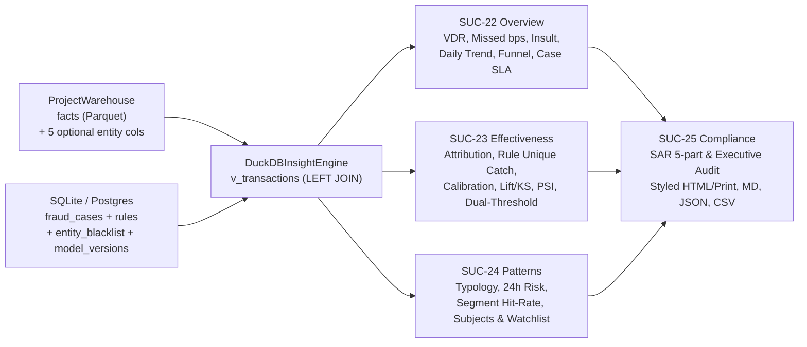
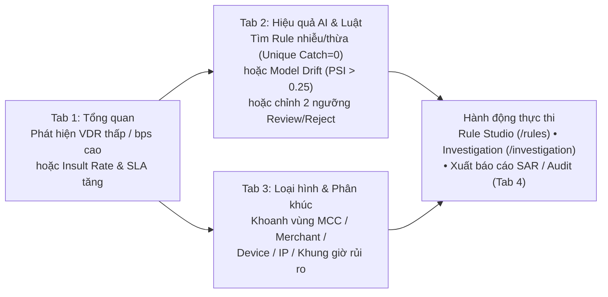

# Plan: Nâng cấp Phân hệ Insight & Report theo chuẩn nghiệp vụ FDS (tham khảo Jube)

> **Task ID:** `insight_report_fds_upgrade` · **Issues:** ISS-046 · **Spec:** `docs/features/insight_report/suc-spec.md` (SUC-22..25, đã đồng bộ 26-11-27)
> **Conflict verdict:** `PARALLEL-SAFE` · **Status:** Approved (26-11-27)

## 1. Context (facts)
- **Sai lệch công thức nghiệp vụ hiện tại trong `DuckDBInsightEngine` (`usfds-core/src/usfds_core/services/insight_report/engine.py`):**
  - `insult_rate` (`engine.py:480`) đang tính `fp_count / max(1, flagged_count)` (thực chất là False Discovery Rate trên tập bị gắn cờ, kể cả ca `pending`) thay vì Customer Insult Rate / False Decline Rate trên giao dịch hợp lệ (`FP / (FP + TN)`). `volume_insult_rate` (`engine.py:481`) có tính nhưng `ExecutiveOverviewTab.tsx` không hiển thị.
  - `verified_fpr` của Rule Leaderboard (`engine.py:809`) tính `fp / ver_cnt` (`= 1 - verified_precision`, tức False Alert Rate / FDR) nhưng gọi tên là `FPR`.
  - Thiếu hoàn toàn nhóm chỉ số **Gian lận lọt lưới (False Negatives)**: `Missed Fraud ($)`, `Value Detection Rate (VDR)`, `Net Fraud Loss (bps)` dù `v_transactions` đã có `effective_label = 1` với `is_flagged = 0`.
  - `REJECT` (Auto-Decline) và `REVIEW` (Manual Review) bị gộp chung vào `is_flagged = 1` (`engine.py:438-441`), không tách riêng tác động chặn nhầm (Hard False Decline) và ma sát xem xét (Soft Friction).
  - Phễu 4 tầng (`engine.py:530-548`) không nhất quán: Stage 3 đếm `total_cases` từ `fraud_cases` còn Stage 4 đếm `evaluated_alerts` trên toàn bộ `v_transactions` (khi bật Dataset Fallback, Stage 4 có thể lớn hơn Stage 3).
  - `score_calibration` (`engine.py:831-859`) đếm mọi giao dịch `effective_label = 0` ở bin thấp (`0.0–0.1`, tức True Negative) vào field `false_positive_count` và UI (`EffectivenessTab.tsx:320`) gắn nhãn là "Giao dịch dương tính giả".
  - `threshold_simulator` (`engine.py:861-913`) chỉ có 1 ngưỡng đơn, so sánh `sim_fp` (Model-only) với `baseline_fp` (Hybrid `is_flagged = 1`), và UI không hiển thị số tiền (`$`) hay lợi ích ròng (`Net Savings`).
  - `financial_trends` (`engine.py:551-582`) nhóm theo `job_id` thay vì theo ngày giao dịch (`tx_timestamp`) và gán nhãn `flagged_count / scanned_count` là `fraud_rate`.
  - `hourly_distribution` (`engine.py:991`) trộn 2 công thức khác nhau trên cùng trục: `(frd_tx if frd_tx > 0 else flg_tx) / max(1, tot_tx)`.
  - `top_flagged_subjects` (`engine.py:1064-1079`) lọc `WHERE is_flagged = 1` nên `total_tx_count` luôn bằng `flagged_tx_count`.
- **Dữ liệu có sẵn trong hệ thống nhưng chưa khai thác:**
  - `ProjectWarehouse` (`usfds-core/src/usfds_core/services/warehouse/project_warehouse.py:35-41`) đã chuẩn hóa sẵn 5 cột thực thể mở rộng (`device_id`, `ip_address`, `card_id`, `merchant_id`, `merchant_category`) vào bảng `facts`, nhưng `engine.py` chỉ query `user_id`.
  - `Case` (`usfds-core/src/usfds_core/domain/entities/case.py:54-64`) đã có `created_at`, `resolved_at`, `resolved_by`, `priority` nhưng chưa tính SLA / MTTR / Backlog Aging / Analyst Consistency.
  - `ModelVersionRepository` đã có sẵn provider `get_model_version_repo` (`usfds-server/src/usfds_server/providers/repos.py:66-67`) nhưng `InsightReportService` chưa inject để hiển thị tên/phiên bản mô hình khi so sánh.
- **Vấn đề UI & Export:**
  - `ReportScopeToolbar.tsx` cố ý lọc theo khoảng thời gian giao dịch (`tx_timestamp`) không có job picker (`ReportScopeToolbar.test.tsx:24`) — cần giữ nguyên nguyên tắc này.
  - `EffectivenessTab.tsx:111,142,289` và `ComplianceReportCenterTab.tsx:310,313` hardcode tên `"XGBoost"` dù hệ thống hỗ trợ đa mô hình/plugin; còn sót nhiều chuỗi tiếng Anh chưa đồng bộ tiếng Việt.
  - `report_builder.py:503-519` xuất HTML bằng cách bọc Markdown thô trong thẻ `<pre>` nên nút "In / lưu PDF" không ra bố cục báo cáo chuẩn.

## 2. Goal, scope verdict & non-goals
- **Goal:** Sửa toàn bộ sai lệch công thức thống kê/FDS trong phân hệ Insight & Report, bổ sung các nhóm chỉ số FDS thực tế (tham khảo chuẩn Jube: Missed Fraud / VDR / bps, Case SLA & MTTR, Calibration Reliability + Lift/Top-K + KS, Dual-Threshold & Cost-Aware Simulator, Rule Unique Catch + FP/FN Samples, Segment Alert Hit-Rate, Model Comparison & PSI Drift), và tái tổ chức giao diện 4 tab kèm tooltip giải thích từng metric bằng tiếng Việt dễ hiểu.
- **Scope:** `OK` — Tất cả nằm gọn trong 1 phân hệ (`insight_report`), không đổi DB schema, không chạm hot-spot files, thực hiện tuần tự qua 3 milestone (`core → server+worker → web`).
- **Non-goals / omitted:**
  - Không làm Self-Service SQL Builder cho user tự gõ SQL (như `VisualisationRegistry` của Jube) vì vượt phạm vi và tăng bề mặt bảo mật.
  - Không làm Survival Analysis (Kaplan-Meier / Cox) hay luồng ingest Chargeback/Dispute trễ 30–90 ngày (sẽ ghi chú rõ trong UI khi chế độ `VERIFIED_ONLY` không có nhãn cho giao dịch không bị gắn cờ).
  - Không lưu Report Snapshot vào DB mới (không cần Alembic migration trong task này).
  - Không thêm lại Job Picker vào `ReportScopeToolbar` (giữ nguyên quyết định kiến trúc của `ISS-012` và test `ReportScopeToolbar.test.tsx`).
- **Assumptions:**
  - Mọi trường cũ đang có trong API payload sẽ giữ nguyên hoặc giữ alias tương thích ngược (trừ sửa đúng giá trị/công thức bị sai như `insult_rate`, `funnel` stage 4, `hourly_distribution.fraud_rate`) và đồng bộ hóa TypeScript + Vitest trong cùng task.
  - Chi phí mặc định trong Threshold Simulator (`review_cost = $5/case`, `false_decline_cost_ratio = 0.15`) là tham số do user tùy chỉnh trực tiếp trên client từ đường cong đã tính sẵn, không cần lưu DB.
  - Các ngưỡng nghiệp vụ đã chốt: cờ `Mẫu nhỏ (is_small_sample)` áp dụng khi `verified_cases < 30` (hoặc `n < 30`); ngưỡng SLA mặc định là `CRITICAL ≤ 4h`, `HIGH ≤ 24h`, `MEDIUM ≤ 72h` (`LOW` không áp SLA cứng); và Dual-Threshold Simulator hiển thị song song cả 2 chế độ **Kết hợp AI + Luật (Hybrid)** và **Chỉ AI (Model-only)**.

## 2.5 Design & Approach (user reviews this section)

### Diagram(s)

#### 1. Luồng dữ liệu phân tích OLAP (ProjectWarehouse → DuckDB → 4 Tab)

#### 2. Quy trình tối ưu chính sách trên UI (Đọc hiểu & Ra quyết định)

### Bảng Từ điển Metrics (Ý nghĩa, Công thức & Ngưỡng đọc hiểu thực tế)

| Nhóm | Metric (Tiếng Việt / Tiếng Anh) | Công thức tính từ dữ liệu USFDS | Ý nghĩa nghiệp vụ & Ví dụ dễ hiểu | Ngưỡng tham khảo thực tế |
|---|---|---|---|---|
| **Bảo vệ & Lọt lưới (Tab 1)** | **Tỷ lệ Bắt Theo Giá trị (`VDR` — Value Detection Rate)** | `Prevented $ / (Prevented $ + Missed Fraud $)` | Trong 100 đồng gian lận xảy ra, hệ thống chặn được bao nhiêu đồng. Quan trọng hơn Recall theo số ca vì 1 ca \$5,000 lớn hơn 100 ca \$5. | Tốt: `≥ 75–85%` |
| **Bảo vệ & Lọt lưới (Tab 1)** | **Gian lận Lọt lưới (`Missed Fraud $`) & `Net Fraud Loss (bps)`** | `Missed $ = SUM(amount)` với `is_flagged=0, label=1`; `bps = (Missed $ / Gross $) * 10,000` | Số tiền gian lận lọt qua hệ thống. `1 bps = 0.01%`. Ví dụ Gross \$1,000,000, lọt \$500 → `5 bps`. | Chuẩn ngành thẻ: `< 5–10 bps` |
| **Ma sát Khách hàng (Tab 1)** | **Tỷ lệ Làm phiền Khách hàng (`Customer Insult Rate`)** | `FP / (TN + FP)` (tách riêng `Hard False Decline` từ `REJECT` và `Soft Friction` từ `REVIEW`) | Cứ 10.000 giao dịch của **khách thật**, có bao nhiêu bị chặn/hỏi nhầm. Chặn nhầm (`REJECT`) gây mất khách nặng hơn đẩy `REVIEW`. | Hard Decline tốt: `< 0.5–1%` (`< 50–100 bps`) |
| **Hiệu quả Cảnh báo (Tab 1)** | **Độ chính xác (`Verified Precision`) & `Alert:Fraud Ratio`** | `Precision = TP / (TP + FP)`; `Ratio = (TP + FP) / TP` | `Ratio = 3 : 1` nghĩa là analyst duyệt 3 cảnh báo thì 1 là gian lận thật, 2 là báo giả. Càng gần `1 : 1` hàng đợi càng sạch. | Thực tế thẻ: `2:1` đến `5:1` (`Precision 20–50%`) |
| **Vận hành Điều tra (Tab 1)** | **Thời gian Xử lý Trung vị (`MTTR P50 / P90`) & `Backlog Aging`** | Trung vị & P90 của `(resolved_at - created_at)` (giờ); đếm case mở theo `<4h, 4–24h, 1–3d, >3d`; SLA `CRITICAL ≤ 4h`, `HIGH ≤ 24h`, `MEDIUM ≤ 72h` | Đo tốc độ đội điều tra và phát hiện hồ sơ `CRITICAL/HIGH/MEDIUM` bị "ngâm" quá hạn SLA. | Critical `≤ 4h`, High `≤ 24h`, Medium `≤ 72h` |
| **Hiệu quả Luật (Tab 2)** | **Tỷ lệ Báo giả (`FAR` — False Alert Rate)** | `FP / (TP + FP)` (`= 1 - Precision`) | Đổi tên đúng từ `Verified FPR`. Nếu `FAR = 80%`, cứ 10 lần luật nổ thì 8 lần là oan khách → cần chỉnh ngưỡng hoặc tắt. | `≥ 70%` → gắn nhãn `NOISY` |
| **Hiệu quả Luật (Tab 2)** | **Bắt Độc nhất (`Unique Catch $ & số ca`)** | Gian lận có **chỉ đúng luật này** match (`len(rules)==1` và `has_ai_hit=0`) | Nếu 1 luật bắt \$10,000 nhưng `Unique Catch = $0` → luật đó trùng hoàn toàn với AI/luật khác, có thể tắt để giảm báo giả mà không lọt gian lận. | `Unique = 0` + `FP cao` → ứng viên tắt |
| **Hiệu quả Luật (Tab 2)** | **Cờ `Mẫu nhỏ (Small Sample)`** | `verified_cases < 30` (học từ Jube) | Cảnh báo số mẫu quá ít (ví dụ mới nổ 3 lần, trúng 3 → Precision 100% nhưng chưa đủ tin cậy thống kê). | `< 30` ca xác minh |
| **Chất lượng Mô hình AI (Tab 2)** | **Hiệu chỉnh Xác suất (`Calibration Curve`, `Brier Score`, `ECE`)** | So sánh `Mean Predicted Score` vs `Observed Fraud Rate` theo 10 bin (`Equal-Width` & `Equal-Count`); `Brier = mean((p - y)^2)` | Nếu model chấm `0.80` thì thực tế ~80% nhóm đó phải là gian lận. `Mean Pred > Observed` = model quá tự tin (*Over-confident*). `Brier` càng gần `0` càng tốt. | `ECE < 0.05`, đường thực nghiệm bám sát `y = x` |
| **Chất lượng Mô hình AI (Tab 2)** | **Đường cong Bắt Top-K (`Lift / Cumulative Gain`) & `KS Statistic`** | Xếp hạng giao dịch theo `model_score` giảm dần; đo `% Fraud $` ở Top `1%, 2%, 5%, 10%, 20%`; `KS = max|CDF_fraud - CDF_legit|` | Trả lời: *"Đội điều tra chỉ đủ sức xem 5% giao dịch điểm cao nhất thì bắt được bao nhiêu % tiền gian lận?"* `KS` đo độ tách biệt giữa nhóm gian lận & hợp lệ. | `KS`: `0.2–0.4` đạt, `> 0.4` tốt (`> 0.7` cẩn thận leakage) |
| **Giám sát Trôi Mô hình (Tab 2)** | **Chỉ số Ổn định Điểm (`PSI` — Population Stability Index)** | $\sum (p_{\text{cur},i} - p_{\text{base},i}) \ln(p_{\text{cur},i} / p_{\text{base},i})$ trên 10 bin điểm (baseline = nửa đầu / đợt đầu, current = nửa sau / đợt mới nhất) | Đo xem phân phối điểm AI gần đây có bị "lệch" so với giai đoạn chuẩn không (do hành vi kẻ gian đổi kiểu hoặc lỗi pipeline dữ liệu). | `< 0.10` Ổn định · `0.10–0.25` Cảnh báo · `> 0.25` Cần retrain |
| **Tối ưu Ngưỡng (Tab 2)** | **Ngưỡng Kép (`τ_review`, `τ_reject`) & `Net Savings ($)`** | `Prevented $ - (Review_count * review_cost) - (Hard_FP $ * false_decline_weight)` | FDS thực tế chia 3 vùng: `< τ_review` (Cho qua), `[τ_review, τ_reject)` (Đẩy duyệt tay), `≥ τ_reject` (Chặn tự động). Hỗ trợ gợi ý tự động theo: **Sức tải duyệt (Top-K)**, **Precision mục tiêu**, hoặc **Tối đa hóa Lợi ích Ròng**. | Chọn điểm tối đa hóa `Net Savings` trong giới hạn nhân sự |
| **Phân khúc Rủi ro (Tab 3)** | **Ma trận Phân khúc (`Segment Hit-Rate`: MCC, Merchant, Device, IP, Card, Amount)** | Với mỗi giá trị phân khúc: `Alert Rate`, `Hit Rate (Precision)`, `Detection Rate (Recall)`, `Missed Fraud $`, `Lift = seg_fraud_rate / overall_fraud_rate` | Tìm phân khúc có `Lift > 2x` (ổ gian lận) hoặc `Hit Rate` rất thấp (ổ báo động giả) để viết luật riêng hoặc gắn danh sách theo dõi. | `Lift ≥ 2.0×` → điểm nóng rủi ro |

### Tổ chức Hiển thị & Bố cục Biểu đồ theo 4 Tab (UI/UX Layout)

Tuân thủ `docs/design-system.md` (Dark Mode OLED, Dual-Encoding icon + badge, `font-mono tabular-nums`, 100% tiếng Việt, kèm component `MetricInfoTooltip` cạnh tiêu đề mỗi KPI/Chart để người dùng mới hiểu ngay công thức & ý nghĩa):

1. **Tab 1 — Tổng quan điều hành (`ExecutiveOverviewTab.tsx`):**
   - **Hàng 1 (6 KPI Cards — lưới 3×2):** (1) Tổng khối lượng quét · (2) Gian lận đã ngăn chặn (`$` + `VDR %`) · (3) Gian lận lọt lưới (`Missed $` + `Net Fraud Loss bps`, ẩn số `0` giả ở chế độ `VERIFIED_ONLY`) · (4) Ma sát khách hàng (`Customer Insult Rate` + tách `Hard Decline $` vs `Soft Review $`) · (5) Hiệu quả cảnh báo (`Verified Precision %` + `Alert:Fraud`) · (6) Vận hành điều tra (`% Đã xử lý` + `MTTR P50` + tồn đọng `Critical/High`).
   - **Hàng 2 (Full-width — `ComposedChart`):** *Xu hướng bảo vệ, lọt lưới & ma sát theo thời gian giao dịch* (Trục X: ngày/tuần theo `tx_timestamp`; Cột trái: `Ngăn chặn ($)` Emerald, `Lọt lưới ($)` Rose, `Ma sát FP ($)` Amber; Đường phải: `Tỷ lệ cảnh báo (%)` Sky).
   - **Hàng 3 (Lưới 7:5):** Trái = *Phễu chuyển đổi 4 tầng nhất quán* (`Scanned → Flagged [REJECT/REVIEW] → Dispatched Cases → Resolved Cases`, luôn đơn điệu giảm); Phải = *Hàng đợi điều tra & SLA* (Trạng thái + Mức ưu tiên + Thanh **Tuổi hồ sơ tồn đọng `Backlog Aging`** + Bảng thu gọn **Hiệu suất theo Điều tra viên**).

2. **Tab 2 — Hiệu quả mô hình & luật (`EffectivenessTab.tsx`):**
   - **Hàng 1 (Full-width):** *Phân bổ bắt gian lận AI vs. Luật* (bỏ chữ `XGBoost`) + **Dải Sức khỏe Mô hình (`Model Health Strip`)**: `KS Statistic`, `Brier Score`, `ECE`, và `Score Drift (PSI)` kèm badge màu chuẩn.
   - **Hàng 2 (Full-width):** *Bảng xếp hạng Tập luật* (bổ sung `FAR %`, `Unique Catch ($ & số ca)`, cờ `Mẫu nhỏ (n < 30)`) + **Drawer/Collapse Xem nhanh Mẫu Sai sót** (Top 5 giao dịch FP của từng luật + Top 5 giao dịch Gian lận Lọt lưới FN của hệ thống, có nút mở nhanh sang Investigation nếu có case).
   - **Hàng 3 (Lưới 6:6):**
     - Trái = *Đường cong Hiệu chỉnh Xác suất (`Calibration Reliability Curve`)* (`ComposedChart`: Đường chéo lý tưởng `y=x` nét đứt + Đường `Observed Fraud Rate` thực nghiệm + Cột mờ nền số lượng mẫu; có nút chuyển `Uniform` / `Decile Equal-Count`).
     - Phải = *Đường cong Bắt Gian lận Top-K (`Cumulative Gain / Lift`)* (`LineChart`: `% Fraud $` & `% Fraud Count` theo Top `1%..100%` điểm cao nhất + bảng tóm tắt nhanh Top 1% / 5% / 10%).
   - **Hàng 4 (Full-width):** *Bộ Mô phỏng Ngưỡng Kép (`Dual-Threshold & Cost-Aware Simulator`)* — 2 thanh trượt `τ_review` & `τ_reject`, **hiển thị song song cả 2 cột/chế độ Kết hợp AI + Luật (Hybrid) và Chỉ AI (Model-only) tại cùng cặp ngưỡng `(τ_review, τ_reject)`**, 3 nút gợi ý tự động (`Sức tải duyệt`, `Precision mục tiêu`, `Tối ưu Lợi ích ròng`) áp dụng được cho từng chế độ, ô nhập `Chi phí duyệt/ca ($)` & `Trọng số chặn nhầm (%)`, hiển thị 4 ô kết quả cho mỗi chế độ (`Gian lận bắt được $ & VDR`, `Hàng đợi REVIEW`, `Chặn nhầm REJECT $`, `Lợi ích ròng Net Savings $`) + banner cảnh báo selection bias khi đang ở `VERIFIED_ONLY`.
   - **Hàng 5 (Full-width — 2 cột 7:5):** Trái = *Bảng So sánh Phiên bản Mô hình (`Model Version Comparison`)* (hiển thị khi có ≥ 1 model version); Phải = *Biểu đồ Phân rã Drift Điểm (`PSI Bin Breakdown`)* so sánh Baseline vs Current theo 10 khoảng điểm.

3. **Tab 3 — Loại hình, thời gian & phân khúc (`TypologiesPatternsTab.tsx`):**
   - **Hàng 1 (Lưới 6:6):** *Loại hình gian lận đã xác nhận* vs *Nguyên nhân gốc dương tính giả* (giữ thiết kế hiện tại, đồng bộ 100% tiếng Việt).
   - **Hàng 2 (Full-width — `ComposedChart`):** *Hồ sơ rủi ro 24 giờ (UTC)* — sửa nhất quán: Cột = Tổng GD; Đường 1 (Rose) = `Tỷ lệ gian lận thực tế (%)`; Đường 2 (Amber nét đứt) = `Tỷ lệ bị gắn cờ (%)`.
   - **Hàng 3 (Full-width):** *Ma trận Rủi ro & Hiệu quả theo Phân khúc (`Segment Alert Hit-Rate`)* — thanh pills chọn chiều: `Khoảng số tiền` | `Ngành hàng (MCC)` | `Merchant` | `Thiết bị` | `Địa chỉ IP` | `Thẻ`, hiển thị bảng thống nhất (`Tổng GD`, `Alert Rate`, `Hit Rate`, `Detection Rate`, `Lọt lưới $`, `Lift`, cờ `Mẫu nhỏ`).
   - **Hàng 4 (Lưới 7:5):** Trái = *Top Đối tượng rủi ro (`user_id`)* (sửa `total_tx_count` đếm tổng giao dịch thật của user + `% gian lận`); Phải = *Tác động Danh sách đen (`Watchlist Impact`)* (số thực thể Active/Removed + số GD & `$` liên quan tới thực thể bị blacklist).

4. **Tab 4 — Trung tâm tuân thủ & SAR (`ComplianceReportCenterTab.tsx`):**
   - Cập nhật preview & export của **Executive Audit Report** đầy đủ các chỉ số mới (VDR, Missed Fraud bps, Insult Rate, Case MTTR, Unique Catch, KS/Brier/PSI, Segment Risk).
   - Render HTML xuất bản/in PDF bằng template HTML có bảng biểu, KPI cards, `@media print` chuẩn A4 (không bọc `<pre>`). Bỏ chữ `XGBoost` hardcode.

### Key decisions & contracts
| Area | Decision / Contract | Rationale / Notes |
|---|---|---|
| API / RBAC | Giữ nguyên 6 endpoints `/api/v1/reports/{overview,effectiveness,patterns,sar/{case_id},executive-summary,export}` và permissions hiện tại (`report:read`, `report:create`, `report:export` theo `PROJECT` scope). Chỉ **mở rộng JSON response** của `/overview`, `/effectiveness`, `/patterns`, `/executive-summary`. | Không phá vỡ RBAC, không cần route mới hay worker job type mới (`JOB_INSIGHT_REPORT` dùng lại nguyên vẹn). |
| Data / Schema | **Không thay đổi DB schema** (`C3: No`). Tận dụng các cột sẵn có trong `ProjectWarehouse` (`facts`: `tx_timestamp`, `device_id`, `ip_address`, `card_id`, `merchant_id`, `merchant_category`, `model_version_id`) và `fraud_cases` (`created_at`, `resolved_at`, `resolved_by`, `priority`). | Đúng Execution Ladder, zero migration risk. |
| Service DI | Inject thêm optional `model_version_repo` và `model_repo` vào `InsightReportService` (`providers/insight.py` và `usfds-worker/src/usfds_worker/handlers.py`) để gắn nhãn phiên bản mô hình (`ModelName v1.2`) thay vì hiển thị UUID thô hoặc hardcode `"XGBoost"`. | Fallback an toàn về chuỗi UUID rút gọn nếu repo là `None` (không làm gãy unit test cũ). |
| Config / Env | `—` | Không thêm biến môi trường mới. |

### Edge cases, concurrency & failure handling
- **Chế độ `VERIFIED_ONLY` không có nhãn cho giao dịch `is_flagged = 0`:** Các chỉ số cần FN (`missed_fraud_amount`, `missed_fraud_count`, `value_detection_rate`, `net_fraud_loss_bps`) và TN (`customer_insult_rate`) trả `null` kèm cờ `ground_truth_coverage = "FLAGGED_ONLY"` thay vì trả `0` giả tạo; UI hiển thị `—` kèm tooltip giải thích.
- **Tập dữ liệu không có cột thực thể mở rộng (`merchant_category`, `device_id`, ...):** Mỗi chiều trong `segment_analytics` trả `available: false` và mảng rỗng nếu 100% giá trị là NULL/rỗng; UI vẫn hiển thị tab `Khoảng số tiền` mặc định và làm mờ các chiều chưa có dữ liệu.
- **Tính PSI khi mẫu quá nhỏ hoặc chỉ có 1 đợt / 1 ngày:** Nếu tổng giao dịch `< 20` hoặc không tách được 2 giai đoạn (baseline vs current mỗi bên `< 10` giao dịch), trả `psi: null`, `status: "INSUFFICIENT_DATA"`; chia bin có sàn `share_floor = 0.0001` (như Jube) để tránh `log(0)`.
- **Dataset không có `tx_timestamp` hợp lệ:** `financial_trends` tự động fallback về group theo `job_id` kèm `granularity: "JOB"`, thay vì lỗi SQL hoặc gom hết vào 1 điểm NULL.
- **Tương thích ngược `verified_fpr`:** Trong `rule_leaderboard`, trả cả `false_alert_rate` (tên chuẩn mới) lẫn `verified_fpr` (alias giá trị cũ trong 1 bản phát hành) để không làm vỡ consumer/test ngoài ý muốn, còn UI hiển thị nhãn chuẩn `Tỷ lệ báo giả (FAR)`.
- **Tải lớn trong DuckDB:** Toàn bộ aggregation mới (Unique Catch, Segment Hit-Rate, Calibration bins, Decile Lift/Gain, PSI, Dual-Threshold curve cho cả Hybrid & Model-only, Top FP/FN samples) chạy bằng SQL trực tiếp trong DuckDB in-memory có giới hạn RAM/CPU (`create_bounded_duckdb_connection`), không kéo toàn bảng về Python loop.

## 3. Files
| Action | File | Milestone | Note |
|---|---|---|---|
| modify | `usfds-core/src/usfds_core/services/insight_report/engine.py` | M1 | Sửa công thức KPI/Funnel/24h/TopSubjects; thêm Missed Fraud/VDR/bps, Case SLA/MTTR/Aging/Analyst, Rule Unique Catch + FP/FN Samples, Calibration/Brier/ECE, Lift/Gain/KS, Dual-Threshold Simulator (Hybrid & Model-only), Model Comparison, PSI Drift, Segment Hit-Rate |
| modify | `usfds-core/src/usfds_core/services/insight_report/service.py` | M1 | Nhận optional `model_version_repo` & `model_repo` để resolve tên/phiên bản model; truyền vào engine |
| modify | `usfds-core/src/usfds_core/services/insight_report/report_builder.py` | M1 | Cập nhật Executive Audit Report với KPI mới; nâng cấp HTML export thành báo cáo chuẩn bảng biểu + `@media print` |
| modify | `usfds-core/tests/test_insight_report_service.py` | M1 | Bổ sung acceptance tests M1 (red → green) |
| modify | `usfds-server/src/usfds_server/providers/insight.py` | M2 | Wire `get_model_version_repo` & `get_model_repo` vào `InsightReportService` |
| modify | `usfds-worker/src/usfds_worker/handlers.py` | M2 | Wire `SqliteModelVersionRepository` & `SqliteModelRepository` trong `handle_insight_report` |
| modify | `usfds-server/tests/test_insight_report_api.py` | M2 | Bổ sung API integration tests M2 |
| modify | `usfds-web/src/types/insightReport.ts` | M3 | Mở rộng TypeScript types cho toàn bộ metrics & charts mới |
| create | `usfds-web/src/components/modules/reports/MetricInfoTooltip.tsx` | M3 | Component tooltip chuẩn hóa giải thích công thức & ý nghĩa từng metric bằng tiếng Việt |
| modify | `usfds-web/src/components/modules/reports/ExecutiveOverviewTab.tsx` | M3 | Tái tổ chức 6 KPI mới, Daily Trend, Funnel chuẩn, Case SLA/Aging/Analyst |
| modify | `usfds-web/src/components/modules/reports/EffectivenessTab.tsx` | M3 | Model Health Strip (KS/Brier/ECE/PSI), Rule Unique Catch + SmallSample + FP/FN Samples, Calibration Reliability Curve, Top-K Lift/Gain, Dual-Threshold Cost-Aware Simulator (song song Hybrid & Model-only), Model Comparison & PSI |
| modify | `usfds-web/src/components/modules/reports/TypologiesPatternsTab.tsx` | M3 | Sửa biểu đồ 24h 2 đường tách biệt, thêm bảng Segment Alert Hit-Rate đa chiều, sửa Top Subjects & Watchlist Impact |
| modify | `usfds-web/src/components/modules/reports/ComplianceReportCenterTab.tsx` | M3 | Bỏ hardcode XGBoost, cập nhật preview Executive Audit mới, nút In/PDF mở HTML đã định dạng đẹp |
| create | `usfds-web/src/components/modules/reports/InsightReportTabs.test.tsx` | M3 | Vitest + MSW test render các KPI/Chart/Tooltip mới và chế độ `VERIFIED_ONLY` |

## 4. Dependencies & conflicts (with other tasks on BOARD)
| # | Check | Answer |
|---|---|---|
| D1 | Needs unfinished task? | No (tất cả task trên `.plan/BOARD.md` đều `Done`) |
| D2 | Needed by unfinished task? | No |
| C1 | Modified files owned by in-progress task? | No (không có task nào đang `In progress`) |
| C2 | Hot-spot files touched | `—` (`providers/insight.py` và `handlers.py` không nằm trong danh sách hot-spot; `providers/repos.py` đã có sẵn `get_model_version_repo` và `get_model_repo`) |
| C3 | Schema change | No |
| C4 | Public contract change | Yes: mở rộng JSON payload của `/api/v1/reports/{overview,effectiveness,patterns,executive-summary}` và sửa ngữ nghĩa `insult_rate` / `funnel[3]` / `hourly_distribution.fraud_rate` → consumer duy nhất: `usfds-web/src/api/insightReportApi.ts` + `usfds-web/src/components/modules/reports/*` (cập nhật đồng bộ trong M3) |
| C5 | Shared UI shell change | No (`App.tsx`, `Sidebar.tsx`, `client.ts` không sửa) |

## 5. Acceptance tests (user reviews this section)
| Milestone | Test | Given | When | Then | Covers |
|---|---|---|---|---|---|
| M1 | `test_overview_missed_fraud_vdr_bps_and_insult_rate_separation` (`usfds-core/tests/test_insight_report_service.py`) | Project có 100 GD gồm TP (`REJECT` & `REVIEW`), FN (lọt lưới), FP (`REJECT` & `REVIEW`), TN với nhãn dataset | Gọi `get_executive_overview(VERIFIED_WITH_DATASET_FALLBACK)` | `missed_fraud_amount` = tổng FN `$`; `value_detection_rate` = `TP$ / (TP$ + FN$)`; `net_fraud_loss_bps` = `(FN$ / Gross$) * 10000`; `customer_insult_rate` = `FP / (TN + FP)` (không phải `FP / Flagged`); tách đúng `hard_false_decline_amount` (`REJECT`) và `soft_review_friction_amount` (`REVIEW`) | SUC-22, ISS-046 |
| M1 | `test_overview_verified_only_returns_null_for_fn_tn_metrics_and_monotonic_funnel` (`usfds-core/tests/test_insight_report_service.py`) | 100 GD (10 flagged, 4 case tạo ra, 2 case đã đóng) và dataset có sẵn cột `label` | Gọi `get_executive_overview(VERIFIED_ONLY)` | `missed_fraud_amount`, `value_detection_rate`, `net_fraud_loss_bps`, `customer_insult_rate` là `None` (`ground_truth_coverage == "FLAGGED_ONLY"`); phễu 4 tầng đơn điệu giảm (`100 >= 10 >= 4 >= 2`) | SUC-22, BR-IR-02, BR-IR-04 |
| M1 | `test_overview_case_sla_mttr_aging_and_daily_trends` (`usfds-core/tests/test_insight_report_service.py`) | Các case (`CRITICAL`, `HIGH`, `MEDIUM`) có `created_at`/`resolved_at` chênh 2h, 6h, 30h, 80h, nhiều `resolved_by`, cùng giao dịch trải dài 3 ngày khác nhau | Gọi `get_executive_overview` | Trả đúng `mttr_p50_hours`, `mttr_p90_hours`, `aging_buckets`, `analyst_stats` theo `resolved_by`, và `sla_breach_count` / `sla_breach_rate` theo ngưỡng `CRITICAL ≤ 4h`, `HIGH ≤ 24h`, `MEDIUM ≤ 72h`; `financial_trends` có `granularity == "DAY"` gồm 3 ngày theo `tx_timestamp` | SUC-22, BR-IR-05, ISS-046 |
| M1 | `test_effectiveness_rule_unique_catch_far_small_sample_and_fp_fn_samples` (`usfds-core/tests/test_insight_report_service.py`) | 2 luật: `R_UNIQUE` bắt độc nhất 1 ca fraud không trùng AI/luật khác; `R_REDUNDANT` trùng hoàn toàn với AI và gây thêm 3 FP (`< 30` ca xác minh) | Gọi `get_effectiveness_analysis` | `R_UNIQUE` có `unique_catch_count == 1`, `unique_catch_amount > 0`; `R_REDUNDANT` có `unique_catch_count == 0`, `false_alert_rate == FP/(TP+FP)`, `is_small_sample == True`; có danh sách `fp_samples` theo rule và `fn_samples` toàn hệ thống | SUC-23, BR-IR-04, ISS-046 |
| M1 | `test_effectiveness_calibration_lift_ks_psi_and_dual_threshold_simulator` (`usfds-core/tests/test_insight_report_service.py`) | 60 GD có nhãn 0/1 trải 2 giai đoạn với phân phối `model_score` dịch chuyển rõ ở giai đoạn sau | Gọi `get_effectiveness_analysis` | `score_calibration` trả `mean_predicted_score` & `observed_fraud_rate` (không gán TN là FP), có cả chế độ `equal_width` & `equal_count`, `brier_score`, `ece`, `ks_statistic`; `lift_gain_curve` có các mốc Top-K; `score_drift.psi > 0.25` (`status == "SIGNIFICANT_SHIFT"`); `threshold_simulator` trả đường cong nhất quán cho cả `hybrid` và `model_only` + gợi ý tối ưu | SUC-23, ISS-046 |
| M1 | `test_patterns_consistent_24h_segments_true_user_totals_and_watchlist_impact` (`usfds-core/tests/test_insight_report_service.py`) | Tập GD có `merchant_category`, `device_id`, `ip_address`, user `U1` có 5 GD (2 bị flag, 3 hợp lệ), `U1` nằm trong `EntityBlacklist(ACTIVE)` | Gọi `get_typology_and_patterns` | Biểu đồ 24h tách riêng `confirmed_fraud_rate` và `flagged_rate`; `segment_analytics` có đủ `amount_brackets` + `merchant_category` + `device_id` với `alert_rate`, `hit_rate`, `detection_rate`, `missed_fraud_amount`, `lift`, `is_small_sample`; `top_flagged_subjects` báo `U1.total_tx_count == 5` (không phải 2); `watchlist_summary` có `matched_tx_count` & `matched_amount` | SUC-24, BR-IR-04, ISS-046 |
| M1 | `test_compliance_html_export_renders_structured_report_without_raw_pre` (`usfds-core/tests/test_insight_report_service.py`) | Project có dữ liệu overview + case đã đóng | Gọi `export_report(..., file_format="html")` cho cả `sar` và `executive` | HTML chứa `<table>`, `@media print`, các chỉ số mới (`VDR`, `Missed Fraud`, `PSI`) và không chỉ bọc raw markdown trong `<pre>` | SUC-25, BR-IR-03, ISS-046 |
| M2 | `test_api_reports_return_upgraded_payload_and_model_labels` (`usfds-server/tests/test_insight_report_api.py`) | DB test có `Model`, `ModelVersion`, `DetectionJob`, `Case` | Gọi `GET /api/v1/reports/overview`, `/effectiveness`, `/patterns`, `/executive-summary`, `/export?file_format=html` | HTTP 200; response chứa đủ các khóa mới (`case_sla`, `score_drift`, `lift_gain_curve`, `segment_analytics`, `model_comparison` có tên model thật); tuân thủ cô lập `project_id` và RBAC | SUC-22..25, BR-IR-01, ISS-046 |
| M3 | `test_report_tabs_render_metrics_tooltips_and_verified_only_guard` (`usfds-web/src/components/modules/reports/InsightReportTabs.test.tsx`) | Mock API trả payload mới cho 4 tab (gồm cả case `VERIFIED_ONLY` trả `null` cho FN/TN metrics) | Render từng tab, kiểm tra `Dual-Threshold Simulator` (song song Hybrid & Model-only) và chuyển chiều phân khúc | Hiển thị đúng VDR/bps/Insult/MTTR/Unique Catch/Calibration/Lift/PSI, hiển thị song song Hybrid và Model-only tại cùng cặp ngưỡng, không còn chữ `"XGBoost"` hardcode, có `MetricInfoTooltip`, và `ReportScopeToolbar.test.tsx` vẫn pass | SUC-22..25, BR-IR-04, ISS-046 |

## 6. Milestones & to-do (checkpoints, not stop points: all tests green at each)

- [x] **M1 — Nâng cấp DuckDB OLAP Engine & Report Builder** (`usfds-core`): Toàn bộ công thức FDS chuẩn hóa, chỉ số mới và HTML export hoạt động chính xác với unit tests xanh.
  - [x] [tests] Viết các acceptance tests M1 trong `usfds-core/tests/test_insight_report_service.py` và xác nhận fail đúng lý do
  - [x] [core] Sửa & mở rộng `compute_executive_overview` (Missed Fraud/VDR/bps, tách REJECT vs REVIEW, Customer Insult Rate chuẩn, Funnel đơn điệu, Daily Trend theo `tx_timestamp`, Case SLA/MTTR/Aging/Analyst với ngưỡng `CRITICAL ≤ 4h`, `HIGH ≤ 24h`, `MEDIUM ≤ 72h`) trong `engine.py`
  - [x] [core] Sửa & mở rộng `compute_effectiveness_analysis` (Rule `false_alert_rate`, `unique_catch`, `is_small_sample` khi `n < 30`, `fp_samples`/`fn_samples`; Calibration `equal_width`/`equal_count` + Brier + ECE; Lift/Gain Top-K + KS; Dual-Threshold & Cost-Aware Simulator cho cả `hybrid` và `model_only`; Model Comparison + PSI Drift) trong `engine.py`
  - [x] [core] Sửa & mở rộng `compute_typology_and_patterns` (tách 24h `confirmed_fraud_rate` vs `flagged_rate`; `segment_analytics` đa chiều trên 5 cột `ProjectWarehouse` + Amount kèm `is_small_sample`; sửa `total_tx_count` của `top_flagged_subjects`; bổ sung `watchlist_summary` impact) trong `engine.py`
  - [x] [core] Cập nhật `service.py` (optional `model_version_repo`/`model_repo`) và `report_builder.py` (Executive Audit mới + HTML/Print template chuẩn)
  - [x] [verify] `./scripts/test.sh core`

- [ ] **M2 — Đồng bộ API Provider & Analytics Worker** (`usfds-server`, `usfds-worker`): Cả chế độ inline và queue worker đều trả đầy đủ metadata model & payload mới.
  - [ ] [tests] Bổ sung integration tests M2 trong `usfds-server/tests/test_insight_report_api.py`
  - [ ] [server] Cập nhật `usfds-server/src/usfds_server/providers/insight.py` để truyền `model_repo` và `model_version_repo`
  - [ ] [worker] Cập nhật `usfds-worker/src/usfds_worker/handlers.py` (`handle_insight_report`) để truyền `SqliteModelRepository` và `SqliteModelVersionRepository`
  - [ ] [verify] `./scripts/test.sh server worker`

- [ ] **M3 — Tái thiết kế 4 Tab Insight & Report + Metric Tooltips** (`usfds-web`): Giao diện 100% tiếng Việt, tổ chức mạch lạc theo quyết định nghiệp vụ, có tooltip giải thích từng metric.
  - [ ] [tests] Viết Vitest + MSW tests M3 tại `usfds-web/src/components/modules/reports/InsightReportTabs.test.tsx`
  - [ ] [web] Cập nhật `usfds-web/src/types/insightReport.ts` và tạo `MetricInfoTooltip.tsx`
  - [ ] [web] Nâng cấp `ExecutiveOverviewTab.tsx` (6 KPI mới + Daily Trend + Funnel chuẩn + Case SLA/Aging/Analyst)
  - [ ] [web] Nâng cấp `EffectivenessTab.tsx` (Model Health Strip, Rule Unique Catch + FP/FN Samples, Calibration Reliability Curve, Top-K Lift/Gain, Dual-Threshold Cost-Aware Simulator hiển thị song song Hybrid & Model-only, Model Comparison & PSI)
  - [ ] [web] Nâng cấp `TypologiesPatternsTab.tsx` (24h 2 đường tách biệt, Segment Hit-Rate Matrix đa chiều, Top Subjects & Watchlist Impact) và `ComplianceReportCenterTab.tsx` (bỏ XGBoost hardcode, mở bản in HTML/PDF chuẩn)
  - [ ] [verify] `./scripts/test.sh web` và `npm run build` (`tsc -b && vite build`)

Checkpoint log:
- 26-11-28 M1: `./scripts/test.sh core` → `197 passed, 15 skipped, 169 warnings in 14.97s` (PASS core). Toàn bộ 7 acceptance tests M1 xanh; không có sai lệch ngoài kế hoạch.

## 7. Review hotspots (filled in after implementation)
- (điền sau khi hoàn tất triển khai)

## 8. Open questions
- `—` (Đã chốt toàn bộ ngày 26-11-27: (1) Đã tạo `ISS-046` và cập nhật `docs/features/insight_report/suc-spec.md`; (2) Chốt `Small Sample` `n < 30` và SLA `CRITICAL ≤ 4h`, `HIGH ≤ 24h`, `MEDIUM ≤ 72h`; (3) Dual-Threshold Simulator hiển thị song song cả 2 chế độ **Hybrid (AI + Luật)** và **Chỉ AI (Model-only)**.)

## 9. Manual E2E verification (post-merge)
- [ ] Chạy trên dữ liệu mẫu lớn (ví dụ tập Credit Card Fraud) có cả giao dịch `ALLOW`/`REVIEW`/`REJECT`, kiểm tra thời gian phản hồi DuckDB trên `/overview`, `/effectiveness`, `/patterns` và kiểm tra chế độ `VERIFIED_ONLY` vs `VERIFIED_WITH_DATASET_FALLBACK`.
- [ ] Bấm **"In / lưu PDF"** trên Tab 4 ở trình duyệt thật (Chrome/Edge) để xác nhận bảng biểu, tiếng Việt UTF-8 và ngắt trang A4 hiển thị chuẩn.
- [ ] Kiểm tra trong chế độ `dispatch_backend=queue` (BullMQ + PostgreSQL + S3) rằng `handle_insight_report` trả đủ tên mô hình và export HTML/CSV/MD/JSON thành công.
