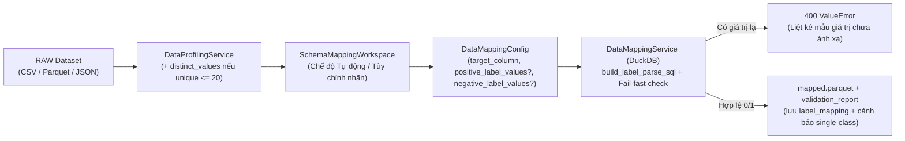
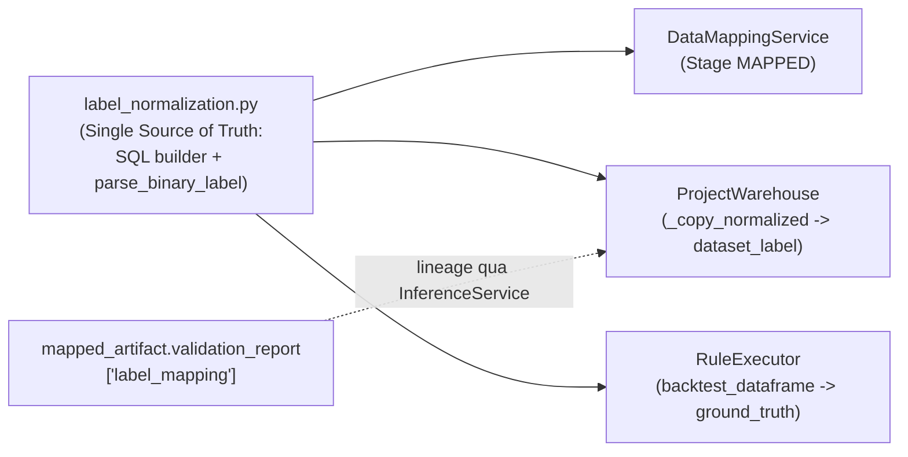

# Plan: Raw Label Value Parsing & Canonical Binary Mapping

> **Task ID:** `raw_label_parsing_and_mapping` · **Issues:** ISS-046 (chosen by the user) · **Spec:** `docs/features/data_management/user-flow-and-ui-design.md` (Màn hình 4 — Schema Mapping & Validation)
> **Conflict verdict:** PARALLEL-SAFE · **Status:** Draft

## 1. Context (facts)
- `usfds-core/src/usfds_core/services/data_management/mapping.py:276-282`: `DataMappingService` chỉ chuyển đổi cột `label` theo kiểu `BOOLEAN` hoặc `TRY_CAST(TRY_CAST(col AS DOUBLE) AS BIGINT)` rồi `COALESCE(..., 0)` và **không đưa `label` vào `ratio_checks`**. Khi file raw chứa chuỗi nhãn phổ biến (`'fraud'` / `'legit'`, `'Yes'` / `'No'`, `'true'` / `'false'` dạng chuỗi), `TRY_CAST` trả `NULL` và `COALESCE` **âm thầm biến 100% nhãn thành `0`** trong khi `validation_status` vẫn là `PASSED`. Các mã số phi nhị phân (`1`/`2`, `-1`/`1`) cũng đi thẳng vào `mapped.parquet` mà không được chuẩn hóa hay báo lỗi.
- `usfds-core/src/usfds_core/services/warehouse/project_warehouse.py:244-250`: `ProjectWarehouse._copy_normalized` chỉ làm `int(float(rec[lbl_col]))` rồi kiểm tra `in (0, 1)`; khi `DetectionJob` chạy trực tiếp trên tập `RAW` có nhãn chuỗi (`'fraud'`/`'legit'`), toàn bộ `dataset_label` rơi về `-1` (`UNVERIFIED`), làm phân hệ Insight & Report (`DATASET_FALLBACK`) không tính được TP/FP.
- `usfds-core/src/usfds_core/services/rule_engine/executor.py:397-402`: `RuleExecutor.backtest_dataframe` tự viết logic riêng nhận `("1", "true", "fraud", "yes")` thành `1` và mọi giá trị còn lại thành `0`, thiếu nhất quán với `DataMappingService` và `ProjectWarehouse`.
- `usfds-core/src/usfds_core/services/data_management/profiling.py:69-128` và `usfds-core/src/usfds_core/domain/schemas/dataset_profiling.py:5-12`: `DataProfilingService` chưa thu thập danh sách giá trị phân biệt (`distinct_values`) cho các cột có số lượng giá trị thấp (low-cardinality), nên màn hình `SchemaMappingWorkspace` (`usfds-web/src/components/modules/data_management/SchemaMappingWorkspace.tsx:992-1038`) chỉ hiển thị giá trị mẫu cứng `"0 / 1"` và chưa cho người dùng xem/chọn ánh xạ giá trị nhãn.
- `usfds-core/src/usfds_core/services/data_management/validation.py:422-431`: `DataQualityValidationService` chưa cảnh báo khi cột `label` chỉ còn 1 lớp duy nhất sau ánh xạ (ví dụ toàn `0` hoặc toàn `1`).

## 2. Goal, scope verdict & non-goals
- **Goal:** Thống nhất cơ chế tự động nhận diện, ánh xạ tường minh (tùy chọn) và kiểm tra fail-fast giá trị cột `label` về chuẩn nhị phân `0`/`1` xuyên suốt `DataMappingService`, `ProjectWarehouse`, `RuleExecutor` và giao diện `SchemaMappingWorkspace`.
- **Scope:** OK
- **Non-goals / omitted:**
  - Không thay đổi yêu cầu bắt buộc 5 trường `CORE` phân biệt (không tự sinh `event_id` hay bỏ bắt buộc `user_id`/`timestamp`/`amount`).
  - Không thay đổi parsing của `amount` (ký tự `$`), ghép nhiều cột thời gian (`Year/Month/Day/Time`), hay mở rộng entity graph.
  - Không thêm endpoint REST mới cho riêng việc đọc giá trị cột — tái sử dụng `distinct_values` từ RAW profiling kèm ô nhập thủ công cho artifact RAW cũ.
  - Không đổi lược đồ cơ sở dữ liệu (không cần Alembic migration).
- **Assumptions:**
  - USFDS giải quyết bài toán phân loại gian lận nhị phân (`0` = Hợp lệ, `1` = Gian lận); nhãn đa lớp nếu có sẽ được gom về nhị phân qua danh sách `positive_label_values` / `negative_label_values`.
  - Ô trống / `NULL` trong cột `label` không bị chặn cứng ở `DataMappingService` mà giữ `NULL` để `DataQualityValidationService` chấm điểm và gắn cảnh báo/lỗi missing (>50% `FAILED`) như hành vi hiện tại; ngược lại, **mọi giá trị khác rỗng nhưng không ánh xạ được** sẽ bị chặn fail-fast kèm danh sách giá trị mẫu không hợp lệ.

## 2.5 Design & Approach (user reviews this section)
### Diagram(s)

### Key decisions & contracts
| Area | Decision / Contract | Rationale / Notes |
|---|---|---|
| Core Normalization | Tạo module dùng chung `usfds-core/src/usfds_core/domain/schemas/label_normalization.py` chứa: • `DEFAULT_POSITIVE_LABEL_VALUES` = `{"1", "1.0", "true", "t", "yes", "y", "fraud", "fraudulent", "positive", "abnormal", "abuse"}` • `DEFAULT_NEGATIVE_LABEL_VALUES` = `{"0", "0.0", "false", "f", "no", "n", "legit", "legitimate", "normal", "negative", "valid", "genuine"}` • `validate_label_value_lists(positive, negative)` (cấm trùng lặp sau trim/lower, cấm `negative` không kèm `positive`) • `build_label_parse_sql(col_ident, col_type, positive_values, negative_values)` trả biểu thức DuckDB ra `BIGINT` (`1`, `0`, hoặc `NULL`) • `parse_binary_label(value, positive_values, negative_values) -> Optional[int]` | Đặt ở `domain/schemas` để `data_management`, `warehouse`, `inference`, `rule_engine` dùng chung không tạo phụ thuộc chéo; triệt tiêu sai lệch giữa 3 nơi. |
| Mapping Rules (Auto vs Custom) | • **Auto mode** (cả 2 list `None`/rỗng): khớp `BOOLEAN`, số đúng bằng `1.0`/`0.0`, hoặc token chuẩn (không phân biệt hoa/thường, đã `TRIM`). Mọi giá trị khác rỗng không khớp trả `NULL` → chặn lỗi. • **Custom mode (chỉ có `positive_label_values`):** giá trị khớp `positive_label_values` → `1`, mọi giá trị khác rỗng còn lại → `0` (hỗ trợ nhanh kiểu `2` hoặc `Attrited Customer` mà không cần gõ tay toàn bộ giá trị âm). • **Custom mode (có cả `positive_label_values` & `negative_label_values`):** khớp nghiêm ngặt 2 tập; giá trị ngoài 2 tập trả `NULL` → chặn lỗi. | An toàn tuyệt đối ở Auto mode (không ép ngầm), linh hoạt tối đa ở Custom mode. |
| API / Schema Contract | Mở rộng tương thích ngược (additive only): • `DataMappingConfig`: thêm `positive_label_values: Optional[List[str]] = None`, `negative_label_values: Optional[List[str]] = None` (tự nhận trên `POST /api/v1/datasets/{dataset_id}/schema-mapping` và worker `handle_schema_mapping`). • `FieldProfilingSummary`: thêm `distinct_values: List[str] = Field(default_factory=list)` (điền khi `1 <= unique_count <= 20`, đã sort, tối đa 20 giá trị). • `mapped_artifact.validation_report["label_mapping"]`: lưu `{"mode": "auto" | "custom", "positive_values": [...], "negative_values": [...]}`. • `InferenceService._trace_model_version_lineage`: lưu `label_mapping` vào `job.summary_metrics` (nếu có) để `ProjectWarehouse` dùng lại khi chuẩn hóa `dataset_label` trên tập `RAW`. | Không thêm route/table/RBAC mới; 100% tương thích ngược với client & artifact cũ. |
| Validation & Quality | • `DataMappingService`: chặn fail-fast (`ValueError` → HTTP `400`) nếu có bất kỳ giá trị nhãn khác rỗng nào không ánh xạ được (`invalid_cnt > 0`), kèm tối đa 5 giá trị mẫu gây lỗi lấy bằng DuckDB. • `DataQualityValidationService`: thêm cảnh báo (`warnings`) khi cột `label` có ít hơn 2 lớp giá trị phân biệt (`unique_count == 1`), tránh việc người dùng đi tới bước Train mới phát hiện chỉ có 1 class. | Bảo vệ dữ liệu minority class (1–5% fraud sẽ không bao giờ bị nuốt như ngưỡng 30% của `timestamp`/`amount`). |
| Frontend UI | Trong hàng `label` của `SchemaMappingWorkspace.tsx`: • Hiển thị giá trị thực tế trích từ `rawArtifact.validation_report.profiling.fields` (`distinct_values`, fallback `"0 / 1"` cho artifact cũ). • Thêm chọn chế độ `Tự động` (`auto`) / `Tùy chỉnh` (`custom`) tương tự cách chọn `Định dạng` ở hàng `timestamp`. • Khi ở chế độ `Tùy chỉnh`: nếu có `distinct_values`, hiển thị chip chọn nhanh giá trị **Gian lận (= 1)** (và tùy chọn **Hợp lệ (= 0)**); luôn kèm ô nhập tay phân tách bằng dấu phẩy để dùng được cả với RAW artifact cũ. | Khớp design system hiện hành của bảng Schema Mapping, không làm phình giao diện. |

### Edge cases, concurrency & failure handling
- **Giá trị số dạng float/chuỗi có khoảng trắng:** `' 1.0 '`, `1.0`, `'True'`, `'FRAUD'`, `'  legit  '` đều được `TRIM` + `LOWER` + nhận diện chính xác cả trong DuckDB SQL lẫn Python `parse_binary_label`.
- **Giá trị `NaN` / `None` / chuỗi rỗng `''`:** Không bị coi là lỗi ánh xạ; được giữ là `NULL` để `DataQualityValidationService` báo tỷ lệ missing (tránh biến `NULL` thành `0` giả tạo).
- **Trùng lặp hoặc cấu hình xung đột:** `positive_label_values` và `negative_label_values` có phần tử trùng nhau (sau `strip().lower()`), hoặc truyền `negative_label_values` mà không truyền `positive_label_values` → `ValueError` ngay trước khi đọc file.
- **Artifact RAW cũ (không có `distinct_values` trong profiling) & artifact MAPPED cũ (không có `label_mapping`):** Frontend fallback sang nhập tay; `InferenceService` và `ProjectWarehouse` fallback về chế độ Auto của `parse_binary_label` — không phá vỡ dữ liệu cũ.
- **Worker Queue mode (`dispatch_backend == "queue"`):** `DataMappingConfig.model_dump(mode="json")` và `DataMappingConfig.model_validate(...)` trong `dataset_router.py:309` và `handlers.py:237` tự động truyền 2 trường mới qua BullMQ mà không cần sửa handler map.

## 3. Files
| Action | File | Milestone | Note |
|---|---|---|---|
| create | `usfds-core/src/usfds_core/domain/schemas/label_normalization.py` | M1 | Single source of truth: default token sets, validator, DuckDB SQL builder, Python `parse_binary_label` |
| modify | `usfds-core/src/usfds_core/domain/schemas/preprocessing_config.py` | M1 | Thêm `positive_label_values`, `negative_label_values` vào `DataMappingConfig` |
| modify | `usfds-core/src/usfds_core/domain/schemas/dataset_profiling.py` | M1 | Thêm `distinct_values: List[str]` vào `FieldProfilingSummary` |
| modify | `usfds-core/src/usfds_core/services/data_management/profiling.py` | M1 | Thu thập `distinct_values` (khi `1 <= unique_count <= 20`) trong cả `analyze` và `analyze_duckdb` |
| modify | `usfds-core/src/usfds_core/services/data_management/mapping.py` | M1 | Dùng `build_label_parse_sql`, fail-fast khi `invalid_cnt > 0` kèm mẫu giá trị lạ, lưu `label_mapping` vào `validation_report` |
| modify | `usfds-core/src/usfds_core/services/data_management/validation.py` | M1 | Thêm cảnh báo single-class cho cột `label` (cả `validate` và `validate_duckdb`) |
| modify | `usfds-core/src/usfds_core/services/warehouse/project_warehouse.py` | M1 | Dùng `parse_binary_label` (kèm `label_mapping` từ `job.summary_metrics` nếu có) |
| modify | `usfds-core/src/usfds_core/services/inference/inference_service.py` | M1 | Trích `label_mapping` từ lineage `mapped_artifact.validation_report` đưa vào `job.summary_metrics` |
| modify | `usfds-core/src/usfds_core/services/rule_engine/executor.py` | M1 | Thay logic hardcode nhãn trong `backtest_dataframe` bằng `parse_binary_label` |
| modify | `usfds-core/tests/test_mapping_service.py` | M1 | Thêm acceptance tests cho auto/custom label parsing, fail-fast, single-class warning |
| modify | `usfds-core/tests/test_project_warehouse.py` | M1 | Thêm acceptance tests cho `ProjectWarehouse` với nhãn chuỗi & custom `label_mapping` |
| modify | `usfds-core/tests/test_rule_engine.py` | M1 | Thêm test nhất quán `parse_binary_label` trong rule backtest |
| modify | `usfds-server/tests/test_dataset_api.py` | M2 | API tests cho `POST /schema-mapping` với nhãn chuỗi `'fraud'/'legit'`, custom `positive_label_values`, lỗi `400` khi gặp giá trị chưa ánh xạ, và kiểm tra `distinct_values` từ `/import` |
| modify | `usfds-web/src/types/dataset.ts` | M3 | Thêm `positive_label_values?`, `negative_label_values?` vào `DataMappingConfig` và `distinct_values?` vào `FieldProfilingSummary` |
| modify | `usfds-web/src/components/modules/data_management/SchemaMappingWorkspace.tsx` | M3 | Hiển thị `distinct_values` thực tế của cột `label`, thêm chuyển đổi chế độ `Tự động` / `Tùy chỉnh` và gửi `positive_label_values` / `negative_label_values` |
| modify | `usfds-web/src/components/modules/data_management/BulkSchemaMappingAndFE.test.tsx` | M3 | Vitest tests cho UI cấu hình ánh xạ nhãn (tự động, chọn chip từ `distinct_values`, nhập tay fallback) |
| migration | — | — | Không đổi lược đồ DB |

## 4. Dependencies & conflicts (with other tasks on BOARD)
| # | Check | Answer |
|---|---|---|
| D1 | Needs unfinished task? | No — toàn bộ task nền (`data_management_duckdb`, `large_data_analytics_duckdb`, `system_metadata_management`) đã `Done` |
| D2 | Needed by unfinished task? | No |
| C1 | Modified files owned by in-progress task? | No — không có task nào `In progress` trên `.plan/BOARD.md` |
| C2 | Hot-spot files touched | — (không sửa hot-spot file nào) |
| C3 | Schema change | No |
| C4 | Public contract change | Yes (chỉ mở rộng tương thích ngược: trường tùy chọn trên `DataMappingConfig` và `FieldProfilingSummary`) → consumers: `usfds-web` (cập nhật M3), `usfds-worker` (tương thích tự động qua Pydantic `DataMappingConfig`) |
| C5 | Shared UI shell change | No |

## 5. Acceptance tests (user reviews this section)
| Milestone | Test | Given | When | Then | Covers |
|---|---|---|---|---|---|
| M1 | `test_map_dataset_auto_parses_string_and_boolean_labels` (`usfds-core/tests/test_mapping_service.py`) | Tập raw có nhãn `'fraud'`/`'legit'`, `'Yes'`/`'No'`, `'TRUE'`/`'FALSE'` (lẫn khoảng trắng/chữ hoa) | Gọi `DataMappingService.map_dataset` ở chế độ mặc định (auto) | `mapped.parquet` có cột `label` đúng `0`/`1` tương ứng, không ép ngầm về toàn `0`; `validation_report["label_mapping"]["mode"] == "auto"` | ISS-046 |
| M1 | `test_map_dataset_rejects_unmapped_label_values_and_supports_custom_mapping` (`usfds-core/tests/test_mapping_service.py`) | Tập raw có cột nhãn giá trị `1`/`2` hoặc `'Attrited Customer'`/`'Existing Customer'` | (a) Gọi `map_dataset` ở chế độ auto; (b) Gọi lại với `positive_label_values=["2"]` hoặc `["Attrited Customer"]` (kèm và không kèm `negative_label_values`); (c) Gọi với 2 list chồng lấp | (a) Raise `ValueError` nêu rõ mẫu giá trị không hợp lệ; (b) Map chính xác về `0`/`1` và lưu `label_mapping` vào `validation_report`; (c) Raise `ValueError` | ISS-046 |
| M1 | `test_map_dataset_preserves_null_labels_and_warns_on_single_class` (`usfds-core/tests/test_mapping_service.py`) | (a) Tập raw có vài ô `label` trống/null cùng giá trị `'fraud'`/`'legit'`; (b) Tập raw chỉ có toàn `'legit'` | Gọi `map_dataset` và kiểm tra `validation_report` | (a) Ô null giữ nguyên `NULL` (không biến thành `0`), báo cảnh báo missing; (b) `validation_report["warnings"]` chứa cảnh báo single-class | ISS-046 |
| M1 | `test_profiling_collects_distinct_values_for_low_cardinality_columns` (`usfds-core/tests/test_data_management_duckdb.py`) | File raw có cột nhãn `'fraud'/'legit'` (`unique_count=2`) và cột ID (`unique_count > 20`) | Chạy `DataProfilingService.analyze_duckdb` và `analyze` | Cột nhãn trả về `distinct_values == ["fraud", "legit"]`; cột high-cardinality trả `distinct_values == []` | ISS-046 |
| M1 | `test_warehouse_and_rule_backtest_parse_string_and_custom_labels` (`usfds-core/tests/test_project_warehouse.py`, `usfds-core/tests/test_rule_engine.py`) | `predictions.parquet` / DataFrame có nhãn `'fraud'/'legit'`, `'Yes'/'No'` hoặc nhãn tùy chỉnh `'2'/'1'` gắn qua `job.summary_metrics["label_mapping"]` | Gọi `ProjectWarehouse.write_job_facts` + `load_fact_table`, và `RuleExecutor.backtest_dataframe` | `dataset_label` trong warehouse và `tp/fp/tn/fn` trong rule backtest nhận đúng `1`/`0`, không rơi về `-1` hay sai lớp | ISS-046 |
| M2 | `test_dataset_api_schema_mapping_string_and_custom_labels` (`usfds-server/tests/test_dataset_api.py`) | Dataset import qua `POST /api/v1/datasets/import` chứa cột nhãn `'fraud'/'legit'` và một dataset khác chứa `'A'/'B'` | (1) Kiểm tra `distinct_values` trong response `/import`; (2) `POST /schema-mapping` auto cho `'fraud'/'legit'`; (3) `POST /schema-mapping` auto rồi custom cho `'A'/'B'` | (1) `profiling.fields` trả `distinct_values`; (2) `'fraud'/'legit'` trả `201` với `label` là `0/1`; (3) `'A'/'B'` trả `400` ở chế độ auto và `201` khi gửi `positive_label_values: ["A"]` | ISS-046 |
| M3 | `SchemaMappingWorkspace: shows distinct label values and submits custom positive/negative label mapping` (`usfds-web/src/components/modules/data_management/BulkSchemaMappingAndFE.test.tsx`) | `rawArtifact` có `validation_report.profiling.fields` chứa `distinct_values: ["fraud", "legit"]` (và case fallback artifact cũ không có `distinct_values`) | Render `SchemaMappingWorkspace`, kiểm tra chip giá trị thực tế, chuyển chế độ `Tùy chỉnh`, chọn chip / nhập tay giá trị Gian lận | Hiển thị đúng `fraud`, `legit`; payload `onConfigChange` không gửi `positive_label_values` ở chế độ `Tự động`, và gửi đúng `positive_label_values` (và `negative_label_values` nếu nhập) ở chế độ `Tùy chỉnh` | ISS-046 |

## 6. Milestones & to-do (checkpoints, not stop points: all tests green at each)
The agent ticks items as it works. This is the task's only to-do list (`TODO.md` is no longer used for new work).

- [ ] **M1 — Shared Label Normalization, DuckDB Mapping/Profiling & Warehouse/Rule Parity** (`usfds-core`): hoàn tất `label_normalization.py`, cập nhật `DataMappingService`, `DataProfilingService`, `DataQualityValidationService`, `ProjectWarehouse`, `InferenceService` và `RuleExecutor`.
  - [ ] [tests] Viết các acceptance tests M1 từ §5 (`test_mapping_service.py`, `test_data_management_duckdb.py`, `test_project_warehouse.py`, `test_rule_engine.py`); xác nhận fail đúng lý do
  - [ ] [core] Tạo `usfds-core/src/usfds_core/domain/schemas/label_normalization.py`
  - [ ] [core] Cập nhật `preprocessing_config.py`, `dataset_profiling.py`, `profiling.py`, `mapping.py`, `validation.py`
  - [ ] [core] Cập nhật `project_warehouse.py`, `inference_service.py`, `rule_engine/executor.py`
  - [ ] [verify] `./scripts/test.sh core`
- [ ] **M2 — API End-to-End Verification & Worker Parity** (`usfds-server`, `usfds-worker`): xác nhận REST API `/import` và `/schema-mapping` (kể cả queue payload) hoạt động đúng cho auto/custom label mapping và trả lỗi `400` rõ ràng.
  - [ ] [tests] Viết acceptance test M2 trong `usfds-server/tests/test_dataset_api.py`; xác nhận pass cả inline và worker validation
  - [ ] [verify] `./scripts/test.sh core infra server worker`
- [ ] **M3 — Schema Mapping UI for Label Value Inspection & Custom Mapping** (`usfds-web`): hiển thị giá trị phân biệt của cột nhãn và bổ sung điều khiển ánh xạ nhãn `Tự động` / `Tùy chỉnh` trong `SchemaMappingWorkspace`.
  - [ ] [tests] Viết Vitest tests M3 trong `BulkSchemaMappingAndFE.test.tsx`; xác nhận fail đúng lý do
  - [ ] [web] Cập nhật `usfds-web/src/types/dataset.ts` và `usfds-web/src/components/modules/data_management/SchemaMappingWorkspace.tsx`
  - [ ] [verify] `./scripts/test.sh core infra server worker cli web`

Checkpoint log (the agent appends one line per finished milestone):
- —

## 7. Review hotspots (filled in after implementation)
- —

## 8. Open questions
- **Chính sách chặn giá trị nhãn lạ (`invalid_cnt > 0`):** Đề xuất chặn cứng ngay khi có **bất kỳ** giá trị nhãn khác rỗng nào không ánh xạ được (thay vì dùng ngưỡng `max_invalid_ratio_allowed = 30%` như `timestamp`/`amount`), vì với bài toán gian lận lớp thiểu số chỉ chiếm 1–5%, cho qua sẽ làm mất sạch mẫu fraud. Bạn đồng ý với chính sách fail-fast này chứ?
- **Chế độ tùy chỉnh chỉ nhập `positive_label_values`:** Khi người dùng chỉ chọn giá trị gian lận (`positive_label_values`, ví dụ `["2"]` hoặc `["Attrited Customer"]`) và để trống `negative_label_values`, hệ thống tự coi mọi giá trị khác rỗng còn lại là `0` (one-vs-rest); nếu điền cả 2 danh sách thì kiểm tra nghiêm ngặt. Hướng này có khớp kỳ vọng của bạn không?

## 9. Manual E2E verification (post-merge)
- [ ] Import file `ccfd-sample-datasets/11. aws-fraud-detector-samples/Transactions_CardNotPresentOnlineTransactions_100k.csv` (nhãn `'fraud'`/`'legit'`) qua giao diện Web: xác nhận bước Schema Mapping hiển thị giá trị mẫu `fraud`, `legit`, chạy chế độ `Tự động` tạo `mapped.parquet` có đầy đủ cả nhãn `0` và `1`, sau đó chạy Training + Detection và xác nhận Insight & Report hiển thị đúng chỉ số TP/FP từ `DATASET_FALLBACK`.
- [ ] Thử import file có nhãn tùy chỉnh (`1`/`2` hoặc `'A'`/`'B'`): xác nhận chế độ `Tự động` báo lỗi rõ ràng trên UI kèm danh sách giá trị chưa ánh xạ, và chuyển sang chế độ `Tùy chỉnh` chọn giá trị gian lận thì ánh xạ thành công.
