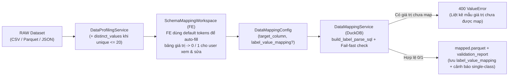
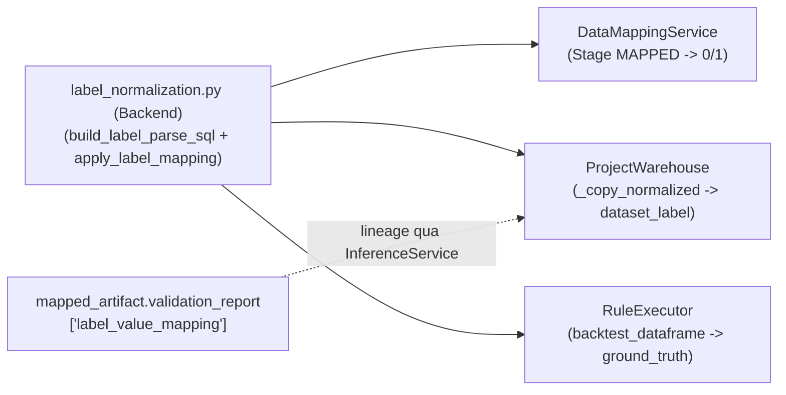

# Plan: Raw Label Value Mapping to Canonical Binary (`0` / `1`)

> **Task ID:** `raw_label_parsing_and_mapping` · **Issues:** ISS-047 (chosen by the user) · **Spec:** `docs/features/data_management/user-flow-and-ui-design.md` (Màn hình 4 — Schema Mapping & Validation)
> **Conflict verdict:** PARALLEL-SAFE · **Status:** Draft

## 1. Context (facts)
- `usfds-core/src/usfds_core/services/data_management/mapping.py:276-282`: `DataMappingService` chỉ chuyển đổi cột `label` theo kiểu `BOOLEAN` hoặc `TRY_CAST(TRY_CAST(col AS DOUBLE) AS BIGINT)` rồi `COALESCE(..., 0)` và **không đưa `label` vào `ratio_checks`**. Khi file raw chứa chuỗi nhãn phổ biến (`'fraud'` / `'legit'`, `'Yes'` / `'No'`, `'true'` / `'false'` dạng chuỗi) hoặc mã hóa khác (`1`/`2`, `'A'`/`'B'`), `TRY_CAST` trả `NULL` và `COALESCE` **âm thầm biến 100% nhãn thành `0`** trong khi `validation_status` vẫn là `PASSED`. Các mã số phi nhị phân (`1`/`2`, `-1`/`1`) cũng đi thẳng vào `mapped.parquet` mà không được map về `0`/`1`.
- `usfds-core/src/usfds_core/services/warehouse/project_warehouse.py:244-250`: `ProjectWarehouse._copy_normalized` chỉ làm `int(float(rec[lbl_col]))` rồi kiểm tra `in (0, 1)`; khi `DetectionJob` chạy trực tiếp trên tập `RAW` có nhãn gốc chưa chuẩn (`'fraud'`/`'legit'`, `1`/`2`), toàn bộ `dataset_label` rơi về `-1` (`UNVERIFIED`), làm phân hệ Insight & Report (`DATASET_FALLBACK`) mất nhãn đối chiếu TP/FP.
- `usfds-core/src/usfds_core/services/rule_engine/executor.py:397-402`: `RuleExecutor.backtest_dataframe` tự viết logic riêng nhận `("1", "true", "fraud", "yes")` thành `1` và mọi giá trị còn lại thành `0`, không đồng bộ với `DataMappingService` và `ProjectWarehouse`.
- `usfds-core/src/usfds_core/services/data_management/profiling.py:69-128` và `usfds-core/src/usfds_core/domain/schemas/dataset_profiling.py:5-12`: `DataProfilingService` chưa thu thập danh sách giá trị phân biệt (`distinct_values`) cho các cột có ít giá trị phân biệt (low-cardinality), nên màn hình `SchemaMappingWorkspace` (`usfds-web/src/components/modules/data_management/SchemaMappingWorkspace.tsx:992-1038`) chỉ hiển thị mẫu tĩnh `"0 / 1"` và chưa cho người dùng xem/map từng giá trị nhãn nguồn sang `0` hoặc `1`.
- `usfds-core/src/usfds_core/services/data_management/validation.py:422-431`: `DataQualityValidationService` chưa cảnh báo khi cột `label` sau ánh xạ chỉ còn 1 lớp duy nhất (ví dụ toàn `0` hoặc toàn `1`).

## 2. Goal, scope verdict & non-goals
- **Goal:** Cho phép người dùng **map tường minh từng giá trị cột `label` của raw data sang giá trị nhị phân chuẩn của hệ thống (`0` = Hợp lệ, `1` = Gian lận)** thông qua `label_value_mapping` ở bước Schema Mapping, kèm **danh sách giá trị mặc định chỉ đặt ở Frontend để gợi ý điền sẵn nhanh (auto-fill)** dựa trên `distinct_values` của profiling; đồng bộ quy tắc áp dụng & lưu vết `label_value_mapping` sang `mapped.parquet`, `ProjectWarehouse` và `RuleExecutor`.
- **Scope:** OK
- **Non-goals / omitted:**
  - Không tự động đoán chuỗi từ khóa (`'fraud'`, `'yes'`, ...) ở Backend; Backend chỉ thực thi đúng `label_value_mapping` tường minh do Frontend/caller gửi lên (hoặc chỉ chấp nhận giá trị đã là nhị phân `0`/`1`/`BOOLEAN` khi `label_value_mapping` không được truyền).
  - Không thay đổi yêu cầu bắt buộc 5 trường `CORE` phân biệt (không tự sinh `event_id` hay bỏ bắt buộc `user_id`/`timestamp`/`amount`).
  - Không thay đổi parsing của `amount` (ký tự `$`), ghép nhiều cột thời gian (`Year/Month/Day/Time`), hay mở rộng entity graph.
  - Không thêm endpoint REST mới cho riêng việc đọc giá trị cột — tái sử dụng `distinct_values` từ RAW profiling kèm ô nhập thủ công cho artifact RAW cũ.
  - Không đổi lược đồ cơ sở dữ liệu (không cần Alembic migration).
- **Assumptions:**
  - USFDS giải quyết bài toán phân loại gian lận nhị phân (`0` = Hợp lệ, `1` = Gian lận); nhãn đa lớp nếu có được gom nhiều-về-1 qua `Dict[str, int]` (ví dụ `{"fraud": 1, "chargeback": 1, "legit": 0}`).
  - Ô trống / `NULL` trong cột `label` giữ nguyên `NULL` để `DataQualityValidationService` chấm điểm và cảnh báo/lỗi missing (>50% `FAILED`) như hành vi hiện tại; ngược lại, **mọi giá trị khác rỗng nhưng không nằm trong `label_value_mapping` (hoặc không phải `0`/`1` nếu không truyền map)** sẽ bị chặn fail-fast kèm mẫu giá trị chưa được map.

## 2.5 Design & Approach (user reviews this section)
### Diagram(s)

### Key decisions & contracts
| Area | Decision / Contract | Rationale / Notes |
|---|---|---|
| Core Normalization (Backend tường minh) | Tạo module `usfds-core/src/usfds_core/domain/schemas/label_normalization.py` (không chứa keyword đoán ngầm): • `validate_label_value_mapping(mapping: Optional[Dict[str, int]])`: chuẩn hóa `strip()` key, cấm key rỗng, cấm trùng key sau `strip()`, bắt buộc value thuộc `{0, 1}`. • `build_label_parse_sql(col_ident, col_type, label_value_mapping)`:   - **Khi có `label_value_mapping`:** sinh biểu thức DuckDB `CASE` map chính xác giá trị nguồn (so khớp sau `TRIM`, và khớp giá trị số chuẩn e.g. `1.0` ↔ `"1"` nếu cột raw dạng số) sang `0` hoặc `1` (`BIGINT`); giá trị khác rỗng ngoài map trả `NULL`.   - **Khi `label_value_mapping` là `None`:** chỉ chấp nhận cột `BOOLEAN` (`true`→`1`, `false`→`0`) hoặc giá trị đã là nhị phân `0`/`1`/`0.0`/`1.0`; mọi giá trị khác rỗng ngoài `0`/`1` trả `NULL` (loại bỏ `COALESCE(..., 0)` nuốt lỗi cũ). • `apply_label_mapping(value, label_value_mapping) -> Optional[int]`: hàm Python tương đương cho `ProjectWarehouse` và `RuleExecutor`. | Backend hoàn toàn tường minh, dự đoán được và đồng bộ một nguồn duy nhất qua `label_normalization.py`. |
| API / Schema Contract | Mở rộng tương thích ngược (additive only): • `DataMappingConfig`: thêm `label_value_mapping: Optional[Dict[str, int]] = None` (tự nhận qua `POST /api/v1/datasets/{dataset_id}/schema-mapping` và worker `handle_schema_mapping`). • `FieldProfilingSummary`: thêm `distinct_values: List[str] = Field(default_factory=list)` (điền khi `1 <= unique_count <= 20`, đã sort, tối đa 20 giá trị). • `mapped_artifact.validation_report["label_value_mapping"]`: lưu lại bảng map đã dùng (nếu có). • `InferenceService._trace_model_version_lineage`: lưu `label_value_mapping` vào `job.summary_metrics` (nếu có) để `ProjectWarehouse` dùng lại khi chuẩn hóa `dataset_label` trên tập `RAW`. | Không thêm route/table/RBAC mới; 100% tương thích ngược với dữ liệu đã là `0`/`1` ở caller/test cũ không truyền `label_value_mapping`. |
| Validation & Quality | • `DataMappingService`: chặn fail-fast (`ValueError` → HTTP `400`) nếu có bất kỳ giá trị nhãn khác rỗng nào chưa được map (`invalid_cnt > 0`), kèm tối đa 5 giá trị mẫu chưa map lấy bằng DuckDB. • `DataQualityValidationService`: thêm cảnh báo (`warnings`) khi cột `label` có ít hơn 2 lớp giá trị phân biệt (`unique_count == 1`), tránh việc người dùng đi tới bước Train mới phát hiện chỉ có 1 class. | Bảo vệ dữ liệu minority class (1–5% fraud sẽ không bao giờ bị nuốt như ngưỡng 30% của `timestamp`/`amount`). |
| Frontend Auto-fill & Mapping UI | Tạo helper `usfds-web/src/utils/labelMapping.ts` giữ danh sách mặc định ở Frontend (`DEFAULT_POSITIVE_LABEL_TOKENS`, `DEFAULT_NEGATIVE_LABEL_TOKENS`) **chỉ để gợi ý điền sẵn nhanh** (giống cách `aliases` tự match tên cột): • Khi người dùng chọn cột nguồn cho `label` trong `SchemaMappingWorkspace.tsx`:   1. Đọc `distinct_values` của cột đó từ `rawArtifact.validation_report.profiling.fields` (nếu artifact RAW cũ chưa có `distinct_values`, cho phép thêm từng cặp `giá trị nguồn -> 0/1` thủ công hoặc bỏ trống nếu dữ liệu đã là `0/1`).   2. Frontend tự đối chiếu `distinct_values` với `DEFAULT_POSITIVE_LABEL_TOKENS` / `DEFAULT_NEGATIVE_LABEL_TOKENS` (case-insensitive, trim) để pre-fill sẵn bảng ánh xạ `rawValue -> 0 | 1 | '' (chưa gán)`.   3. Hiển thị trực quan ngay tại hàng `label` danh sách từng giá trị nguồn kèm nút/select chuyển `0 (Hợp lệ)` / `1 (Gian lận)` để user kiểm tra, sửa nhanh hoặc gán nốt các giá trị lạ chưa có trong danh sách mặc định.   4. Nút `Kiểm định dữ liệu` không bị bất ngờ ngầm: nếu vẫn còn `distinct_value` ở trạng thái chưa gán, cảnh báo rõ (hoặc chặn submit trên UI) và luôn gửi `label_value_mapping` đầy đủ về backend khi mapping cột `label`. | Đúng bản chất UX: danh sách mặc định chỉ giúp FE điền nhanh cho user, còn mọi quyết định ánh xạ đều tường minh dưới dạng `raw_value -> 0/1`. |

### Edge cases, concurrency & failure handling
- **Giá trị có khoảng trắng hoặc chữ hoa/thường khi FE gợi ý và BE so khớp:** FE match không phân biệt hoa/thường sau `trim()`, nhưng lưu **giá trị gốc hoặc trimmed** làm key gửi trong `label_value_mapping`; DuckDB & Python `TRIM(CAST(... AS VARCHAR))` khớp chuẩn xác kể cả số thập phân `'1.0'`/`'0.0'`.
- **Giá trị `NaN` / `None` / chuỗi rỗng `''`:** Không bị coi là lỗi ánh xạ; được giữ là `NULL` để `DataQualityValidationService` báo tỷ lệ missing (tránh biến `NULL` thành `0` giả tạo).
- **Mapping không hợp lệ:** Value ngoài `{0, 1}`, key rỗng sau `strip()`, hoặc trùng key sau `strip()` → `ValueError` ngay trước khi mở file.
- **Artifact RAW cũ (không có `distinct_values` trong profiling) & artifact MAPPED cũ (không có `label_value_mapping`):** UI cho phép thêm thủ công từng dòng `giá trị gốc -> 0/1` (hoặc gửi `label_value_mapping = undefined` nếu dữ liệu đã là `0/1`); `InferenceService` và `ProjectWarehouse` nếu không có `label_value_mapping` thì dùng kiểm tra nhị phân chặt `0`/`1`/`BOOLEAN` trên `apply_label_mapping`.
- **Worker Queue mode (`dispatch_backend == "queue"`):** `DataMappingConfig.model_dump(mode="json")` và `DataMappingConfig.model_validate(...)` trong `dataset_router.py:309` và `handlers.py:237` tự động truyền `label_value_mapping` qua BullMQ mà không cần sửa handler map.

## 3. Files
| Action | File | Milestone | Note |
|---|---|---|---|
| create | `usfds-core/src/usfds_core/domain/schemas/label_normalization.py` | M1 | Validator `label_value_mapping`, DuckDB SQL builder (`build_label_parse_sql`), Python parity helper (`apply_label_mapping`) |
| modify | `usfds-core/src/usfds_core/domain/schemas/preprocessing_config.py` | M1 | Thêm `label_value_mapping: Optional[Dict[str, int]] = None` vào `DataMappingConfig` |
| modify | `usfds-core/src/usfds_core/domain/schemas/dataset_profiling.py` | M1 | Thêm `distinct_values: List[str]` vào `FieldProfilingSummary` |
| modify | `usfds-core/src/usfds_core/services/data_management/profiling.py` | M1 | Thu thập `distinct_values` (khi `1 <= unique_count <= 20`) trong cả `analyze` và `analyze_duckdb` |
| modify | `usfds-core/src/usfds_core/services/data_management/mapping.py` | M1 | Dùng `build_label_parse_sql`, fail-fast khi `invalid_cnt > 0` kèm mẫu giá trị chưa map, lưu `label_value_mapping` vào `validation_report` |
| modify | `usfds-core/src/usfds_core/services/data_management/validation.py` | M1 | Thêm cảnh báo single-class cho cột `label` (cả `validate` và `validate_duckdb`) |
| modify | `usfds-core/src/usfds_core/services/warehouse/project_warehouse.py` | M1 | Dùng `apply_label_mapping` (kèm `label_value_mapping` từ `job.summary_metrics` nếu có) |
| modify | `usfds-core/src/usfds_core/services/inference/inference_service.py` | M1 | Trích `label_value_mapping` từ lineage `mapped_artifact.validation_report` đưa vào `job.summary_metrics` |
| modify | `usfds-core/src/usfds_core/services/rule_engine/executor.py` | M1 | Dùng `apply_label_mapping` trong `backtest_dataframe` (nhận `label_value_mapping` tùy chọn nếu có) |
| modify | `usfds-core/tests/test_mapping_service.py` | M1 | Thêm acceptance tests cho `label_value_mapping`, strict `0/1` khi `None`, fail-fast, single-class warning |
| modify | `usfds-core/tests/test_project_warehouse.py` | M1 | Thêm acceptance tests cho `ProjectWarehouse` với `label_value_mapping` trong `job.summary_metrics` |
| modify | `usfds-core/tests/test_rule_engine.py` | M1 | Thêm test nhất quán `apply_label_mapping` trong rule backtest |
| modify | `usfds-server/tests/test_dataset_api.py` | M2 | API tests cho `/import` trả `distinct_values`, `POST /schema-mapping` nhận `label_value_mapping` cho `'fraud'/'legit'` và `'1'/'2'`, và trả `400` khi thiếu giá trị trong map hoặc nhãn không phải `0/1` |
| create | `usfds-web/src/utils/labelMapping.ts` | M3 | Danh sách token mặc định FE (`DEFAULT_POSITIVE_LABEL_TOKENS`, `DEFAULT_NEGATIVE_LABEL_TOKENS`) + hàm `suggestLabelValueMapping(distinctValues)` |
| modify | `usfds-web/src/types/dataset.ts` | M3 | Thêm `label_value_mapping?: Record<string, 0 | 1>` vào `DataMappingConfig` và `distinct_values?: string[]` vào `FieldProfilingSummary` |
| modify | `usfds-web/src/components/modules/data_management/SchemaMappingWorkspace.tsx` | M3 | Tự động gợi ý bảng map giá trị nhãn `raw -> 0/1` từ `distinct_values` khi chọn cột `label`, cho phép chỉnh sửa / thêm thủ công, và gửi `label_value_mapping` |
| modify | `usfds-web/src/components/modules/data_management/BulkSchemaMappingAndFE.test.tsx` | M3 | Vitest tests cho FE auto-suggest `distinct_values`, sửa gán `0/1`, chặn/báo thiếu giá trị chưa map, và fallback nhập tay |
| migration | — | — | Không đổi lược đồ DB |

## 4. Dependencies & conflicts (with other tasks on BOARD)
| # | Check | Answer |
|---|---|---|
| D1 | Needs unfinished task? | No — toàn bộ task nền (`data_management_duckdb`, `large_data_analytics_duckdb`, `system_metadata_management`) đã `Done` |
| D2 | Needed by unfinished task? | No |
| C1 | Modified files owned by in-progress task? | No — không có task nào `In progress` trên `.plan/BOARD.md` |
| C2 | Hot-spot files touched | — (không sửa hot-spot file nào) |
| C3 | Schema change | No |
| C4 | Public contract change | Yes (chỉ mở rộng tương thích ngược: trường tùy chọn trên `DataMappingConfig` và `FieldProfilingSummary`) → consumers: `usfds-web` (cập nhật M3), `usfds-worker` (tương thích tự động qua Pydantic `DataMappingConfig`) |
| C5 | Shared UI shell change | No |

## 5. Acceptance tests (user reviews this section)
| Milestone | Test | Given | When | Then | Covers |
|---|---|---|---|---|---|
| M1 | `test_map_dataset_with_explicit_label_value_mapping` (`usfds-core/tests/test_mapping_service.py`) | Tập raw có nhãn `'fraud'`/`'legit'`, hoặc `1`/`2`, hoặc nhiều-về-1 `'chargeback','fraud'`→`1`, `'ok'`→`0` | Gọi `DataMappingService.map_dataset` kèm `label_value_mapping` tường minh | `mapped.parquet` có cột `label` đúng `0`/`1` tương ứng; `validation_report["label_value_mapping"]` lưu lại bảng map đã dùng | ISS-047 |
| M1 | `test_map_dataset_strict_canonical_binary_and_rejects_unmapped_values` (`usfds-core/tests/test_mapping_service.py`) | (a) Tập raw có `'fraud'/'legit'` nhưng không truyền `label_value_mapping`; (b) Tập raw có `'A','B','C'` với `label_value_mapping={"A": 1, "B": 0}` thiếu `'C'`; (c) `label_value_mapping` có value `2` hoặc key trùng sau `strip()` | Gọi `map_dataset` | (a) Không âm thầm ép thành `0`, raise `ValueError` nêu mẫu `'fraud'`/`'legit'`; (b) Raise `ValueError` nêu mẫu chưa map `'C'`; (c) Raise `ValueError` cấu hình không hợp lệ; còn file đã là `0`/`1`/`true`/`false` thì pass bình thường | ISS-047 |
| M1 | `test_map_dataset_preserves_null_labels_and_warns_on_single_class` (`usfds-core/tests/test_mapping_service.py`) | (a) Tập raw có vài ô `label` trống/null cùng giá trị `'fraud'`/`'legit'`; (b) Tập raw chỉ có toàn `'legit'` với `{"legit": 0}` | Gọi `map_dataset` và kiểm tra `validation_report` | (a) Ô null giữ nguyên `NULL` (không biến thành `0`), báo cảnh báo missing; (b) `validation_report["warnings"]` chứa cảnh báo single-class | ISS-047 |
| M1 | `test_profiling_collects_distinct_values_for_low_cardinality_columns` (`usfds-core/tests/test_data_management_duckdb.py`) | File raw có cột nhãn `'fraud'/'legit'` (`unique_count=2`) và cột ID (`unique_count > 20`) | Chạy `DataProfilingService.analyze_duckdb` và `analyze` | Cột nhãn trả về `distinct_values == ["fraud", "legit"]`; cột high-cardinality trả `distinct_values == []` | ISS-047 |
| M1 | `test_warehouse_and_rule_backtest_apply_explicit_label_mapping` (`usfds-core/tests/test_project_warehouse.py`, `usfds-core/tests/test_rule_engine.py`) | `predictions.parquet` / DataFrame có nhãn `'fraud'/'legit'` hoặc `'2'/'1'` gắn `label_value_mapping` qua `job.summary_metrics` / tham số backtest | Gọi `ProjectWarehouse.write_job_facts` + `load_fact_table`, và `RuleExecutor.backtest_dataframe` | `dataset_label` trong warehouse và `tp/fp/tn/fn` trong rule backtest nhận đúng `1`/`0`, không rơi về `-1` hay sai lớp | ISS-047 |
| M2 | `test_dataset_api_schema_mapping_explicit_label_value_mapping` (`usfds-server/tests/test_dataset_api.py`) | Dataset import qua `POST /api/v1/datasets/import` chứa cột nhãn `'fraud'/'legit'` và dataset thứ hai chứa `'1'/'2'` | (1) Kiểm tra `distinct_values` trong response `/import`; (2) `POST /schema-mapping` không truyền `label_value_mapping` cho `'fraud'/'legit'`; (3) Gửi `label_value_mapping: {"fraud": 1, "legit": 0}` và `{"2": 1, "1": 0}` | (1) `profiling.fields` trả `distinct_values`; (2) Bị chặn `400` kèm mẫu giá trị chưa map (không biến thành `0`); (3) Trả `201` với cột `label` đúng `0`/`1` | ISS-047 |
| M3 | `SchemaMappingWorkspace: auto-suggests label value mapping from default list and lets user customize 0/1 mapping` (`usfds-web/src/components/modules/data_management/BulkSchemaMappingAndFE.test.tsx`) | (1) `rawArtifact` có `distinct_values: ["fraud", "legit"]`; (2) `rawArtifact` có `distinct_values: ["1", "2"]` (giá trị `"2"` không có trong default list) | Render `SchemaMappingWorkspace` | (1) FE tự điền sẵn `fraud -> 1`, `legit -> 0` và `onConfigChange` emit `label_value_mapping: { fraud: 1, legit: 0 }`; (2) FE điền sẵn `1 -> 1`, đánh dấu `"2"` là chưa gán (`isValid=false`), cho tới khi user chọn `2 -> 0` hoặc sửa `1 -> 0, 2 -> 1` thì `isValid=true` và gửi đúng `label_value_mapping` | ISS-047 |

## 6. Milestones & to-do (checkpoints, not stop points: all tests green at each)
The agent ticks items as it works. This is the task's only to-do list (`TODO.md` is no longer used for new work).

- [ ] **M1 — Explicit Label Normalization, DuckDB Mapping/Profiling & Warehouse/Rule Parity** (`usfds-core`): hoàn tất `label_normalization.py` (`label_value_mapping`), cập nhật `DataMappingService`, `DataProfilingService`, `DataQualityValidationService`, `ProjectWarehouse`, `InferenceService` và `RuleExecutor`.
  - [ ] [tests] Viết các acceptance tests M1 từ §5 (`test_mapping_service.py`, `test_data_management_duckdb.py`, `test_project_warehouse.py`, `test_rule_engine.py`); xác nhận fail đúng lý do
  - [ ] [core] Tạo `usfds-core/src/usfds_core/domain/schemas/label_normalization.py`
  - [ ] [core] Cập nhật `preprocessing_config.py`, `dataset_profiling.py`, `profiling.py`, `mapping.py`, `validation.py`
  - [ ] [core] Cập nhật `project_warehouse.py`, `inference_service.py`, `rule_engine/executor.py`
  - [ ] [verify] `./scripts/test.sh core`
- [ ] **M2 — API End-to-End Verification & Worker Parity** (`usfds-server`, `usfds-worker`): xác nhận REST API `/import` và `/schema-mapping` (kể cả queue payload) trả `distinct_values`, nhận `label_value_mapping` và trả lỗi `400` rõ ràng khi còn giá trị chưa map.
  - [ ] [tests] Viết acceptance test M2 trong `usfds-server/tests/test_dataset_api.py`; xác nhận pass cả inline và worker validation
  - [ ] [verify] `./scripts/test.sh core infra server worker`
- [ ] **M3 — Frontend Auto-Suggest & Value-to-Binary (`0`/`1`) Mapping UI** (`usfds-web`): tạo `labelMapping.ts` chứa danh sách gợi ý mặc định trên FE, hiển thị bảng map từng `distinct_value -> 0 / 1` tại hàng `label` của `SchemaMappingWorkspace`.
  - [ ] [tests] Viết Vitest tests M3 trong `BulkSchemaMappingAndFE.test.tsx`; xác nhận fail đúng lý do
  - [ ] [web] Tạo `usfds-web/src/utils/labelMapping.ts`; cập nhật `usfds-web/src/types/dataset.ts` và `usfds-web/src/components/modules/data_management/SchemaMappingWorkspace.tsx`
  - [ ] [verify] `./scripts/test.sh core infra server worker cli web`

Checkpoint log (the agent appends one line per finished milestone):
- —

## 7. Review hotspots (filled in after implementation)
- —

## 8. Open questions
- **Chính sách chặn giá trị nhãn chưa map ở Backend (`invalid_cnt > 0`):** Đề xuất chặn fail-fast ngay khi có bất kỳ giá trị khác rỗng nào chưa được map (thay vì ngưỡng `30%` như `timestamp`/`amount`), để minority class (1–5% fraud) không bị mất ngầm. Bạn đồng ý chứ?
- **Khi cột raw đã là `0`/`1` và caller/API gọi trực tiếp không truyền `label_value_mapping`:** Cho phép `label_value_mapping=None` hoạt động ở chế độ kiểm tra nhị phân chặt (chỉ nhận `0`/`1`/`0.0`/`1.0`/`BOOLEAN`, từ chối chuỗi lạ thay vì tự đoán hay ép về `0`), trong khi FE vẫn luôn hiển thị và gửi `label_value_mapping` tường minh nếu có `distinct_values`. Hướng này ổn với bạn chứ?

## 9. Manual E2E verification (post-merge)
- [ ] Import file `ccfd-sample-datasets/11. aws-fraud-detector-samples/Transactions_CardNotPresentOnlineTransactions_100k.csv` (nhãn `'fraud'`/`'legit'`): kiểm tra FE tự gợi ý sẵn `fraud -> 1 (Gian lận)` và `legit -> 0 (Hợp lệ)` từ `distinct_values`, tạo `mapped.parquet` đủ nhãn `0`/`1`, chạy Training + Detection và xác nhận Insight & Report hiển thị đúng chỉ số TP/FP.
- [ ] Import file có nhãn phi mặc định (vd. `1`/`2` hoặc `'Attrited Customer'`/`'Existing Customer'`): kiểm tra FE đánh dấu giá trị chưa nhận diện là *Chưa gán*, sau khi chọn mapping `0`/`1` cho đủ các giá trị thì Schema Mapping thành công.
