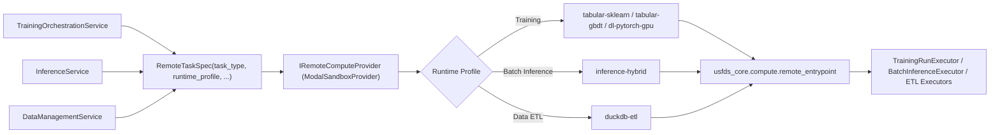
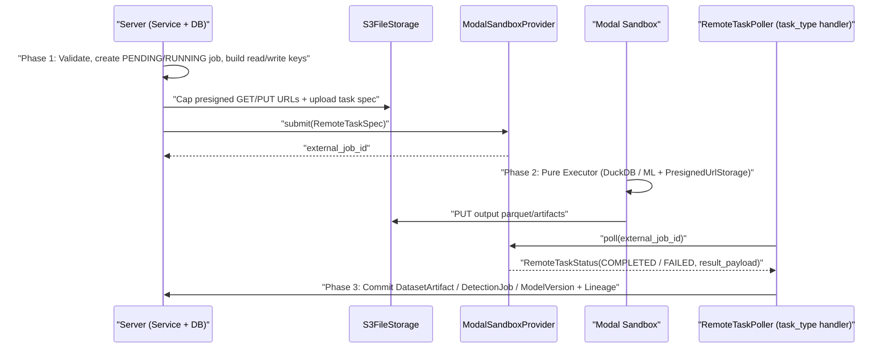

# Plan: Unified Remote Compute Platform for Inference & Data Processing (Đợt 2)

> **Task ID:** `remote_compute_multi_workload` · **Issues:** — (future epic, follow-up to ISS-009, ISS-056) · **Spec:** `docs/arch/01-context-and-runtime.md`, `docs/arch/modules/training-and-models.md`, `docs/features/detection/inference/suc-spec.md` <!-- [26-11-28] removed deleted research doc link -->
> **Conflict verdict:** BLOCKED (needs `remote_training_sandbox_hardening` first) · **Status:** Draft

## 1. Context (facts)
- Tầng provider hiện đóng cứng vào domain training: `usfds-core/src/usfds_core/services/training/providers/base_provider.py:11-49` (`RemoteTrainingJobSpec` / `RemoteJobStatus`), `usfds-server/src/usfds_server/services/remote_poller.py:62` (chỉ query `training_runs`).
- `BatchInferenceExecutor` (`usfds-core/src/usfds_core/services/inference/executor.py:259-705`) đã tách hoàn toàn khỏi DB và chỉ dùng `IFileStorage`, nhưng `DetectionJobModel` (`usfds-infra/src/usfds_infra/database/tables/detection.py:10-50`) chưa có `compute_target`/`external_job_id`/`compute_metadata`, và `get_inference_service` (`usfds-server/src/usfds_server/providers/detection.py:38-41`) mới chỉ rẽ nhánh local vs `QueueBatchInferenceDispatcher`.
- `FeatureEngineeringExecutionService` (`usfds-core/src/usfds_core/services/preprocessing/feature_engineering_service.py:25-35`) chỉ nhận `IFileStorage` nhưng nhận/trả entity `DatasetArtifact` trực tiếp và chạy đồng bộ trong `DataManagementService` (`usfds-core/src/usfds_core/services/data_management/service.py:97-99`).
- `DatasetIngestionService` (`usfds-core/src/usfds_core/services/data_management/ingestion.py:40-54`) và `DataMappingService` (`usfds-core/src/usfds_core/services/data_management/mapping.py:54-64`) đang trộn lẫn DuckDB compute với repository DB (`artifact_repo`, `dataset_repo`, `project_repo`, `metadata_repo`) trong cùng method.
- Các artifact `.joblib` (`fitted_feature_engineers.joblib`, `preprocessor.joblib`) lưu đường dẫn module Python bên trong pickle (vd `usfds_core.services.features.compiler.CompiledFeaturePipeline` tại `usfds-core/src/usfds_core/services/inference/executor.py:94-108`) nên mọi refactor đóng gói phải giữ nguyên module path của các class được pickle.

## 2. Goal, scope verdict & non-goals
- **Goal:** Tổng quát hóa tầng remote compute provider sang `usfds_core/compute/` để hỗ trợ offload thống nhất cho **Training**, **Batch Inference**, và **Data Processing (Feature Engineering, Ingestion, Schema Mapping)** với runtime image profile cô lập theo từng tác vụ.
- **Scope:** TOO-BROAD → Đã tách sẵn thành 3 milestone rõ ràng (M1: Unified Compute Layer, M2: Batch Inference Offload, M3: Data Processing 3-Phase Refactor & Offload); đề xuất tách issue riêng theo từng workload nếu cần chia thành các session độc lập sau khi Đợt 1 hoàn tất.
- **Non-goals / omitted:**
  - Không offload Real-time Online Inference (<100ms latency).
  - Không offload Graph Exploration (LadybugDB in-memory) hay Insight Report trong đợt này.
  - Không đổi module path của `CompiledFeaturePipeline` hay các transformer được pickle bằng `joblib`.
- **Assumptions:** Đợt 1 (`remote_training_sandbox_hardening`) đã hoàn tất và ổn định trên Modal Sandbox.

## 2.5 Design & Approach (user reviews this section)
### Diagram(s)

#### A. Kiến trúc Remote Compute dùng chung cho nhiều loại tác vụ

#### B. Pattern 3 pha bất đồng bộ cho Data Processing & Batch Inference

### Key decisions & contracts
| Area | Decision / Contract | Rationale / Notes |
|---|---|---|
| Core compute layer | Tạo `usfds_core/compute/` chứa `RemoteTaskSpec`, `RemoteTaskStatus`, `IRemoteComputeProvider`, `RemoteProviderRegistry`, `remote_entrypoint.py` (dispatch theo `task_type`). | Tách abstraction compute ra khỏi domain `training`, giữ wrapper tương thích cho `services/training/providers/`. |
| DB Schema | (1) Thêm `compute_target`, `external_job_id`, `compute_metadata` trên `detection_jobs`; (2) Thêm bảng `data_processing_jobs` theo dõi async status `PENDING/RUNNING/COMPLETED/FAILED` cho `ingestion`, `schema_mapping`, `feature_engineering` (1 Alembic revision). | Theo dõi đồng nhất trạng thái chạy nền, tự phục hồi sau restart server qua `RemoteTaskPoller`. |
| Runtime profiles | Bổ sung `inference-hybrid` (`sklearn` + `xgboost`/`torch` tùy model framework + `duckdb` khi `use_rules=True`) và `duckdb-etl` (`pydantic`, `duckdb`, `pyarrow`, `pandas`, `numpy` — không kéo `sklearn`/`xgboost`/`torch`/`shap`/`ladybug`). | Đảm bảo mỗi container chỉ nạp đúng thư viện cần cho tác vụ đó. |
| Pickle backward-compat | Giữ nguyên đường dẫn module của `CompiledFeaturePipeline` và các class trong `services/preprocessing/`. | Tránh lỗi `ModuleNotFoundError` / `AttributeError` khi `joblib.load()` các artifact cũ. |

### Edge cases, concurrency & failure handling
- **Companion artifacts cho Batch Inference** (`preprocessor.joblib`, `fitted_feature_engineers.joblib`, `column_mapping.json`): chỉ cấp presigned GET URL cho những file thực sự tồn tại trên S3 (kiểm tra `file_storage.exists()` ở pha prepare).
- **Idempotency & crash recovery cho Data Processing:** `DataIngestionExecutor` / `SchemaMappingExecutor` ghi kết quả ra đường dẫn tạm theo `job_id`, chỉ tạo `DatasetArtifact` và cập nhật lineage trong transaction commit khi job chuyển `RUNNING → COMPLETED`.

## 3. Files
| Action | File | Milestone | Note |
|---|---|---|---|
| create | `usfds-core/src/usfds_core/compute/__init__.py` | M1 | Unified `IRemoteComputeProvider`, `RemoteTaskSpec`, `RemoteTaskStatus` |
| create | `usfds-core/src/usfds_core/compute/remote_entrypoint.py` | M1 | Generic dispatcher theo `task_type` |
| modify | `usfds-infra/src/usfds_infra/compute/{modal_provider,modal_images}.py` | M1 | Hỗ trợ đa `task_type` và profile `inference-hybrid`, `duckdb-etl` |
| modify | `usfds-server/src/usfds_server/services/remote_poller.py` | M1 | `RemoteTaskPoller` với handler registry theo `task_type` |
| modify | `usfds-core/src/usfds_core/services/inference/**` | M2 | `RoutingInferenceDispatcher`, `compute_target` resolution & `apply_remote_status` |
| modify | `usfds-infra/src/usfds_infra/database/{tables,repos}/detection.py` | M2 | Tracking `compute_target`, `external_job_id`, `compute_metadata` |
| migration | `usfds-infra/src/usfds_infra/database/migrations/versions/<rev>_add_multi_workload_remote_compute.py` | M2/M3 | Cột trên `detection_jobs` + bảng `data_processing_jobs` |
| modify | `usfds-server/src/usfds_server/{providers,routers}/detection*` | M2 | API chọn compute target và sync remote `DetectionJob` |
| modify | `usfds-web/src/components/modules/detection/**` | M2 | UI chọn compute target cho Batch Detection |
| create | `usfds-core/src/usfds_core/services/{data_management,preprocessing}/*_executor.py` | M3 | Tách pure DuckDB executors cho ingestion, mapping, feature engineering |
| create | `usfds-infra/src/usfds_infra/database/{tables,repos}/data_job.py` | M3 | Persistence cho `data_processing_jobs` |
| modify | `usfds-server/src/usfds_server/routers/dataset_router.py` | M3 | Async job endpoints & polling cho remote data processing |
| modify | `usfds-web/src/components/modules/dataset/**` | M3 | Async polling UI cho Data Management jobs |

## 4. Dependencies & conflicts (with other tasks on BOARD)
| # | Check | Answer |
|---|---|---|
| D1 | Needs unfinished task? | Yes: `remote_training_sandbox_hardening` (Đợt 1) |
| D2 | Needed by unfinished task? | No |
| C1 | Modified files owned by in-progress task? | No (cần sequence sau Đợt 1) |
| C2 | Hot-spot files touched | Yes (append-only): `usfds-infra/database/{models,repositories,__init__}.py`, `usfds-server/{api,config,dependencies}.py`, `usfds-server/providers/repos.py` |
| C3 | Schema change | Yes: thêm cột trên `detection_jobs` + bảng `data_processing_jobs` |
| C4 | Public contract change | Yes: async job response cho data processing endpoints + `compute_target` trên batch inference request |
| C5 | Shared UI shell change | No |

## 5. Acceptance tests (user reviews this section)
| Milestone | Test | Given | When | Then | Covers |
|---|---|---|---|---|---|
| M1 | `test_generic_remote_entrypoint_dispatches_by_task_type` (`usfds-core/tests/compute/test_unified_compute.py`) | `RemoteTaskSpec` cho `training` và `batch_inference` | Chạy `remote_entrypoint` với `USFDS_SPEC_GET_URL` | Route đúng tới executor tương ứng và phát `__USFDS_RESULT_JSON__:` | Multi-workload |
| M1 | `test_remote_task_poller_routes_terminal_status_to_registered_handlers` (`usfds-server/tests/test_remote_poller.py`) | Active remote jobs thuộc nhiều `task_type` trong DB | Chạy `RemoteTaskPoller.poll_once()` | Poll không giữ DB session và gọi đúng handler commit kết quả theo `task_type` | Multi-workload |
| M2 | `test_batch_inference_executor_runs_over_presigned_storage_for_builtin_and_plugin` (`usfds-core/tests/inference/test_remote_inference.py`) | Input dataset + model + companion artifacts phục vụ qua `PresignedUrlStorage` | Chạy `BatchInferenceExecutor.run(payload)` | Tải đủ input/companion artifacts, chạy model + rules và upload `predictions.parquet` qua PUT URL | Batch Inference |
| M2 | `test_routing_inference_dispatcher_offloads_to_modal_and_poller_completes_job` (`usfds-server/tests/test_detection_api.py`) | `DetectionJob` gửi với `compute_target="modal"` | Dispatch rồi chạy poller | Lưu `external_job_id`, chuyển `COMPLETED` và ghi `summary_metrics` idempotent | Batch Inference |
| M3 | `test_duckdb_etl_executors_run_without_db_over_presigned_storage` (`usfds-core/tests/data_management/test_remote_etl.py`) | Raw/mapped dataset qua `PresignedUrlStorage` | Chạy `DataIngestionExecutor`, `SchemaMappingExecutor`, `FeatureEngineeringExecutor` | Thực thi thuần DuckDB/pandas không cần DB repo, upload output parquet và trả metadata summary | Data Processing |
| M3 | `test_data_processing_async_job_commits_artifact_idempotently` (`usfds-server/tests/test_dataset_api.py`) | `data_processing_jobs` đang `RUNNING` | Poller nhận `COMPLETED` hai lần liên tiếp | Tạo đúng 1 `DatasetArtifact` + lineage, không trùng lặp | Data Processing |

## 6. Milestones & to-do (checkpoints, not stop points: all tests green at each)
The agent ticks items as it works. This is the task's only to-do list (`TODO.md` is no longer used for new work).

- [ ] **M1 — Unified Compute Layer (`usfds_core/compute/`)** (`usfds-core`, `usfds-infra`, `usfds-server`):
  - [ ] [tests] Viết tests M1 cho generic `RemoteTaskSpec`, `remote_entrypoint`, và `RemoteTaskPoller`
  - [ ] [core] Tạo `usfds_core/compute/` và giữ alias tương thích tại `services/training/providers/`
  - [ ] [infra] Cập nhật `ModalTrainingProvider` / `modal_images.py` nhận `RemoteTaskSpec`
  - [ ] [server] Tổng quát hóa `RemoteTaskPoller`
  - [ ] [verify] `./scripts/test.sh core infra server`
- [ ] **M2 — Batch Inference Offload** (`usfds-core`, `usfds-infra`, `usfds-server`, `usfds-web`):
  - [ ] [tests] Viết tests M2 cho `PresignedUrlStorage` inference + `DetectionJob` polling
  - [ ] [core] Thêm `compute_target` & `RoutingInferenceDispatcher` + `apply_remote_status`
  - [ ] [infra] Cập nhật `DetectionJobModel` + repository + Alembic migration
  - [ ] [server] Cập nhật `detection_router` + `providers/detection.py`
  - [ ] [web] Thêm UI chọn compute target cho Batch Detection
  - [ ] [verify] `./scripts/test.sh`
- [ ] **M3 — Data Processing 3-Phase Refactor & Offload** (`usfds-core`, `usfds-infra`, `usfds-server`, `usfds-web`):
  - [ ] [tests] Viết tests M3 cho pure ETL executors và async commit idempotent
  - [ ] [core] Tách 3 pha (`prepare -> pure executor -> commit`) cho `DatasetIngestionService`, `DataMappingService`, `FeatureEngineeringExecutionService`
  - [ ] [infra] Thêm `data_processing_jobs` table, repo, Alembic migration
  - [ ] [server] Bổ sung async job flow và endpoints cho Data Management
  - [ ] [web] Bổ sung UI polling trạng thái job cho Data Management
  - [ ] [verify] `./scripts/test.sh`

Checkpoint log (the agent appends one line per finished milestone):
- <YY-MM-DD> M1 done: <test summary line>; notes: <deviations or —>

## 7. Review hotspots (filled in after implementation)
—

## 8. Open questions
- Data Processing (`ingestion`, `mapping`, `feature_engineering`) có chuyển API sang hoàn toàn bất đồng bộ (`202 Accepted` + polling job status trên UI) hay giữ chế độ `sync` cho file nhỏ và chỉ async khi offload remote?
- Có tách Đợt 2 thành 3 issue riêng trong `docs/issues/` (`ISS-046` Unified Compute, `ISS-047` Remote Batch Inference, `ISS-048` Remote Data Processing) để triển khai từng session độc lập không?

## 9. Manual E2E verification (post-merge)
- [ ] Chạy Batch Inference và Feature Engineering / Schema Mapping trên dataset lớn (>500k rows) qua Modal Sandbox với `usfds-worker` tắt hẳn.
