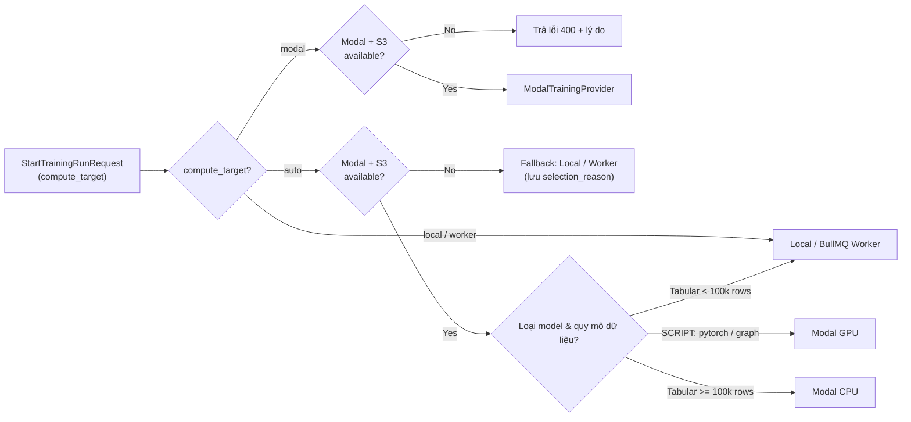
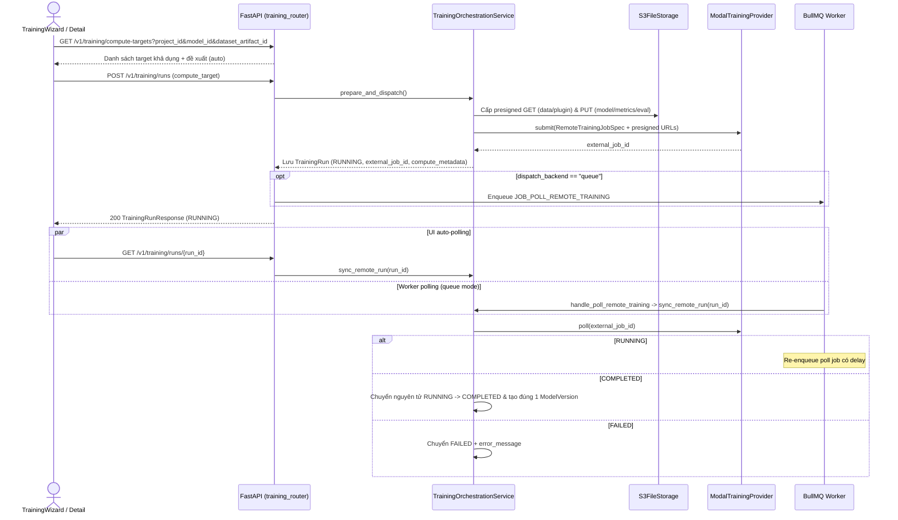

# Plan: Remote Training Compute (Multi-Provider, Modal & Auto Selection)

> **Task ID:** `remote_training_compute` · **Issues:** ISS-009 · **Spec:** `docs/features/detection/training/suc-spec.md` (`SUC-08`; cập nhật phần `compute_target` & remote provider khi được user duyệt)
> **Conflict verdict:** PARALLEL-SAFE · **Status:** Draft

## 1. Context (facts)
- `TrainingRun` (`usfds-core/src/usfds_core/domain/entities/model.py:71`), `TrainingRunConfig` (`usfds-core/src/usfds_core/domain/schemas/training_config.py:14`), `TrainingRunPayload` (`usfds-core/src/usfds_core/domain/schemas/training_payload.py:19`), `StartTrainingRunRequest` (`usfds-server/src/usfds_server/schemas/training_api_schemas.py:43`), và bảng `training_runs` (`usfds-infra/src/usfds_infra/database/tables/model.py:71`) đã có sẵn trường `compute_target` (mặc định `"local"`), nhưng chưa có `external_job_id` hay metadata phân giải compute.
- `get_training_service` (`usfds-server/src/usfds_server/providers/training.py:36-39`) chỉ rẽ nhánh toàn cục giữa `QueueTrainingDispatcher` (`dispatch_backend == "queue"`) và `SynchronousRunDispatcher`, bỏ qua `config.compute_target`.
- `TrainingRunExecutor` (`usfds-core/src/usfds_core/services/training/executor.py:21-24`) đã tách hoàn toàn khỏi DB và chỉ đọc/ghi qua `IFileStorage` (`usfds-core/src/usfds_core/storage/base_storage.py:6-53`) — nơi đã có interface `generate_presigned_upload_url` và `generate_presigned_download_url` (implement bởi `S3FileStorage` tại `usfds-infra/src/usfds_infra/storage/s3_storage.py:17-41`).
- `TrainingRunExecutor` chạy được cả `BUILTIN` (`RandomForestTrainer`, `XGBoostTrainer` trong `usfds-core/src/usfds_core/services/training/models/builtin_trainer.py:200-262`) lẫn `SCRIPT` (`ScriptPluginTrainer` trong `script_trainer.py:19-80`), nên đóng gói `usfds_core` vào Modal image cho phép chạy chung một executor cho cả hai loại mô hình.
- `TrainingRunDetailView.tsx:107-110` và `ModelHubView.tsx:112-120` đã có sẵn cơ chế auto-polling khi `run.status` là `PENDING` hoặc `RUNNING`. `TrainingWizardView.tsx:323-329,730-826` chưa truyền `compute_target`.
- RBAC phân phạm vi theo project (`ISS-042`) và quyền `OWN` (`ISS-043`) đã merge vào `main` (`26-11-22`), nên mọi endpoint training mới phải kiểm tra `project_id` và quyền truy cập theo actor hiện tại.

## 2. Goal, scope verdict & non-goals
- **Goal:** Hỗ trợ offload `TrainingRun` (`BUILTIN` và `SCRIPT`) sang third-party compute provider theo kiến trúc đa provider (triển khai đầu tiên: `ModalTrainingProvider` dùng presigned URL + polling), kèm chế độ `auto` tự động chọn compute dựa trên metadata của model và dataset, có UI chọn/hiển thị đề xuất trên `TrainingWizardView`.
- **Scope:** OK
- **Non-goals / omitted:**
  - Không triển khai `HTTPWebhookProvider` hay webhook callback endpoint (dùng polling theo lựa chọn của user).
  - Không hỗ trợ hủy job remote đang chạy (`cancel` trên UI/API thuộc `ISS-011`; interface `IRemoteComputeProvider` chỉ chừa method `cancel` tối thiểu để tương thích).
  - Không offload Batch Inference (`SUC-15`) hay Feature Engineering (`SUC-05`) trong task này.
  - Không tự động upload/deploy Modal App từ runtime server; cung cấp module `modal_app.py` để deploy (`modal deploy`) và cấu hình qua env (`USFDS_MODAL_*`).
- **Assumptions:**
  - Để dùng remote compute qua presigned URL, hệ thống chạy với `USFDS_STORAGE_BACKEND=s3` và `USFDS_S3_PUBLIC_ENDPOINT_URL` trỏ tới endpoint S3/RustFS/MinIO/R2 mà Modal container truy cập được.
  - `modal` SDK là optional dependency ở `usfds-infra`; khi chưa cài `modal` hoặc chưa cấu hình env/S3, `ModalTrainingProvider.is_available()` trả về `False` kèm lý do, hệ thống không lỗi khi khởi động và fallback về local/worker khi `compute_target="auto"`.

## 2.5 Design & Approach (user reviews this section)

### Diagram(s)

#### A. Luồng chọn compute (`ComputeSelectionPolicy`)

#### B. Luồng thực thi & đồng bộ kết quả (Offload sang Modal)

### Key decisions & contracts
| Area | Decision / Contract | Rationale / Notes |
|---|---|---|
| Core isolation | Đóng gói `usfds-core` vào Modal image; I/O qua `PresignedUrlStorage(IFileStorage)` dùng `urllib.request` (stdlib). | Tái dùng nguyên `TrainingRunExecutor` cho cả `BUILTIN` và `SCRIPT`; Modal container không giữ S3 credentials. |
| API & RBAC | `GET /api/v1/training/compute-targets?project_id=&model_id=&dataset_artifact_id=` trả `{ targets: ComputeTargetOption[], recommendation: ComputeRecommendation }`. Kiểm tra quyền training trên `project_id` và phạm vi truy cập `model_id`/`dataset_artifact_id` theo `ISS-042`/`ISS-043`. | Ngăn rò rỉ metadata model/dataset giữa các project; đồng bộ với RBAC hiện hành. |
| DB Schema | Thêm 2 cột nullable trên `training_runs`: `external_job_id` (`VARCHAR(255)`) và `compute_metadata` (`JSON`: `requested_target`, `resolved_target`, `resource_tier`, `selection_reason`, `provider`). | Tương thích ngược run cũ; 1 Alembic revision riêng. |
| Config / Env | `USFDS_MODAL_ENABLED=false`, `USFDS_MODAL_APP_NAME`, `USFDS_MODAL_CPU_FN`, `USFDS_MODAL_GPU_FN`, `USFDS_AUTO_COMPUTE_ROW_THRESHOLD=100000`, `USFDS_REMOTE_PRESIGNED_TTL_SECONDS=14400`, `USFDS_REMOTE_POLL_INTERVAL_SECONDS=15`. | Tập trung ở `config.py` + `deploy/.env.example`; không tạo UI nhập secret. |
| FE layering | Tách phần fetch `compute-targets` sang hook `useComputeTargets.ts` trong `usfds-web/src/hooks/` theo `usfds-frontend-change`. | Không thêm lời gọi API inline trực tiếp vào `TrainingWizardView.tsx`. |

### Edge cases, concurrency & failure handling
- **Race condition khi UI và Worker cùng gọi `sync_remote_run`:** Thực hiện chuyển trạng thái nguyên tử (chỉ tạo `ModelVersion` khi `TrainingRun` chuyển từ `RUNNING` sang `COMPLETED` và chưa có `version_id`), đảm bảo idempotent kể cả khi 2 luồng poll chạm nhau đồng thời.
- **Presigned PUT URL hết hạn giữa chừng:** Đặt TTL mặc định 4 giờ (`USFDS_REMOTE_PRESIGNED_TTL_SECONDS=14400`); nếu `PresignedUrlStorage.save_bytes` gặp HTTP 403/401 thì fail-fast và trả rõ lỗi hết hạn URL về `TrainingRun.error_message`.
- **Provider hoặc S3 không khả dụng:** `ModalTrainingProvider.is_available()` trả `(False, reason)`; `compute_target="auto"` fallback về local/worker kèm `selection_reason`, còn `compute_target="modal"` trả HTTP 400 rõ ràng.
- **Polling khi `GET /runs` (danh sách):** Chỉ sync các run có `status == RUNNING` và `external_job_id IS NOT NULL`, giới hạn timeout ngắn trên mỗi lần `poll()` để không làm chậm trang danh sách.

## 3. Files
| Action | File | Milestone | Note |
|---|---|---|---|
| modify | `usfds-core/src/usfds_core/domain/entities/model.py` | M1 | Thêm `external_job_id`, `compute_metadata` trên `TrainingRun` |
| modify | `usfds-core/src/usfds_core/domain/schemas/training_config.py` | M1 | Cho phép `compute_target` nhận `"auto"`, `"local"`, `"worker"`, `"modal"`, ... |
| modify | `usfds-core/src/usfds_core/domain/schemas/training_payload.py` | M1 | Thêm `RemoteTrainingJobSpec`, `RemoteJobStatus`, `ComputeTargetInfo`, `ComputeRecommendation` |
| create | `usfds-core/src/usfds_core/storage/presigned_storage.py` | M1 | `PresignedUrlStorage(IFileStorage)` dùng `urllib.request` (stdlib) |
| create | `usfds-core/src/usfds_core/services/training/providers/__init__.py` | M1 | Package export |
| create | `usfds-core/src/usfds_core/services/training/providers/base_provider.py` | M1 | `IRemoteComputeProvider` + `RemoteProviderRegistry` |
| create | `usfds-core/src/usfds_core/services/training/compute_policy.py` | M1 | `ComputeSelectionPolicy` + `ComputePolicyThresholds` |
| create | `usfds-core/src/usfds_core/services/training/dispatchers/routing_dispatcher.py` | M1 | `RoutingTrainingDispatcher` xây `PresignedIOBundle` & route local/queue vs remote |
| modify | `usfds-core/src/usfds_core/services/training/training_service.py` | M1 | Tích hợp `ComputeSelectionPolicy`, lưu `external_job_id`/`compute_metadata`, thêm `sync_remote_run` (idempotent) & `recommend_compute_target` |
| modify | `usfds-core/src/usfds_core/services/training/__init__.py` | M1 | Append-only hot-spot export |
| modify | `usfds-infra/src/usfds_infra/database/tables/model.py` | M1 | Thêm cột `external_job_id`, `compute_metadata` vào `TrainingRunModel` |
| modify | `usfds-infra/src/usfds_infra/database/repos/model.py` | M1 | Map `external_job_id`, `compute_metadata` trong `SqliteTrainingRunRepository` |
| migration | `usfds-infra/src/usfds_infra/database/migrations/versions/<rev>_add_training_run_compute_tracking.py` | M1 | Alembic revision cho 2 cột mới trên `training_runs` |
| create | `usfds-infra/src/usfds_infra/compute/__init__.py` | M2 | Export `ModalTrainingProvider` |
| create | `usfds-infra/src/usfds_infra/compute/modal_app.py` | M2 | Modal Image (`usfds_core`) & `run_usfds_training` (CPU + GPU) |
| create | `usfds-infra/src/usfds_infra/compute/modal_provider.py` | M2 | `ModalTrainingProvider(IRemoteComputeProvider)` (lazy import `modal`, submit + poll) |
| modify | `usfds-infra/src/usfds_infra/job_queue/bullmq_queue.py` | M2 | Append-only constant `JOB_POLL_REMOTE_TRAINING` |
| modify | `usfds-infra/src/usfds_infra/job_queue/__init__.py` | M2 | Append-only export `JOB_POLL_REMOTE_TRAINING` |
| modify | `usfds-worker/src/usfds_worker/handlers.py` | M2 | Thêm `handle_poll_remote_training` |
| modify | `usfds-worker/src/usfds_worker/main.py` | M2 | Append-only đăng ký `JOB_POLL_REMOTE_TRAINING` vào `TRAINING_QUEUE_HANDLERS` |
| modify | `usfds-server/src/usfds_server/config.py` | M2 | Append-only `USFDS_MODAL_*` và `USFDS_AUTO_COMPUTE_*` settings |
| modify | `usfds-server/src/usfds_server/providers/training.py` | M2 | Wire `RemoteProviderRegistry` + `RoutingTrainingDispatcher` + `ComputeSelectionPolicy` |
| modify | `usfds-server/src/usfds_server/schemas/training_api_schemas.py` | M2 | Thêm `ComputeTargetOptionResponse`, `ComputeTargetsResponse`, mở rộng `TrainingRunResponse` |
| modify | `usfds-server/src/usfds_server/routers/training_router.py` | M2 | Thêm `GET /api/v1/training/compute-targets` (kèm RBAC/project scope), gọi `sync_remote_run` khi poll `GET /runs/{run_id}` & `GET /runs` |
| modify | `deploy/.env.example` | M2 | Append-only biến môi trường `USFDS_MODAL_*` và `USFDS_AUTO_COMPUTE_*` |
| modify | `usfds-web/src/types/model.ts` | M3 | Thêm `ComputeTargetOption`, `ComputeTargetsResponse`, fields trên `TrainingRunResponse` |
| modify | `usfds-web/src/api/trainingApi.ts` | M3 | Thêm `getComputeTargets` |
| create | `usfds-web/src/hooks/useComputeTargets.ts` | M3 | Hook `useQuery` lấy danh sách compute target + đề xuất theo `projectId`/`modelId`/`datasetArtifactId` |
| modify | `usfds-web/src/hooks/index.ts` | M3 | Append-only export `useComputeTargets` |
| modify | `usfds-web/src/components/modules/model/TrainingWizardView.tsx` | M3 | Dùng `useComputeTargets`, chọn `compute_target` (`auto` / `local` / `modal`) & hiển thị gợi ý + lý do tại Bước 3 |
| modify | `usfds-web/src/components/modules/model/TrainingRunDetailView.tsx` | M3 | Hiển thị `compute_target`, `selection_reason`, `external_job_id` |
| modify | `docs/features/detection/training/suc-spec.md` | M3 | Bổ sung `[26-11-22]` tài liệu `compute_target` (`auto`/remote) trong `SUC-08` (chỉ sau khi user duyệt) |

## 4. Dependencies & conflicts (with other tasks on BOARD)
| # | Check | Answer |
|---|---|---|
| D1 | Needs unfinished task? | No (all tasks on `.plan/BOARD.md` are `Done`; `automl_training_integration` is `Planned` and independent) |
| D2 | Needed by unfinished task? | No |
| C1 | Modified files owned by in-progress task? | No |
| C2 | Hot-spot files touched | Yes (append-only): `usfds-core/src/usfds_core/services/training/__init__.py`, `usfds-infra/src/usfds_infra/job_queue/bullmq_queue.py`, `usfds-infra/src/usfds_infra/job_queue/__init__.py`, `usfds-worker/src/usfds_worker/main.py`, `usfds-server/src/usfds_server/providers/training.py`, `usfds-server/src/usfds_server/config.py`, `deploy/.env.example`, `usfds-web/src/hooks/index.ts` |
| C3 | Schema change | Yes: thêm 2 cột nullable `external_job_id`, `compute_metadata` trên `training_runs` (1 Alembic revision riêng) |
| C4 | Public contract change | Yes: `TrainingRunResponse` thêm optional fields (`external_job_id`, `compute_metadata`), `StartTrainingRunRequest.compute_target` chấp nhận `"auto"`/`"modal"`, thêm `GET /api/v1/training/compute-targets` → consumers: `usfds-web/src/api/trainingApi.ts` (cùng task M3) |
| C5 | Shared UI shell change | No |

## 5. Acceptance tests (user reviews this section)
| Milestone | Test | Given | When | Then | Covers |
|---|---|---|---|---|---|
| M1 | `test_presigned_storage_roundtrip_reads_and_uploads` (`usfds-core/tests/training/test_remote_compute.py`) | `PresignedUrlStorage` được khởi tạo với local HTTP mock server cấp URL `GET` và `PUT` | Gọi `exists`, `read_bytes` rồi `save_bytes` | Đọc đúng bytes qua `GET`, ghi đúng payload qua `PUT`, và raise `FileNotFoundError` / `KeyError` với path không map | ISS-009 |
| M1 | `test_training_run_executor_runs_builtin_and_script_over_presigned_storage` (`usfds-core/tests/training/test_remote_compute.py`) | Dữ liệu train/test parquet (và plugin `.zip` với `SCRIPT`) phục vụ qua presigned `GET` URLs; đầu ra map sang presigned `PUT` URLs | Chạy `TrainingRunExecutor(file_storage=PresignedUrlStorage(...)).run(payload)` cho `BUILTIN` (`random_forest`) và `SCRIPT` | Cả 2 tạo và upload thành công artifact mô hình, `metrics.json`, `eval_predictions.parquet` qua `PUT` và trả `TrainingRunResult(is_success=True)` | ISS-009 |
| M1 | `test_compute_policy_selects_remote_for_dl_or_large_tabular_and_falls_back_when_unavailable` (`usfds-core/tests/training/test_remote_compute.py`) | Dataset nhỏ vs dataset `>= 100_000` rows, và `SCRIPT` plugin `pytorch`/`graph` vs `tabular`, với provider khả dụng hoặc không khả dụng | Gọi `ComputeSelectionPolicy.resolve(...)` với `compute_target="auto"` | Chọn remote GPU cho `pytorch`/`graph`, remote CPU cho tabular lớn, `local` cho tabular nhỏ, và luôn fallback `local` kèm lý do nếu provider unavailable | ISS-009 |
| M1 | `test_routing_dispatcher_generates_presigned_urls_and_submits_remote_job` (`usfds-core/tests/training/test_remote_compute.py`) | `TrainingOrchestrationService` dùng `RoutingTrainingDispatcher` + fake `IRemoteComputeProvider` + storage hỗ trợ presigned URLs | Gọi `prepare_and_dispatch(compute_target="modal")` | `TrainingRun` lưu `status=RUNNING`, `compute_target="modal"`, `external_job_id` khác rỗng, `compute_metadata` có `selection_reason`; `provider.submit` nhận đủ `read_urls`/`write_urls` không chứa secret | ISS-009 |
| M1 | `test_sync_remote_run_is_idempotent_and_registers_model_version` (`usfds-core/tests/training/test_remote_compute.py`) | `TrainingRun` đang `RUNNING` với `external_job_id`; fake provider trả `RUNNING` ở lần 1 và `COMPLETED` kèm `TrainingRunResult` ở lần 2 | Gọi `service.sync_remote_run(run_id)` lần 1, lần 2, và gọi lại lần 3 | Lần 1 giữ `RUNNING`; lần 2 chuyển `COMPLETED` và tạo đúng 1 `ModelVersion(CANDIDATE)`; lần 3 không tạo thêm `ModelVersion` trùng | ISS-009 |
| M1 | `test_training_run_repo_persists_external_job_id_and_compute_metadata` (`usfds-infra/tests/test_model_repositories.py`) | SQLite per-test DB đã migrate schema mới | Lưu và đọc lại `TrainingRun` có `compute_target="modal"`, `external_job_id="fc-123"`, `compute_metadata={"resolved_target": "modal"}` | Đọc lại khớp nguyên vẹn `external_job_id` và `compute_metadata` | ISS-009 |
| M2 | `test_modal_provider_availability_and_submit_poll` (`usfds-infra/tests/test_modal_provider.py`) | Fake Modal `Function`/`FunctionCall` + config S3/Modal đầy đủ vs thiếu token hoặc `LocalFileStorage` | Kiểm tra `is_available()`, `submit(job_spec)`, `poll(call_id)` (`TimeoutError` -> `RUNNING`, kết quả -> `COMPLETED`, exception -> `FAILED`) | Phản ánh đúng availability, trả `object_id` khi submit, map đúng 3 trạng thái khi poll | ISS-009 |
| M2 | `test_compute_targets_endpoint_enforces_project_rbac_and_syncs_remote_run` (`usfds-server/tests/test_training_api.py`) | FastAPI TestClient với `ModalTrainingProvider` fake đã đăng ký, 1 user thuộc project và 1 user ngoài project | Gọi `GET /api/v1/training/compute-targets?project_id=...&model_id=...&dataset_artifact_id=...`, `POST /api/v1/training/runs` (`compute_target="auto"`), rồi `GET /api/v1/training/runs/{run_id}` | User ngoài project nhận `403`; user hợp lệ nhận danh sách target + recommendation; `POST /runs` trả `RUNNING` với `external_job_id`; `GET /runs/{run_id}` sync từ fake provider sang `COMPLETED` và gắn `version_id` | ISS-009, ISS-042 |
| M2 | `test_worker_poll_remote_training_requeues_until_complete` (`usfds-worker/tests/test_handlers.py`) | Job `poll_remote_training` với fake provider trả `RUNNING` rồi `COMPLETED` | Gọi `handle_poll_remote_training` | Khi `RUNNING` tự re-enqueue poll job có delay; khi `COMPLETED` cập nhật `TrainingRun` + `ModelVersion` | ISS-009 |
| M3 | `test_training_wizard_displays_compute_recommendation_and_submits_target` (`usfds-web/src/components/modules/model/TrainingWizardView.test.tsx`) | MSW mock `GET /v1/training/compute-targets` trả `auto` đề xuất `modal` + lý do, cùng `local` | Render `TrainingWizardView`, đi tới Bước 3, kiểm tra hiển thị gợi ý và submit với target mặc định hoặc chọn tay | Request `POST /v1/training/runs` gửi đúng `compute_target` đã chọn và hiển thị lý do đề xuất bằng tiếng Việt | ISS-009 |

## 6. Milestones & to-do (checkpoints, not stop points: all tests green at each)
The agent ticks items as it works. This is the task's only to-do list.

- [ ] **M1 — Core compute abstraction, presigned storage, auto policy & DB schema** (`usfds-core`, `usfds-infra`):
  - [ ] [tests] Viết toàn bộ unit tests M1 trong `usfds-core/tests/training/test_remote_compute.py` và `usfds-infra/tests/test_model_repositories.py`; xác nhận fail đúng lý do
  - [ ] [core] Thêm `external_job_id`, `compute_metadata` trên `TrainingRun`; thêm `RemoteTrainingJobSpec`, `RemoteJobStatus`, `ComputeTargetInfo`, `ComputeRecommendation`
  - [ ] [core] Implement `PresignedUrlStorage` (`usfds_core/storage/presigned_storage.py`)
  - [ ] [core] Implement `IRemoteComputeProvider`, `RemoteProviderRegistry`, `ComputeSelectionPolicy`, `RoutingTrainingDispatcher`, và `sync_remote_run` (idempotent) / `recommend_compute_target` trong `TrainingOrchestrationService`
  - [ ] [infra] Cập nhật `TrainingRunModel`, `SqliteTrainingRunRepository`, và tạo 1 Alembic revision mới (`add_training_run_compute_tracking`)
  - [ ] [verify] `./scripts/test.sh core infra`
- [ ] **M2 — Modal provider, server endpoints & worker polling** (`usfds-infra`, `usfds-server`, `usfds-worker`):
  - [ ] [tests] Viết M2 tests trong `usfds-infra/tests/test_modal_provider.py`, `usfds-server/tests/test_training_api.py`, `usfds-worker/tests/test_handlers.py`; xác nhận fail đúng lý do
  - [ ] [infra] Tạo `modal_app.py` (Modal image gồm `usfds_core` + CPU/GPU entrypoint chạy `TrainingRunExecutor` với `PresignedUrlStorage`) và `ModalTrainingProvider` (lazy SDK import, submit + poll)
  - [ ] [infra] Append `JOB_POLL_REMOTE_TRAINING` vào `bullmq_queue.py` và `__init__.py`
  - [ ] [worker] Thêm `handle_poll_remote_training` vào `handlers.py` và đăng ký vào `TRAINING_QUEUE_HANDLERS` ở `main.py`
  - [ ] [server] Thêm `USFDS_MODAL_*` và `USFDS_AUTO_COMPUTE_*` vào `config.py` + `deploy/.env.example`; wire `RoutingTrainingDispatcher` & `ModalTrainingProvider` tại `providers/training.py`
  - [ ] [server] Thêm `GET /api/v1/training/compute-targets` (kèm RBAC/project scope), tích hợp `sync_remote_run` vào `GET /runs` & `GET /runs/{run_id}`, enqueue poll job trong `queue` mode
  - [ ] [verify] `./scripts/test.sh infra server worker`
- [ ] **M3 — Web UI compute selector, detail display & docs** (`usfds-web`, `docs`):
  - [ ] [tests] Viết `usfds-web/src/components/modules/model/TrainingWizardView.test.tsx`; xác nhận fail đúng lý do
  - [ ] [web] Cập nhật `types/model.ts`, `api/trainingApi.ts` (`getComputeTargets`), tạo hook `src/hooks/useComputeTargets.ts` và export tại `src/hooks/index.ts`
  - [ ] [web] Cập nhật `TrainingWizardView.tsx` Bước 3 (chọn `auto` / `local` / `modal`, hiển thị đề xuất + lý do + trạng thái khả dụng) và `TrainingRunDetailView.tsx` (hiển thị thông tin compute)
  - [ ] [docs] Cập nhật `docs/features/detection/training/suc-spec.md` (`[26-11-22]`) sau khi có xác nhận của user
  - [ ] [verify] `./scripts/test.sh` (full suite: `core`, `infra`, `server`, `worker`, `web`)

Checkpoint log:
- —

## 7. Review hotspots (filled in after implementation)
- —

## 8. Open questions
- Quyền RBAC cho `GET /api/v1/training/compute-targets` dùng chung quyền chạy training theo `project_id` đã ổn chưa?
- TTL mặc định 4 giờ (`USFDS_REMOTE_PRESIGNED_TTL_SECONDS=14400`) có đủ cho các job training thực tế của bạn không?
- Bạn đồng ý cho phép cập nhật `docs/features/detection/training/suc-spec.md` ở Milestone M3 không?

## 9. Manual E2E verification (post-merge)
- [ ] Deploy `modal_app.py` (`modal deploy`) và chạy 1 job `BUILTIN` + 1 job `SCRIPT` trên môi trường thật có `USFDS_STORAGE_BACKEND=s3` + `USFDS_S3_PUBLIC_ENDPOINT_URL`.
- [ ] Xác nhận khi tắt `USFDS_MODAL_ENABLED=false`, UI báo Modal không khả dụng và `compute_target="auto"` tự fallback về local/worker.
- [ ] Xác nhận khi UI đang mở trang chi tiết run cùng lúc với BullMQ worker polling, chỉ đúng 1 `ModelVersion` được tạo khi job hoàn tất.
