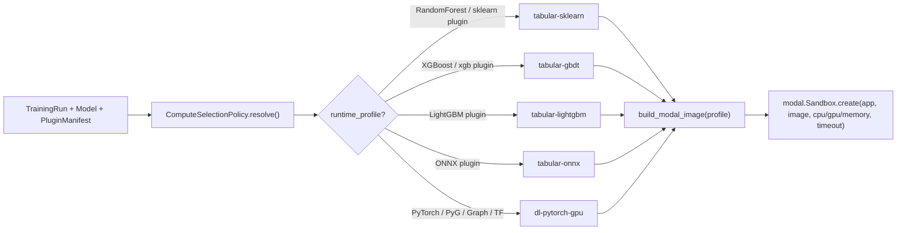
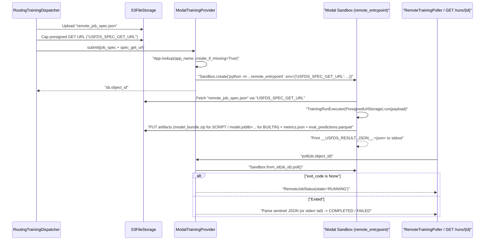

# Plan: Remote Training Sandbox Hardening & Runtime Profile Isolation (Đợt 1)

> **Task ID:** `remote_training_sandbox_hardening` · **Issues:** ISS-009 (follow-up hardening) · **Spec:** `docs/features/detection/training/suc-spec.md` (`SUC-08`)
> **Conflict verdict:** PARALLEL-SAFE · **Status:** Done (26-11-28)

## 1. Context (facts)
- `usfds-core/src/usfds_core/__init__.py:6-11` và `usfds-core/src/usfds_core/services/__init__.py:1-6` dùng eager wildcard `import *`, kéo toàn bộ `data_management` (`duckdb`), `investigation` (`ladybug`, `shap`), `preprocessing` (`imblearn`, `category_encoders`) ngay khi import `usfds_core.services.training.executor`. Toàn bộ codebase (`usfds-core`, `usfds-infra`, `usfds-server`, `usfds-worker`, `usfds-cli`, `custom-models`) không có caller nào dùng `from usfds_core import ...` hay `from usfds_core.services import ...`.
- `usfds-infra/src/usfds_infra/compute/modal_app.py:28-49` chỉ cài 7 thư viện (`pydantic`, `pandas`, `numpy`, `pyarrow`, `scikit-learn>=1.5`, `xgboost`, `joblib`) rồi `.add_local_python_source("usfds_core")` và bắt chạy tay `modal deploy`. Khi chạy thật trên Modal: (a) container crash `ModuleNotFoundError: duckdb` do eager import, (b) thiếu `torch`/`lightgbm`/`onnxruntime` cho GPU/SCRIPT plugins mà `ComputeSelectionPolicy` (`usfds-core/src/usfds_core/services/training/compute_policy.py:18-27`) và `ModelPluginManifest` (`usfds-core/src/usfds_core/domain/schemas/model_plugin.py:15`) hỗ trợ, (c) lệch version `scikit-learn>=1.5` so với `usfds-core/pyproject.toml:14` (`scikit-learn>=1.4.0,<1.6.0`).
- `usfds-infra/src/usfds_infra/compute/modal_provider.py:97` gọi `modal.Function.from_name(app_name, fn_name)` nên phụ thuộc vào bước `modal deploy` thủ công; chưa kiểm tra `USFDS_S3_PUBLIC_ENDPOINT_URL` trỏ về `localhost`/`127.0.0.1`.
- `usfds-core/src/usfds_core/services/training/dispatchers/routing_dispatcher.py:12-24` hardcode 11 filename `_STANDARD_OUTPUT_FILENAMES`, trong khi `usfds-core/src/usfds_core/services/training/executor.py:126-130` upload mọi file lẻ trong `workspace.model_dir` trước khi đóng `model_bundle.zip` cho `SCRIPT` plugin → gây `KeyError` ở `PresignedUrlStorage.save_bytes` (`usfds-core/src/usfds_core/storage/presigned_storage.py:66`) nếu plugin tạo file phụ tên tùy ý.
- `usfds-core/src/usfds_core/services/training/models/script_trainer.py:29` hardcode `timeout_seconds = 600` (10 phút), lệch với timeout 4 giờ của remote job.
- `usfds-server/src/usfds_server/routers/training_router.py:806-808` gọi `service.sync_remote_run(run.run_id)` trực tiếp trong DB session `get_db()`, giữ connection DB trong suốt lời gọi mạng `provider.poll()`.

## 2. Goal, scope verdict & non-goals
- **Goal:** Sửa toàn bộ lỗi chặn chạy thật trên Modal và loại bỏ hoàn toàn bước `modal deploy` thủ công bằng `modal.Sandbox` + runtime image profile cô lập theo từng loại model/framework (không dùng `__getattr__`), đồng thời sửa lỗi presigned upload của `SCRIPT` plugin, đồng bộ timeout và giải phóng DB session khi poll tại `GET /runs/{run_id}`.
- **Scope:** OK
- **Non-goals / omitted:**
  - Không thêm `__getattr__` lazy fallback vào `usfds_core/__init__.py` hay `usfds_core/services/__init__.py` (theo yêu cầu người dùng).
  - Không tổng quát hóa sang Batch Inference hay Data Processing (thuộc Đợt 2: `.plan/remote_compute_multi_workload.md`).
  - Không thay đổi DB schema (không cần Alembic migration mới) và không thay đổi UI (`usfds-web`).
  - Không cài thư viện tùy ý từ user manifest (`requirements.txt` trong plugin zip) ở đợt này; chỉ dùng tập runtime profile chuẩn đã kiểm soát.
- **Assumptions:**
  - `modal` SDK >= 0.73 (hỗ trợ `modal.App.lookup(..., create_if_missing=True)`, `modal.Sandbox.create(...)`, `modal.Sandbox.from_id(...)`, `sb.poll()`, `sb.terminate()`, `modal.Image.debian_slim().pip_install(...).add_local_python_source("usfds_core")`).
  - Hệ thống chạy remote với `USFDS_STORAGE_BACKEND=s3` và `USFDS_S3_PUBLIC_ENDPOINT_URL` là endpoint truy cập được từ Internet (không phải `localhost`/`127.0.0.1`).

## 2.5 Design & Approach (user reviews this section)
### Diagram(s)

#### A. Phân giải Runtime Profile & dựng Modal Sandbox Image động

#### B. Luồng thực thi Zero-Deploy qua Modal Sandbox & lấy kết quả

### Key decisions & contracts
| Area | Decision / Contract | Rationale / Notes |
|---|---|---|
| Core imports | Gỡ toàn bộ eager `import *` ở `usfds-core/src/usfds_core/__init__.py` và `usfds-core/src/usfds_core/services/__init__.py` (chỉ giữ docstring, không dùng `__getattr__`). | Container training chỉ nạp các module thuộc `services/training/` + `domain/`, không kéo `duckdb`/`ladybug`/`shap`/`imblearn`. |
| Runtime profiles | Thêm `runtime_profile: str = "tabular-sklearn"` trên `RemoteTrainingJobSpec` và `ComputeRecommendation` (`compute_metadata["runtime_profile"]`). Pin `scikit-learn>=1.4.0,<1.6.0` khớp `usfds-core/pyproject.toml:14`. Các profile: `tabular-sklearn`, `tabular-gbdt`, `tabular-lightgbm`, `tabular-onnx`, `dl-pytorch-gpu` (thêm `torch-geometric` nếu `pyg`/`graph`). | Cô lập dependency theo workload, giảm kích thước image, đồng bộ phiên bản `scikit-learn` để `joblib.load()` khi inference không lỗi. |
| Modal Sandbox (zero-deploy) | Xóa `usfds-infra/src/usfds_infra/compute/modal_app.py`, tạo `usfds-infra/src/usfds_infra/compute/modal_images.py` (`build_modal_image`) và `usfds-core/src/usfds_core/services/training/remote_entrypoint.py` (`python -m usfds_core.services.training.remote_entrypoint`). `ModalTrainingProvider` dùng `App.lookup(app_name, create_if_missing=True)` + `Sandbox.create(...)` + `Sandbox.from_id(...).poll()` + `sb.terminate()` cho `cancel()`. | Triệt tiêu bước `modal deploy` thủ công, cho phép build image động theo `runtime_profile` (Modal tự cache layer) và hỗ trợ `cancel()`. |
| Spec & Result transport | Upload `models/{model_id}/runs/{run_id}/remote_job_spec.json` lên storage, chỉ truyền 1 biến môi trường `USFDS_SPEC_GET_URL` vào Sandbox. Entrypoint in kết quả có tiền tố `__USFDS_RESULT_JSON__:` ra stdout. | Tránh giới hạn kích thước env/CLI và không lộ danh sách presigned URLs ra command line; tách biệt kết quả khỏi log stdout thông thường. |
| SCRIPT artifact upload | Trong `TrainingRunExecutor.run()`, khi `is_script_plugin == True`, chỉ upload `model_bundle.zip` (chứa toàn bộ `src/` và `artifacts/`), không upload các file lẻ bên trong `workspace.model_dir`. | Triệt tiêu hoàn toàn `KeyError` từ `PresignedUrlStorage` khi plugin tạo các file phụ tên tùy ý. |
| Timeout propagation | Thêm `timeout_seconds: Optional[int] = None` vào `TrainingRunPayload`, truyền xuống `ModelTrainerFactory.create_trainer` → `ScriptPluginTrainer` (mặc định giữ 600s cho local nếu `None`, hoặc `USFDS_MODAL_TIMEOUT_SECONDS` cho remote). | Cho phép job `SCRIPT` trên remote chạy tới hết ngưỡng cấu hình (vd 14400s) thay vì bị cắt ở 600s. |
| DB session hygiene | `GET /api/v1/training/runs/{run_id}` dùng helper 3 pha (đọc ngắn → đóng session → `provider.poll()` → ghi ngắn khi terminal), không giữ session `get_db()` qua network I/O. | Nhất quán với `RemoteTrainingPoller`, tránh cạn connection pool khi người dùng mở trang chi tiết run. |
| Config / Env | Giữ `USFDS_MODAL_ENABLED`, `USFDS_MODAL_APP_NAME`; bỏ hẳn `USFDS_MODAL_CPU_FN`/`USFDS_MODAL_GPU_FN` và thay bằng `USFDS_MODAL_GPU_TYPE` (`"T4"`), `USFDS_MODAL_CPU_CORES` (`4.0`), `USFDS_MODAL_MEMORY_MB` (`8192`), `USFDS_MODAL_GPU_MEMORY_MB` (`16384`), `USFDS_MODAL_TIMEOUT_SECONDS` (`14400`). | Khớp hoàn toàn với cấu hình tài nguyên động của `modal.Sandbox.create(...)`. |

### Edge cases, concurrency & failure handling
- **Sandbox crash trước khi in `__USFDS_RESULT_JSON__:`** (vd OOM, image build fail, segfault): khi `sb.poll()` trả `exit_code != 0` mà stdout không có dòng sentinel, `ModalTrainingProvider.poll()` lấy tối đa 2000 ký tự cuối của `stderr` (fallback `stdout`) trả `RemoteJobStatus(state="FAILED", error_message=...)`.
- **`USFDS_S3_PUBLIC_ENDPOINT_URL` trỏ về localhost:** Nếu endpoint public chứa `localhost`, `127.0.0.1`, `::1`, hoặc `0.0.0.0`, `ModalTrainingProvider.is_available()` trả `(False, reason)` rõ ràng để chặn submit job lên cloud rồi fail khi container boot (cho phép truyền `allow_localhost_presigned=True` trong constructor khi chạy test local HTTP server).
- **`GET /runs/{run_id}` trong unit test dùng `dependency_overrides[get_training_service]`:** Khi `_server_deps._session_factory` chưa khởi tạo (test mock service), fallback gọi `service.sync_remote_run()` trực tiếp để không làm vỡ test hiện có; runtime thật dùng `_session_factory` tách 3 pha.
- **Vòng đời file `remote_job_spec.json`:** Được lưu dưới prefix run (`models/{model_id}/runs/{run_id}/remote_job_spec.json`), không ảnh hưởng `ModelVersion`; presigned GET URL tự hết hạn theo `USFDS_REMOTE_PRESIGNED_TTL_SECONDS`.

## 3. Files
| Action | File | Milestone | Note |
|---|---|---|---|
| modify | `usfds-core/src/usfds_core/__init__.py` | M1 | Xóa eager `import *` (không thêm `__getattr__`) |
| modify | `usfds-core/src/usfds_core/services/__init__.py` | M1 | Xóa eager `import *` (không thêm `__getattr__`) |
| modify | `usfds-core/src/usfds_core/domain/schemas/training_payload.py` | M1 | Thêm `timeout_seconds` trên `TrainingRunPayload`, `runtime_profile` trên `RemoteTrainingJobSpec` và `ComputeRecommendation` |
| modify | `usfds-core/src/usfds_core/services/training/compute_policy.py` | M1 | Resolve `runtime_profile` theo model/framework/tier |
| modify | `usfds-core/src/usfds_core/services/training/executor.py` | M1 | Bỏ upload file lẻ `model_dir` khi `is_script_plugin=True` (chỉ upload `model_bundle.zip`); truyền `payload.timeout_seconds` xuống `ModelTrainerFactory` |
| modify | `usfds-core/src/usfds_core/services/training/models/trainer_factory.py` | M1 | Nhận optional `timeout_seconds` truyền vào `ScriptPluginTrainer` |
| modify | `usfds-core/src/usfds_core/services/training/dispatchers/routing_dispatcher.py` | M1 | Gắn `runtime_profile`, upload `remote_job_spec.json` + gắn `spec_get_url` vào `metadata` (hoặc trường chuyên biệt) |
| modify | `usfds-core/src/usfds_core/services/training/training_service.py` | M1 | Lưu `runtime_profile` vào `compute_metadata`, truyền `timeout_seconds` vào `TrainingRunPayload` |
| create | `usfds-core/src/usfds_core/services/training/remote_entrypoint.py` | M1 | CLI entrypoint `python -m usfds_core.services.training.remote_entrypoint` chạy trong Modal Sandbox (đọc `USFDS_SPEC_GET_URL`, chạy `TrainingRunExecutor`, in `__USFDS_RESULT_JSON__:`) |
| create | `usfds-infra/src/usfds_infra/compute/modal_images.py` | M2 | `RUNTIME_PROFILE_DEPS` (pin `scikit-learn>=1.4.0,<1.6.0`) & `build_modal_image(modal_mod, profile)` |
| delete | `usfds-infra/src/usfds_infra/compute/modal_app.py` | M2 | Xóa file manual `modal deploy` obsolete |
| modify | `usfds-infra/src/usfds_infra/compute/modal_provider.py` | M2 | Chuyển sang `App.lookup(..., create_if_missing=True)` + `Sandbox.create` + `Sandbox.from_id().poll()` + `cancel()` (`terminate`) + guard localhost S3 endpoint |
| modify | `usfds-server/src/usfds_server/config.py` | M3 | Append/cập nhật env `USFDS_MODAL_GPU_TYPE`, `USFDS_MODAL_CPU_CORES`, `USFDS_MODAL_MEMORY_MB`, `USFDS_MODAL_GPU_MEMORY_MB`, `USFDS_MODAL_TIMEOUT_SECONDS` |
| modify | `usfds-server/src/usfds_server/providers/training.py` | M3 | Truyền cấu hình Sandbox mới vào `ModalTrainingProvider` và timeout vào `TrainingOrchestrationService` |
| modify | `usfds-server/src/usfds_server/routers/training_router.py` | M3 | Tách pha poll mạng khỏi DB session trong `GET /runs/{run_id}` |
| modify | `deploy/.env.example` | M3 | Cập nhật biến môi trường Modal mới |

## 4. Dependencies & conflicts (with other tasks on BOARD)
| # | Check | Answer |
|---|---|---|
| D1 | Needs unfinished task? | No (tất cả task trên `.plan/BOARD.md` đều `Done`) |
| D2 | Needed by unfinished task? | Yes: `remote_compute_multi_workload` (Draft, future session) |
| C1 | Modified files owned by in-progress task? | No |
| C2 | Hot-spot files touched | Yes (append-only where applicable): `usfds-core/src/usfds_core/__init__.py`, `usfds-core/src/usfds_core/services/__init__.py`, `usfds-server/src/usfds_server/config.py`, `usfds-server/src/usfds_server/providers/training.py`, `deploy/.env.example` |
| C3 | Schema change | No (không đổi DB schema) |
| C4 | Public contract change | Minor backward-compatible additions (`TrainingRunPayload.timeout_seconds`, `RemoteTrainingJobSpec.runtime_profile`, `ComputeRecommendation.runtime_profile` đều có default; không phá vỡ REST contract) |
| C5 | Shared UI shell change | No |

## 5. Acceptance tests (user reviews this section)
| Milestone | Test | Given | When | Then | Covers |
|---|---|---|---|---|---|
| M1 | `test_importing_training_executor_does_not_load_heavy_unrelated_deps` (`usfds-core/tests/training/test_remote_compute.py`) | Subprocess Python sạch chạy trong môi trường `usfds-core` | Thực thi `from usfds_core.services.training.executor import TrainingRunExecutor` | `duckdb`, `ladybug`, `shap`, `imblearn`, `category_encoders` không xuất hiện trong `sys.modules` | ISS-009 |
| M1 | `test_compute_policy_resolves_runtime_profile_per_model_and_framework` (`usfds-core/tests/training/test_remote_compute.py`) | Các cặp `(Model, plugin_framework)`: `random_forest`, `xgboost`, plugin `lightgbm`, plugin `onnx`, plugin `pytorch`/`pyg` | Gọi `ComputeSelectionPolicy.resolve(...)` | Trả về đúng `runtime_profile`: `tabular-sklearn`, `tabular-gbdt`, `tabular-lightgbm`, `tabular-onnx`, `dl-pytorch-gpu` (hoặc `dl-pyg-gpu` nếu tách PyG) | ISS-009 |
| M1 | `test_script_plugin_with_custom_artifact_files_succeeds_over_presigned_storage` (`usfds-core/tests/training/test_remote_compute.py`) | `SCRIPT` plugin tạo file phụ tên tùy ý (`custom_scaler.pkl`, `vocab.json`) trong `artifact_dir`, chạy qua `PresignedUrlStorage` chỉ cấp standard write URLs | Chạy `TrainingRunExecutor(file_storage=PresignedUrlStorage(...)).run(payload)` | Không ném `KeyError`; upload thành công `model_bundle.zip` chứa các file phụ đó cùng `metrics.json` | ISS-009 |
| M1 | `test_remote_entrypoint_reads_spec_url_and_emits_structured_result_json` (`usfds-core/tests/training/test_remote_compute.py`) | Local HTTP mock server phục vụ `remote_job_spec.json`, train/test parquet và nhận write PUT URLs | Chạy `remote_entrypoint.main()` với biến môi trường `USFDS_SPEC_GET_URL` | In ra stdout dòng `__USFDS_RESULT_JSON__:<json>` parse thành `TrainingRunResult(is_success=True)` | ISS-009 |
| M1 | `test_training_executor_propagates_timeout_seconds_to_script_trainer` (`usfds-core/tests/training/test_remote_compute.py`) | `TrainingRunPayload(execution_type="SCRIPT", timeout_seconds=1800, ...)` | Gọi `TrainingRunExecutor.run(payload)` (mock `ScriptPluginTrainer`) | `ScriptPluginTrainer` được khởi tạo với `timeout_seconds=1800` | ISS-009 |
| M2 | `test_modal_image_builder_selects_minimal_pinned_dependencies_per_profile` (`usfds-infra/tests/test_modal_provider.py`) | Fake `modal.Image` ghi nhận các lời gọi `pip_install` và `add_local_python_source` | Gọi `build_modal_image` cho từng `runtime_profile` | Mỗi profile cài đúng tập package tối thiểu, pin `scikit-learn>=1.4.0,<1.6.0`, không có `duckdb`/`ladybug`/`shap`; chỉ profile DL mới có `torch` | ISS-009 |
| M2 | `test_modal_sandbox_provider_zero_deploy_submit_poll_cancel_and_localhost_guard` (`usfds-infra/tests/test_modal_provider.py`) | Fake Modal SDK (`App.lookup`, `Sandbox.create`, `Sandbox.from_id`) và `s3_storage` (cả endpoint public lẫn `http://localhost:9000`) | Kiểm tra `is_available()`, `submit()`, `poll()` (`None` → `RUNNING`, sentinel stdout → `COMPLETED`, non-zero exit + stderr → `FAILED`), và `cancel()` | Chặn localhost S3 endpoint; `submit()` tự gọi `App.lookup(create_if_missing=True)` + `Sandbox.create` kèm `USFDS_SPEC_GET_URL`; `poll()` và `cancel()` (`terminate()`) hoạt động đúng | ISS-009 |
| M3 | `test_get_training_run_releases_db_session_before_remote_poll` (`usfds-server/tests/test_training_api.py`) | `TrainingRun(RUNNING, external_job_id="sb-1")` trong DB thật của app (`_session_factory`) và fake `provider.poll()` kiểm tra DB lock/session | Gọi `GET /api/v1/training/runs/{run_id}?project_id=...` | Không có DB session bị giữ trong suốt lúc gọi `provider.poll()`, trạng thái chuyển `COMPLETED` và tạo đúng 1 `ModelVersion` | ISS-009 |

## 6. Milestones & to-do (checkpoints, not stop points: all tests green at each)
The agent ticks items as it works. This is the task's only to-do list (`TODO.md` is no longer used for new work).

- [x] **M1 — Core import isolation, runtime profiles, remote entrypoint & SCRIPT/timeout fixes** (`usfds-core`):
  - [x] [tests] Viết toàn bộ tests M1 trong `usfds-core/tests/training/test_remote_compute.py`; xác nhận fail đúng lý do (reproducing bug #1, #3, #5)
  - [x] [core] Gỡ eager `import *` ở `usfds_core/__init__.py` và `usfds_core/services/__init__.py` (không dùng `__getattr__`)
  - [x] [core] Mở rộng `training_payload.py` (`timeout_seconds`, `runtime_profile`), cập nhật `compute_policy.py`, `trainer_factory.py`, `executor.py`, `routing_dispatcher.py`, `training_service.py`
  - [x] [core] Tạo `usfds-core/src/usfds_core/services/training/remote_entrypoint.py`
  - [x] [verify] `./scripts/test.sh core`
- [x] **M2 — Zero-deploy Modal Sandbox provider & dynamic profile images** (`usfds-infra`):
  - [x] [tests] Viết tests M2 trong `usfds-infra/tests/test_modal_provider.py`; xác nhận fail đúng lý do
  - [x] [infra] Tạo `usfds-infra/src/usfds_infra/compute/modal_images.py` và xóa `usfds-infra/src/usfds_infra/compute/modal_app.py`
  - [x] [infra] Cập nhật `usfds-infra/src/usfds_infra/compute/modal_provider.py` sang `App.lookup` + `Sandbox.create`/`from_id`/`poll`/`terminate` + localhost S3 endpoint guard
  - [x] [verify] `./scripts/test.sh infra`
- [x] **M3 — Server config wiring & DB-session-free on-demand poll** (`usfds-server`, `deploy`):
  - [x] [tests] Viết test M3 trong `usfds-server/tests/test_training_api.py`; xác nhận fail đúng lý do
  - [x] [server] Cập nhật `usfds-server/src/usfds_server/config.py`, `usfds-server/src/usfds_server/providers/training.py`, `deploy/.env.example`
  - [x] [server] Cập nhật `usfds-server/src/usfds_server/routers/training_router.py` (`GET /runs/{run_id}` tách pha poll mạng khỏi DB session)
  - [x] [verify] `./scripts/test.sh core infra server worker`

Checkpoint log (the agent appends one line per finished milestone):
- 26-11-28 M1 done: 195 passed, 15 skipped, 169 warnings in 12.82s (`./scripts/test.sh core`); notes: separated `dl-pyg-gpu` profile for PyG/graph plugins in `ComputeSelectionPolicy`; also moved `duckdb_io` imports in `project_management/schema_validator.py` inside the two DuckDB methods to break a latent circular import exposed by removing `services/__init__.py` eager `import *`
- 26-11-28 M2 done: 55 passed, 27 warnings in 6.38s (`./scripts/test.sh infra`); notes: —
- 26-11-28 M3 done: core 195 passed (15 skipped), infra 55 passed, server 60 passed, worker 10 passed (`./scripts/test.sh core infra server worker`); notes: —

## 7. Review hotspots (filled in after implementation)
1. `usfds-core/src/usfds_core/services/training/compute_policy.py:81-111` (M1): `resolve_runtime_profile()` prioritizes explicit `plugin_framework` and `default_hyperparameters["framework"]` before falling back to `model_name`/`description`, separating `dl-pyg-gpu` from `dl-pytorch-gpu`; risky if a custom plugin omits `framework` in manifest and relies on naming; covered by `test_compute_policy_resolves_runtime_profile_per_model_and_framework`.
2. `usfds-core/src/usfds_core/services/training/executor.py:107-125` (M1): Branches on `is_script_plugin` (`execution_type == "SCRIPT"` and non-empty `plugin_src_dir`) to upload only `model_bundle.zip` and skip per-file uploads from `workspace.model_dir`; risky if a SCRIPT plugin is misclassified and leaves loose artifacts unbundled or triggers `PresignedUrlStorage` `KeyError`; covered by `test_script_plugin_with_custom_artifact_files_succeeds_over_presigned_storage` and `test_training_run_executor_runs_builtin_and_script_over_presigned_storage`.
3. `usfds-core/src/usfds_core/services/training/dispatchers/routing_dispatcher.py:116-128` (M1): Uploads `remote_job_spec.json` to storage and attaches `spec_get_url` into `job_spec.metadata` before `provider.submit()`; risky if storage does not retain `remote_job_spec.json` until container boot or TTL expires early; covered by `test_routing_dispatcher_generates_presigned_urls_and_submits_remote_job` and `test_remote_entrypoint_reads_spec_url_and_emits_structured_result_json`.
4. `usfds-core/src/usfds_core/services/project_management/schema_validator.py:176-226` (M1): Moved `duckdb_io` imports into `extract_raw_schema_from_duckdb()` and `validate_duckdb_view()` to break a latent circular import (`schema_validator.py` <-> `data_management/ingestion.py`) exposed by removing `services/__init__.py` wildcard imports; covered by `test_importing_training_executor_does_not_load_heavy_unrelated_deps` and full `infra`/`server` suites.
5. `usfds-infra/src/usfds_infra/compute/modal_provider.py:114-233` (M2): `is_available()` blocks loopback S3 endpoints (`localhost`/`127.0.0.1`/`::1`/`0.0.0.0`), `submit()` uses zero-deploy `App.lookup(create_if_missing=True)` + `Sandbox.create`, `poll()` scans stdout backwards for `__USFDS_RESULT_JSON__:` and falls back to 2000-char stderr tail on crash, `cancel()` calls `sb.terminate()`; risky if sandbox emits truncated sentinel or non-standard error output; covered by `test_modal_sandbox_provider_zero_deploy_submit_poll_cancel_and_localhost_guard`.
6. `usfds-server/src/usfds_server/routers/training_router.py:875-986` (M3): `get_training_run` drops `Depends(get_db)`-backed parameters so no DB session/connection is held open during `provider.poll()`, running Phase 1 (authz + snapshot), Phase 2 (network poll), Phase 3 (apply terminal status), with a fallback path when tests override `get_training_service`/`get_actor_context`/`get_authz_service`/`get_user_repo`; risky if authz/project scope checks diverge from the fallback helper; covered by `test_get_training_run_releases_db_session_before_remote_poll` and `test_remote_training_api_rbac_and_sync_lifecycle`.

## 8. Open questions
— (Đã xác nhận 26-11-27: bỏ hẳn `USFDS_MODAL_CPU_FN` / `USFDS_MODAL_GPU_FN`; giữ GPU mặc định `"T4"`.)

## 9. Manual E2E verification (post-merge)
- [ ] Chạy server với `USFDS_MODAL_ENABLED=true`, `MODAL_TOKEN_ID/SECRET`, `USFDS_STORAGE_BACKEND=s3`, `USFDS_S3_PUBLIC_ENDPOINT_URL=<public URL>` (tắt `usfds-worker`) **mà KHÔNG chạy `modal deploy`**.
- [ ] Train 1 model `BUILTIN` (`random_forest` hoặc `xgboost`) và 1 `SCRIPT` plugin có file phụ tùy ý → xác nhận Modal tự tạo app/sandbox, build đúng image profile gọn, không lỗi `ModuleNotFoundError`, hoàn tất `COMPLETED` và tạo đúng 1 `ModelVersion`.
