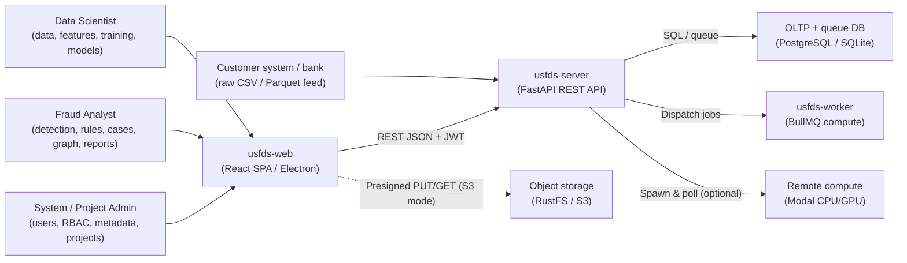
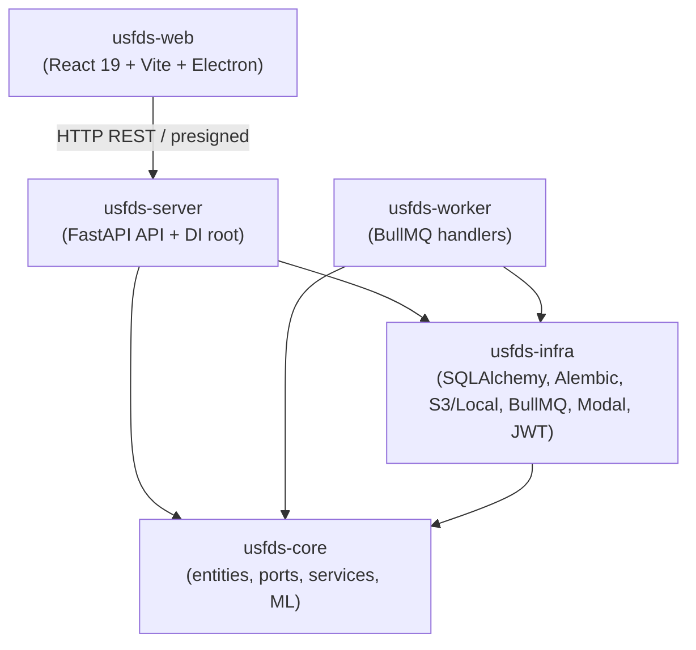
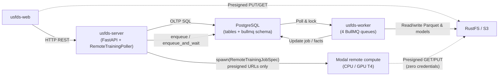

# 01 — System Context, Packages & Runtime (As-Built)
<!-- [26-11-27] Created. [26-11-28] English rewrite; single-organization framing; out-of-scope packages removed. -->

Three views of the running system: **system boundary**, **package structure (Clean Architecture)**, and **runtime & deployment**.

## 1. System context

USFDS is a fraud detection system deployed for **one organization** (not multi-tenant) when they self-host it. Inside it, a **`Project` is a workspace isolation boundary**: every business resource (`datasets`, `features`, `rules`, `models`, `detection_jobs`, `fraud_cases`, warehouse files) is scoped by `project_id` (`INV-002`). Exceptions are the system-wide `BUILTIN` catalog (built-in models, built-in features) and `system_column_metadata`.

## 2. Packages & dependency direction

In scope: **5 packages** (4 Python Poetry packages on Python 3.12 + 1 TypeScript/React package). Other packages in the repo are out of current scope. Dependencies point inward to `usfds-core` (`INV-005`, `P-04`).

| Package | Role | Allowed internal deps | Boundary |
|---|---|---|---|
| `usfds-core` | Domain entities, enums, ports (repository, storage, compute, dispatcher, notifier), business / ML / analytics services | none | Must not import `sqlalchemy`, `fastapi`, `boto3`, `bullmq`, `modal`, `usfds_infra`, `usfds_server`, `usfds_worker`. Direct `duckdb` / `ladybug` imports are frozen legacy (`P-04`, `ISS-057`). |
| `usfds-infra` | Infrastructure adapters: ORM tables + Alembic migrations, SQL / S3 / local / BullMQ / Modal / JWT implementations, PostgreSQL-compat test guard | `usfds-core` | Only package that touches SQLAlchemy, boto3, BullMQ, Modal SDK. |
| `usfds-server` | FastAPI composition root, routers, DI providers, auth/RBAC enforcement, `RemoteTrainingPoller` | `usfds-core`, `usfds-infra` (dev: `usfds-worker`) | No complex business logic; no direct ORM queries outside repositories/providers. |
| `usfds-worker` | Consumer for heavy jobs on 4 BullMQ queues; `InlineJobQueue` test double | `usfds-core`, `usfds-infra` | Runs with PostgreSQL + S3; every executor runs via `asyncio.to_thread` to keep the BullMQ lock alive. |
| `usfds-web` | UI (browser SPA or Electron desktop) | HTTP only | Layers `components → hooks (React Query) → api/client.ts` (`INV-014`). |

## 3. Runtime modes (desktop vs client–server)

Deployment settings come from `USFDS_*` env vars (`usfds-server/src/usfds_server/config.py`, `deploy/.env.example`). Env is for deployment infrastructure and secrets; business values belong in system metadata (`P-01`).

| Component | Desktop / local (default) | Client–server (`deploy/docker-compose.yml`) |
|---|---|---|
| OLTP database | SQLite (`usfds.db`, WAL, `foreign_keys=ON`) | PostgreSQL 17 (`USFDS_DB_URL=postgresql+psycopg://...`) |
| File storage | `LocalFileStorage` (`USFDS_STORAGE_BACKEND=local`) | `S3FileStorage` (`USFDS_STORAGE_BACKEND=s3`) on **RustFS** (S3v4 path-style; internal `endpoint_url` vs `public_endpoint_url` for presigning) |
| Job dispatch | `sync` (in the server process) | `queue` (**BullMQ on PostgreSQL**, schema `bullmq`), consumed by `usfds-worker` |
| Authentication | `USFDS_AUTH_MODE=local_auto` (auto-login `bootstrap_admin`) | `USFDS_AUTH_MODE=required` (HS256 JWT bearer + rotating refresh sessions) |
| Remote training | Off (`USFDS_MODAL_ENABLED=false`) | Optional **Modal** (CPU 4 vCPU/8 GB, GPU T4/16 GB); the server runs `RemoteTrainingPoller` every 15 s (independent of `usfds-worker`) |
| Default ports | Server `8200`, web dev `5173` | Server `8000`, web nginx `5173`, Postgres `5400`, RustFS `9000/9001` |

### Storage concepts → as-built

| Concept | As-built | Notes |
|---|---|---|
| OLTP DB | PostgreSQL (SQLite locally), 27 ORM tables via Alembic | See [`04-data-model-erd.md`](04-data-model-erd.md). |
| File storage (data lake) | RustFS (S3-compatible) or local filesystem behind `IFileStorage` | Raw / mapped / enriched Parquet, model artifacts, `predictions.parquet`, exports. |
| Analytic DB (OLAP) | **Bounded DuckDB** (`:memory:`, CPU/RAM capped) over `ProjectWarehouse` Parquet | No separate warehouse server; each completed `DetectionJob` writes one append-only fact file. |
| Graph DB | **Embedded LadybugDB** (`:memory:`) built from `ProjectWarehouse`, LRU + TTL cache | `docker-compose.yml` ships an `apache/age` image and `initdb/10-usfds-graph.sql`, but the graph service does **not** query Apache AGE. |
| Job queue | **BullMQ on PostgreSQL** (`bullmq` schema) | No Redis / RabbitMQ. |

## 4. Client–server–worker runtime & remote compute

### BullMQ queues & jobs (`usfds-worker/src/usfds_worker/main.py`)

| Queue (`USFDS_WORKER_QUEUES`) | Job | Server call style | Timeout / retry |
|---|---|---|---|
| `usfds-training` (`training`) | `training_run` | Fire-and-forget (`enqueue`) | `attempts=1`; handler skips if DB status is already terminal |
| `usfds-training` (`training`) | `plugin_dry_run` | Request/reply (`enqueue_and_wait`) | `USFDS_QUEUE_WAIT_TIMEOUT_SECONDS` (300 s), `attempts=1` |
| `usfds-batch-inference` (`batch_inference`) | `batch_inference` | Fire-and-forget | `attempts=1`; skips terminal status |
| `usfds-batch-inference` (`batch_inference`) | `rule_backtest` | Request/reply | 300 s, `attempts=1` |
| `usfds-data-pipeline` (`data_pipeline`) | `dataset_ingestion`, `schema_mapping`, `feature_engineering` | Request/reply | 300 s, `attempts=1` |
| `usfds-analytics` (`analytics`) | `insight_report` | Request/reply | `USFDS_ANALYTICS_WAIT_TIMEOUT_SECONDS` (120 s), **`attempts=3`** |

Failure semantics (`ISS-021`, `INV-008`):
- Deterministic errors (`ValueError`, `LookupError`, `FileNotFoundError`, `TypeError`, `MemoryError`) are wrapped in `bullmq.UnrecoverableError` → no retry; the server re-raises the original exception.
- `enqueue_and_wait` timeout: if the job has not started (`waiting` / `delayed` / `prioritized`) the server removes it and returns `504` (`cancelled=True`); if it is running, the job continues and the server returns `504` (`cancelled=False`, with `job_id`).

## 5. Storage key layout

All file I/O goes through `IFileStorage`; download authorization in `storage_router.py` depends on these prefixes.

| Prefix | Writer | Purpose |
|---|---|---|
| `uploads/{purpose}/{project_id\|global}/{uuid}/{filename}` | Client (presigned PUT) | Staging for `dataset_raw`, `detection_input`, `model_plugin` |
| `datasets/{dataset_id}/raw/{filename}` | `DatasetIngestionService` | Normalized raw file |
| `datasets/{dataset_id}/mapped/{artifact_id}/mapped.parquet` | `DataMappingService` | Data mapped to system columns |
| `datasets/{dataset_id}/artifacts/{artifact_id}/...` | Feature engineering / preprocessing | `train_enriched.parquet`, `test_enriched.parquet`, `fitted_feature_engineers.joblib`, `fitted_pipeline.joblib` |
| `models/{model_id}/plugin_source.zip` | Plugin registration | Custom plugin source |
| `models/{model_id}/runs/{run_id}/...` | `TrainingRunExecutor` | Model artifact (`model.joblib` + `preprocessor.joblib`, or `model_bundle.zip`) + companions (`C3`) |
| `datasets/{project_id}/inferences/inputs/{job_id}/{filename}` | `InferenceService` | Copy of batch detection input |
| `datasets/{project_id}/inferences/{target}/{job_id}/predictions.parquet` | `BatchInferenceExecutor` | Scores + rules + final decision |
| `warehouse/{project_id}/fact_transactions/job_{job_id}.parquet` | `ProjectWarehouse` | Append-only fact table for insight, graph, behavior profile (`C5`) |
| `exports/{datasets\|detection\|reports}/...` | Routers | Temporary user downloads (presigned GET or stream) |
