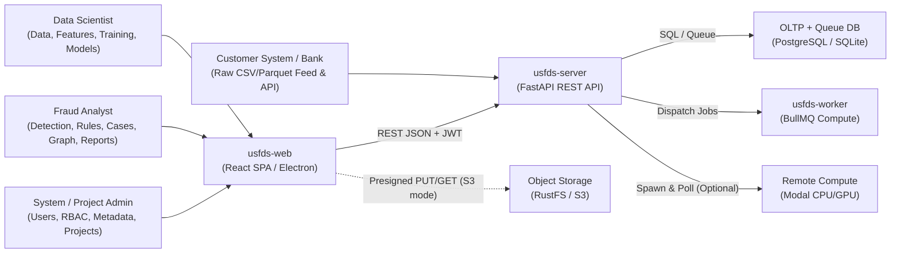
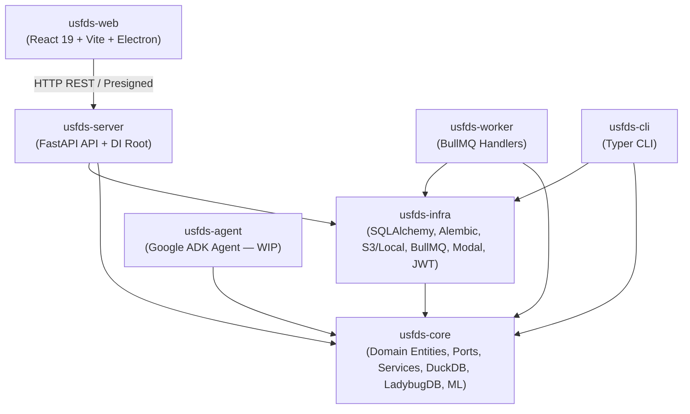
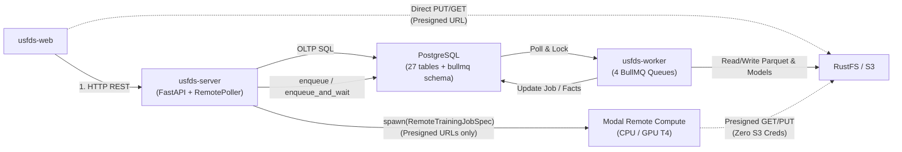

# 01 — System Context, Packages & Runtime Architecture (As-Built)
<!-- [26-11-27] Created: As-Built context, Clean Architecture packages, dual deployment modes, queues, and storage layout. -->

Tài liệu này mô tả hệ thống USFDS đang vận hành thực tế theo 3 góc nhìn: **Ranh giới hệ thống (System Boundary)**, **Cấu trúc mã nguồn (Clean Architecture Packages)** và **Kiến trúc thực thi & triển khai (Runtime & Deployment)**.

---

## 1. Ranh giới hệ thống & Tác nhân (System Context)

USFDS là nền tảng phát hiện gian lận giao dịch (Fraud Detection System) hoạt động theo mô hình **Project-Scoped Multi-Tenant**: mọi tài nguyên nghiệp vụ (`datasets`, `features`, `rules`, `models`, `detection_jobs`, `fraud_cases`, `warehouse`) đều được cô lập theo `project_id` (ngoại trừ catalog hệ thống `BUILTIN` như built-in models, built-in features và `system_column_metadata`).

---

## 2. Cấu trúc Monorepo & Chiều phụ thuộc (Clean Architecture)

Hệ thống gồm **7 package độc lập** (6 Python Poetry packages trên Python 3.12 + 1 TypeScript/React package). Quy tắc bất biến là **phụ thuộc một chiều hướng vào `usfds-core`** (`INV-005`):

| Package | Vai trò thực tế | Phụ thuộc nội bộ cho phép | Ghi chú ranh giới |
|---|---|---|---|
| `usfds-core` | Domain entities, enums, repository/storage/compute ports, toàn bộ business/ML/DuckDB/LadybugDB services | **Không có** | Cấm import `sqlalchemy`, `fastapi`, `boto3`, `bullmq`, `usfds_infra`, `usfds_server`. |
| `usfds-infra` | Adapter hạ tầng: 27 ORM tables + Alembic migrations, SQL/S3/Local/BullMQ/Modal/JWT implementations, `pg_compat` test guard | `usfds-core` | Nguồn duy nhất chạm SQLAlchemy, boto3, BullMQ, Modal SDK. |
| `usfds-server` | FastAPI composition root (`api.py`), 16 routers, DI (`providers/*`), auth/RBAC enforcement, `RemoteTrainingPoller` | `usfds-core`, `usfds-infra` *(dev: `usfds-worker`)* | Không chứa business logic phức tạp; không truy vấn ORM trực tiếp ngoài repos/providers. |
| `usfds-worker` | Consumer chạy các tác vụ nặng từ 4 hàng đợi BullMQ + test double `InlineJobQueue` | `usfds-core`, `usfds-infra` | Luôn chạy với PostgreSQL + S3; mọi executor chạy qua `asyncio.to_thread` để gia hạn lock. |
| `usfds-web` | Giao diện người dùng (Browser SPA hoặc Electron desktop) | Giao tiếp HTTP | 3 lớp chuẩn: `components → hooks (React Query) → api/client.ts`. |
| `usfds-cli` | Công cụ dòng lệnh nội bộ | `usfds-core`, `usfds-infra` | — |
| `usfds-agent` | Prototype AI agent điều tra/báo cáo (`ISS-033`, chưa vận hành) | `usfds-core` | Chưa gắn vào luồng production. |

---

## 3. Hai chế độ vận hành thực tế (Desktop vs Client–Server)

Cấu hình qua biến môi trường `USFDS_*` (`usfds-server/src/usfds_server/config.py` và `deploy/.env.example`):

| Thành phần | Chế độ Desktop / Local (Mặc định) | Chế độ Client–Server (`deploy/docker-compose.yml`) |
|---|---|---|
| **Database (OLTP)** | SQLite (`usfds.db`, WAL + `foreign_keys=ON`) | PostgreSQL 17 (`USFDS_DB_URL=postgresql+psycopg://...`, pool 10+10) |
| **Object / File Storage** | `LocalFileStorage` (`USFDS_STORAGE_BACKEND=local`, `storage_output/`) | `S3FileStorage` (`USFDS_STORAGE_BACKEND=s3`) kết nối **RustFS** (S3v4 path-style, tách `endpoint_url` nội bộ và `public_endpoint_url` để ký presigned URL) |
| **Job Dispatch** | `sync` (chạy trực tiếp trong tiến trình server) | `queue` (**BullMQ trên PostgreSQL**, schema `bullmq`), tiêu thụ bởi `usfds-worker` |
| **Authentication** | `USFDS_AUTH_MODE=local_auto` (tự động đăng nhập `bootstrap_admin`) | `USFDS_AUTH_MODE=required` (HS256 JWT Bearer + rotating refresh token session) |
| **Remote Training** | Tắt mặc định (`USFDS_MODAL_ENABLED=false`) | Tùy chọn **Modal Serverless** (CPU 4vCPU/8GB, GPU T4/16GB); server chạy `RemoteTrainingPoller` nền mỗi 15s (không phụ thuộc `usfds-worker`) |
| **Port mặc định** | Server `8200`, Web dev `5173` | Compose: Server `8000`, Web nginx `5173`, Postgres `5400`, RustFS `9000/9001` |

### Đối chiếu Storage Khái niệm (High-Level) → Storage Thực tế (As-Built)

| Khái niệm trong sơ đồ gốc | Cài đặt thực tế hiện nay | Lý do & Lưu ý quan trọng |
|---|---|---|
| **Transactional DB (OLTP)** | PostgreSQL (hoặc SQLite ở local) — 27 bảng ORM quản lý bởi Alembic | Chứa metadata dự án, RBAC, dataset lineage, rules, model registry, jobs, `fraud_cases`, `entity_blacklist`, `audit_logs`. |
| **File Storage (Data Lake)** | RustFS (S3-compatible) hoặc Local filesystem qua `IFileStorage` | Lưu raw/mapped/enriched Parquet, model artifacts/bundles, `predictions.parquet`, exports. |
| **Analytic DB (OLAP)** | **DuckDB bounded (`:memory:`, 2 threads / 512MB)** đọc `ProjectWarehouse` Parquet trên S3/Local | Thay vì dựng thêm ClickHouse/DW riêng; mỗi `DetectionJob` COMPLETED ghi 1 file fact append-only để Insight & Behavior Profile truy vấn. |
| **Graph DB** | **LadybugDB (`:memory:`)** dựng từ `ProjectWarehouse` với LRU+TTL cache (4 entries / 600s) | **Lưu ý:** `docker-compose.yml` dùng image `apache/age` và có `initdb/10-usfds-graph.sql`, nhưng dịch vụ `network_graph.py` thực tế chạy bằng **embedded LadybugDB**, không truy vấn Apache AGE. |
| **Job Queue** | **BullMQ trên PostgreSQL** (`bullmq` schema) | Dùng chung instance PostgreSQL, không cần thêm Redis/RabbitMQ. |

---

## 4. Kiến trúc Runtime Client–Server–Worker & Remote Compute

### Danh mục 4 BullMQ Queues & 8 Jobs (`usfds-worker/src/usfds_worker/main.py`)

| Queue (`USFDS_WORKER_QUEUES`) | Job Name | Kiểu gọi từ Server | Timeout / Retry |
|---|---|---|---|
| `usfds-training` (`training`) | `training_run` | Fire-and-forget (`enqueue`) | `attempts=1`; handler bỏ qua nếu DB status đã terminal (`COMPLETED`/`FAILED`/`CANCELLED`) |
| `usfds-training` (`training`) | `plugin_dry_run` | Request/Reply (`enqueue_and_wait`) | `USFDS_QUEUE_WAIT_TIMEOUT_SECONDS` (300s), `attempts=1` |
| `usfds-batch-inference` (`batch_inference`) | `batch_inference` | Fire-and-forget (`enqueue`) | `attempts=1`; handler bỏ qua nếu DB status đã terminal |
| `usfds-batch-inference` (`batch_inference`) | `rule_backtest` | Request/Reply (`enqueue_and_wait`) | 300s, `attempts=1` |
| `usfds-data-pipeline` (`data_pipeline`) | `dataset_ingestion`, `schema_mapping`, `feature_engineering` | Request/Reply (`enqueue_and_wait`) | 300s, `attempts=1` |
| `usfds-analytics` (`analytics`) | `insight_report` | Request/Reply (`enqueue_and_wait`) | `USFDS_ANALYTICS_WAIT_TIMEOUT_SECONDS` (120s), **`attempts=3`** |

> **Cơ chế lỗi & Timeout (`ISS-021`):**
> - Lỗi xác định (`ValueError`, `LookupError`, `FileNotFoundError`, `TypeError`, `MemoryError`) được worker bọc trong `bullmq.UnrecoverableError` → **không retry**, server tái tạo lại exception gốc.
> - Khi `enqueue_and_wait` quá hạn: nếu job chưa bắt đầu (`waiting`/`delayed`/`prioritized`), server xóa job khỏi queue và trả `HTTP 504` (`cancelled=True`); nếu job đã chạy, giữ nguyên job nền và trả `HTTP 504` (`cancelled=False`, kèm `job_id`).

---

## 5. Quy ước không gian khóa lưu trữ (Storage Key Layout)

Mọi dịch vụ đọc/ghi file qua `IFileStorage` và kiểm tra quyền tải xuống qua `storage_router.py` phụ thuộc vào các prefix sau:

| Prefix trên S3 / Storage | Chủ sở hữu ghi | Mục đích & Quyền đọc |
|---|---|---|
| `uploads/{purpose}/{project_id\|global}/{uuid}/{filename}` | Client (qua presigned PUT) | Vùng staging cho `dataset_raw`, `detection_input`, `model_plugin` |
| `datasets/{dataset_id}/raw/{filename}` | `DatasetIngestionService` | File raw chuẩn hóa của dataset |
| `datasets/{dataset_id}/mapped/{artifact_id}/mapped.parquet` | `DataMappingService` | Dữ liệu đã ánh xạ về cột chuẩn hệ thống |
| `datasets/{dataset_id}/artifacts/{artifact_id}/...` | `FeatureEngineering` / `Preprocessing` | `train_enriched.parquet`, `test_enriched.parquet`, `fitted_feature_engineers.joblib`, `fitted_pipeline.joblib` |
| `models/{model_id}/plugin_source.zip` | `PluginRegistration` | Mã nguồn plugin script tùy chỉnh |
| `models/{model_id}/runs/{run_id}/...` | `TrainingRunExecutor` | `model.joblib` + `preprocessor.joblib` (hoặc `model_bundle.zip`), sibling `fitted_feature_engineers.joblib`, `column_mapping.json`, `metrics.json`, `eval_predictions.parquet` |
| `datasets/{project_id}/inferences/inputs/{job_id}/{filename}` | `InferenceService` | Bản sao đầu vào batch detection |
| `datasets/{project_id}/inferences/{target}/{job_id}/predictions.parquet` | `BatchInferenceExecutor` | Kết quả chấm điểm + luật + quyết định cuối |
| `warehouse/{project_id}/fact_transactions/job_{job_id}.parquet` | `ProjectWarehouse` | Bảng fact chuẩn hóa append-only cho Insight, Graph & Behavior Profile |
| `exports/{datasets\|detection\|reports}/...` | Routers tương ứng | File xuất tạm cho người dùng tải xuống (presigned GET hoặc stream) |
