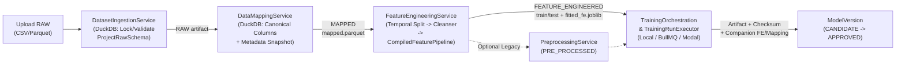
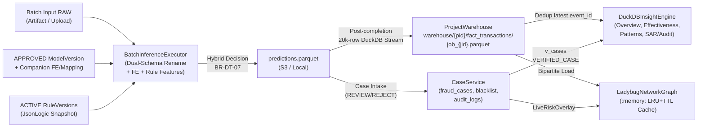

# 02 — End-to-End Data Flows, Shared Contracts & State Machines
<!-- [26-11-27] Created: Backbone Training & Inference->Investigation->Insight flows, 5 cross-module contracts, and entity state machines. -->

Tài liệu này ánh xạ trực tiếp 2 sơ đồ quy trình chức năng & dữ liệu gốc (`2. Functional Process` và `3. Data & Functional Process`) xuống **đúng luồng xử lý đang chạy trong code**, đồng thời chỉ rõ **5 hợp đồng dùng chung giữa các module** — nơi các thay đổi cục bộ dễ gây lỗi ngầm cho phân hệ khác nhất.

---

## 1. Luồng A — Training Pipeline (Data Prep → Features → Model Registry)

Hệ thống áp dụng **Kiến trúc chuẩn bị dữ liệu 2 tầng (Two-Tier Data Preparation)** (xem quyết định tại [`docs/features/critical_changes.md`](../features/critical_changes.md)): tầng Data Management dừng ở dữ liệu giàu đặc trưng nhưng **bảo lưu 100% khóa định danh & thời gian** (`event_id`, `user_id`, `timestamp`), còn chuẩn hóa toán học theo họ mô hình (Tabular / Sequence / Graph) nằm ở tầng Training.

**Điểm chốt chống lỗi trên Luồng A:**
1. **Schema Lock tại Ingestion (`BR-PM-01..03`):** Dataset RAW đầu tiên khóa `Project.raw_schema` (version 1). Các lần tải tiếp theo chấp nhận thiếu tối đa 1 cột (cột nhãn cho inference) và tự loại bỏ cột dư thừa.
2. **Temporal Split trước Fit (Chống Data Leakage):** `FeatureEngineeringExecutionService` chia train/test theo trình tự thời gian **trước khi** fit `StandardDataCleanser`, `TARGET_RATE` encoder và `CompiledFeaturePipeline` (lưu `train_history_tail` tối đa 200k dòng vào `fitted_feature_engineers.joblib` để tính rolling nhân quả khi test/inference).
3. **Worker không chạm DB:** `TrainingRunExecutor` chỉ nhận `TrainingRunPayload` + `IFileStorage` (hoặc `PresignedUrlStorage` trên Modal), trả `TrainingRunResult` để server/handler cập nhật `training_runs` và cấp phát `ModelVersion` (`v1, v2, ...`) một cách idempotent.

---

## 2. Luồng B — Inference → Investigation → Insight Pipeline

**Điểm chốt nghiệp vụ trên Luồng B:**
1. **Quy tắc quyết định lai (`BR-DT-07`, `inference/executor.py`):**
   - `Rule REJECT` → `final_action = REJECT` (`is_flagged = 1`)
   - Ngược lại, nếu `Rule REVIEW` **hoặc** `(có model và model_score >= score_threshold)` → `final_action = REVIEW` (`is_flagged = 1`)
   - Ngược lại → `final_action = ALLOW` (`is_flagged = 0`)
2. **Chống trùng lặp giao dịch khi quét lại nhiều lần (`ProjectWarehouse.load_fact_table`):** Khi đọc nhiều `job_*.parquet`, DuckDB loại trùng theo `event_id`, giữ bản ghi của lần quét mới nhất (`scanned_at DESC, job_id DESC`).
3. **Thứ tự ưu tiên nhãn sự thật trong Insight (`DuckDBInsightEngine`):** `VERIFIED_CASE` (từ `fraud_cases` đã `RESOLVED_FRAUD` / `RESOLVED_LEGITIMATE`) > `DATASET_FALLBACK` (`dataset_label` từ file đầu vào) > `UNVERIFIED`.
4. **Live Overlay không làm hỏng cache đồ thị:** `LadybugNetworkGraphService` cache cấu trúc đồ thị `User ↔ {Device, IpAddress, Card, Merchant}` trong RAM, còn trạng thái `Case` và `EntityBlacklist` được phủ (overlay) trực tiếp ở thời điểm truy vấn.

---

## 3. Năm hợp đồng dùng chung giữa các module (Shared Contracts)

Khi sửa bất kỳ module nào chạm tới 5 hợp đồng dưới đây, **bắt buộc** kiểm tra toàn bộ producer & consumer trong bảng:

| # | Hợp đồng (Contract) | Producer (Nơi tạo) | Consumers (Nơi phụ thuộc) | Quy ước cốt lõi & Rủi ro hiện hữu |
|---|---|---|---|---|
| **C1** | **System Column Metadata & `non_ml_columns`** | `SystemColumnMetadataService` (5 cột `CORE` bất biến: `event_id`, `timestamp`, `amount`, `user_id`, `label` + 18 cột `DOMAIN`), snapshot vào `MAPPED` artifact | `DataMappingService`, `FeatureCompiler`, `Preprocessing`, `BuiltinModelTrainer`, `BatchInferenceExecutor`, `ProjectWarehouse`, `RuleExecutor` | Mọi tra cứu cột chuẩn phải đi qua `resolve_canonical_column()`. **Rủi ro hiện có:** `BuiltinModelTrainer` & `inference/executor.py` hiện chỉ loại tập `NON_ML_COLUMNS` tĩnh thay vì đọc snapshot `non_ml_columns` động của project. |
| **C2** | **Dataset Artifact `output_paths` & Lineage** | `Ingestion`, `DataMapping`, `FeatureEngineering`, `Preprocessing` | `TrainingOrchestrationService`, `InferenceService`, `DatasetExport` | Key cố định theo stage: `RAW={raw}`, `MAPPED={mapped}`, `FEATURE_ENGINEERED={train, fitted_engineers, [test]}`, `PRE_PROCESSED={train, test, pipeline}`. `parent_artifact_id` tạo chuỗi truy vết phả hệ. |
| **C3** | **Model Artifact & Companion Bundle** | `TrainingRunExecutor`, `RoutingTrainingDispatcher` | `TrainingOrchestrationService`, `InferenceService`, `BatchInferenceExecutor`, `ModalTrainingProvider` | `BUILTIN` lưu `model.joblib` + `preprocessor.joblib`; `SCRIPT` đóng gói `model_bundle.zip` (`src/` + `artifacts/`). Cả hai cùng để sibling `fitted_feature_engineers.joblib` & `column_mapping.json` trong thư mục run. Remote compute chỉ cấp presigned PUT cho 11 tên file cố định. **Rủi ro hiện có (`ISS-001`):** format còn ngầm định, `PRE_PROCESSED` chưa copy `fitted_pipeline.joblib` vào thư mục run, `is_script_plugin` hardcode kiểm tra `main.py`. |
| **C4** | **Binary Label Normalization (`0` / `1`)** | `domain/schemas/label_normalization.py` & `DataMappingService` | `Training`, `RuleExecutor` (backtest), `ProjectWarehouse` (`dataset_label`), `DuckDBInsightEngine` | Chuẩn hóa tập trung tại `label_normalization.py` (`ISS-047`, đã resolved): hỗ trợ tự nhận diện (`0/1`, `true/false`, `yes/no`, `fraud/legit`) + cấu hình tường minh (`positive_label_values`, `negative_label_values`), fail-fast cho giá trị không ánh xạ được (không còn silent `COALESCE(..., 0)`). |
| **C5** | **Project Fact Warehouse Schema (`25` cột)** | `ProjectWarehouse.write_job_facts` (từ `predictions.parquet`) | `DuckDBInsightEngine`, `LadybugNetworkGraphService`, `BehaviorProfile` | File append-only `warehouse/{pid}/fact_transactions/job_{jid}.parquet` với 20 cột core + 5 cột thực thể tùy chọn (`device_id`, `ip_address`, `card_id`, `merchant_id`, `merchant_category`). Mọi thay đổi schema phải giữ tương thích ngược (`union_by_name=true`). |

---

## 4. Vòng đời trạng thái các thực thể cốt lõi (State Machines)

| Thực thể | Enum / Trường trạng thái | Luồng chuyển trạng thái hợp lệ | Ràng buộc chuyển đổi chính |
|---|---|---|---|
| **Dataset Artifact** | `PipelineStage` + `ValidationStatus` | `RAW → MAPPED → FEATURE_ENGINEERED [→ PRE_PROCESSED]` | Mỗi stage tạo `DatasetArtifact` mới trỏ `parent_artifact_id` về stage trước; không ghi đè artifact cũ. |
| **TrainingRun / DetectionJob** | `TrainingRunStatus` / `DetectionJobStatus` | `PENDING → RUNNING → COMPLETED \| FAILED \| CANCELLED` | Trạng thái terminal (`COMPLETED`, `FAILED`, `CANCELLED`) là bất biến; worker/poller bỏ qua khi redelivery. |
| **ModelVersion** | `ModelVersionStatus` | `DRAFT \| CANDIDATE → APPROVED → DEPRECATED → ARCHIVED` | Kích hoạt (`APPROVED`) phải kiểm tra artifact tồn tại + khớp SHA-256; nhiều version có thể đồng thời `APPROVED`. |
| **Rule** | `RuleStatus` | `DRAFT ↔ ACTIVE ↔ INACTIVE` | Chỉ được `ACTIVE` sau khi `project.raw_schema` đã khóa (`BR-PM-04`) và condition hợp lệ (`BR-PM-05`). Mọi sửa đổi `condition`/`action` tạo `RuleVersion` bất biến mới. |
| **Fraud Case** | `CaseStatus` (`case.py`) | `OPEN → IN_PROGRESS ↔ PENDING_CUSTOMER → RESOLVED_FRAUD \| RESOLVED_LEGITIMATE` *(reopen → `IN_PROGRESS`)* | Intake chỉ nhận `REVIEW`/`REJECT`, unique theo `(project_id, event_id)`. Mọi update bắt buộc khớp `expected_version` (optimistic locking). Chỉ `RESOLVED_FRAUD` mới được thêm `EntityBlacklist`. |
| **Project** | `ProjectStatus` | `ACTIVE → ARCHIVED` | Không được archive/xóa khi còn workload đang chạy; `raw_schema` chỉ reset/unlock khi 0 datasets, 0 rules, 0 detection jobs. |

> [!NOTE]
> Codebase hiện còn tồn tại 2 phân hệ legacy song song (`InvestigationCase`/`InvestigationStatus` và `Deployment`/`Pipeline` cho online inference). Các tính năng mới **chỉ phát triển trên** `Case`/`CaseService` và `DetectionJob`/`ModelVersion`.
