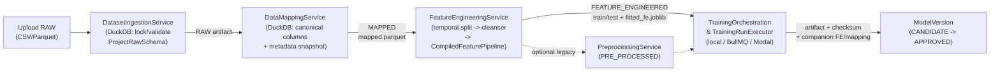
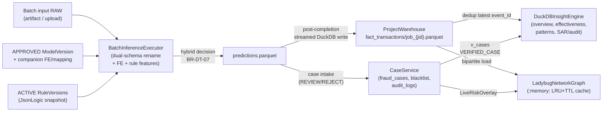

# 02 — Data Flows, Shared Contracts & State Machines
<!-- [26-11-27] Created. [26-11-28] English rewrite; bug details replaced by ISS references. -->

Maps the functional process and data process designs onto the flows that run in code, and names the **5 cross-module contracts** where a local change most easily breaks another module silently.

## 1. Flow A — Training (data prep → features → model registry)

**Two-tier data preparation** (decision: [`docs/features/critical_changes.md`](../features/critical_changes.md)): data management stops at feature-rich data that **keeps identifiers and time** (`event_id`, `user_id`, `timestamp`); model-family-specific math (tabular / sequence / graph) belongs to training.

Guard points:
1. **Schema lock at ingestion (`BR-PM-01..03`):** the first RAW dataset locks `Project.raw_schema` (version 1). Later uploads may miss at most one column (the label, for inference) and extra columns are dropped.
2. **Temporal split before fit (anti-leakage, `INV-009`):** train/test is split by event time **before** fitting `StandardDataCleanser`, `TARGET_RATE` encoders and `CompiledFeaturePipeline`. `train_history_tail` (≤ 200k rows) is stored in `fitted_feature_engineers.joblib` for causal rolling features at test / inference time.
3. **Executors never touch the DB (`INV-005`, `P-03`):** `TrainingRunExecutor` receives only `TrainingRunPayload` + `IFileStorage` (or `PresignedUrlStorage` on Modal) and returns `TrainingRunResult`; the server / handler updates `training_runs` and allocates `ModelVersion` (`v1, v2, ...`) idempotently.

## 2. Flow B — Inference → Investigation → Insight

Business guard points:
1. **Hybrid decision (`BR-DT-07`, `INV-013`):** `Rule REJECT` → `REJECT`; else `Rule REVIEW` **or** `(has_model and model_score >= score_threshold)` → `REVIEW`; else `ALLOW`. `is_flagged = 1` for `REJECT` / `REVIEW`.
2. **Re-scan dedup (`ProjectWarehouse.load_fact_table`):** across many `job_*.parquet`, keep the latest record per `event_id` (`scanned_at DESC, job_id DESC`).
3. **Ground-truth precedence in insight:** `VERIFIED_CASE` (resolved `fraud_cases`) > `DATASET_FALLBACK` (`dataset_label` from input) > `UNVERIFIED`.
4. **Live overlay keeps the graph cache valid:** graph structure `User ↔ {Device, IpAddress, Card, Merchant}` is cached; `Case` and `EntityBlacklist` state is overlaid at query time.

## 3. Shared contracts `C1–C5`

When a change touches one of these, check **every** producer and consumer listed.

| # | Contract | Producer | Consumers | Core rule |
|---|---|---|---|---|
| **C1** | System column metadata & `non_ml_columns` | `SystemColumnMetadataService` (5 immutable `CORE` columns `event_id`, `timestamp`, `amount`, `user_id`, `label` + `DOMAIN` columns), snapshotted into the `MAPPED` artifact | Data mapping, feature compiler, preprocessing, built-in trainer, batch inference, warehouse, rule executor | Canonical column lookup only via `resolve_canonical_column()` (`INV-010`). Feature vectors exclude every column whose snapshot `ml_role != FEATURE` (`INV-009`; open gap `ISS-050`). |
| **C2** | `DatasetArtifact.output_paths` & lineage | Ingestion, mapping, feature engineering, preprocessing | Training orchestration, inference, dataset export | Fixed keys per stage: `RAW={raw}`, `MAPPED={mapped}`, `FEATURE_ENGINEERED={train, fitted_engineers, [test]}`, `PRE_PROCESSED={train, test, pipeline}`. `parent_artifact_id` forms the lineage chain. |
| **C3** | Model artifact & companion bundle | `TrainingRunExecutor`, `RoutingTrainingDispatcher` | Training orchestration, inference, batch inference, Modal provider | `BUILTIN` → `model.joblib` + `preprocessor.joblib`; `SCRIPT` → `model_bundle.zip` (`src/` + `artifacts/`). Both keep sibling `fitted_feature_engineers.joblib` and `column_mapping.json` in the run folder. Remote compute may write only a fixed set of presigned file names. Format is still implicit (`ISS-001`, `ISS-051`). |
| **C4** | Binary label normalization (`0` / `1`) | `domain/schemas/label_normalization.py`, `DataMappingService` | Training, rule backtest, warehouse (`dataset_label`), insight engine | One shared normalizer: auto-detect (`0/1`, `true/false`, `yes/no`, `fraud/legit`) + explicit `positive_label_values` / `negative_label_values`; unmappable values fail fast, never silently become `0` (`INV-010`). |
| **C5** | Project fact warehouse schema | `ProjectWarehouse.write_job_facts` (from `predictions.parquet`) | Insight engine, network graph, behavior profile | Append-only `warehouse/{pid}/fact_transactions/job_{jid}.parquet`: core columns + optional entity columns (`device_id`, `ip_address`, `card_id`, `merchant_id`, `merchant_category`). Schema changes must stay backward compatible (`union_by_name=true`). |

## 4. State machines

| Entity | Status field | Valid transitions | Key constraints |
|---|---|---|---|
| Dataset artifact | `PipelineStage` + `ValidationStatus` | `RAW → MAPPED → FEATURE_ENGINEERED [→ PRE_PROCESSED]` | Each stage creates a new artifact pointing to its parent; never overwrites. |
| TrainingRun / DetectionJob | `TrainingRunStatus` / `DetectionJobStatus` | `PENDING → RUNNING → COMPLETED \| FAILED \| CANCELLED` | Terminal states are immutable; workers/pollers ignore redelivery (`INV-008`). |
| ModelVersion | `ModelVersionStatus` | `DRAFT \| CANDIDATE → APPROVED → DEPRECATED → ARCHIVED` | `APPROVED` requires the artifact to exist and match SHA-256; several versions may be `APPROVED` at once. |
| Rule | `RuleStatus` | `DRAFT ↔ ACTIVE ↔ INACTIVE` | `ACTIVE` only after `project.raw_schema` is locked (`BR-PM-04`) and the condition is valid (`BR-PM-05`). Any `condition` / `action` edit creates a new immutable `RuleVersion`. |
| Fraud case | `CaseStatus` | `OPEN → IN_PROGRESS ↔ PENDING_CUSTOMER → RESOLVED_FRAUD \| RESOLVED_LEGITIMATE` (reopen → `IN_PROGRESS`) | Intake only for `REVIEW` / `REJECT`, unique per `(project_id, event_id)`. Updates must match `expected_version` (`INV-012`). Only `RESOLVED_FRAUD` may add `EntityBlacklist`. |
| Project | `ProjectStatus` | `ACTIVE → ARCHIVED` | No archive/delete while workloads run (`INV-011`); `raw_schema` resets only with 0 datasets, 0 rules, 0 detection jobs. |

> [!NOTE]
> Two legacy subsystems still exist: `InvestigationCase` / `InvestigationStatus` and `Deployment` / `Pipeline` (online inference). New work builds only on `Case` / `CaseService` and `DetectionJob` / `ModelVersion`.
