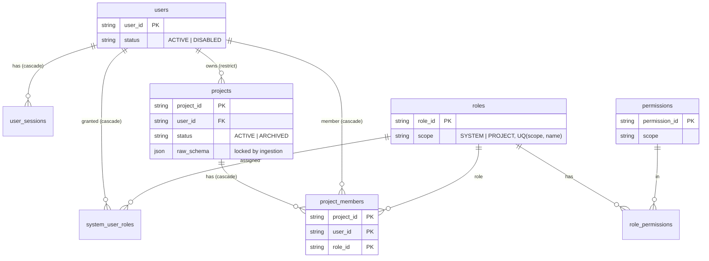
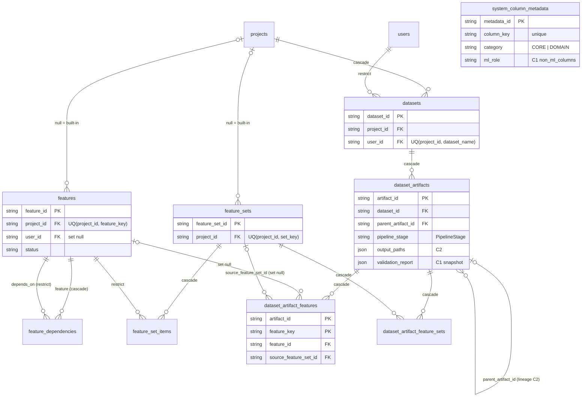
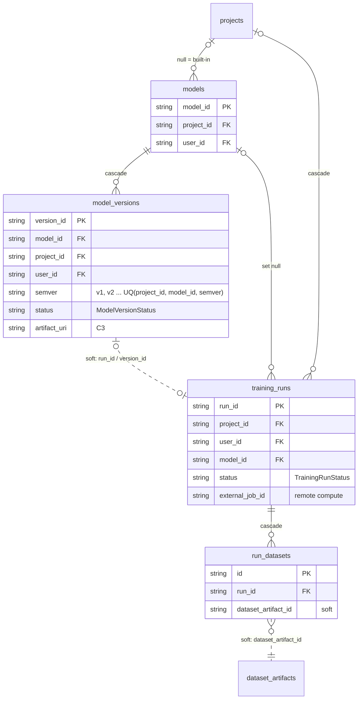
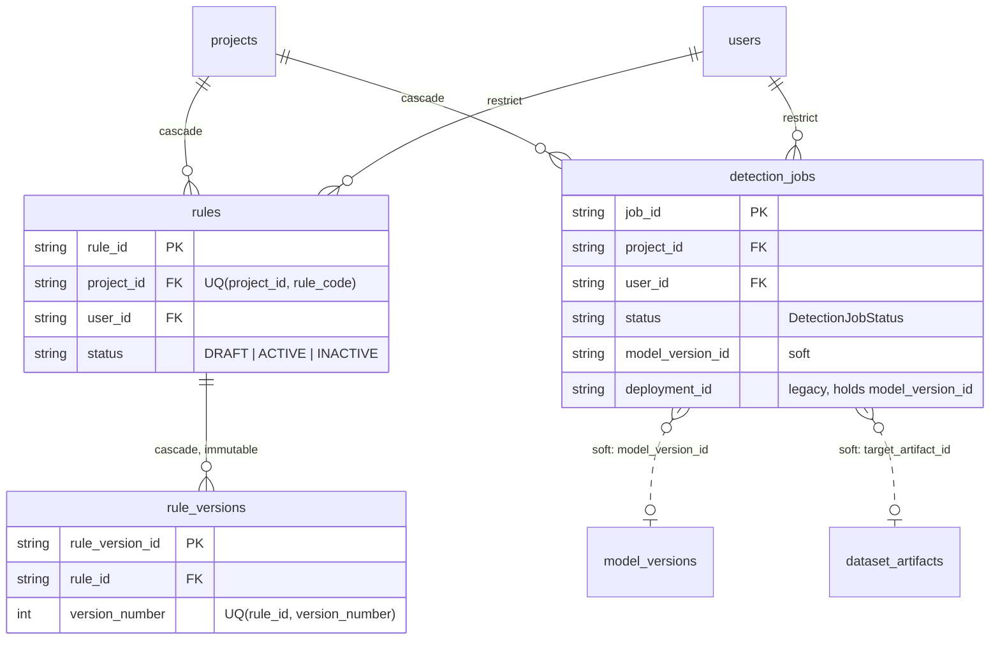
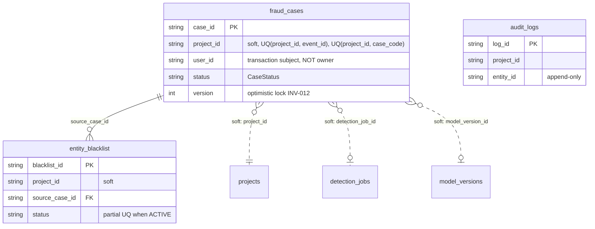

# 04 — Data Model (ERD, relations level)
<!-- [26-11-28] Created: relations-level ERD of the 27 ORM tables, grouped by owning module. -->

Relations-level view of the OLTP schema: tables, primary / foreign keys, cardinality, and only the columns that carry a cross-module contract (`project_id`, `user_id`, `status`, versions, artifact references). Full columns and types live in the ORM (`usfds-infra/src/usfds_infra/database/tables/*.py`, `case_models.py`); schema changes go only through Alembic (`INV-006`).

Conventions:
- Solid line = DB foreign key. Dotted line = **soft reference** (ID column without FK; integrity is enforced in code).
- `users` / `projects` appear as stubs in several diagrams; they are owned by module 1.
- `project_id` nullable (`null`) = system-wide built-in row.
- `user_id` FKs to `users` use `ON DELETE RESTRICT` unless the edge is labelled otherwise (`INV-011`); `project_id` FKs use `ON DELETE CASCADE`.

## 1. Auth, RBAC & projects — [module 1](modules/auth-and-access.md)

## 2. Data, system metadata & features — [module 2](modules/data-and-features.md)

`system_column_metadata` is global (no `project_id`); it is the first kind of system metadata (`P-01`).

## 3. Training & model registry — [module 3](modules/training-and-models.md)

## 4. Detection & rules — [module 4](modules/detection-and-rules.md)

## 5. Investigation — [module 5](modules/investigation-and-graph.md)

## 6. Insight & warehouse — [module 6](modules/insight-and-warehouse.md)

No OLTP tables. The warehouse is Parquet files (`C5`) read by DuckDB; it joins `fraud_cases` (module 5) for ground truth.
