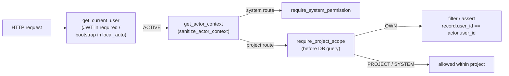

# Module 1 — Auth, RBAC, Project Isolation & Storage Access
<!-- [26-11-27] Created as auth-and-tenancy.md. [26-11-28] Renamed (single organization, no tenants); English rewrite. -->

## 1. Responsibility & boundary
- **Does:**
  - Authenticates users (`required`: JWT bearer + rotating refresh sessions; `local_auto`: bootstrap admin on desktop).
  - Authorizes with **3-scope RBAC (`OWN < PROJECT < SYSTEM`)**, isolates data by `project_id`, prevents privilege escalation, protects the last `project_admin`.
  - Manages the `Project` lifecycle (create, archive, delete, members, lock / reset `ProjectRawSchema`).
  - Signs and authorizes `presigned-upload` / `presigned-download` for `IFileStorage`.
- **Does not:** handle dataset, model, rule or case content. It provides `ActorContext`, `BaseQueryFilter`, and authorization helpers / dependencies to other routers and services.

## 2. Data ownership

| Resource | Owned tables / storage | Access from other modules |
|---|---|---|
| Auth & sessions | `users`, `user_sessions` | Only via `AuthService` / `IUserRepository`. `users.user_id` is referenced with `ON DELETE RESTRICT`. |
| RBAC | `roles`, `permissions`, `role_permissions`, `system_user_roles`, `project_members` | Loaded via `IUserRepository.load_actor_context(user_id)`, checked via `AuthzService`. |
| Projects | `projects` (incl. JSON `raw_schema`) | Others only read `raw_schema` via `IProjectRepository` / `ProjectSchemaValidator`; only `DatasetIngestionService` (lock) and `ProjectService` (reset / unlock) write it. |
| Upload staging | `uploads/{purpose}/{project_id\|global}/{uuid}/{filename}` | Client PUTs via presigned URL; domain services read and copy to the target prefix. |

## 3. Shared contracts

- **`ActorContext`** (`usfds_core/domain/entities/auth.py`): immutable (after `sanitize_actor_context`), carries `user_id`, `status`, `is_system_admin`, `system_permissions`, `projects[project_id].permissions`. Every non-public router receives it from `get_actor_context`.
- **Standard authorization pattern on project routers (`INV-002`, `INV-003`):**
  1. List `GET`: `resolve_project_list_owner(actor, perm, project_id)` → `actor.user_id` for `OWN`, `None` for `PROJECT` / `SYSTEM`, else `403`.
  2. Detail `GET /{id}`: `project_id` required; call `require_project_scope` **before** querying (anti-404-oracle); `404` if the record belongs to another project; then `require_project_permission(..., owner_id=record.user_id)`.
  3. `POST` / `PATCH` / `DELETE`: active project membership (`can_create`) or `owner_id=record.user_id` (`can_mutate`).
- **Storage download authorization** (`storage_router.py`): rejects path traversal (`..`, leading `/`), allows only registered prefixes (`uploads/`, `exports/`, `datasets/`), and checks `project_id` + `OWN` ownership.

## 4. State machine & critical flow

- **`UserStatus`:** `ACTIVE ↔ DISABLED` (`DISABLED` or `reset_password` revokes all `user_sessions`).
- **`ProjectStatus`:** `ACTIVE → ARCHIVED` (blocked while workloads run).

## 5. Known traps & code / spec map
- `SYSTEM_ONLY_PERMISSIONS` (e.g. `user:*`, `role:*`, `model_builtin:manage`, `project:create`) are never attached to `RoleScope.PROJECT`.
- Open gaps: `ISS-048` (active-workload check misses SQL `TrainingRun`s → `INV-011`), `ISS-052` (feature read endpoints skip `OWN` filtering → `INV-003`).
- **Code:** `usfds-core/src/usfds_core/services/{auth,project_management}/`, `usfds-server/src/usfds_server/routers/{auth,user,rbac,project,storage}_router.py`, `usfds-server/src/usfds_server/providers/auth.py`, `usfds-web/src/lib/feature-policy.ts`.
- **Spec:** [`project_management/suc-spec.md`](../../features/project_management/suc-spec.md), [`project_management/design.md`](../../features/project_management/design.md).
