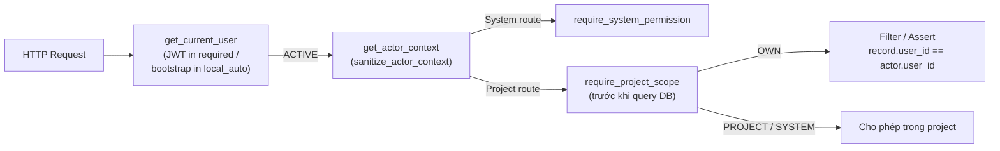

# Module 1 — Auth, RBAC, Tenancy & Storage Access
<!-- [26-11-27] Created: As-Built module architecture for auth, 3-scope RBAC, projects, and presigned storage authorization. -->

## 1. Trách nhiệm & Ranh giới
- **Làm gì:**
  - Xác thực người dùng (`required` JWT Bearer + rotating refresh session, hoặc `local_auto` bootstrap admin ở chế độ desktop).
  - Phân quyền **RBAC 3 phạm vi (`OWN < PROJECT < SYSTEM`)**, cô lập dữ liệu theo `project_id`, chống leo thang quyền và bảo vệ `project_admin` cuối cùng.
  - Quản lý vòng đời `Project` (tạo, archive, xóa, thành viên, khóa & reset `ProjectRawSchema`).
  - Ký và kiểm soát quyền `presigned-upload` / `presigned-download` cho `IFileStorage`.
- **KHÔNG làm gì:** Không xử lý nội dung nghiệp vụ của dataset, model, rule hay case; chỉ cung cấp `ActorContext`, `BaseQueryFilter`, và các hàm/dependency kiểm tra quyền cho routers/services khác.

---

## 2. Data Ownership

| Loại tài nguyên | Sở hữu độc quyền (Bảng ORM / Storage) | Quy tắc truy cập từ module khác |
|---|---|---|
| **Auth & Sessions** | `users`, `user_sessions` | Chỉ đọc/cập nhật qua `AuthService` / `IUserRepository`. `users.user_id` là FK `ON DELETE RESTRICT` từ các bảng tài nguyên chính. |
| **RBAC** | `roles`, `permissions`, `role_permissions`, `system_user_roles`, `project_members` | Nạp tổng hợp qua `IUserRepository.load_actor_context(user_id)` và kiểm duyệt qua `AuthzService`. |
| **Projects** | `projects` (gồm cột JSON `raw_schema`) | Module khác chỉ đọc `raw_schema` qua `IProjectRepository` / `ProjectSchemaValidator`; chỉ `DatasetIngestionService` (khóa) và `ProjectService` (reset/unlock) được ghi. |
| **Upload Staging** | `uploads/{purpose}/{project_id\|global}/{uuid}/{filename}` | Client PUT trực tiếp qua presigned URL; domain services đọc và copy sang vùng lưu trữ đích. |

---

## 3. Shared Contracts

- **`ActorContext` (`usfds_core/domain/entities/auth.py`):** Đối tượng bất biến (đã qua `sanitize_actor_context`) mang `user_id`, `status`, `is_system_admin`, `system_permissions`, và `projects[project_id].permissions`. Mọi router non-public đều nhận đối tượng này từ `get_actor_context`.
- **Quy tắc chuẩn kiểm tra quyền trên mọi Project Router (`INV-002`, `INV-003`):**
  1. `GET` danh sách: dùng `resolve_project_list_owner(actor, perm, project_id)` → trả `actor.user_id` nếu scope là `OWN`, `None` nếu `PROJECT`/`SYSTEM`, hoặc ném `403`.
  2. `GET` chi tiết theo `{id}`: bắt buộc có `project_id`, gọi `require_project_scope` **trước** khi query DB (anti-404-oracle), trả `404` nếu bản ghi thuộc project khác, sau đó gọi `require_project_permission(..., owner_id=record.user_id)`.
  3. `POST`/`PATCH`/`DELETE`: kiểm tra active project membership (`can_create`) hoặc `owner_id=record.user_id` (`can_mutate`).
- **Storage Download Authorization (`storage_router.py:115-205`):** Chặn path traversal (`..`, dẫn đầu `/`), chỉ cho phép các prefix đã đăng ký (`uploads/`, `exports/`, `datasets/`), và đối chiếu `project_id` + `OWN` owner tương ứng.

---

## 4. State Machine & Critical Flows

- **`UserStatus`:** `ACTIVE ↔ DISABLED` (khi `DISABLED` hoặc `reset_password` → thu hồi toàn bộ `user_sessions`).
- **`ProjectStatus`:** `ACTIVE → ARCHIVED` (chặn archive/delete khi còn workload đang chạy).

---

## 5. Known Gotchas & Code/Spec Map
- **Bẫy 1 (`ISS-048`):** `ProjectService._check_active_workloads` (`project_service.py:87-98`) hiện kiểm tra `TrainingRun` bằng `hasattr(repo, "_runs")` (chỉ có trên InMemory repo) → bỏ sót training run đang chạy trên SQL DB.
- **Bẫy 2 (`ISS-052`):** `feature_router.py` hiện mới gọi `require_project_scope` ở các endpoint đọc, chưa lọc `GrantScope.OWN` giống các router khác.
- **Bẫy 3:** Quyền `SYSTEM_ONLY_PERMISSIONS` (15 mã như `user:*`, `role:*`, `model_builtin:manage`, `project:create`) không bao giờ được gắn vào `RoleScope.PROJECT`.
- **Code chính:** `usfds-core/src/usfds_core/services/auth/`, `services/project_management/`, `usfds-server/src/usfds_server/routers/{auth,user,rbac,project,storage}_router.py`, `providers/auth.py`, `usfds-web/src/lib/feature-policy.ts`.
- **Spec:** [`docs/features/project_management/suc-spec.md`](../../features/project_management/suc-spec.md), [`docs/features/project_management/design.md`](../../features/project_management/design.md).
