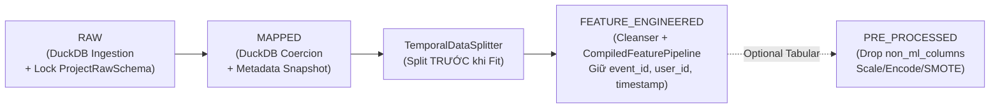

# Module 2 — Data Management, System Metadata & Feature Engineering
<!-- [26-11-27] Created: As-Built module architecture for ingestion, schema mapping, system metadata, 2-tier feature compiler, and preprocessing. -->

## 1. Trách nhiệm & Ranh giới
- **Làm gì:**
  - Tiếp nhận dataset thô (CSV/Parquet), khóa & kiểm tra `ProjectRawSchema`, sinh hồ sơ dữ liệu (profiling) và kiểm định chất lượng qua bounded DuckDB.
  - Quản trị `SystemColumnMetadata` (5 cột `CORE` bất biến + 18+ cột `DOMAIN`) và ánh xạ cột nguồn về cột chuẩn (`DataMappingService`).
  - Quản lý catalog đặc trưng động (`Feature`, `FeatureSet`, DAG phụ thuộc, kiểm tra tương thích, preview 200 dòng) và thực thi **Feature Compiler 2 tầng** (Tier 1 DuckDB `VELOCITY`/`EXPRESSION` + `TARGET_RATE`; Tier 2 subprocess `PYTHON_CODE`).
  - Chuẩn bị dữ liệu 2 tầng (`FEATURE_ENGINEERED` bảo lưu định danh/thời gian) và tùy chọn `PRE_PROCESSED` dạng bảng phẳng.
- **KHÔNG làm gì:** Không huấn luyện mô hình AI và không chấm điểm detection; không loại bỏ `event_id`, `user_id`, `timestamp` ở stage `FEATURE_ENGINEERED` (`BR-DM-07`, `INV-009`).

---

## 2. Data Ownership

| Loại tài nguyên | Sở hữu độc quyền | Lưu ý ranh giới |
|---|---|---|
| **Datasets & Lineage** | `datasets`, `dataset_artifacts` (`parent_artifact_id`), `datasets/{dataset_id}/{raw,mapped,artifacts}/...` | `delete_dataset` kiểm tra in-use (409), xóa file trên `IFileStorage`, và gọi `handle_dataset_deleted` để mở khóa `raw_schema` nếu là dataset cuối cùng. |
| **System Metadata** | `system_column_metadata` | 5 cột `CORE` (`event_id`, `timestamp`, `amount`, `user_id`, `label`) không được xóa; `ml_role` quyết định cột nào là `non_ml_columns`. |
| **Features & Lineage** | `features`, `feature_dependencies`, `feature_sets`, `feature_set_items`, `dataset_artifact_features`, `dataset_artifact_feature_sets` | `project_id IS NULL` = built-in catalog; không được xóa feature đang có dependent, nằm trong `FeatureSet`, hoặc bị tham chiếu bởi `ACTIVE` rule. |

---

## 3. Shared Contracts

- **Contract `C1` — System Column Resolution & `non_ml_columns`:**
  - Mọi phân hệ tra cứu cột chuẩn qua `resolve_canonical_column()` (`domain/schemas/system_metadata.py`).
  - `DataMappingService` ghi snapshot `{column_mapping, column_semantic_types, retained_columns, non_ml_columns, metadata_snapshot}` vào `validation_report` của artifact `MAPPED`.
- **Contract `C2` — `DatasetArtifact.output_paths` (`domain/schemas/artifact_output.py`):**
  - `RAW`: `{"raw"}`
  - `MAPPED`: `{"mapped"}`
  - `FEATURE_ENGINEERED`: `{"train", "fitted_engineers", optional "test"}`
  - `PRE_PROCESSED`: `{"train", "test", "pipeline"}`
- **Contract `CompiledFeaturePipeline` (`fitted_feature_engineers.joblib`):**
  - Đóng gói thứ tự topo Kahn DAG, `TargetRate` encoders fit trên train, và `train_history_tail` (tối đa `USFDS_FEATURE_HISTORY_TAIL_ROWS=200000` dòng) để đảm bảo **tính nhân quả (causal rolling parity)** giữa train → test → inference.
  - Tier-2 `PYTHON_CODE` trao đổi Parquet + JSON `states` qua subprocess có timeout (`60s`), AST allowlist import — **không pickle code người dùng**.
- **Contract `materialize_rule_enriched_features()` (`features/compiler.py`):** Cung cấp tính năng biên dịch đặc trưng `enriched.*` on-the-fly cho `RuleExecutor` (backtest) và `BatchInferenceExecutor` (rule-only detection).

---

## 4. State Machine & Critical Flows

- **Quy tắc chống Data Leakage (`INV-009`):** Chia Train/Test theo mốc thời gian diễn ra trước khi fit `StandardDataCleanser`, `TARGET_RATE`, hay bất kỳ bộ biến đổi nào. (`LeakedFeatureEngineeringExecutionService` chỉ phục vụ thí nghiệm so sánh, không dùng cho luồng chính.)

---

## 5. Known Gotchas & Code/Spec Map
- **Bẫy 1 (Chuẩn hóa nhãn `C4`, `ISS-047` đã resolved):** Mọi bước đọc/map nhãn nhị phân dùng chung `domain/schemas/label_normalization.py` (hỗ trợ auto-detect + mapping tường minh và fail-fast cho nhãn không ánh xạ được); không viết lại logic cast nhãn riêng lẻ.
- **Bẫy 2:** `mapping.py:260, 303` format `timestamp` thành `VARCHAR` bỏ phần mili-giây (`%Y-%m-%d %H:%M:%S`), buộc các consumer sau phải parse lại.
- **Bẫy 3 (`INV-007`):** `Ingestion` và `DataMapping` chạy bounded DuckDB streaming; riêng `FeatureEngineeringExecutionService` & `PreprocessingExecutionService` vẫn nạp Parquet vào pandas (cần lưu ý giới hạn RAM khi mở rộng).
- **Code chính:** `usfds-core/src/usfds_core/services/{data_management,features,preprocessing}/`, `usfds-server/src/usfds_server/routers/{dataset,feature,system_metadata}_router.py`, `usfds-worker/src/usfds_worker/handlers.py` (`handle_dataset_ingestion`, `handle_schema_mapping`, `handle_feature_engineering`).
- **Spec:** [`docs/features/data_management/`](../../features/data_management/), [`docs/features/feature_management/context-modeling.md`](../../features/feature_management/context-modeling.md), [`docs/features/critical_changes.md`](../../features/critical_changes.md).
