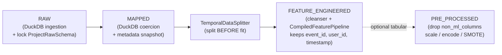

# Module 2 — Data Management, System Metadata & Feature Engineering
<!-- [26-11-27] Created. [26-11-28] English rewrite; system metadata framed as the P-01 registry. -->

## 1. Responsibility & boundary
- **Does:**
  - Ingests raw datasets (CSV / Parquet), locks and validates `ProjectRawSchema`, profiles and quality-checks data with bounded DuckDB.
  - Owns **system metadata** — the `P-01` registry. Today it holds `SystemColumnMetadata` (5 immutable `CORE` columns + `DOMAIN` columns); future configurable values extend it. Maps source columns to system columns (`DataMappingService`).
  - Manages the dynamic feature catalog (`Feature`, `FeatureSet`, dependency DAG, compatibility checks, preview) and runs the **two-tier feature compiler**: Tier 1 DuckDB (`VELOCITY` / `EXPRESSION` + `TARGET_RATE`), Tier 2 subprocess (`PYTHON_CODE`).
  - Prepares data in two tiers (`FEATURE_ENGINEERED` keeps identifiers and time) with optional flat `PRE_PROCESSED`.
- **Does not:** train or score models; drop `event_id`, `user_id`, `timestamp` at `FEATURE_ENGINEERED` (`BR-DM-07`, `INV-009`).

## 2. Data ownership

| Resource | Owned | Boundary |
|---|---|---|
| Datasets & lineage | `datasets`, `dataset_artifacts` (`parent_artifact_id`), `datasets/{dataset_id}/{raw,mapped,artifacts}/...` | `delete_dataset` checks in-use (`409`), deletes files on `IFileStorage`, and unlocks `raw_schema` when the last dataset goes (`INV-011`). |
| System metadata | `system_column_metadata` | The 5 `CORE` columns (`event_id`, `timestamp`, `amount`, `user_id`, `label`) cannot be deleted; `ml_role` decides `non_ml_columns`. |
| Features & lineage | `features`, `feature_dependencies`, `feature_sets`, `feature_set_items`, `dataset_artifact_features`, `dataset_artifact_feature_sets` | `project_id IS NULL` = built-in catalog. A feature with dependents, in a `FeatureSet`, or used by an `ACTIVE` rule cannot be deleted. |

## 3. Shared contracts

- **`C1` — system column resolution & `non_ml_columns`:** all lookups go through `resolve_canonical_column()` (`domain/schemas/system_metadata.py`). `DataMappingService` writes `{column_mapping, column_semantic_types, retained_columns, non_ml_columns, metadata_snapshot}` into the `MAPPED` artifact's `validation_report`.
- **`C2` — `DatasetArtifact.output_paths`** (`domain/schemas/artifact_output.py`): `RAW {raw}`, `MAPPED {mapped}`, `FEATURE_ENGINEERED {train, fitted_engineers, [test]}`, `PRE_PROCESSED {train, test, pipeline}`.
- **`C4` — label normalization:** every label read / map uses `domain/schemas/label_normalization.py`; never reimplement label casting.
- **`CompiledFeaturePipeline`** (`fitted_feature_engineers.joblib`): Kahn topological order of the DAG, `TargetRate` encoders fit on train, and `train_history_tail` (≤ `USFDS_FEATURE_HISTORY_TAIL_ROWS`) for **causal rolling parity** train → test → inference. Tier-2 `PYTHON_CODE` exchanges Parquet + JSON `states` with a timed-out subprocess under an AST import allowlist — user code is never pickled. The pickle stores module paths, so moving pickled classes breaks old artifacts.
- **`materialize_rule_enriched_features()`** (`features/compiler.py`): compiles `enriched.*` features on the fly for rule backtest and rule-only batch detection.

## 4. State machine & critical flow

- **Anti-leakage (`INV-009`):** split by event time before fitting `StandardDataCleanser`, `TARGET_RATE` or any transformer. `LeakedFeatureEngineeringExecutionService` exists only for comparison experiments.

## 5. Known traps & code / spec map
- Mapping writes `timestamp` as `VARCHAR` without milliseconds (`%Y-%m-%d %H:%M:%S`); downstream consumers must parse it.
- Ingestion and mapping stream with bounded DuckDB; feature engineering and preprocessing still load Parquet into pandas (`INV-016`, `ISS-055`).
- **Code:** `usfds-core/src/usfds_core/services/{data_management,features,preprocessing}/`, `usfds-server/src/usfds_server/routers/{dataset,feature,system_metadata}_router.py`, `usfds-worker/src/usfds_worker/handlers.py` (`handle_dataset_ingestion`, `handle_schema_mapping`, `handle_feature_engineering`).
- **Spec:** [`data_management/`](../../features/data_management/), [`feature_management/context-modeling.md`](../../features/feature_management/context-modeling.md), [`critical_changes.md`](../../features/critical_changes.md).
