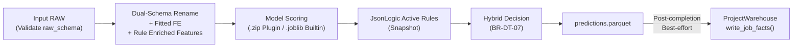

# Module 4 — Detection Inference & Rule Engine
<!-- [26-11-27] Created: As-Built module architecture for batch/hybrid detection, JsonLogic rule engine, and prediction results. -->

## 1. Trách nhiệm & Ranh giới
- **Làm gì:**
  - Quản trị luật nghiệp vụ JsonLogic (`Rule` + `RuleVersion` bất biến) và chạy thử nghiệm hồi cứu (`RuleExecutor.backtest_dataframe` qua BullMQ `rule_backtest`).
  - Điều phối phát hiện gian lận lai (`InferenceService.start_detection_job` + `BatchInferenceExecutor`): kết hợp `APPROVED` `ModelVersion` (tùy chọn) và tập `ACTIVE` `RuleVersion` snapshot theo quy tắc `BR-DT-07`.
  - Truy vấn phân trang & xuất kết quả dự đoán trực tiếp bằng DuckDB trên `predictions.parquet` (`prediction_results.py`).
  - Kích hoạt ghi fact sang `ProjectWarehouse` (best-effort) sau khi job `COMPLETED`.
- **KHÔNG làm gì:** Không quản lý hồ sơ điều tra (`Case`) và **hiện KHÔNG tự động đối chiếu `EntityBlacklist`** trong lúc đánh giá luật hay chấm điểm batch; `BatchInferenceExecutor` tuyệt đối không chạm DB (`INV-005`).

---

## 2. Data Ownership

| Loại tài nguyên | Sở hữu độc quyền | Lưu ý ranh giới |
|---|---|---|
| **Rule Catalog** | `rules`, `rule_versions` | Mỗi thay đổi `condition`/`action` tạo `RuleVersion` mới tăng dần bất biến. Kích hoạt `ACTIVE` bắt buộc `project.raw_schema` đã khóa (`BR-PM-04`) và hợp lệ (`BR-PM-05`). |
| **Detection Jobs** | `detection_jobs` | Lưu `summary_metrics` JSON, `input_path`, `output_path`, `score_threshold`, `use_rules`. |
| **Inference Files** | `datasets/{project_id}/inferences/inputs/{job_id}/...`, `datasets/{project_id}/inferences/{target}/{job_id}/predictions.parquet` | `predictions.parquet` là đầu vào trực tiếp cho `ProjectWarehouse.write_job_facts` và `CaseService.intake`. |

---

## 3. Shared Contracts

- **Contract `predictions.parquet`:** Chứa các cột đầu vào + `model_score`, `fraud_probability`, `triggered_rules`, `triggered_rule_details`, `raw_attributes`, `rule_action`, `final_action`, `is_flagged`, `prediction`.
- **Contract Quyết định lai (`BR-DT-07`, `INV-013`):**
  - `Rule REJECT` → `final_action = REJECT` (`is_flagged = 1`)
  - Ngược lại, `Rule REVIEW` hoặc `(has_model and model_score >= score_threshold)` → `final_action = REVIEW` (`is_flagged = 1`)
  - Ngược lại → `final_action = ALLOW` (`is_flagged = 0`)
- **Contract Payload đánh giá JsonLogic:**
  - `BatchInferenceExecutor` đưa cả `mapped.*`, `enriched.*`, và `"model_score"` / `"model": {"score", "fraud_probability"}` vào `eval_payload`.
  - `RuleExecutor` (backtest) biên dịch on-the-fly các đặc trưng `enriched.*` qua `materialize_rule_enriched_features()` (nhưng chưa inject `model_score`).
- **Contract Phụ thuộc Artifact từ Module 3:** Khi chạy job có model, `InferenceService` tìm companion `fitted_feature_engineers.joblib` & `column_mapping.json` trong thư mục run trước, sau đó mới truy ngược phả hệ `TrainingRun → RunDataset → DatasetArtifact`.

---

## 4. State Machine & Critical Flows

- **`RuleStatus`:** `DRAFT ↔ ACTIVE ↔ INACTIVE`.
- **`DetectionJobStatus`:** `PENDING → RUNNING → COMPLETED | FAILED | CANCELLED` (terminal bất biến).

---

## 5. Known Gotchas & Code/Spec Map
- **Bẫy 1 (`ISS-049`):** `inference/executor.py:594, 643` hiện gọi `apply_domain_feature_engineers` **2 lần liên tiếp** đối với model `BUILTIN`.
- **Bẫy 2 (`ISS-053`):** `ProjectSchemaValidator.validate_rule_condition` (`schema_validator.py:408-427`) đối chiếu tên trường với `project.raw_schema` (tên cột thô) và chưa whitelist `model_score`/`model.score`, gây lệch với payload thực thi của `BatchInferenceExecutor`.
- **Bẫy 3 (`ISS-002`):** `RuleManager.delete_rule` chưa có kiểm tra in-use/status guard — có thể xóa trực tiếp rule đang `ACTIVE`.
- **Bẫy 4 (Legacy):** Luồng `Deployment`/`Pipeline` (`online_inference`, `batch_inference`) vẫn tồn tại song song; luồng chính hiện hành là `start_detection_job` (lưu ý: `DetectionJob.deployment_id` đang gán tạm `model_version_id`).
- **Code chính:** `usfds-core/src/usfds_core/services/{inference,rule_engine}/`, `usfds-server/src/usfds_server/routers/{detection,rule}_router.py`, `usfds-worker/src/usfds_worker/handlers.py` (`handle_batch_inference`, `handle_rule_backtest`).
- **Spec:** [`docs/features/detection/suc-spec.md`](../../features/detection/suc-spec.md), [`docs/features/detection/user-flow-and-ui-design.md`](../../features/detection/user-flow-and-ui-design.md).
