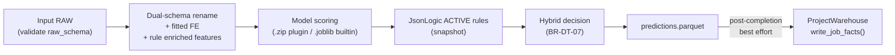

# Module 4 — Detection Inference & Rule Engine
<!-- [26-11-27] Created. [26-11-28] English rewrite; bug details moved to issues. -->

## 1. Responsibility & boundary
- **Does:**
  - Manages JsonLogic business rules (`Rule` + immutable `RuleVersion`) and backtests them (`RuleExecutor.backtest_dataframe` via BullMQ `rule_backtest`).
  - Orchestrates hybrid fraud detection (`InferenceService.start_detection_job` + `BatchInferenceExecutor`): optional `APPROVED` `ModelVersion` + snapshot of `ACTIVE` `RuleVersion`s, decided by `BR-DT-07`.
  - Paginates and exports prediction results with DuckDB over `predictions.parquet` (`prediction_results.py`).
  - Triggers the warehouse fact write (best effort) after a job is `COMPLETED`.
- **Does not:** manage cases; check `EntityBlacklist` during rule evaluation or batch scoring. `BatchInferenceExecutor` never touches the DB (`INV-005`).

## 2. Data ownership

| Resource | Owned | Boundary |
|---|---|---|
| Rule catalog | `rules`, `rule_versions` | Each `condition` / `action` edit creates a new immutable `RuleVersion`. `ACTIVE` requires a locked (`BR-PM-04`) and valid (`BR-PM-05`) `project.raw_schema`. |
| Detection jobs | `detection_jobs` | Holds `summary_metrics`, `input_path`, `output_path`, `score_threshold`, `use_rules`. |
| Inference files | `datasets/{project_id}/inferences/inputs/{job_id}/...`, `datasets/{project_id}/inferences/{target}/{job_id}/predictions.parquet` | `predictions.parquet` feeds `ProjectWarehouse.write_job_facts` and `CaseService.intake`. |

## 3. Shared contracts

- **`predictions.parquet`:** input columns + `model_score`, `fraud_probability`, `triggered_rules`, `triggered_rule_details`, `raw_attributes`, `rule_action`, `final_action`, `is_flagged`, `prediction`.
- **Hybrid decision (`BR-DT-07`, `INV-013`):** `Rule REJECT` → `REJECT`; else `Rule REVIEW` or `(has_model and model_score >= score_threshold)` → `REVIEW`; else `ALLOW`. `is_flagged = 1` for `REJECT` / `REVIEW`.
- **JsonLogic evaluation payload:** `BatchInferenceExecutor` exposes `mapped.*`, `enriched.*`, and `"model_score"` / `"model": {"score", "fraud_probability"}`. Backtest compiles `enriched.*` on the fly via `materialize_rule_enriched_features()` but does not inject `model_score`.
- **Artifact dependency on module 3 (`C3`):** for model jobs, `InferenceService` looks for companion `fitted_feature_engineers.joblib` and `column_mapping.json` in the run folder first, then falls back to lineage `TrainingRun → RunDataset → DatasetArtifact`.

## 4. State machine & critical flow

- **`RuleStatus`:** `DRAFT ↔ ACTIVE ↔ INACTIVE`.
- **`DetectionJobStatus`:** `PENDING → RUNNING → COMPLETED | FAILED | CANCELLED` (terminal immutable).

## 5. Known traps & code / spec map
- Legacy `Deployment` / `Pipeline` flows (`online_inference`, `batch_inference`) still exist next to the current `start_detection_job` flow; `DetectionJob.deployment_id` temporarily stores `model_version_id`.
- Rule validation checks field names against `raw_schema` while execution evaluates mapped / enriched / model fields — the two can disagree (`ISS-053`).
- Open gaps: `ISS-049` (feature engineers applied twice for built-in models → `INV-007`), `ISS-002` (active rules can be deleted → `INV-011`).
- **Code:** `usfds-core/src/usfds_core/services/{inference,rule_engine}/`, `usfds-server/src/usfds_server/routers/{detection,rule}_router.py`, `usfds-worker/src/usfds_worker/handlers.py` (`handle_batch_inference`, `handle_rule_backtest`).
- **Spec:** [`detection/suc-spec.md`](../../features/detection/suc-spec.md), [`detection/user-flow-and-ui-design.md`](../../features/detection/user-flow-and-ui-design.md).
