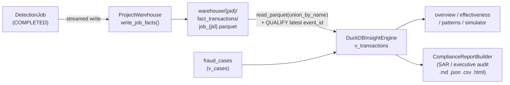

# Module 6 — Project Warehouse, Insight & Compliance Reports
<!-- [26-11-27] Created. [26-11-28] English rewrite. -->

## 1. Responsibility & boundary
- **Does:**
  - Maintains the per-project analytic layer (`ProjectWarehouse`): each completed `DetectionJob`'s `predictions.parquet` becomes one append-only fact Parquet file, deduplicated by `event_id` on read.
  - Computes FDS analytics with bounded DuckDB (`DuckDBInsightEngine`): executive overview (`SUC-22`), effectiveness (`SUC-23`), typology & patterns (`SUC-24`).
  - Builds and exports compliance reports (`ComplianceReportBuilder`, `SUC-25`): SAR dossier and executive audit report as `.md`, `.json`, `.csv`, `.html`.
- **Does not:** modify `predictions.parquet`, `fraud_cases` or `detection_jobs`; load full transaction files with pandas in the API (`INV-007`, `INV-016`). In queue mode heavy queries run on `usfds-analytics`.

## 2. Data ownership

| Resource | Owned | Boundary |
|---|---|---|
| Fact warehouse | `warehouse/{project_id}/fact_transactions/job_{job_id}.parquet` | Exactly one append-only file per completed `DetectionJob`. Read via `ProjectWarehouse.load_fact_table()` (runs `sync_missing_jobs` for completed jobs without facts). |
| Report exports | `exports/reports/{project_id}/{filename}` | Temporary; downloaded via presigned GET (S3) or streaming (local). |

## 3. Shared contracts

- **`C5` — `fact_transactions` schema** (defined in `project_warehouse.py`):
  - Core columns: `job_id`, `job_name`, `job_created_at`, `scanned_at`, `model_version_id`, `score_threshold`, `event_id`, `user_id`, `tx_timestamp`, `hour_utc`, `amount`, `model_score`, `rule_action`, `final_action`, `is_flagged`, `has_rule_hit`, `has_ai_hit`, `rule_codes VARCHAR[]`, `dataset_label` (`-1|0|1`), `has_label_col BOOLEAN`.
  - Optional entity columns: `device_id`, `ip_address`, `card_id`, `merchant_id`, `merchant_category` (filled with `NULL` for old facts via `union_by_name=true`).
- **Dedup & label precedence (`DuckDBInsightEngine`):** `QUALIFY row_number() OVER (PARTITION BY event_id ORDER BY scanned_at DESC, job_id DESC) = 1`; facts join `v_cases` (incl. intake-only cases via `UNION ALL`) into `v_transactions`; truth precedence `VERIFIED_CASE` > `DATASET_FALLBACK` > `UNVERIFIED`.
- **Bounded DuckDB (`INV-007`):** every analytic connection uses `create_bounded_duckdb_connection(...)` (capped threads / RAM, spill directory) to avoid OOM under concurrency. Limits are candidates for system metadata (`P-01`, `ISS-058`).
- **Label normalization (`C4`):** `ProjectWarehouse` uses the shared `label_normalization.py`, consistent with mapping and rule backtest.

## 4. Critical flow

## 5. Known traps & code / spec map
- Metric formulas (insult rate, verified FPR, VDR, missed fraud, `REJECT` vs `REVIEW`, case SLA / MTTR, calibration, dual-threshold simulator, model comparison + PSI) are standardized (`ISS-046`); any formula change must keep `INV-013`.
- `insight_report` is the only job with `attempts=3` (read-only, safe to retry transient S3 / DuckDB errors); `ValueError` / `LookupError` still stop retries via `UnrecoverableError`.
- `ProjectWarehouse` is a concrete DuckDB class in core with no port (`P-04`, `ISS-057`).
- **Code:** `usfds-core/src/usfds_core/services/{warehouse,insight_report}/`, `usfds-server/src/usfds_server/routers/insight_report_router.py`, `usfds-worker/src/usfds_worker/handlers.py` (`handle_insight_report`).
- **Spec:** [`insight_report/suc-spec.md`](../../features/insight_report/suc-spec.md).
