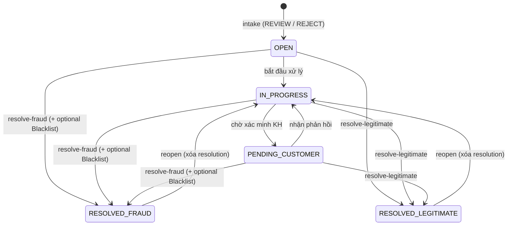

# Module 5 — Investigation, Case Management & Network Graph
<!-- [26-11-27] Created: As-Built module architecture for fraud cases, blacklist, behavior profiles, and LadybugDB network graph. -->

## 1. Trách nhiệm & Ranh giới
- **Làm gì:**
  - Tiếp nhận giao dịch nghi vấn (`REVIEW`/`REJECT`) thành hồ sơ điều tra (`Case`), tính điểm ưu tiên (`priority_score` 0–100 & `RiskLevel`), xử lý kết luận (`RESOLVED_FRAUD` / `RESOLVED_LEGITIMATE`), mở lại (`reopen`), và ghi nhật ký kiểm toán bất biến (`AuditLog`).
  - Quản trị danh sách đen thực thể (`EntityBlacklist`: `USER_ID`, `CARD_ID`, `DEVICE_ID`, `IP_ADDRESS`, `MERCHANT_ID`) phát sinh từ case xác nhận gian lận.
  - Dựng hồ sơ hành vi người dùng (`BehaviorProfile` 30/90 ngày) bằng DuckDB và phân tích mạng lưới đa thực thể (**Graph Exploration**) bằng **embedded LadybugDB (`:memory:`)**.
- **KHÔNG làm gì:** Không tự chạy chấm điểm mô hình hay ghi vào `ProjectWarehouse`; không tự chặn giao dịch trong Rule Engine (chỉ cung cấp dữ liệu `Case` & `EntityBlacklist` cho Insight, Graph Overlay và Compliance Report).

---

## 2. Data Ownership

| Loại tài nguyên | Sở hữu độc quyền | Lưu ý ranh giới |
|---|---|---|
| **Cases** | `fraud_cases` | Unique `(project_id, event_id)` và `(project_id, case_code)`. Lưu ý: cột `user_id` trên `fraud_cases` là **định danh chủ thể giao dịch**, không phải FK owner tài khoản điều tra viên; `project_id`/`detection_job_id`/`model_version_id` là soft refs (chưa có DB FK). |
| **Blacklist** | `entity_blacklist` | Partial unique index `WHERE status = 'ACTIVE'` trên `(project_id, entity_type, entity_value)`; `source_case_id -> fraud_cases.case_id`. |
| **Audit Trail** | `audit_logs` | Chỉ ghi thêm (append-only), có index theo `(entity_type, entity_id)` và `project_id`. |
| **Graph Cache (In-Memory)** | `LadybugNetworkGraphService` LRU+TTL cache | Tối đa `USFDS_GRAPH_CACHE_MAX_ENTRIES=4`, TTL `600s`, buffer pool `256MB` mỗi graph; tự làm mới khi `source_fingerprint` của warehouse thay đổi. |

---

## 3. Shared Contracts

- **Contract `Case.verified_label` → Insight (`Module 6`):** `RESOLVED_FRAUD → 1`, `RESOLVED_LEGITIMATE → 0`, các trạng thái mở → `None`. Đây là nguồn nhãn ưu tiên cao nhất (`VERIFIED_CASE`) cho `DuckDBInsightEngine`.
- **Contract Optimistic Locking (`INV-012`):** Mọi thao tác cập nhật case qua `ICaseRepository.save(case, expected_version)` phải khớp `version` hiện hành; sai version ném `CaseConflictError` (HTTP `409`).
- **Contract Input cho Graph & Behavior Profile (từ `ProjectWarehouse` `C5`):**
  - Đọc `fact_transactions` đã dedup từ `ProjectWarehouse` (hoặc fallback artifact Parquet/CSV).
  - Đồ thị hai phía (bipartite): `User` nối tới 4 loại thực thể phụ (`Device`, `IpAddress`, `Card`, `Merchant`) qua quan hệ `USED_DEVICE`, `USED_IP`, `USED_CARD`, `TRANSACTED_AT`.
  - `LiveRiskOverlay` phủ trạng thái `Case` + `EntityBlacklist` trực tiếp lúc truy vấn mà không cần dựng lại đồ thị trong cache; giới hạn mở rộng `MAX_EXPAND_NEIGHBORS=50`, `MAX_CANVAS_NODES=200`, gắn cờ super-node khi degree > `50`.

---

## 4. State Machine & Critical Flows

- **Quy tắc kết luận:**
  - `resolve-fraud`: bắt buộc `reason` thuộc `FRAUD_REASONS` + `summary >= 10` ký tự; mọi `block_entities` phải được xác minh thuộc `attributes` của giao dịch trước khi ghi `EntityBlacklist`.
  - `resolve-legitimate`: bắt buộc `reason` thuộc `LEGITIMATE_REASONS`; **cấm** thêm blacklist.

---

## 5. Known Gotchas & Code/Spec Map
- **Bẫy 1 (Phân biệt `user_id`):** Trên `fraud_cases`, `user_id` là **khách hàng thực hiện giao dịch**, không phải `owner_id` cho `GrantScope.OWN` (quyền Investigation hiện kiểm tra ở mức project: `case:read/create/manual_review/escalate/reopen`, `blacklist:manage`).
- **Bẫy 2 (Graph engine thực tế):** Dù `deploy/docker-compose.yml` dùng image `apache/age`, Graph Exploration thực tế chạy trên **embedded LadybugDB (`:memory:`)**, không query PostgreSQL AGE. Nếu dataset chỉ có `user_id` mà thiếu cả 4 cột thực thể phụ (`device_id`, `ip_address`, `card_id`, `merchant_id`), đồ thị sẽ trả thông báo thiếu cột liên kết.
- **Bẫy 3 (Legacy song song):** `InvestigationCase`/`InvestigationStatus`/`InvestigationService` (`domain/entities/investigation.py`) là mô hình cũ; luồng hiện hành là `Case`/`CaseStatus`/`CaseService` (`domain/entities/case.py`). Luồng Assign/Claim đã deprecated từ `ISS-045`.
- **Code chính:** `usfds-core/src/usfds_core/services/investigation/{case_service,behavior_profile,duckdb_engine,explainability,network_graph}.py`, `usfds-infra/src/usfds_infra/database/{case_models,case_repositories}.py`, `usfds-server/src/usfds_server/routers/{investigation,network_graph}_router.py`.
- **Spec:** [`docs/features/investigation/suc-spec.md`](../../features/investigation/suc-spec.md).
