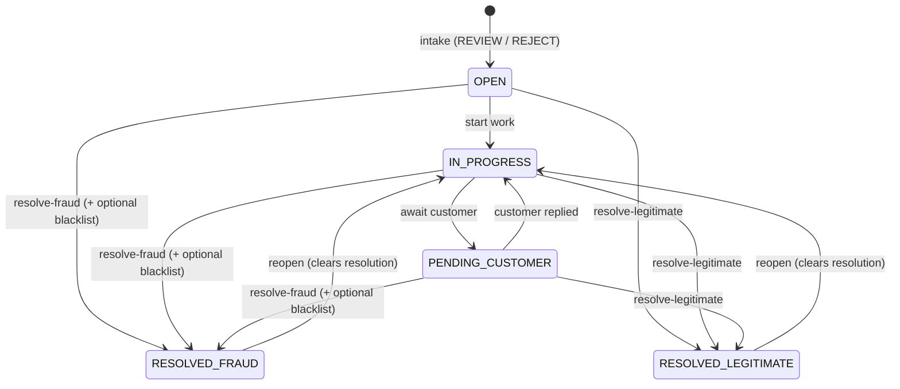

# Module 5 — Investigation, Case Management & Network Graph
<!-- [26-11-27] Created. [26-11-28] English rewrite. -->

## 1. Responsibility & boundary
- **Does:**
  - Turns suspicious transactions (`REVIEW` / `REJECT`) into investigation cases (`Case`), computes `priority_score` (0–100) and `RiskLevel`, resolves (`RESOLVED_FRAUD` / `RESOLVED_LEGITIMATE`), reopens, and writes an append-only `AuditLog`.
  - Manages the entity blacklist (`EntityBlacklist`: `USER_ID`, `CARD_ID`, `DEVICE_ID`, `IP_ADDRESS`, `MERCHANT_ID`) created from confirmed fraud cases.
  - Builds user behavior profiles (30 / 90 days) with DuckDB and multi-entity **graph exploration** with **embedded LadybugDB** (`:memory:`).
- **Does not:** score models or write `ProjectWarehouse`; block transactions in the rule engine. It only supplies `Case` and `EntityBlacklist` data to insight, graph overlay and compliance reports.

## 2. Data ownership

| Resource | Owned | Boundary |
|---|---|---|
| Cases | `fraud_cases` | Unique `(project_id, event_id)` and `(project_id, case_code)`. `user_id` here is the **transaction subject**, not the investigator / owner. `project_id`, `detection_job_id`, `model_version_id` are soft references (no DB FK). |
| Blacklist | `entity_blacklist` | Partial unique index `WHERE status = 'ACTIVE'` on `(project_id, entity_type, entity_value)`; `source_case_id → fraud_cases.case_id`. |
| Audit trail | `audit_logs` | Append-only; indexed by `(entity_type, entity_id)` and `project_id`. |
| Graph cache (in memory) | `LadybugNetworkGraphService` LRU + TTL cache | Size / TTL / buffer pool from `USFDS_GRAPH_CACHE_*`; refreshed when the warehouse `source_fingerprint` changes. |

## 3. Shared contracts

- **`Case.verified_label` → insight (module 6):** `RESOLVED_FRAUD → 1`, `RESOLVED_LEGITIMATE → 0`, open states → `None`. Highest-priority ground truth (`VERIFIED_CASE`).
- **Optimistic locking (`INV-012`):** every update goes through `ICaseRepository.save(case, expected_version)`; mismatch → `CaseConflictError` (`409`).
- **Graph & behavior profile input (from `C5`):**
  - Reads deduplicated `fact_transactions` from `ProjectWarehouse` (fallback: artifact Parquet / CSV).
  - Bipartite graph: `User` → `Device`, `IpAddress`, `Card`, `Merchant` via `USED_DEVICE`, `USED_IP`, `USED_CARD`, `TRANSACTED_AT`.
  - `LiveRiskOverlay` overlays `Case` + `EntityBlacklist` at query time without rebuilding the cached graph; expansion and canvas sizes are capped and super-nodes are flagged.

## 4. State machine & critical flow

- `resolve-fraud`: `reason` in `FRAUD_REASONS` + `summary` ≥ 10 chars; every `block_entities` value must exist in the transaction's `attributes` before writing `EntityBlacklist`.
- `resolve-legitimate`: `reason` in `LEGITIMATE_REASONS`; blacklisting is forbidden.

## 5. Known traps & code / spec map
- `fraud_cases.user_id` is the customer, not an `OWN` owner; investigation permissions are project-level (`case:read/create/manual_review/escalate/reopen`, `blacklist:manage`).
- `deploy/docker-compose.yml` ships `apache/age`, but graph exploration runs on embedded LadybugDB. If a dataset has `user_id` but none of `device_id`, `ip_address`, `card_id`, `merchant_id`, the graph returns a missing-link-columns message.
- Legacy `InvestigationCase` / `InvestigationStatus` / `InvestigationService` coexist with the current `Case` / `CaseStatus` / `CaseService`; assign / claim is deprecated (`ISS-045`).
- The LadybugDB implementation and DuckDB readers live in core instead of behind ports (`P-04`, `ISS-057`).
- **Code:** `usfds-core/src/usfds_core/services/investigation/{case_service,behavior_profile,duckdb_engine,explainability,network_graph}.py`, `usfds-infra/src/usfds_infra/database/{case_models,case_repositories}.py`, `usfds-server/src/usfds_server/routers/{investigation,network_graph}_router.py`.
- **Spec:** [`investigation/suc-spec.md`](../../features/investigation/suc-spec.md).
