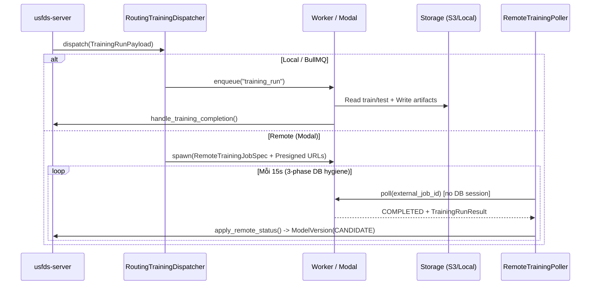

# Module 3 — Model Training, Registry & Remote Compute
<!-- [26-11-27] Created: As-Built module architecture for training orchestration, plugins, versioning/lineage, and Modal remote compute. -->

## 1. Trách nhiệm & Ranh giới
- **Làm gì:**
  - Quản lý catalog mô hình (`BUILTIN`: `random_forest`, `xgboost`; `SCRIPT`: plugin người dùng upload có AST validator + synthetic dry-run).
  - Điều phối `TrainingRun` trên 3 đích tính toán: **Local sync**, **BullMQ worker (`usfds-training`)**, và **Remote Compute (Modal CPU / GPU T4)** thông qua `ComputeSelectionPolicy` + `RoutingTrainingDispatcher` + `RemoteTrainingPoller`.
  - Quản lý `ModelVersion` (đánh số đơn điệu `v1, v2, ...` duy nhất theo `(project_id, model_id)`), kiểm tra SHA-256 khi kích hoạt `APPROVED`, và truy vết phả hệ (`DatasetArtifact → TrainingRun → ModelVersion`).
- **KHÔNG làm gì:** Không chấm điểm giao dịch batch/online (thuộc Module 4); `TrainingRunExecutor` tuyệt đối không chạm DB (`INV-005`).

---

## 2. Data Ownership

| Loại tài nguyên | Sở hữu độc quyền | Lưu ý ranh giới |
|---|---|---|
| **Model Registry** | `models`, `model_versions`, `training_runs`, `run_datasets` | `models` & `model_versions` có `project_id IS NULL` cho global built-in (chỉ sửa qua `model_builtin:manage`). Unique index riêng cho cả `project_id IS NOT NULL` và `IS NULL`. |
| **Plugin & Run Artifacts** | `models/{model_id}/plugin_source.zip`, `models/{model_id}/runs/{run_id}/...` | Chứa artifact mô hình + companion files (`fitted_feature_engineers.joblib`, `column_mapping.json`, `metrics.json`, `eval_predictions.parquet`). |

---

## 3. Shared Contracts

- **Contract `C3` — Model Artifact & Companion Files:**
  - `BUILTIN`: lưu `model.joblib` + `preprocessor.joblib` (+ `model.json` với XGBoost); `ModelVersion.artifact_uri` trỏ tới `.../model.joblib`.
  - `SCRIPT`: đóng gói `src/` + `artifacts/` thành `model_bundle.zip`; `artifact_uri` trỏ tới `.../model_bundle.zip`.
  - Cả hai loại đều lưu sibling `fitted_feature_engineers.joblib` và `column_mapping.json` trong cùng thư mục `models/{model_id}/runs/{run_id}/` để Module 4 (Inference) tải độc lập.
- **Contract Remote Compute (`RemoteTrainingJobSpec` & 11 Fixed Write URLs):**
  - `RoutingTrainingDispatcher` ký presigned GET cho inputs (`train`, `test`, `fe_artifact`, plugin zip) và presigned PUT cho **đúng 11 tên file chuẩn** (`routing_dispatcher.py:12-24`) với TTL `USFDS_REMOTE_PRESIGNED_TTL_SECONDS` (14400s).
  - Container Modal chỉ dùng `PresignedUrlStorage` — **0 credential S3/DB** (`INV-004`).
- **Contract Auto-Compute Policy (`compute_policy.py`):** `auto` chọn `remote gpu` nếu plugin `SCRIPT` dùng keyword DL/graph (`pytorch`, `torch`, `tensorflow`, `gnn`, `pyg`, `dgl`), chọn `remote cpu` nếu `row_count >= USFDS_AUTO_COMPUTE_ROW_THRESHOLD` (`100_000`), còn lại `local`.

---

## 4. State Machine & Critical Flows

- **`TrainingRunStatus`:** `PENDING → RUNNING → COMPLETED | FAILED | CANCELLED` (terminal bất biến, idempotent khi redelivery).
- **`ModelVersionStatus`:** `DRAFT | CANDIDATE → APPROVED → DEPRECATED → ARCHIVED` (chuyển sang `APPROVED` bắt buộc verify file tồn tại + khớp SHA-256).

---

## 5. Known Gotchas & Code/Spec Map
- **Bẫy 1 (`ISS-001` & `ISS-051`):** Format artifact còn ngầm định theo đuôi `.zip` vs `.joblib`; `training/executor.py:156` hardcode kiểm tra `main.py` thay vì đọc `entrypoint` trong `plugin_manifest.json`; model train từ `PRE_PROCESSED` chưa copy `fitted_pipeline.joblib` vào thư mục run (sẽ mất pipeline nếu dataset bị xóa sau này).
- **Bẫy 2 (`ISS-050`):** `BuiltinModelTrainer` (`builtin_trainer.py:93-97`) hiện chỉ loại tập `NON_ML_COLUMNS` tĩnh thay vì đọc `non_ml_columns` động từ `SystemColumnMetadata` snapshot.
- **Bẫy 3:** Remote Modal chỉ upload được trong 11 tên file đã cấp presigned PUT — mọi file phụ của plugin cần nằm trong `model_bundle.zip`.
- **Code chính:** `usfds-core/src/usfds_core/services/training/` (gồm `remote_entrypoint.py`), `usfds-infra/src/usfds_infra/compute/{modal_provider,modal_images}.py`, `usfds-server/src/usfds_server/{routers/training_router.py,services/remote_poller.py}`, `usfds-worker/src/usfds_worker/handlers.py` (`handle_training_run`, `handle_plugin_dry_run`).
- **Spec:** [`docs/features/detection/suc-spec.md`](../../features/detection/suc-spec.md).
