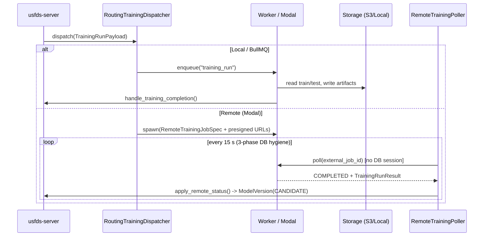

# Module 3 — Model Training, Registry & Remote Compute
<!-- [26-11-27] Created. [26-11-28] English rewrite; P-02 / P-03 reference module; bug details moved to issues. -->

## 1. Responsibility & boundary
- **Does:**
  - Manages the model catalog: `BUILTIN` (`random_forest`, `xgboost`) and `SCRIPT` (user-uploaded plugins with AST validator + synthetic dry run). This is the reference implementation of `P-02`.
  - Orchestrates `TrainingRun` on 3 compute targets — **in-process**, **BullMQ worker** (`usfds-training`), **remote** (Modal CPU / GPU T4) — via `ComputeSelectionPolicy` + `RoutingTrainingDispatcher` + `RemoteTrainingPoller`. This is the reference implementation of `P-03`.
  - Manages `ModelVersion` (monotonic `v1, v2, ...` unique per `(project_id, model_id)`), SHA-256 check on `APPROVED`, lineage `DatasetArtifact → TrainingRun → ModelVersion`.
- **Does not:** score transactions (module 4). `TrainingRunExecutor` never touches the DB (`INV-005`).

## 2. Data ownership

| Resource | Owned | Boundary |
|---|---|---|
| Model registry | `models`, `model_versions`, `training_runs`, `run_datasets` | `project_id IS NULL` = global built-ins (editable only with `model_builtin:manage`); separate unique indexes for `project_id IS NULL` and `IS NOT NULL`. |
| Plugin & run artifacts | `models/{model_id}/plugin_source.zip`, `models/{model_id}/runs/{run_id}/...` | Model artifact + companions (`fitted_feature_engineers.joblib`, `column_mapping.json`, `metrics.json`, `eval_predictions.parquet`). |

## 3. Shared contracts

- **`C3` — model artifact & companions:**
  - `BUILTIN`: `model.joblib` + `preprocessor.joblib` (+ `model.json` for XGBoost); `ModelVersion.artifact_uri` → `.../model.joblib`.
  - `SCRIPT`: `src/` + `artifacts/` zipped as `model_bundle.zip`; `artifact_uri` → `.../model_bundle.zip`.
  - Both keep sibling `fitted_feature_engineers.joblib` and `column_mapping.json` in `models/{model_id}/runs/{run_id}/` so inference can load them independently.
- **Remote compute contract (`RemoteTrainingJobSpec`):** `RoutingTrainingDispatcher` signs presigned GET for inputs (`train`, `test`, `fe_artifact`, plugin zip) and presigned PUT for a **fixed set of output file names**, TTL `USFDS_REMOTE_PRESIGNED_TTL_SECONDS`. The container uses only `PresignedUrlStorage` — zero S3 / DB credentials (`INV-004`).
- **Auto compute policy** (`compute_policy.py`): `auto` picks remote GPU for `SCRIPT` plugins using DL / graph keywords (`torch`, `tensorflow`, `gnn`, `pyg`, `dgl`, ...), remote CPU when `row_count >= USFDS_AUTO_COMPUTE_ROW_THRESHOLD`, else local. Routing values are candidates for system metadata (`P-01`, `ISS-058`).

## 4. State machine & critical flow

- **`TrainingRunStatus`:** `PENDING → RUNNING → COMPLETED | FAILED | CANCELLED` (terminal immutable, idempotent on redelivery).
- **`ModelVersionStatus`:** `DRAFT | CANDIDATE → APPROVED → DEPRECATED → ARCHIVED` (`APPROVED` verifies file exists + SHA-256).

## 5. Known traps & code / spec map
- Remote runs can upload only the pre-signed file names; any extra plugin file must live inside `model_bundle.zip`.
- `IRemoteComputeProvider` is still training-specific; other job types cannot run remotely yet (`ISS-056`, draft epic `.plan/remote_compute_multi_workload.md`).
- Open gaps: `ISS-001` / `ISS-051` (artifact format implicit; plugin entrypoint hardcoded; `PRE_PROCESSED` pipeline not copied into the run folder), `ISS-050` (static `NON_ML_COLUMNS` instead of the `C1` snapshot).
- **Code:** `usfds-core/src/usfds_core/services/training/` (incl. `remote_entrypoint.py`), `usfds-infra/src/usfds_infra/compute/{modal_provider,modal_images}.py`, `usfds-server/src/usfds_server/{routers/training_router.py,services/remote_poller.py}`, `usfds-worker/src/usfds_worker/handlers.py` (`handle_training_run`, `handle_plugin_dry_run`).
- **Spec:** [`detection/suc-spec.md`](../../features/detection/suc-spec.md), [`detection/training/suc-spec.md`](../../features/detection/training/suc-spec.md).
