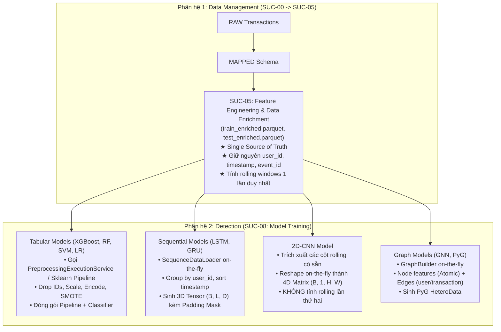

# Thay đổi kiến trúc trọng yếu (Critical Architectural Changes)

> **Ngày cập nhật:** 09/10/2026  
> **Chủ đề:** Tách rời khâu Làm giàu đặc trưng (Feature Engineering) và Chuẩn hóa đa mô hình (Model-Specific Normalization)  
> **Tài liệu liên quan:** 
> - `docs/usecase/suc-module-1-2.md` (`SUC-05`, `SUC-08`)
> - `docs/features/data_management/gap.md`
> - `docs/features/detection/gap.md`
> - [Notion: Cải thiện quy trình tiền xử lý dữ liệu để hỗ trợ đa mô hình học máy](https://app.notion.com/p/C-i-thi-n-quy-tr-nh-ti-n-x-l-d-li-u-h-tr-a-m-h-nh-h-c-m-y-3f4b99c6a95080cbbb58f1c107c92e83)

---

## 1. Bối cảnh & Vấn đề kiến trúc cũ (The Architectural Problem)

Trong thiết kế ban đầu, quy trình xử lý dữ liệu qua 4 stage tuyến tính:
$$\text{RAW} \longrightarrow \text{MAPPED} \longrightarrow \text{FEATURE\_ENGINEERED} \longrightarrow \text{PRE\_PROCESSED} \longrightarrow \text{TRAIN}$$

Tuy nhiên, việc gán cứng bước **Auto-Normalization** (`PRE_PROCESSED`) vào phân hệ Data Management (`SUC-05`) đã gây ra 3 điểm nghẽn nghiêm trọng:

1. **Ép khuôn sớm dạng bảng (Premature Tabular-centric Coupling):**
   - `PreprocessingExecutionService` tự động loại bỏ vĩnh viễn các trường định danh và thời gian (`user_id`, `timestamp`, `event_id`) trước khi đưa qua `RobustScaler` và `SMOTE`.
   - Kết quả đầu ra bị "đóng đinh" thành bảng 2D phẳng (`train_processed.parquet`). Dữ liệu này **hoàn toàn vô dụng** đối với các mô hình học sâu và đồ thị:
     - **LSTM / GRU:** Cần chuỗi 3D Tensor `(B, L, D)` theo trình tự thời gian của từng `user_id` (SMOTE sinh mẫu tổng hợp phá hủy trật tự thời gian).
     - **2D-CNN:** Cần ma trận tương quan không - thời gian 4D `(B, 1, H, W)`.
     - **GNN:** Cần các khóa định danh để thiết lập cạnh nối mạng lưới đồ thị (`HeteroData`).
2. **Trùng lặp tính toán (Double Aggregation):**
   - Tại `FEATURE_ENGINEERED`, `VelocityFeatureEngineer` đã thực hiện `rolling.groupby()` tốn nhiều tài nguyên CPU/RAM.
   - Nhưng khi đưa vào các mô hình deep learning (như `cnn.py`), script mô hình lại phải tự tính toán rolling window lần 2, gây lãng phí tài nguyên và làm nghẽn độ trễ khi Online Serving.
3. **Cố định siêu tham số của mô hình từ tầng dữ liệu:**
   - Độ dài chuỗi $L$ của LSTM, kích thước lưới $H \times W$ của CNN, hay tỷ lệ resampling thực chất là **siêu tham số (Hyperparameters)** của từng thuật toán mô hình cụ thể. Không thể gán cứng chúng ở tầng lưu trữ tĩnh của Data Management.

---

## 2. Kiến trúc mới: Phân tầng & Decoupled Data Pipeline

Hệ thống chuyển đổi sang mô hình **Phân tầng đặc trưng (Two-Tier Data Preparation Architecture)** và chuyển khâu chuẩn hóa toán học về đúng **Không gian Huấn luyện Mô hình (Model Training Scope)**.

### Nguyên tắc phân tầng đặc trưng:
* **Tầng 1 - Dữ liệu nghiệp vụ (Business Data) tại Data Management:**
  - **Atomic Features:** `amount`, `hour_of_day`, `day_of_week`, `country_mismatch`, `delta_time`.
  - **Aggregated Features:** Cửa sổ trượt (1h, 24h, 7d...) tính **1 lần duy nhất** tại `FEATURE_ENGINEERED`.
  - **Bảo lưu tuyệt đối:** `user_id`, `timestamp`, `event_id` không bao giờ bị loại bỏ ở phân hệ Data Management.
* **Tầng 2 - Chuẩn hóa mô hình (Model Representation) tại Detection:**
  - Khâu Scale, Encode, Tensor Reshape, Graph Building diễn ra **on-the-fly** hoặc được quản lý bởi chính `Trainer` của thuật toán đó trong `SUC-08`.

---

## 3. Tác động cụ thể tới Đặc tả Use Case và Mã nguồn (`usfds-core`)

### 3.1. Cập nhật Đặc tả Use Case (`docs/usecase/suc-module-1-2.md`)
* **`SUC-05` đổi tên thành:** `Create advanced features & enrich dataset` (Tạo đặc trưng nâng cao và làm giàu dữ liệu).
* **Kết thúc của `SUC-05`:** Dừng lại ở stage `FEATURE_ENGINEERED` (lưu `train_enriched.parquet`, `test_enriched.parquet`). Bổ sung quy tắc nghiệp vụ `BR-DM-07` bắt buộc bảo lưu khóa định danh và thời gian.
* **`SUC-08` (Start model training):** Chịu trách nhiệm tự động kích hoạt chuẩn hóa dữ liệu đầu vào phù hợp với thuật toán đã chọn (Tabular, Sequence, Graph).
* **`SUC-07` (Export dataset):** Hỗ trợ xuất cả dataset ở stage `FEATURE_ENGINEERED` lẫn `PRE_PROCESSED`.

### 3.2. Cập nhật `TrainingOrchestrationService` (`training_service.py`)
* Cho phép nhận đầu vào linh hoạt từ cả `PipelineStage.FEATURE_ENGINEERED` lẫn `PipelineStage.PRE_PROCESSED`.
* Khi nhận artifact ở stage `FEATURE_ENGINEERED`:
  - Tabular Trainer sẽ áp dụng pipeline biến đổi bảng phẳng.
  - Deep Learning Trainer sẽ áp dụng `DataLoader` chuỗi/đồ thị tương ứng.

---

## 4. Bảng tổng kết lợi ích kiến trúc (Architectural Scorecard)

| Tiêu chí | Kiến trúc cũ (Monolithic Tabular) | Kiến trúc mới (Decoupled Multi-Modal) |
| :--- | :--- | :--- |
| **Hỗ trợ đa mô hình AI** | Chỉ hỗ trợ duy nhất mô hình bảng phẳng (XGBoost, RF). | Hỗ trợ tự nhiên mọi họ mô hình: Tabular, LSTM/GRU, 2D-CNN, GNN. |
| **Tính toàn vẹn dữ liệu** | Bị mất `user_id`, `timestamp` từ sớm; SMOTE phá hủy chuỗi thời gian. | Bảo lưu 100% định danh và thứ tự thời gian tại `train_enriched.parquet`. |
| **Hiệu năng tính toán** | Bị trùng lặp tính toán rolling window (Double Aggregation). | Tính toán rolling 1 lần duy nhất tại Feature Engineering; zero duplication. |
| **Độ trễ Online Serving** | Phải chạy qua nhiều tầng transform chắp vá (> 100ms). | Tối ưu hóa theo từng mô hình; model bundle chứa trọn gói transform. |
| **Dung lượng lưu trữ** | Nguy cơ phình to nếu sinh thêm file tensor `.pt` tĩnh trên ổ đĩa. | Tiết kiệm tối đa; chỉ lưu trữ bản Parquet gốc, biến đổi on-the-fly trên RAM/GPU. |
| **Độ phức tạp code** | Cố ép mọi thuật toán vào một khuôn Parquet 2D. | Tách bạch rõ ràng theo nguyên tắc Single Responsibility & Open-Closed. |
