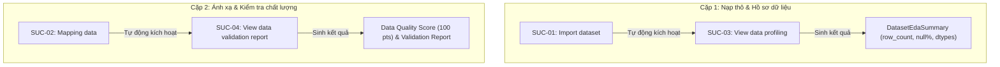

# Phân tích khoảng trống (Gap Analysis) - Phân hệ Data Management

> **Phân hệ:** Data Management (Quản lý dữ liệu)  
> **Mục tiêu:** Chuẩn bị dữ liệu sạch, giàu đặc trưng và đạt chuẩn để phục vụ huấn luyện mô hình học máy và thực thi tập luật; quản lý vòng đời và phả hệ dữ liệu (Data Lineage).

---
## Phân tích ngày 10-10-2026

### 1. `usfds-core`

Phân hệ Data Management gồm **8 System Use Cases (SUC-00 đến SUC-07)**:
- **Đã đáp ứng đầy đủ ở tầng Core (3 SUC):** `SUC-01`, `SUC-03`, `SUC-05`.
- **Đã đáp ứng một phần / Có sẵn mô hình dữ liệu & logic nền tảng (5 SUC):** `SUC-00`, `SUC-02`, `SUC-04`, `SUC-06`, `SUC-07`.
- **Chưa cài đặt (0 SUC):** Toàn bộ use case đều đã có cấu trúc nền tảng trong core.

---
### 2. `usfds-server`

### 3. `usfds-web`

### 4. Phân tích kiến trúc: Mối quan hệ kích hoạt tự động giữa các Use Case

Hệ thống có hai cặp tác vụ liên kết chặt chẽ theo mô hình **Action -> Automatic Profiling/Validation Trigger**:

#### So sánh chi tiết hai cặp liên kết:

1. **Cặp SUC-01 (Import dataset) ➔ SUC-03 (View data profiling):**
   * **Bối cảnh:** Khi nạp tệp dữ liệu thô (chưa biết cấu trúc, chưa chuẩn hóa).
   * **Mục đích:** Khảo sát tổng quan phân bố các cột, số dòng, kiểu dữ liệu suy diễn và tỷ lệ missing để Data Scientist có cơ sở định hình việc mapping.
   * **Hiện trạng cài đặt:** **Đã hoàn thiện**. `RawDatasetIngestionService` tự động gọi `DatasetEdaService.analyze()` ngay sau khi kiểm tra checksum và lưu tệp.

2. **Cặp SUC-02 (Mapping data) ➔ SUC-04 (View data validation report):**
   * **Bối cảnh:** Khi dữ liệu đã được ánh xạ vào 5 trường nghiệp vụ bắt buộc (`event_id`, `timestamp`, `amount`, `user_id`, `label`) và các trường tùy chọn.
   * **Mục đích:** Kiểm tra sâu về tính hợp lệ nghiệp vụ (Business Rules), trùng lặp giao dịch/ID, giá trị số tiền $\le 0$, thời gian tương lai, phát hiện ngoại lai (Outliers) và tính toán **Data Quality Score** tổng hợp.
   * **Hiện trạng cài đặt:** **Cần bổ sung**. Cần xây dựng `DataMappingService` (`SUC-02`) sao cho sau khi lưu thành công tệp `mapped.parquet`, nó sẽ tự động kích hoạt `DataQualityValidationService` (`SUC-04`) để lưu báo cáo `validation_report` và gán trạng thái `validation_status` vào `DatasetArtifact` stage `MAPPED`.

---

### 4. Danh sách các khoảng trống cần bổ sung (Action Items)

1. **Xây dựng `DataMappingService` (`SUC-02`):**
   * Nhận cấu hình ánh xạ `DataMappingConfig`.
   * Kiểm tra nghiêm ngặt 5 trường chuẩn bắt buộc (`BR-DM-03`) và không trùng cột (`BR-DM-04`).
   * Thực hiện lọc cột, chuẩn hóa thời gian và chuyển đổi định dạng sang `mapped.parquet`.
   * Tạo `DatasetArtifact` với stage `MAPPED`.
2. **Xây dựng `DataQualityValidationService` (`SUC-04`):**
   * Tính toán điểm **Data Quality Score (thang điểm 0–100)** dựa trên: tỷ lệ missing, tỷ lệ trùng lặp, vi phạm quy tắc số tiền/thời gian, và ngoại lai.
   * Tự động được gọi bởi `DataMappingService` ngay sau khi sinh file mapped.
   * Ghi kết quả vào `validation_report` của artifact `MAPPED`.
3. **Bổ sung các endpoints tại `usfds-server`:**
   * CRUD và tìm kiếm dataset catalog (`SUC-00`).
   * Download / Presigned URL cho artifact chuẩn hóa (`SUC-07`).
   * Lineage API trả về DAG JSON cho giao diện người dùng (`SUC-06`).
