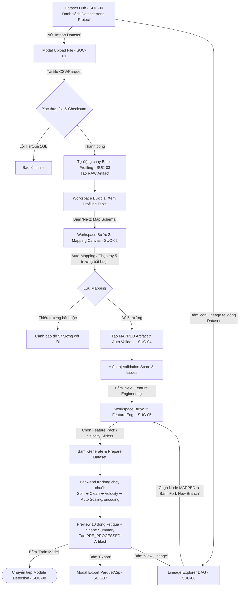

# Thiết kế User Flow & UI/UX: Module Data Management

Tài liệu này đặc tả chi tiết **User Flow**, **Cấu trúc Bố cục Giao diện (Layout Wireframes)**, và **Tương tác Người dùng (Interactions)** cho phân hệ **Data Management** của hệ thống USFDS. Tài liệu cung cấp đầy đủ ngữ cảnh để UI Designer hoặc AI UI Agent triển khai trực tiếp các màn hình và thành phần giao diện.

---

## 1. Tổng quan & Kiến trúc Luồng Dữ liệu (Pipeline Architecture)

Phân hệ Data Management phục vụ tác nhân chính là **Data Scientist**, với mục tiêu chuẩn bị dữ liệu sạch, giàu đặc trưng và chuẩn hóa cho việc huấn luyện mô hình phát hiện gian lận.

### 1.1. Vòng đời Artifact & Tính bất biến (Lineage)
- Mỗi tác vụ xử lý thành công sẽ tạo ra một **`DatasetArtifact`** bất biến, liên kết với artifact cha thông qua `parent_artifact_id`.
- Trạng thái pipeline chuyển dịch tuần tự: `RAW` $\to$ `MAPPED` $\to$ `PRE_PROCESSED` $\to$ `TRAINED_MODEL` (kết nối sang Module Detection).

### 1.2. Workspace Stepper 3 bước (Rút gọn)
Để tối ưu hóa trải nghiệm người dùng, toàn bộ logic chuẩn hóa toán học phức tạp (Scaling, Encoding, Resampling) được tự động hoá hoàn toàn ở back-end sau khi cấu hình đặc trưng nghiệp vụ:

```
[ Bước 1: RAW Data & Profiling ] ──> [ Bước 2: Schema Mapping & Validation ] ──> [ Bước 3: Feature Eng. & Auto-Normalize ] ──> [ Sẵn sàng Train Model / Export ]
```

---

## 2. Sơ đồ Macro User Flow (Toàn cảnh người dùng)



---

## 3. Chi tiết Giao diện & Tương tác từng Màn hình (Screen Specifications)

---

### Màn hình 1: Dataset Hub (Danh mục quản lý tập dữ liệu - SUC-00)

* **Mục đích:** Là trang chủ của Data Management, cung cấp cái nhìn tổng quan về tất cả các dataset, phiên bản mới nhất, điểm chất lượng và trạng thái pipeline.
* **Layout Structure:**
  - **Header Bar:**
    - Tiêu đề trang: `Data Management / Datasets`
    - Bộ lọc nhanh: Tabs phân loại (`All`, `Raw`, `Mapped`, `Model Ready`)
    - Ô tìm kiếm: `Search datasets by name, tag, creator...`
    - Nút CTA Primary: **`[ + Import Dataset ]`** (Màu xanh dương, icon upload).
  - **KPI Summary Cards (3 thẻ trên đầu trang):**
    - Card 1: *Total Datasets* (vd: 12 Datasets | 28 Artifact Versions)
    - Card 2: *Model Ready Datasets* (vd: 8 Datasets đã qua Feature Engineering)
    - Card 3: *Avg Quality Score* (vd: 92/100 | 95% Validated)
  - **Dataset Catalog Table (Bảng chính):**
    - Cột 1: **Dataset Name** (Tên kỹ thuật + Tên hiển thị bên dưới, kèm icon PII nếu có).
    - Cột 2: **Current Stage** (Badge màu: `RAW` - Lam, `MAPPED` - Lục, `PRE_PROCESSED` - Tím).
    - Cột 3: **Latest Artifact Info** (Dung lượng, Số dòng, Checksum SHA-256 rút gọn).
    - Cột 4: **Quality Score** (Điểm từ 0-100 kèm dot màu trạng thái: Xanh cho PASSED, Cam cho WARNING).
    - Cột 5: **Lineage Tree** (Icon nhánh cây hiển thị số node/nhánh, vd: `3 versions / 2 branches`).
    - Cột 6: **Updated Time** (Thời gian cập nhật tương đối, vd: `2 hours ago`).
    - Cột 7: **Actions (Cố định phải):**
      - Nút **`Open Workspace`**: Mở trực tiếp Stepper tại bước tiếp theo tương ứng với stage hiện tại.
      - Nút **`View Lineage`**: Mở sơ đồ cây phả hệ (Screen 2).
      - Menu Dropdown (`...`): *Rename*, *View Metadata*, *Delete*.

---

### Màn hình 2: Interactive Lineage Explorer (Cây phả hệ dữ liệu & Rẽ nhánh - SUC-06)

* **Mục đích:** Trực quan hóa cây phả hệ (DAG) của một Dataset từ file nạp ban đầu cho đến các nhánh đặc trưng và mô hình AI đã huấn luyện; hỗ trợ người dùng rẽ nhánh thử nghiệm mới (**Branching**).
* **Layout Structure: Split Canvas (60% Đồ thị - 40% Inspector)**

```
+-----------------------------------------------------------------------------------------------------------------------+
| BREADCRUMB: Datasets / credit_card_fraud_2026 / Lineage Graph                    [ Zoom: (-) 100% (+) ] [ Reset View ]|
+-------------------------------------------------------------+---------------------------------------------------------+
| INTERACTIVE DAG CANVAS (Trái 60%)                           | NODE INSPECTOR PANEL (Phải 40% - Drawer cố định)        |
|                                                             |                                                         |
|   [ (R) Artifact #1: RAW ]                                  | Node Selected: Artifact #2 (MAPPED)                     |
|           |                                                 | Stage: MAPPED | Created: 2026-10-07 14:20                |
|           v (Auto-mapping)                                  | Parent: Artifact #1 (RAW)                               |
|   [ (M) Artifact #2: MAPPED ]                               | Checksum: sha256:4a8b...9f2e                            |
|        /              \                                     | Storage: datasets/cc/mapped.parquet (14.2 MB)           |
|       /                \ (Fork Branch)                      |---------------------------------------------------------|
|      v                  v                                   | Validation Status: [ PASSED ] (Score: 98/100)            |
| [ (P) Artifact #3 ]    [ (P) Artifact #4 (Active) ]         | Rows: 100,000 | Cols: 5 Core + 4 Optional               |
|      |                  |                                   |---------------------------------------------------------|
|      v                  v                                   | PRIMARY ACTIONS:                                        |
| [ Model: XGB-v1 ]     [ Ready for Model Training ]          | [ 🌿 Fork New Pipeline Branch from this Node ]          |
|                       (Created with 7d Velocity)            | [ 👁 View Data Profiling / Validation Report ]           |
|                                                             | [ ⬇ Export Artifact ]                                   |
+-------------------------------------------------------------+---------------------------------------------------------+
```

* **Quy ước Node trên Đồ thị:**
  - **Node RAW:** Viền xanh lam, icon file tệp nguồn.
  - **Node MAPPED:** Viền xanh lục, hiển thị điểm chất lượng (Validation Score).
  - **Node PRE_PROCESSED:** Viền tím, hiển thị số lượng feature và tên nhánh thử nghiệm.
  - **Node TRAINED_MODEL:** Viền vàng cam, hiển thị tên mô hình và chỉ số hiệu năng (ROC-AUC / F1).
* **Tương tác Rẽ nhánh (Branching Flow):**
  1. Người dùng click chọn một node `MAPPED` (hoặc `PRE_PROCESSED`) trên canvas.
  2. Bảng bên phải hiển thị nút nổi bật: **`[ 🌿 Fork New Pipeline Branch ]`**.
  3. Dialog xác nhận xuất hiện: Người dùng nhập *Branch Name* (vd: `exp-velocity-168h-ratios`).
  4. Hệ thống chuyển hướng vào **Workspace Stepper tại Bước 3 (Feature Engineering)**:
     - Dữ liệu nguồn tự động liên kết với Artifact được chọn làm cha (`parent_artifact_id`).
     - Người dùng chỉ cần tinh chỉnh cấu hình đặc trưng mới và nhấn Run.

---

### Màn hình 3: Import Dataset & Basic Data Profiling (SUC-01 & SUC-03)

* **Phần 1: Modal Upload (SUC-01)**
  - Vùng kéo thả tệp hỗ trợ định dạng `.csv`, `.parquet`, `.json` (tối đa 1GB).
  - Form nhập liệu: Tên tập dữ liệu, Phân loại bảo mật (`Data Classification`: Public/Internal/Confidential/Restricted), Cờ đánh dấu dữ liệu nhạy cảm (`Contains PII` Toggle).
  - Tiến trình tải lên có thanh progress 0% $\to$ 100% kèm tốc độ truyền.
* **Phần 2: Màn hình Workspace Bước 1 - Basic Data Profiling (SUC-03)**
  - Sau khi nạp thành công, hệ thống tự động đưa người dùng vào Workspace Stepper Bước 1:
  - **Header KPI:** Tổng số dòng (`row_count`), Tổng số cột (`field_count`), Checksum SHA-256.
  - **Bảng Hồ sơ Dữ liệu (`DatasetEdaSummary`):**
    - Cột 1: `Field Name` (Tên cột gốc).
    - Cột 2: `Data Type` (Tag kiểu dữ liệu: `int64`, `float64`, `object`, `datetime`).
    - Cột 3: `Unique Count` (Số giá trị duy nhất).
    - Cột 4: `Missing Values` (Số ô trống + Tỷ lệ % có thanh mini-bar trực quan).
    - Cột 5: `Top Sample Preview` (Hiển thị 3 giá trị mẫu tiêu biểu).
  - **Action Button ở góc dưới phải:** Nút Primary **`[ Proceed to Schema Mapping ➔ ]`**.

---

### Màn hình 4: Schema Mapping & Validation Canvas (SUC-02 & SUC-04)

* **Vị trí:** Bước 2 trên Workspace Stepper.
* **Quy tắc bắt buộc:** Bài toán phát hiện gian lận của FDS **bắt buộc phải đủ 5 trường cốt lõi**. Nếu thiếu bất kỳ trường nào, nút Save Mapping sẽ bị vô hiệu hóa.
* **Layout Structure (Chia 2 cột trực quan):**

```
+-----------------------------------------------------------------------------------------------------------------------+
| WORKSPACE STEPPER: [ ✓ 1. Ingest & Profile ] ===> [ ● 2. Schema Mapping & Validation ] ===> [ 3. Feature & Normalize ] |
+-----------------------------------------------------------------------------------------------------------------------+
| LEFT PANEL (45%): FDS CANONICAL SCHEMA MAPPING              | RIGHT PANEL (55%): LIVE VALIDATION & SAMPLE PREVIEW     |
|                                                             |                                                         |
| Mapping Template: [ Select Template: Bank Partner A v ]     | QUALITY HEALTH GAUGE: [ 96 / 100 ] Trạng thái: PASSED   |
|                                                             |                                                         |
| 1. MANDATORY CORE FIELDS (Bắt buộc đủ 5 trường):            | Check Results:                                          |
| - [event_id]   <-- [ trans_id             v ] (Auto-match)  | [✓] Missing Values: 0.0% trên các trường bắt buộc       |
| - [timestamp]  <-- [ trans_date_time      v ] (Auto-match)  | [✓] Time Parsing: Hợp lệ theo ISO8601                   |
|   Format Hint: [ AUTO v ]                                   | [✓] Duplicates: Không phát hiện trùng Transaction ID    |
| - [amount]     <-- [ amt                  v ] (Auto-match)  | [!] Outliers: 12 giao dịch vượt ngưỡng Z-score > 3      |
| - [user_id]    <-- [ cc_num               v ] (Selected)    |---------------------------------------------------------|
| - [label]      <-- [ is_fraud             v ] (Auto-match)  | DATA SAMPLE PREVIEW (5 dòng đầu sau khi ánh xạ):        |
|                                                             | event_id | timestamp | amount | user_id | label | ... |
| 2. OPTIONAL DOMAIN FIELDS:                                  | TX1001   | 14:02:00  | 250.0  | U8892   | 0     | ... |
| - [merchant]   <-- [ merch_name           v ]               | TX1002   | 14:03:15  | 12.5   | U1104   | 0     | ... |
| - [category]   <-- [ category             v ]               |---------------------------------------------------------|
| - [ + Add Optional Mapping ]                                | PRIMARY CTA:                                            |
|                                                             | [ Save Mapping & Run Validation ➔ ]                     |
+-------------------------------------------------------------+---------------------------------------------------------+
```

* **Xử lý trạng thái Validation:**
  - `PASSED`: Điểm $\ge 80$, không vi phạm trường bắt buộc $\to$ Nút **`[ Proceed to Feature Engineering ➔ ]`** sáng xanh.
  - `WARNING`: Có ngoại lai hoặc missing nhỏ $\to$ Hiển thị banner cảnh báo, cho phép tiếp tục vì backend sẽ tự làm sạch ở bước sau.
  - `FAILED`: Thiếu trường bắt buộc hoặc tỷ lệ lỗi $> 30\%$ $\to$ Chặn chuyển bước, tô viền đỏ các trường lỗi kèm hướng dẫn sửa.

---

### Màn hình 5: Feature Engineering & Auto-Normalization Workspace (SUC-05)

* **Vị trí:** Bước 3 trên Workspace Stepper.
* **Mục đích:** Cấu hình đặc trưng gian lận nghiệp vụ; backend tự động xử lý tiền xử lý dữ liệu và chuẩn hóa toán học.
* **Bố cục màn hình:**
  1. **Control Panel (Bên trái):**
     - **Gói đặc trưng có sẵn (Feature Presets):**
       - `[ Radio ] Preset: Credit Card Fraud Standard` (Hour + Ratios + Velocity 1h, 24h).
       - `[ Radio ] Preset: High-Frequency E-Commerce` (Short-window velocity 5m, 1h).
       - `[ Radio ] Custom Configuration`.
     - **Temporal Split Slider:** Tỷ lệ Train / Test (Mặc định: 80% Train / 20% Test phân chia theo mốc thời gian tăng dần).
     - **Tùy chọn đặc trưng nghiệp vụ (Checkboxes & Sliders):**
       - `[x] Cyclical Hour of Day`: Tự động tính sin/cos giờ giao dịch.
       - `[x] Amount Deviation Ratio`: Tỷ lệ số tiền giao dịch so với mức trung bình người dùng.
       - `[x] Velocity Features`: Tích chọn các cửa sổ thời gian cuộn (`1h`, `24h`, `168h / 7 ngày`).
     - **Lưu gói mẫu:** `[ ] Save configuration as new Feature Package` (Nhập tên gói).
     - Nút CTA: **`[ ⚡ Generate & Prepare Dataset ]`**.
  2. **Execution & Result Panel (Bên phải):**
     - Khi người dùng bấm Generate: Hiển thị thanh tiến trình xử lý ngầm (Split $\to$ Cleansing $\to$ Feature Eng $\to$ Auto RobustScaler & One-Hot).
     - Khi hoàn tất:
       - **Shape Summary Banner:** 
         - Train set: `80,000 dòng × 24 đặc trưng`
         - Test set: `20,000 dòng × 24 đặc trưng`
         - Pipeline: `fitted_pipeline.joblib (1.2 MB)`
       - **Interactive Diff Table Preview:** Bảng hiển thị 10 dòng dữ liệu đầu ra. Các cột đặc trưng mới sinh ra (`hour_sin`, `hour_cos`, `amt_ratio`, `velocity_count_24h`) có **Highlight viền xanh nhẹ** để người dùng dễ phân biệt với cột gốc.
  3. **Bottom Navigation Bar:**
     - Nút Secondary: **`[ Export Dataset ]`** (Mở SUC-07).
     - Nút Secondary: **`[ View in Lineage Graph ]`** (Mở SUC-06).
     - Nút Primary: **`[ 🚀 Send to Model Training (Module Detection) ➔ ]`**.

---

### Màn hình 6: Export Dataset Modal (SUC-07)

* **Mục đích:** Tải xuống dữ liệu chuẩn hóa và transformer pipeline phục vụ nghiên cứu offline.
* **Thành phần giao diện:**
  - **Checklist chọn thành phần tải:**
    - `[x] Training Set (train_processed.parquet)`
    - `[x] Testing Set (test_processed.parquet)`
    - `[ ] Scikit-Learn Pipeline Object (fitted_pipeline.joblib)`
    - `[ ] Schema Metadata & Feature Dictionary (JSON)`
  - **Định dạng:** Radio buttons (`.parquet` - khuyên dùng cho Big Data / ML, hoặc `.csv`).
  - **Tùy chọn nén:** Toggle `Nén toàn bộ thành tệp .zip`.
  - **Nút tải:** `[ Generate Secure Download Link ]`. Khi bấm, hệ thống sinh presigned link và tự động kích hoạt tải xuống tệp.

---

## 4. Bảng Ma trận Trạng thái Giao diện (UI State Matrix)

| Màn hình | Empty State (Chưa có dữ liệu) | Loading / Processing State | Error / Exception State | Success State |
| :--- | :--- | :--- | :--- | :--- |
| **Dataset Hub** | Illustration trống + Nút `Import Dataset` ở giữa màn hình | Skeleton loading dạng bảng 5 dòng | Banner đỏ: Lỗi kết nối máy chủ | Bảng danh sách đầy đủ kèm phân trang |
| **Lineage Graph** | Thông báo: "Chưa có artifact nào được ghi nhận" | Spinner tải sơ đồ mạng DAG | Lỗi hiển thị đồ thị: Nút `Reload Graph` | Sơ đồ DAG tương tác, pan/zoom mượt mà |
| **Schema Mapping** | Chưa chọn tệp thô | Đang đọc 5 dòng mẫu preview | Thiếu 1 trong 5 trường bắt buộc: Viền đỏ + Disable nút Save | Điểm Quality xanh lá $\ge 80$, nút Next bật sáng |
| **Feature Workspace**| Chưa có artifact MAPPED | Thanh Progress chạy nền hiển thị từng bước xử lý ngầm | Cảnh báo: Quá tải bộ nhớ khi tính cửa sổ trượt lớn | Bảng 10 dòng preview có tag highlight cột mới |

---

## 5. Hướng dẫn Dành cho Agent / Frontend Developer

1. **Tuân thủ Design Tokens trong `base.md`:** Luôn sử dụng đúng các mã màu `STAGE_RAW`, `STAGE_MAPPED`, `STAGE_PRE_PROCESSED` để đảm bảo nhận diện thị giác nhất quán xuyên suốt ứng dụng.
2. **Không đưa config Normalization lên UI:** Các thao tác toán học như Scaler (RobustScaler, StandardScaler) và Encoding (One-hot) là hoàn toàn tự động ở backend; giao diện chỉ tập trung vào **ngữ cảnh gian lận** (Velocity, Window sizes, Ratios).
3. **5 trường bắt buộc trong Mapping:** Form mapping phải có validation chặn cứng nếu người dùng bỏ sót bất kỳ trường nào trong bộ 5 trường: `event_id`, `timestamp`, `amount`, `user_id`, `label`.
4. **Lineage Node Interaction:** Mỗi khi một Node trong cây Lineage được chọn, toàn bộ metadata và nút rẽ nhánh (`Fork New Branch`) phải được cập nhật tức thì tương ứng với Node đó.
