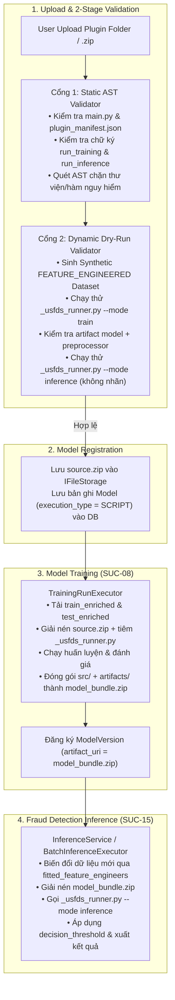

# Thiết kế Kiến trúc Plugin Mô hình Học máy (Model Plugin Architecture)

> **Ngày cập nhật:** 19/10/2026  
> **Phân hệ:** Detection — Model Training & Inference (`SUC-08`, `SUC-09`, `SUC-10`, `SUC-15`)  
> **Tài liệu liên quan:**
> - `docs/features/critical_changes.md` (Kiến trúc phân tầng dữ liệu `FEATURE_ENGINEERED`)
> - `docs/features/detection/suc-spec.md`
> - [Notion: Thiết kế và cài đặt chức năng huấn luyện mô hình](https://app.notion.com/p/Thi-t-k-v-c-i-t-ch-c-n-ng-hu-n-luy-n-m-h-nh-3cfb99c6a9508025a664daae78ac209c)

---

## 1. Bối cảnh & Quyết định Kiến trúc Cốt lõi

Hệ thống `usfds` hướng tới khả năng mở rộng theo kiến trúc **Bring-Your-Own-Algorithm (Plugin Architecture)**: cho phép người dùng (Data Scientist) đóng gói và import mã nguồn mô hình học máy của họ vào hệ thống để huấn luyện (Training) và suy diễn phát hiện gian lận (Inference/Detection) mà không cần sửa đổi hay biên dịch lại `usfds-core`.

Để hỗ trợ đồng thời các mô hình học máy trên dữ liệu dạng bảng (LR, SVM, Random Forest, XGBoost) lẫn các mô hình học sâu trên cấu trúc phức tạp (Chuỗi thời gian LSTM, Ma trận 2 chiều 2D-CNN, Đồ thị GNN), hệ thống áp dụng **4 quyết định thiết kế nền tảng**:

1. **Thống nhất đầu vào dữ liệu ở giai đoạn `FEATURE_ENGINEERED`:**
   - Mọi mô hình (dù là `BUILTIN` hay `SCRIPT` do người dùng import) đều nhận dữ liệu đầu vào từ Dataset Artifact ở stage `FEATURE_ENGINEERED` (`train_enriched.parquet` và `test_enriched.parquet`).
   - Dữ liệu này đã được chia theo thời gian (`TemporalDataSplitter`), làm sạch (`StandardDataCleanser`), làm giàu đặc trưng miền (`CreditCardFeatureEngineer`, `VelocityFeatureEngineer`), nhưng **vẫn giữ nguyên đầy đủ ngữ nghĩa nghiệp vụ** (`event_id`, `user_id`, `timestamp`, `amount` và các cột phân loại).
2. **Đóng gói Chuẩn hóa Đặc thù Thuật toán (Model-Owned Normalization):**
   - Các bước biến đổi gắn liền với bản chất toán học của từng mô hình (như loại bỏ cột định danh, `OneHotEncoder`, `StandardScaler`, `SMOTE`, tạo cửa sổ 2D-Matrix, gom chuỗi theo `user_id`, hoặc dựng đồ thị `HeteroData`) do **chính mô hình thực hiện**.
   - Mô hình bắt buộc phải lưu lại artifact của bước chuẩn hóa này (`preprocessor.joblib` hoặc trạng thái biến đổi) cùng với trọng số mô hình (`model.joblib`, `model.pt`,...) vào chung một gói (`ModelBundle`).
3. **Cơ chế System Runner Wrapper (`_usfds_runner.py`):**
   - Người dùng **không cần** viết logic đọc tham số dòng lệnh (`argparse`), không cần hard-code tên file `train.parquet`/`test.parquet`, và không bị phụ thuộc vào định dạng `.parquet` hay `.csv`.
   - Hệ thống tự động tiêm một script điều phối `_usfds_runner.py` vào Workspace lúc thực thi để chuyển đổi định dạng file theo yêu cầu của plugin, truyền đường dẫn file trực tiếp vào hàm Python của người dùng, và chuẩn hóa toàn bộ đầu ra (`metrics.json`, `eval_predictions.parquet`).
4. **Tách biệt Thư mục Mã nguồn Plugin khỏi `usfds-core`:**
   - Các mô hình tùy chỉnh của người dùng được phát triển ở thư mục độc lập (ví dụ: `custom-models/` hoặc tải lên từ máy trạm của user), hoàn toàn tách rời khỏi mã nguồn nền tảng `usfds-core`.

---

## 2. Luồng Nghiệp vụ End-to-End (5 Giai đoạn)



---

## 3. Các Ràng buộc của Hệ thống (System Constraints & Plugin Contract)

### 3.1. Ràng buộc về Cấu trúc Gói Mã nguồn (`Packaging Contract`)
Một gói mô hình hợp lệ khi import vào hệ thống phải là một thư mục hoặc file nén `.zip` có cấu trúc:

```plain text
<model_plugin_root>/
├── plugin_manifest.json        # (Khuyến nghị) Đặc tả siêu dữ liệu của mô hình
├── main.py                     # (Bắt buộc) Entrypoint chứa run_training & run_inference
└── ...                         # (Tùy chọn) Các module phụ trợ: preprocessing.py, models.py, utils.py
```

* **Giới hạn dung lượng:** Gói mã nguồn không vượt quá `10 MB`, không chứa thư mục môi trường ảo (`venv/`, `.venv/`), `.git/`, hoặc file nhị phân không rõ nguồn gốc.
* **Nội dung `plugin_manifest.json`:**
  ```json
  {
    "model_name": "custom_logistic_regression",
    "display_name": "Custom Logistic Regression (Plugin)",
    "description": "Logistic Regression with custom StandardScaler and OneHotEncoder",
    "framework": "scikit-learn",
    "data_modality": "tabular",
    "data_format": "parquet",
    "required_columns": ["amount", "account_age_days"],
    "default_hyperparameters": {
      "C": 1.0,
      "max_iter": 200
    },
    "dry_run_hyperparameters": {
      "C": 1.0,
      "max_iter": 20
    },
    "hyperparameter_schema": {
      "C": {"type": "float", "min": 0.001, "max": 100.0},
      "max_iter": {"type": "int", "min": 10, "max": 2000}
    }
  }
  ```
  - `data_format`: Nhận giá trị `"parquet"` (mặc định) hoặc `"csv"`. Nếu plugin khai báo `"csv"`, hệ thống sẽ tự động chuyển đổi `train_enriched.parquet` và `test_enriched.parquet` sang `.csv` trước khi truyền đường dẫn file vào hàm của user.

### 3.2. Ràng buộc về Giao diện Hàm trong `main.py` (`Entrypoint Function Contract`)
File `main.py` bắt buộc phải định nghĩa **2 hàm chuẩn**:

```python
from typing import Any, Dict
import numpy as np

def run_training(
    train_file: str,
    test_file: str,
    artifact_dir: str,
    target_column: str,
    hyperparameters: Dict[str, Any],
) -> Dict[str, Any]:
    """
    Thực thi huấn luyện mô hình từ đường dẫn file cụ thể.
    - train_file: Đường dẫn tuyệt đối tới file dữ liệu huấn luyện (stage FEATURE_ENGINEERED).
    - test_file: Đường dẫn tuyệt đối tới file dữ liệu kiểm thử (stage FEATURE_ENGINEERED).
    - artifact_dir: Thư mục lưu trữ trọng số mô hình VÀ bộ chuẩn hóa (preprocessor).
    - target_column: Tên cột nhãn mục tiêu (ví dụ: 'label' hoặc 'is_fraud').
    - hyperparameters: Từ điển siêu tham số đã hợp nhất.

    Returns:
        Dict chứa:
        - "metrics": Dict[str, float] (tùy chọn nếu đã trả về y_true và y_prob, hệ thống sẽ tự tính chuẩn hóa)
        - "y_true": Mảng 1D nhãn thực tế trên tập test
        - "y_prob": Mảng 1D xác suất dự đoán gian lận [0.0, 1.0] trên tập test
    """
    ...

def run_inference(
    input_file: str,
    artifact_dir: str,
) -> np.ndarray:
    """
    Thực thi suy diễn (chấm điểm gian lận) trên dữ liệu mới (KHÔNG có cột target).
    - input_file: Đường dẫn tuyệt đối tới file dữ liệu cần dự đoán (stage FEATURE_ENGINEERED).
    - artifact_dir: Thư mục chứa model và preprocessor đã lưu ở bước run_training.

    Returns:
        Mảng 1 chiều (np.ndarray hoặc list[float]) chứa xác suất gian lận P(fraud) trong đoạn [0.0, 1.0],
        bắt buộc giữ đúng số lượng phần tử và THỨ TỰ DÒNG khớp 1-1 với dữ liệu trong input_file.
    """
    ...
```

### 3.3. Ràng buộc về Lưu trữ Artifact Chuẩn hóa & Mô hình (`Artifact Contract`)
* Trong `run_training(...)`, mô hình **bắt buộc** phải lưu vào `artifact_dir`:
  1. **Trọng số mô hình:** Có tên chứa `model` hoặc phần mở rộng hợp lệ (`.joblib`, `.pkl`, `.pt`, `.pth`, `.json`, `.onnx`).
  2. **Bộ chuẩn hóa dữ liệu (Preprocessor):** File `preprocessor.joblib` (hoặc lưu gộp trong một `Pipeline` duy nhất).
* Sau khi `run_training` kết thúc, `TrainingRunExecutor` sẽ đóng gói toàn bộ mã nguồn `src/` và thư mục `artifact_dir` thành gói **`model_bundle.zip`** lưu trữ trên `IFileStorage` để phục vụ Inference hoàn toàn độc lập.

### 3.4. Ràng buộc về An toàn, Thư viện & Chạy thử (`Validation & Security Constraints`)
1. **Kiểm tra Tĩnh (Static AST Check):**
   - Chặn các câu lệnh `import` module mạng hoặc điều khiển tiến trình hệ thống: `socket`, `subprocess`, `urllib`, `requests`, `http`, `ftplib`, `telnetlib`, `pty`, `ctypes`.
   - Chặn các hàm thực thi mã động nguy hiểm: `eval()`, `exec()`, `compile()`.
   - Chỉ cho phép các thư viện thuộc hệ sinh thái dữ liệu & học máy đã cài đặt trên Worker (`numpy`, `pandas`, `polars`, `scipy`, `sklearn`, `xgboost`, `lightgbm`, `torch`, `torch_geometric`, `joblib`, và thư viện chuẩn Python).
2. **Kiểm tra Động (Dynamic Dry-Run Smoke Test):**
   - Tự động sinh dữ liệu giả lập chuẩn `FEATURE_ENGINEERED` (có đủ `event_id`, `user_id` lặp theo chuỗi, `timestamp`, `amount`, các cột số/phân loại và `label`).
   - Chạy thử liên hoàn `run_training` $\rightarrow$ kiểm tra file trong `artifact_dir` $\rightarrow$ xóa cột `label` $\rightarrow$ chạy thử `run_inference`.
   - Đảm bảo chiều dài вектор xác suất trả về từ `run_inference` bằng đúng số dòng đầu vào, không chứa `NaN`/`Inf` và nằm trong đoạn $[0.0, 1.0]$.
   - Thời gian chạy thử tối đa (timeout): `60 giây`.

---

## 4. Cấu trúc Thư mục Cài đặt

```plain text
usfds/
├── custom-models/                                   # Thư mục chứa các Custom Model Plugins (tách biệt khỏi usfds-core)
│   ├── logistic_regression/                         # Plugin 1: Logistic Regression + Custom Preprocessor (định dạng Parquet)
│   │   ├── plugin_manifest.json
│   │   ├── preprocessing.py
│   │   └── main.py
│   └── svm/                                         # Plugin 2: Linear SVM Calibrated + Custom Preprocessor (định dạng CSV)
│       ├── plugin_manifest.json
│       └── main.py
└── usfds-core/
    └── src/usfds_core/
        ├── domain/schemas/
        │   └── model_plugin.py                      # Schema cho ModelPluginManifest & PluginValidationResult
        └── services/
            ├── training/
            │   ├── plugins/
            │   │   ├── runner_template.py           # Mã nguồn _usfds_runner.py tự động tiêm vào Workspace
            │   │   ├── validator.py                 # Static AST Validator + Dynamic Dry-Run Validator
            │   │   └── plugin_service.py            # Service upload, validate và đăng ký Model Plugin
            │   └── models/
            │       ├── builtin_trainer.py           # Nâng cấp hỗ trợ FEATURE_ENGINEERED + lưu preprocessor.joblib
            │       └── script_trainer.py            # Nâng cấp giải nén plugin, tiêm _usfds_runner.py, hỗ trợ CSV/Parquet
            └── inference/
                ├── executor.py                      # Nâng cấp hỗ trợ thực thi Inference từ model_bundle.zip của Plugin
                └── inference_service.py             # Hỗ trợ cả Online & Batch Inference cho Plugin Model
```
