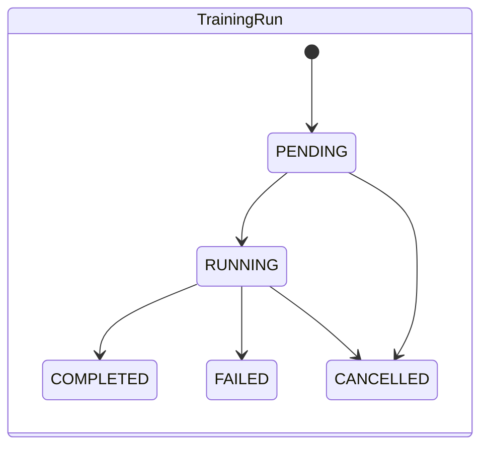
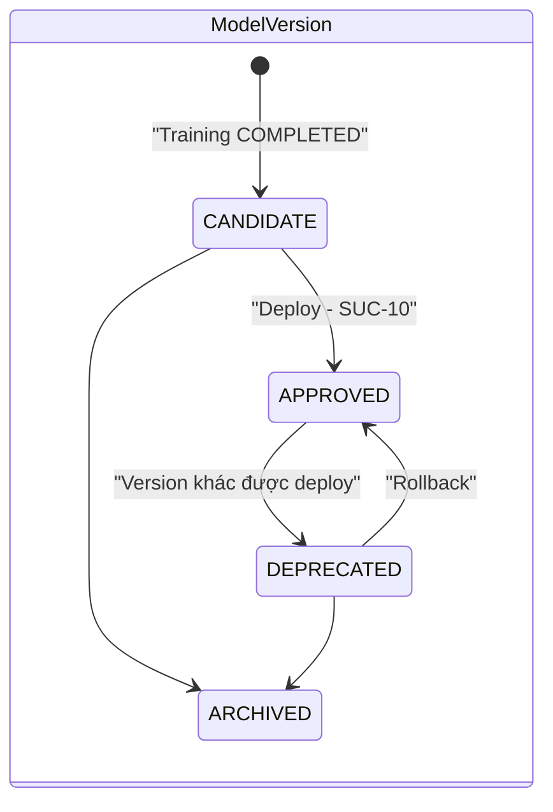
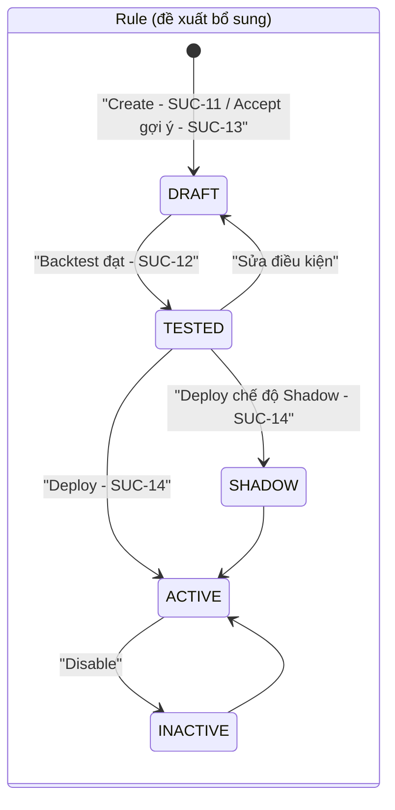
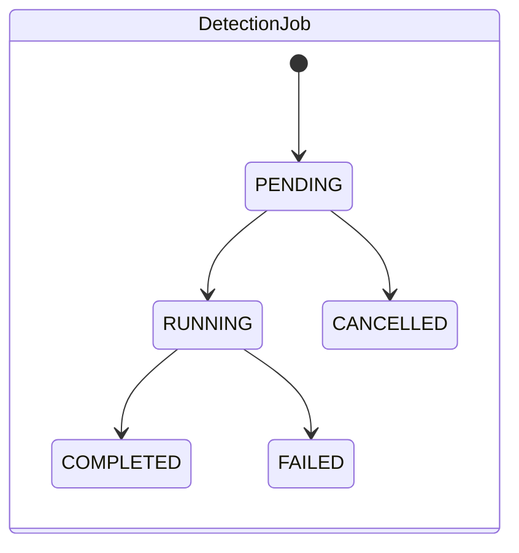
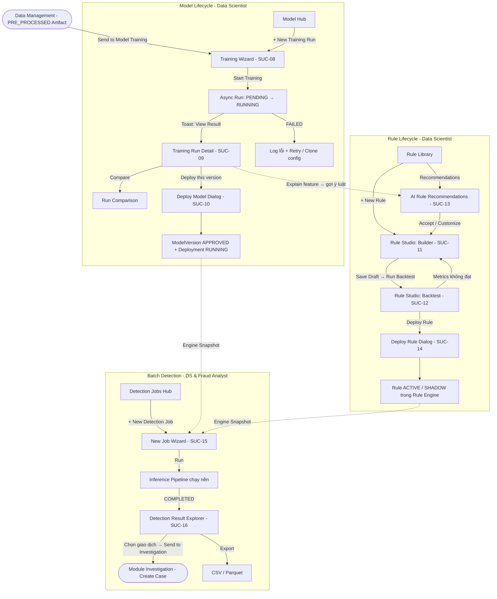

# Thiết kế User Flow & UI/UX: Module Detection

Tài liệu này đặc tả chi tiết **User Flow**, **Cấu trúc Bố cục Giao diện (Layout Wireframes)**, và **Tương tác Người dùng (Interactions)** cho phân hệ **Detection** (`SUC-08` → `SUC-16`) của hệ thống USFDS. Tài liệu kế thừa toàn bộ Design Tokens, Global Shell và Component Specs trong [`base.md`](../base.md), đồng thời nối tiếp trực tiếp đầu ra `PRE_PROCESSED` của [Module Data Management](../data_management/user-flow-and-ui-design.md).

---

## 0. Danh mục Màn hình Stitch MCP (Project ID: `2080675356172484819`)

Tất cả các màn hình giao diện bên dưới đã được khởi tạo và đồng bộ hoàn chỉnh trên Google Stitch MCP với Theme **High-Precision Technical Engineering** (Dark OLED Palette):

| Use Case | Screen Name / Title | Stitch Screen ID | Loại màn hình |
| :--- | :--- | :--- | :--- |
| **SUC-08** | USFDS - Model Training Wizard (SUC-08) | `1d519cdd4ba543f3843df23b33b2182e` | 4-Step Wizard Page |
| **SUC-09** | USFDS - Training Run Detail & Evaluation (SUC-09) | `765161d6b2b74d86b142c5096d468894` | Detail & Analytics Dashboard |
| **SUC-10** | USFDS - Deploy Model Modal Dialog (SUC-10) | `a04104711d13439ea14f0c8e352f92dd` | Modal Dialog / Confirmation |
| **SUC-11** | USFDS - Rule Studio Builder (SUC-11) | `aa76dceb13e147159d0a2a2e9aa77d30` | Visual Rule Builder Studio |
| **SUC-12** | USFDS - Rule Backtest Workspace (SUC-12) | `8cab4bb2e82b4792a267cb933d51debe` | Backtest Execution & Confusion Matrix |
| **SUC-13** | USFDS - AI Rule Recommendations (SUC-13) | `a2a5611da62e444899f4461edcb79057` | Rule Discovery & AI Mining Table |
| **SUC-14** | USFDS - Deploy Rule Dialog (SUC-14) | `e1aa5de6078b412486cdd009bfbdbf0a` | Modal Dialog / Shadow vs Active |
| **SUC-15** | USFDS - Detection Job Wizard (SUC-15) | `ac1be0fc554742f7b6f4a2b0af461bb7` | 3-Step Inference Job Creation |
| **SUC-16** | USFDS - Detection Result Explorer & Case Dispatch (SUC-16) | `35d8a34415854d1eb17b35597d02a6b4` | Results Table, Drilldown & Dispatch |

---

## 1. Tổng quan & Kiến trúc Luồng Phát hiện

### 1.1. Vị trí của Detection trong hệ thống

Theo sơ đồ `functional-process.png`, Detection gồm 2 giai đoạn tách biệt:

| Giai đoạn | Thành phần | Use Case | Actor |
| :--- | :--- | :--- | :--- |
| **Training Stage** | Model Training → Trained Model | SUC-08, SUC-09, SUC-10 | Data Scientist |
| **Rule Authoring** | Rule Engine (định nghĩa luật) | SUC-11, SUC-12, SUC-13, SUC-14 | Data Scientist |
| **Inference Stage** | Data Mapping → Validate → Feature Eng. → Pre-processing → **Model Inference → Rule Engine → Decision Engine** → Investigation / Report | SUC-15, SUC-16 | Data Scientist, Fraud Analyst |

Inference Stage **tái sử dụng** các artifact được sinh ra ở Training Stage: `Mapping schema`, `Feature definitions`, `Pre-processing pipeline (fitted_pipeline.joblib)` và `Trained Model`. Do đó UI của Detection Job **không yêu cầu người dùng cấu hình lại** các bước này — chỉ cần chọn dữ liệu đầu vào và "bộ động cơ" đang Active.

### 1.2. Các vòng đời đối tượng chính (Object Lifecycles)









> **Ghi chú mô hình dữ liệu:** Entity `Rule` hiện chỉ có cờ `is_active`. Để hỗ trợ ràng buộc *"phải backtest trước khi deploy"* (SUC-12 → SUC-14) và chế độ Shadow, đề xuất bổ sung trường `status` (`DRAFT | TESTED | SHADOW | ACTIVE | INACTIVE`), `version`, `action` (`FLAG | REVIEW | BLOCK`), `severity`/`score_weight`, và `last_backtest_id`.

### 1.3. Mã màu bổ sung cho Detection (mở rộng Semantic Tokens)

```css
:root {
  /* Model Version Status */
  --mv-candidate-color:  var(--primitives-blue-500);     /* CANDIDATE */
  --mv-approved-color:   var(--primitives-emerald-400);  /* APPROVED / Active (Production) */
  --mv-deprecated-color: var(--primitives-slate-500);    /* DEPRECATED / ARCHIVED */

  /* Rule Status */
  --rule-draft-color:    var(--primitives-slate-400);
  --rule-tested-color:   var(--primitives-blue-500);
  --rule-shadow-color:   var(--primitives-purple-400);
  --rule-active-color:   var(--primitives-emerald-400);

  /* Risk & Decision (luôn đi kèm icon + nhãn - Dual Encoding) */
  --risk-low-color:      var(--primitives-emerald-400);  /* score < review_threshold  → APPROVE */
  --risk-medium-color:   var(--primitives-amber-400);    /* review ≤ score < block   → REVIEW  */
  --risk-high-color:     var(--primitives-red-500);      /* score ≥ block_threshold  → BLOCK   */
  --risk-high-bg:        rgba(239, 68, 68, 0.12);

  /* Chart */
  --chart-fraud:         var(--primitives-red-500);
  --chart-legit:         var(--primitives-blue-500);
  --chart-threshold:     var(--primitives-amber-400);
}
```

### 1.4. Kiến trúc Thông tin (Sidebar – nhóm *Detection & Modeling*)

```
Detection & Modeling
├── Models            /models                      → Model Hub (Registry + Training Runs)      SUC-08, 09, 10
│   ├── /models/train                              → Training Wizard                           SUC-08
│   ├── /models/runs/:run_id                       → Training Run Detail                       SUC-09
│   └── /models/runs/compare?ids=..                → Run Comparison                            SUC-09 (alt)
├── Rules             /rules                       → Rule Library                              SUC-11, 14
│   ├── /rules/new | /rules/:rule_id               → Rule Studio (Builder | Backtest | History) SUC-11, 12
│   └── /rules/recommendations                     → AI Rule Recommendations                   SUC-13
└── Detection Jobs    /detection/jobs              → Detection Jobs Hub                        SUC-15
    ├── /detection/jobs/new                        → New Detection Job Wizard                  SUC-15
    └── /detection/jobs/:job_id                    → Detection Result Explorer                 SUC-16
```

**Phân quyền hiển thị:**

| Màn hình | Data Scientist | Fraud Analyst |
| :--- | :--- | :--- |
| Models / Rules (toàn bộ) | Full | Ẩn khỏi sidebar |
| Detection Jobs Hub, New Job | Full | Full (chỉ dùng engine đang Active, không đổi version) |
| Detection Result Explorer | Full + tab *Model Diagnostics* | Full (trọng tâm: Send to Investigation) |

---

## 2. Sơ đồ Macro User Flow

### 2.1. Toàn cảnh



### 2.2. Hành trình theo vai trò (Role-based Journeys)

**Data Scientist – "Từ dataset đến engine sẵn sàng":**
`PRE_PROCESSED artifact` → Train 2–3 thuật toán (SUC-08) → So sánh & chọn run tốt nhất (SUC-09) → Deploy version (SUC-10) → Xem gợi ý luật (SUC-13) → Tinh chỉnh + Backtest (SUC-11, SUC-12) → Deploy luật (SUC-14) → Chạy job kiểm chứng (SUC-15) → Đánh giá kết quả (SUC-16).

**Fraud Analyst – "Rà soát lô giao dịch hằng ngày":**
Detection Jobs Hub → New Job (upload file giao dịch, engine Active tự gắn) (SUC-15) → Nhận Toast khi xong → Result Explorer, lọc `BLOCK`/`REVIEW` (SUC-16) → Xem lý do (rule hit + top SHAP) → Chọn nhiều giao dịch → **Send to Investigation**.

---

## 3. Chi tiết Giao diện & Tương tác từng Màn hình

---

### Màn hình D1: Model Hub (Registry & Training Runs)

* **Mục đích:** Trang chủ của nhóm Models – nơi khởi tạo huấn luyện (SUC-08), truy cập kết quả (SUC-09) và theo dõi version đang Active (SUC-10).
* **Layout Structure:**

```
+-----------------------------------------------------------------------------------------------------------------------+
| Detection / Models                                   [ Search runs, models, versions... ]  [ + New Training Run ]     |
+-----------------------------------------------------------------------------------------------------------------------+
| ┌ ACTIVE ENGINE ──────────────────────────────────────────────────────────────────────────────────────────────────┐   |
| │ ● PRODUCTION   xgboost-fraud  v1.0.3  [APPROVED]   ROC-AUC 0.981 · PR-AUC 0.842 · F1 0.811   Threshold 0.62     │   |
| │ Deployed 2 days ago by ds.minh  ·  Trained on: cc_fraud_2026 / Artifact #4 (PRE_PROCESSED)   [ View ] [ Rollback ]│   |
| └─────────────────────────────────────────────────────────────────────────────────────────────────────────────────┘   |
|  [ Total Runs: 18 ]   [ Running: 1 ]   [ Candidates: 5 ]   [ Best PR-AUC: 0.857 (rf-v1.0.2) ]                         |
+-----------------------------------------------------------------------------------------------------------------------+
| TABS:  [ Training Runs ]  [ Model Registry ]                                                                          |
| Filters: Status [All v]  Algorithm [All v]  Dataset [All v]  Created by [All v]        [ Compare (0) ] (disabled)     |
+----+------------------------+--------------+-------------------+---------+--------+-------+----------+----------------+
| [] | Run Name               | Algorithm    | Dataset Artifact  | Status  | PR-AUC | F1    | Duration | Actions        |
+----+------------------------+--------------+-------------------+---------+--------+-------+----------+----------------+
| [] | xgb-velocity-168h      | XGBoost      | cc_fraud #4 (P)   | ◐ RUN 62%| —      | —     | 04:12    | [Cancel]       |
| [] | rf-baseline            | RandomForest | cc_fraud #4 (P)   | ✓ DONE  | 0.857  | 0.823 | 06:40    | [View][Deploy] |
| [] | xgb-default            | XGBoost      | cc_fraud #3 (P)   | ✓ DONE  | 0.842  | 0.811 | 03:05    | [View] ACTIVE  |
| [] | gnn-graph-v0           | GNN          | cc_fraud #4 (P)   | ✕ FAIL  | —      | —     | 00:41    | [Logs][Retry]  |
+----+------------------------+--------------+-------------------+---------+--------+-------+----------+----------------+
```

* **Tab Model Registry:** Danh sách `Model` (thuật toán đã đăng ký: `execution_type` BUILTIN/SCRIPT/DOCKER_IMAGE, `risk_level`), mở rộng mỗi dòng để xem các `ModelVersion` (semver, status badge, threshold, run gốc).
* **Tương tác:**
  - Tick ≥ 2 run `COMPLETED` → nút **`Compare (n)`** bật sáng → mở Run Comparison.
  - Dòng `RUNNING` cập nhật realtime (polling/WebSocket) với mini progress bar + epoch/tree hiện tại.
  - Dòng đang Active được ghim nhãn `ACTIVE` màu `--mv-approved-color`.

---

### Màn hình D2: Training Wizard (SUC-08 – Start model training)

* **Vị trí:** Full-page wizard 3 bước (dùng Workspace Stepper chuẩn trong `base.md`). Được mở từ `[+ New Training Run]` hoặc từ nút **`Send to Model Training`** ở SUC-05 (khi đó Bước 1 đã được điền sẵn artifact).
* **Stepper:** `[ 1. Training Data ] ===> [ 2. Algorithm & Hyperparameters ] ===> [ 3. Review & Launch ]`

```
+-----------------------------------------------------------------------------------------------------------------------+
| STEPPER: [ ✓ 1. Training Data ] ===> [ ● 2. Algorithm & Hyperparameters ] ===> [ 3. Review & Launch ]                  |
+------------------------------------------+----------------------------------------------------------------------------+
| ALGORITHM CATALOG (Trái 35%)             | HYPERPARAMETER FORM (Phải 65%) - sinh động từ hyperparameter_schema         |
|                                          |                                                                            |
| ( ) Logistic Regression   [Baseline]     | Model: XGBoost · BUILTIN · Risk: MEDIUM                                     |
| (●) XGBoost               [Recommended]  | Preset: ( ) Fast  (●) Balanced  ( ) Max Recall  ( ) Custom                 |
| ( ) Random Forest                        |----------------------------------------------------------------------------|
| ( ) LightGBM                             | n_estimators      [====|=========] 400        (50 – 2000)                   |
| ( ) Isolation Forest      [Unsupervised] | max_depth         [==|===========]   6        (2 – 16)                     |
| ( ) GNN (GraphSAGE)       [Beta · GPU]   | learning_rate     [ 0.05        ]            float, log-scale              |
| ---------------------------------------- | scale_pos_weight  [ AUTO v ]  ⓘ Tự tính theo tỷ lệ fraud = 1:578            |
| Mỗi card: mô tả 1 dòng, thời gian ước    | subsample         [ 0.8         ]                                          |
| tính, yêu cầu tài nguyên (CPU/GPU)       | ▸ Advanced (colsample_bytree, gamma, min_child_weight, early_stopping)     |
|                                          |----------------------------------------------------------------------------|
|                                          | Imbalance Strategy: (●) Class weight  ( ) SMOTE (train only)  ( ) None     |
|                                          | Threshold Optimization: [x] Tự đề xuất ngưỡng tối ưu theo [ F1 v ]          |
|                                          | [ { } View as JSON ]  [ Reset to defaults ]                                |
+------------------------------------------+----------------------------------------------------------------------------+
|                                                              [ ← Back ]   [ Next: Review & Launch → ]                 |
+-----------------------------------------------------------------------------------------------------------------------+
```

* **Bước 1 – Training Data:**
  - Dropdown chọn Dataset → chọn Artifact (chỉ liệt kê artifact `PRE_PROCESSED`, `validation_status ≠ FAILED`; artifact khác hiển thị disabled kèm tooltip lý do).
  - Card tóm tắt artifact: Train/Test rows, số đặc trưng, tỷ lệ fraud (`label=1`), branch name, link *View Lineage*.
  - Cảnh báo **Imbalance** nếu tỷ lệ fraud < 1% → gợi ý bật `scale_pos_weight` ở Bước 2.
* **Bước 2 – Algorithm & Hyperparameters:** như wireframe. Form render tự động từ `Model.hyperparameter_schema` (int → slider, float → input, enum → select); giá trị mặc định lấy từ `default_hyperparameters`; trường bị override so với default được đánh dấu chấm xanh.
* **Bước 3 – Review & Launch:**
  - `Run Name` (auto: `{algo}-{branch}-{yyyyMMdd-HHmm}`, cho sửa), mô tả, `Compute Target` (`local` / queue worker).
  - Bảng tóm tắt cấu hình + diff hyperparameter so với default.
  - CTA Primary: **`[ ▶ Start Training ]`**.
* **Sau khi Start (theo sequence `training_sequence`):**
  1. API trả về `TrainingRun(status=RUNNING)` ngay → điều hướng sang **Run Detail** ở chế độ *Live*.
  2. Global Async Task Panel (góc dưới phải) hiển thị tiến trình; người dùng có thể rời trang.
  3. Hoàn tất → Toast `Training "rf-baseline" completed · PR-AUC 0.857  [ View Result ➔ ]`; `ModelVersion` mới tạo ở trạng thái `CANDIDATE`.
* **Exception:** artifact bị xóa/không hợp lệ (bước 6 sequence) → banner đỏ ở Bước 1; dispatch thất bại → Toast lỗi + giữ nguyên cấu hình để Retry.

---

### Màn hình D3: Training Run Detail (SUC-09 – View model training result)

* **Mục đích:** Đánh giá toàn diện chất lượng mô hình và hiểu *vì sao* mô hình ra quyết định trước khi deploy.
* **Header:** `Models / Runs / rf-baseline`  · Status badge · Version `v1.0.2 [CANDIDATE]` · Duration · Created by · Actions: **`[ 🚀 Deploy this version ]`** (Primary), `[ Clone & Re-train ]`, `[ Compare with Active ]`, `[ ⋯ Download artifact / Logs ]`.
* **Tabs:** `Overview` · `Performance` · `Explainability` · `Configuration` · `Logs` · `Lineage`

```
+-----------------------------------------------------------------------------------------------------------------------+
| TAB: [ Overview ] [ Performance ] [ Explainability ] [ Configuration ] [ Logs ] [ Lineage ]                           |
+-----------------------------------------------------------------------------------------------------------------------+
| KPI CARDS (so sánh với Active v1.0.3):                                                                                |
| [ ROC-AUC 0.984 ▲0.003 ] [ PR-AUC 0.857 ▲0.015 ] [ F1 0.823 ▲0.012 ] [ Precision 0.871 ] [ Recall 0.780 ] [ Loss 0.041]|
+-------------------------------------------------------+---------------------------------------------------------------+
| ROC CURVE                     | PR CURVE              | CONFUSION MATRIX @ threshold                                  |
|  1 ┤      ______              |  1 ┤‾‾‾‾\             |                 Predicted Legit   Predicted Fraud             |
|    │   __/  (this run)        |    │     \___         |  Actual Legit     56,812 (TN)       118 (FP)                  |
|    │  /  ..(active)           |    │         \__      |  Actual Fraud         21 (FN)        74 (TP)                  |
|  0 ┼/──────────── 1           |  0 ┼──────────── 1    |---------------------------------------------------------------|
|                               |                       | DECISION THRESHOLD                                            |
|                               |                       | 0 [==============|=====] 1     0.62  (Recommended: 0.62 ★)     |
|                               |                       | Precision 0.871 · Recall 0.780 · FPR 0.21% · Alerts/10k: 33  |
+-------------------------------------------------------+---------------------------------------------------------------+
| SCORE DISTRIBUTION (histogram fraud vs legit, đường dọc = threshold)                                                  |
+-----------------------------------------------------------------------------------------------------------------------+
```

* **Tab Performance – Threshold Explorer (tương tác cốt lõi):**
  - Kéo slider ngưỡng → Confusion Matrix, Precision/Recall, FPR và **Alert volume ước tính** cập nhật tức thì (tính client-side từ `eval_predictions.parquet`).
  - Marker ★ tại `recommended_threshold`; nút `[ Reset to recommended ]`. Ngưỡng đã chọn được mang sang dialog Deploy (SUC-10).
  - Toggle hiển thị Confusion Matrix theo *số tuyệt đối* / *% theo hàng*.
* **Tab Explainability:**
  - **Global Feature Importance** (bar chart ngang Top 20, toggle `Gain` / `SHAP mean |value|`).
  - **SHAP Beeswarm / Summary plot** cho Top 15 feature.
  - Click một feature → panel phải: biểu đồ phụ thuộc (dependence plot) + nút **`[ ✨ Suggest rules from this feature ]`** → mở SUC-13 với bộ lọc feature đã chọn.
* **Tab Configuration:** hyperparameters (JSON viewer read-only, nút Copy), dataset artifact (link Lineage), checksum model, framework, `compute_target`.
* **Tab Logs:** log streaming (font mono, auto-scroll, filter level); hiển thị `error_message` nổi bật khi FAILED.
* **Tab Lineage:** nhúng mini DAG `RAW → MAPPED → PRE_PROCESSED → TRAINED_MODEL` (tái sử dụng Lineage Canvas SUC-06), node hiện tại được highlight.
* **Run Comparison (luồng thay thế):** bảng ngang tối đa 4 run (metrics, hyperparams khác nhau được tô sáng), ROC/PR chồng lớp với màu phân biệt + pattern nét (dual-encoding), chọn "Winner" → `[ Deploy ]`.

---

### Màn hình D4: Deploy Model Dialog (SUC-10 – Deploy model)

* **Dạng:** Modal 640px, mở từ Run Detail / Model Registry. Đây là thao tác **có rủi ro cao** → thiết kế theo nguyên tắc *Review – Confirm*.

```
+---------------------------------------------------------------------------+
| Deploy Model Version                                                 [ X ] |
+---------------------------------------------------------------------------+
| Version:      random-forest  v1.0.2   [CANDIDATE]                         |
| Environment:  ( ) DEVELOPMENT  ( ) STAGING  (●) PRODUCTION                |
| Decision threshold: [ 0.62 ]  (từ Threshold Explorer · Recommended 0.62)   |
|---------------------------------------------------------------------------|
| CHANGE IMPACT (so với đang Active: xgboost v1.0.3)                        |
|                Current     New        Δ                                   |
|   PR-AUC       0.842       0.857      ▲ +0.015                            |
|   Recall       0.761       0.780      ▲ +0.019                            |
|   FPR          0.25%       0.21%      ▼ -0.04%                            |
|   Alerts/10k   38          33         ▼ -5                                |
|---------------------------------------------------------------------------|
| Rollout: (●) Replace immediately   ( ) Shadow (chấm song song, không quyết)|
| ⚠ Version hiện tại v1.0.3 sẽ chuyển sang DEPRECATED (có thể Rollback).    |
| Release note: [ Thêm velocity 168h, cải thiện recall...               ]   |
| Gõ "xgboost→rf v1.0.2" để xác nhận: [                    ]               |
+---------------------------------------------------------------------------+
|                                         [ Cancel ]  [ 🚀 Deploy ] (disabled)|
+---------------------------------------------------------------------------+
```

* **Xử lý hệ thống:** tạo `Deployment(version_id, environment, status=PENDING→STARTING→RUNNING)`, chuyển `ModelVersion.status = APPROVED`, version cũ → `DEPRECATED`.
* **Feedback:** stepper trạng thái mini trong modal (`Registering → Loading artifact → Health check → Live`) → Toast thành công, Active Engine card ở Model Hub cập nhật.
* **Ràng buộc/Exception:**
  - Chỉ version `CANDIDATE`/`DEPRECATED` mới deploy được; version `FAILED`/`ARCHIVED` ẩn nút.
  - **Feature contract check:** nếu tập đặc trưng của model khác với pipeline Inference hiện hành → chặn và hiển thị danh sách feature lệch.
  - Health check thất bại → `Deployment FAILED`, tự giữ nguyên version cũ, hiển thị log.
  - Nếu metric mới **kém hơn** Active → banner vàng *"Version mới có PR-AUC thấp hơn bản hiện hành"* (không chặn, nhưng yêu cầu nhập lý do).

---

### Màn hình D5: Rule Library

* **Mục đích:** Danh mục tập luật của Project; điểm vào cho SUC-11, SUC-13, SUC-14.

```
+-----------------------------------------------------------------------------------------------------------------------+
| Detection / Rules                [ Search rules... ]   [ ✨ Recommendations (6 new) ]   [ + New Rule ]                 |
+-----------------------------------------------------------------------------------------------------------------------+
| [ Active: 14 ]  [ Shadow: 2 ]  [ Draft: 5 ]  [ Ruleset hit-rate 24h: 1.8% ]  [ Ruleset version: rs-v27 ]              |
| TABS: [ All ] [ Active ] [ Shadow ] [ Tested ] [ Draft ] [ Inactive ]     Type [All v]  Action [All v]                 |
+------------------------+-------------+-----------------------------------------+--------+---------+--------+----------+
| Rule Name              | Type        | Condition (tóm tắt)                     | Action | Status  | Prec.  | Actions  |
+------------------------+-------------+-----------------------------------------+--------+---------+--------+----------+
| R-012 High velocity 1h | THRESHOLD   | velocity_count_1h > 8 AND amount > 500  | BLOCK  | ● ACTIVE| 0.71   | [⋯]      |
| R-019 Night big ticket | COMPOSITE   | hour ∈ [0,4] AND amt_ratio > 5          | REVIEW | ◐ SHADOW| 0.44   | [⋯]      |
| R-021 Blacklist device | BLACKLIST   | device_id IN list:bl_devices (213)      | BLOCK  | ○ DRAFT | —      | [⋯]      |
+------------------------+-------------+-----------------------------------------+--------+---------+--------+----------+
```

* **Tương tác:** click dòng → mở Rule Studio; menu `⋯`: *Duplicate*, *Run Backtest*, *Deploy*, *Disable*, *View history*; toggle nhanh Active/Inactive (có confirm) cho rule đã `TESTED`.
* Cột `Prec.` lấy từ backtest gần nhất; rule chưa backtest hiển thị `—` kèm icon cảnh báo.

---

### Màn hình D6: Rule Studio – Builder (SUC-11 – Create rule)

* **Dạng:** Full-page, 3 tab: `[ Builder ]  [ Backtest ]  [ History ]`. Tab Backtest bị khóa cho đến khi rule được lưu Draft.
* **Layout:** Visual Condition Builder (trái 60%) + Live Preview & JSON (phải 40%).

```
+-----------------------------------------------------------------------------------------------------------------------+
| Rules / R-022 (Draft)    Name: [ High amount new device       ]   Type: [ COMPOSITE v ]   [ Save Draft ] [ Backtest → ]|
+-------------------------------------------------------------+---------------------------------------------------------+
| CONDITION BUILDER                                           | LIVE PREVIEW                                            |
|                                                             |                                                         |
| IF  [ ALL v ] of the following are true:                    | Human-readable:                                         |
|  ┌──────────────────────────────────────────────────────┐   |  "Gắn cờ REVIEW khi số tiền > 2,000 VÀ (thiết bị        |
|  │ [ amount           v ] [ >  v ] [ 2000        ] [🗑] │   |   mới trong 24h HOẶC ≥ 5 giao dịch trong 1 giờ)"        |
|  │ ┌ ANY of ──────────────────────────────────────────┐ │   |---------------------------------------------------------|
|  │ │ [ is_new_device_24h v ] [ = v ] [ true    ] [🗑] │ │   | Quick estimate (trên 10k mẫu gần nhất):                 |
|  │ │ [ velocity_count_1h v ] [ ≥ v ] [ 5       ] [🗑] │ │   |   Hits: 41 (0.41%)  ·  Fraud trong hits: 17 (41%)       |
|  │ │ [ + Condition ]  [ + Group ]                     │ │   |   ▁▂▃▅▇ phân bố amount của hits                         |
|  │ └──────────────────────────────────────────────────┘ │   |---------------------------------------------------------|
|  │ [ + Condition ]  [ + Group ]                         │   | rule_condition (JSON)        [ Copy ] [ Edit as JSON ]  |
|  └──────────────────────────────────────────────────────┘   | { "all": [                                              |
|                                                             |   {"field":"amount","op":">","value":2000},             |
| THEN                                                        |   {"any":[ ... ]} ] }                                   |
|  Action:   ( ) FLAG   (●) REVIEW   ( ) BLOCK                |                                                         |
|  Severity: [ HIGH v ]   Score weight: [ +0.25 ]              |                                                         |
|  Reason code: [ RC_NEW_DEVICE_HIGH_AMT ]                    |                                                         |
|  Description: [ ...                                     ]   |                                                         |
+-------------------------------------------------------------+---------------------------------------------------------+
```

* **Field picker:** dropdown có tìm kiếm, nhóm theo nguồn: *Core* (`amount`, `timestamp`…), *Engineered features* (`velocity_*`, `amt_ratio`, `hour_sin`…), *Model output* (`model_score`), *Lists* (blacklist/whitelist). Mỗi field hiển thị kiểu dữ liệu + min/max/phân vị (từ profiling) để gợi ý ngưỡng hợp lý.
* **Operator theo kiểu dữ liệu:** số (`> ≥ < ≤ = ≠ BETWEEN`), chuỗi/category (`= ≠ IN NOT IN`), boolean (`= true/false`), list (`IN list`).
* **Validation inline:** giá trị sai kiểu → viền đỏ; group rỗng → cảnh báo; độ sâu lồng tối đa 3 cấp; tên rule trùng trong Project → lỗi.
* **Quick estimate** debounce 600ms trên sample nhỏ – chỉ mang tính tham khảo, khác với Backtest đầy đủ.
* `Save Draft` → `Rule(status=DRAFT)`; CTA **`Backtest →`** lưu và chuyển tab.

---

### Màn hình D7: Rule Studio – Backtest (SUC-12 – Test rule)

* **Mục đích:** Đánh giá rule trên dữ liệu lịch sử có nhãn trước khi đưa vào động cơ chính thức.

```
+-----------------------------------------------------------------------------------------------------------------------+
| TAB: [ Builder ] [ ● Backtest ] [ History ]                                                                           |
| Dataset: [ cc_fraud_2026 / Artifact #2 (MAPPED, labeled) v ]  Period: [ 2026-07-01 → 2026-09-30 ]                     |
| Compare with: [x] Ruleset Active (rs-v27)   [x] Model Active (xgb v1.0.3 @0.62)               [ ▶ Run Backtest ]       |
+-----------------------------------------------------------------------------------------------------------------------+
| RESULT (rule R-022 độc lập)                                                                                           |
| [ Hits 1,284 (0.43%) ] [ Precision 0.46 ] [ Recall 0.31 ] [ FPR 0.23% ] [ Alerts/day ≈ 14 ] [ $ Fraud caught 182k ]    |
+-------------------------------------------------------+---------------------------------------------------------------+
| INCREMENTAL VALUE (so với engine hiện tại)            | HITS OVER TIME (line: hits/day, cột: fraud/day)               |
|  ┌──────── Venn ────────┐                             |  ▂▃▂▅▃▂▆▃▂▃▄▂▃▅                                               |
|  │ Model ∩ Rule : 402   │  Chỉ rule bắt được: 188     |                                                               |
|  │ Chỉ Rule     : 188 ★ │  (fraud mới, model bỏ sót)  |                                                               |
|  └──────────────────────┘  Δ Recall engine: +4.1%     |                                                               |
|                            Δ Alert volume: +6.2%      |                                                               |
+-------------------------------------------------------+---------------------------------------------------------------+
| SAMPLE HITS  [ All ] [ True Positive ] [ False Positive ]                                     [ Export CSV ]          |
| event_id | timestamp | amount | user_id | label | matched conditions                                                 |
+-----------------------------------------------------------------------------------------------------------------------+
| Verdict: ✓ Đạt tiêu chí (Precision ≥ 0.30, FPR ≤ 0.5%)     [ ← Edit Rule ]   [ Mark as Tested ]  [ 🚀 Deploy Rule ]  |
+-----------------------------------------------------------------------------------------------------------------------+
```

* **Xử lý:** Backtest chạy nền (non-blocking); kết quả được lưu thành *Backtest Report* gắn với `rule_version` (xem lại trong tab History).
* **Verdict:** so với tiêu chí cấu hình ở Project settings → `PASSED` (chuyển rule sang `TESTED`, mở khóa Deploy) / `WARNING` (cho deploy kèm lý do) / `FAILED` (khóa Deploy).
* **Exception:** dataset không có cột `label` → chỉ hiển thị Hits/Alert volume, ẩn Precision/Recall kèm banner giải thích; field trong rule không tồn tại trong dataset → báo lỗi liệt kê field thiếu.

---

### Màn hình D8: AI Rule Recommendations (SUC-13 – Get recommended rules)

* **Mục đích:** Hệ thống khai phá luật tự động (Decision Tree / mẫu bất thường mới) để hỗ trợ Data Scientist.

```
+-----------------------------------------------------------------------------------------------------------------------+
| Rules / Recommendations                                                                                               |
| Source data: [ cc_fraud #4 v ]  Method: [ Decision Tree (depth ≤ 3) v ]  Focus: [ Fraud model bỏ sót (FN) v ]         |
| Min precision: [ 0.3 ]  Min support: [ 20 ]                                                     [ ✨ Generate ]         |
+-----------------------------------------------------------------------------------------------------------------------+
| ┌ SUGGESTION #1 ─────────────────────────────── Confidence ████████░ 0.82 ┐  ┌ SUGGESTION #2 ──────────────────────┐   |
| │ IF velocity_sum_24h > 3,450  AND  hour_sin < -0.71                     │  │ IF amt_ratio > 7.2 AND              │   |
| │    AND merchant_category IN (electronics, gift_card)                   │  │    is_new_device_24h = true         │   |
| │ Support 214 · Precision 0.58 · Recall +3.2% · Lift 41×                 │  │ Support 96 · Precision 0.49 ...     │   |
| │ Overlap với rule hiện có: 12% (R-012)                                  │  │ ⚠ Trùng 78% với R-019               │   |
| │ Lý do: "Cụm giao dịch đêm khuya, chi tiêu dồn dập ở ngành rủi ro cao"  │  │                                     │   |
| │ [ Dismiss ]   [ Customize in Builder ]   [ ✓ Accept as Draft ]         │  │ [ Dismiss ] [ Customize ] [ Accept ]│   |
| └────────────────────────────────────────────────────────────────────────┘  └─────────────────────────────────────┘   |
+-----------------------------------------------------------------------------------------------------------------------+
```

* **Tương tác:**
  - `Accept as Draft` → tạo `Rule(DRAFT)` với `rule_condition` sinh sẵn, Toast `[ Backtest now ➔ ]`.
  - `Customize in Builder` → mở D6 với điều kiện điền sẵn (ngưỡng có thể làm tròn "dễ đọc", vd 3,450 → 3,500).
  - `Dismiss` → yêu cầu chọn lý do nhanh (*Không hợp lý nghiệp vụ / Trùng lặp / Quá nhiều FP*) – làm dữ liệu phản hồi.
  - Gợi ý trùng lặp cao (> 60%) với rule hiện có được gắn nhãn cảnh báo và đẩy xuống cuối.
* **Trạng thái:** chưa có model/dataset `PRE_PROCESSED` → empty state hướng dẫn; đang khai phá → skeleton card + progress; không tìm thấy luật đạt ngưỡng → gợi ý nới `Min precision`.

---

### Màn hình D9: Deploy Rule Dialog (SUC-14 – Deploy rule)

* **Điều kiện mở:** rule ở trạng thái `TESTED` (hoặc `SHADOW` → nâng cấp lên ACTIVE).

```
+---------------------------------------------------------------------------+
| Deploy Rule: R-022 High amount new device                            [ X ] |
+---------------------------------------------------------------------------+
| Last backtest: 2026-10-08 · ✓ PASSED · Precision 0.46 · FPR 0.23%          |
| Mode:  ( ) Shadow – chỉ ghi nhận hit, không ảnh hưởng quyết định            |
|        (●) Active – tham gia Rule Engine & Decision Engine                  |
| Priority: [ 20 ]  (rule có priority cao hơn được đánh giá trước)            |
| Impact dự kiến: Alerts/day ≈ +14 · Δ Recall engine +4.1%                   |
| Ruleset mới: rs-v28 (14 → 15 active rules)   [ View diff ]                 |
| Change note: [ ...                                                     ]   |
+---------------------------------------------------------------------------+
|                                           [ Cancel ]  [ Deploy to rs-v28 ] |
+---------------------------------------------------------------------------+
```

* **Xử lý:** tạo **Ruleset snapshot** bất biến mới (`rs-v28`) để mọi Detection Job ghi nhận chính xác bộ luật đã dùng; Rule Library cập nhật badge.
* **Exception:** chưa backtest hoặc backtest cũ hơn lần sửa cuối → nút Deploy disabled + link *"Run backtest"*; xung đột logic (rule `BLOCK` mâu thuẫn rule `WHITELIST` cùng điều kiện) → cảnh báo.

---

### Màn hình D10: Detection Jobs Hub & New Job Wizard (SUC-15 – Start detection job)

#### D10.a – Detection Jobs Hub

```
+-----------------------------------------------------------------------------------------------------------------------+
| Detection / Jobs                                                     [ Search jobs... ]   [ + New Detection Job ]     |
| [ Jobs 7d: 23 ]  [ Running: 1 ]  [ Txn scanned 7d: 1.2M ]  [ Flagged 7d: 3,412 (0.28%) ]  [ Sent to cases: 418 ]      |
+--------------------------+------------------+----------------+-----------+-----------+---------+---------+------------+
| Job Name                 | Input            | Engine         | Status    | Records   | Flagged | Time    | Actions    |
+--------------------------+------------------+----------------+-----------+-----------+---------+---------+------------+
| daily-batch-2026-10-08   | txn_1008.csv     | xgb1.0.3+rs-v27| ◐ RUN 48% | 52,104    | —       | 01:12   | [Cancel]   |
| daily-batch-2026-10-07   | txn_1007.parquet | xgb1.0.3+rs-v27| ✓ DONE    | 49,880    | 141     | 02:31   | [Results]  |
+--------------------------+------------------+----------------+-----------+-----------+---------+---------+------------+
```

#### D10.b – New Detection Job Wizard

* **Stepper:** `[ 1. Input Data ] ===> [ 2. Detection Engine ] ===> [ 3. Decision Policy & Run ]`

```
+-----------------------------------------------------------------------------------------------------------------------+
| STEPPER: [ ✓ 1. Input Data ] ===> [ ● 2. Detection Engine ] ===> [ 3. Decision Policy & Run ]                          |
+-----------------------------------------------------------------------------------------------------------------------+
| ENGINE SNAPSHOT (mặc định = cấu hình Active của Project)                                                              |
| ┌ MODEL ───────────────────────────────────────────┐   ┌ RULE ENGINE ───────────────────────────────────────────────┐ |
| │ (●) Active: xgboost v1.0.3 [APPROVED] @0.62      │   │ (●) Active ruleset rs-v27 (14 rules)   [ View rules ]      │ |
| │ ( ) Chọn version khác   [ v ]  (Data Scientist)  │   │ [x] Bao gồm rule SHADOW (chỉ ghi nhận, không quyết định)   │ |
| │ ( ) Không dùng model (Rule only)                 │   │ ( ) Không dùng rule (Model only)                           │ |
| └──────────────────────────────────────────────────┘   └────────────────────────────────────────────────────────────┘ |
| INFERENCE PIPELINE (tự động tái sử dụng từ Training Stage – read-only)                                                |
|  Mapping schema ✓ ─▶ Validate ✓ ─▶ Feature definitions ✓ ─▶ fitted_pipeline.joblib ✓ ─▶ Model ─▶ Rules ─▶ Decision    |
+-----------------------------------------------------------------------------------------------------------------------+
|                                                              [ ← Back ]   [ Next: Decision Policy → ]                 |
+-----------------------------------------------------------------------------------------------------------------------+
```

* **Bước 1 – Input Data:**
  - Nguồn: (●) *Upload file mới* (kéo-thả, `.csv/.parquet/.json`, ≤ 1GB – tái sử dụng component SUC-01) hoặc ( ) *Chọn dataset có sẵn trong Data Hub*.
  - Hệ thống **tự áp dụng Mapping Template** của pipeline đã train; hiển thị bảng kiểm tra nhanh *"4/4 trường bắt buộc khớp ✓"* (cột `label` **không bắt buộc** khi inference). Nếu tên cột khác → mở mapping rút gọn inline.
  - Preview 5 dòng + số bản ghi ước tính.
* **Bước 2 – Detection Engine:** như wireframe. Fraud Analyst chỉ thấy lựa chọn *Active* (các option khác ẩn). Pipeline strip hiển thị đúng chuỗi Inference Stage của kiến trúc.
* **Bước 3 – Decision Policy & Run:**
  - **Decision bands** (thanh 3 vùng kéo được): `APPROVE < 0.40 ≤ REVIEW < 0.80 ≤ BLOCK`; chú thích *"Rule có action BLOCK sẽ ghi đè điểm số"*.
  - Chiến lược kết hợp: (●) `Max(model_score, rule_score)` ( ) `Weighted (α·model + (1-α)·rules)`.
  - Job name (auto), mô tả, `[x] Thông báo khi hoàn tất`, `[ ] Tự động tạo Case cho giao dịch BLOCK`.
  - CTA: **`[ ▶ Start Detection Job ]`** → tạo `DetectionJob(PENDING)` → về Hub với dòng mới đang chạy; tiến trình hiển thị theo giai đoạn `Mapping → Validate → Features → Preprocess → Inference → Rules → Decision`.
* **Exception:** file lỗi định dạng/quá cỡ (tái sử dụng thông điệp SUC-01); thiếu trường bắt buộc sau mapping → chặn ở Bước 1; không có engine Active → empty state *"Chưa có model/ruleset nào được deploy"* (DS: link sang Models; Analyst: liên hệ DS); job FAILED giữa chừng → hiển thị giai đoạn lỗi + `error_message` + `[ Retry ]`.

---

### Màn hình D11: Detection Result Explorer (SUC-16 – View detection result)

* **Mục đích:** Màn hình làm việc chính của Fraud Analyst: phân loại, hiểu lý do, và chuyển giao dịch đáng ngờ sang Investigation.

```
+-----------------------------------------------------------------------------------------------------------------------+
| Detection / Jobs / daily-batch-2026-10-07   ✓ COMPLETED · 49,880 records · 02:31 · Engine xgb1.0.3 + rs-v27           |
|                                                                [ Export v ]  [ Re-run with current engine ]          |
+-----------------------------------------------------------------------------------------------------------------------+
| [ ⛔ BLOCK 41 ]   [ ⚠ REVIEW 100 ]   [ ✓ APPROVE 49,739 ]   [ Fraud rate 0.28% ]   [ Amount at risk $96,420 ]          |
+---------------------------------------------+-------------------------------------------------------------------------+
| RISK SCORE DISTRIBUTION (log-y, 2 đường band)| TOP TRIGGERED RULES            | TOP RISK DRIVERS (SHAP, toàn job)     |
|  ▇▅▃▂▁▁▁▁▁▁▁▁▁▁▁▁▁|▁▁▁▁▁▁▁|▁▂                | R-012 High velocity 1h   38    | velocity_count_1h  ████████          |
|  0            0.40      0.80     1          | R-019 Night big ticket   22    | amt_ratio          █████              |
+---------------------------------------------+-------------------------------------------------------------------------+
| Filters: Decision [BLOCK,REVIEW v]  Score [0.4 – 1.0]  Rule [Any v]  Amount ≥ [   ]  User [   ]   Status [Not sent v]  |
| Selected: 12   [ 📁 Send to Investigation ]  [ Mark as reviewed ]                                                     |
+----+------------+---------------------+---------+--------+-------+-----------+---------------------------+-------------+
| [] | event_id   | timestamp           | user_id | amount | Score | Decision  | Reasons                   | Case        |
+----+------------+---------------------+---------+--------+-------+-----------+---------------------------+-------------+
| [x]| TX-883120  | 2026-10-07 02:14:09 | U8892   | 4,980  | 0.97  | ⛔ BLOCK  | R-012 · velocity_1h ↑     | —           |
| [x]| TX-883511  | 2026-10-07 02:31:44 | U8892   | 3,250  | 0.91  | ⛔ BLOCK  | R-012 · amt_ratio ↑       | —           |
| [] | TX-871004  | 2026-10-07 11:05:12 | U1104   |   820  | 0.66  | ⚠ REVIEW | model · new_device        | CASE-0192 ↗ |
+----+------------+---------------------+---------+--------+-------+-----------+---------------------------+-------------+
```

* **Transaction Inspector Drawer (click dòng – 520px, theo chuẩn Slide-over trong `base.md`):**
  - Tabs: `Overview` (toàn bộ trường mapped + engineered), `Why flagged`, `User history`.
  - **Why flagged:** (1) Điểm model + vị trí trên thang decision band; (2) Danh sách rule hit với điều kiện được tô sáng phần thỏa mãn (vd `velocity_count_1h = 11 > 8`); (3) **SHAP waterfall** Top 5 đặc trưng đóng góp, diễn giải ngôn ngữ tự nhiên.
  - **User history:** timeline giao dịch cùng `user_id` trong job (cụm giao dịch dồn dập nổi bật).
  - Footer: `[ Send to Investigation ]`, `[ Mark as False Positive ]` (ghi feedback cho tái huấn luyện).
* **Send to Investigation (bulk/single):** modal xác nhận → chọn *Tạo case mới* (gom theo `user_id` hoặc mỗi giao dịch 1 case) / *Gắn vào case có sẵn*, mức ưu tiên (mặc định theo Decision), người phụ trách → tạo Case ở module Investigation; cột `Case` hiển thị mã liên kết, giao dịch đã gửi không thể gửi trùng (checkbox disabled + tooltip).
* **Export:** CSV/Parquet của toàn bộ hoặc tập đã lọc (kèm score, decision, reasons) → presigned URL.
* **Tab phụ cho Data Scientist – `Model Diagnostics`:** score drift so với phân bố lúc train (PSI), tỷ lệ hit từng rule so với backtest — gợi ý nhu cầu tái huấn luyện.

---

## 4. Bảng Ma trận Trạng thái Giao diện (UI State Matrix)

| Màn hình | Empty State | Loading / Processing | Error / Exception | Success |
| :--- | :--- | :--- | :--- | :--- |
| **Model Hub** | Illustration + "Chưa có run nào" + CTA `New Training Run` (link tới dataset `PRE_PROCESSED`) | Skeleton bảng 5 dòng; dòng RUNNING có progress | Banner lỗi tải danh sách + `Retry` | Bảng runs + Active Engine card |
| **Training Wizard** | Không có artifact `PRE_PROCESSED` → link sang Data Management SUC-05 | Spinner khi load `hyperparameter_schema` | Giá trị siêu tham số ngoài miền → viền đỏ, khóa Next; dispatch lỗi → Toast | Chuyển sang Run Detail (Live) |
| **Run Detail** | — | Live mode: log streaming + progress; biểu đồ placeholder | `FAILED`: banner đỏ + `error_message` + `Clone & Re-train` | KPI, curves, SHAP đầy đủ |
| **Deploy Model** | — | Stepper `Registering → Health check → Live` | Feature contract mismatch / Health check fail → giữ version cũ | Toast + Active Engine cập nhật |
| **Rule Library** | "Chưa có luật" + CTA `New Rule` và `Xem gợi ý AI` | Skeleton bảng | Lỗi tải → banner | Danh sách + badge trạng thái |
| **Rule Builder** | Builder có 1 dòng điều kiện trống | Quick estimate spinner nhỏ | Sai kiểu/thiếu giá trị → inline error; tên trùng | Toast "Draft saved" |
| **Backtest** | Chưa chạy: mô tả + CTA `Run Backtest` | Progress chạy nền | Dataset thiếu `label` / thiếu field → banner | Metrics + Venn + Verdict |
| **Recommendations** | Chưa đủ dữ liệu → hướng dẫn | Skeleton cards | Không có luật đạt ngưỡng → gợi ý nới tham số | Danh sách card gợi ý |
| **Detection Jobs Hub** | "Chưa có job" + CTA `New Detection Job` | Dòng RUNNING hiển thị giai đoạn hiện tại | Job FAILED: badge đỏ + `View error` | Bảng job + KPI 7 ngày |
| **Result Explorer** | Job không có giao dịch flagged → state tích cực "Không phát hiện bất thường" | Skeleton bảng + chart (virtual scroll) | Lỗi tải kết quả / Gửi case thất bại → Toast + giữ selection | Bảng kết quả, drawer giải thích |

---

## 5. Hướng dẫn Dành cho Agent / Frontend Developer

1. **Tuân thủ `base.md`:** Dark mode, Inter + JetBrains Mono (`tabular-nums` cho score, amount, metric), mật độ cao, mọi trạng thái dùng *icon + nhãn + màu* (Dual Encoding). Không dùng emoji trong UI thật – các ký hiệu trong wireframe (🚀, ✨, ⛔…) chỉ minh họa, thay bằng icon Lucide tương ứng (`Rocket`, `Sparkles`, `OctagonX`, `TriangleAlert`, `CircleCheck`).
2. **Biểu đồ:** dùng thư viện có hỗ trợ dark theme và tooltip bàn phím (Recharts/ECharts). ROC/PR/Confusion Matrix tính sẵn ở backend (`metrics.json`); riêng Threshold Explorer tính client-side từ `eval_predictions` (đã downsample ≤ 50k điểm).
3. **Form siêu tham số động:** render từ `Model.hyperparameter_schema` (JSON Schema) – không hard-code theo thuật toán.
4. **Async-first:** Training, Backtest, Detection Job, Rule Recommendation đều chạy nền → dùng chung *Global Async Task Panel* + Toast `[ View Result ➔ ]`; trạng thái lấy theo enum `TrainingRunStatus` / `DetectionJobStatus`.
5. **Tính truy vết (Traceability):** mỗi Detection Job phải hiển thị chính xác *Model version + threshold + Ruleset snapshot* đã dùng; mỗi ModelVersion liên kết ngược tới `DatasetArtifact` qua Lineage.
6. **Thao tác rủi ro cao** (Deploy model, Deploy rule, Send to Investigation hàng loạt) luôn có bước Review impact + Confirm.
7. **Phân quyền ở cả UI và API:** Fraud Analyst không thấy menu Models/Rules và không được chọn engine khác Active khi tạo job.
