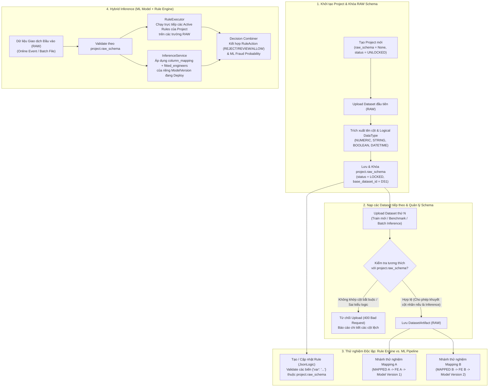

# Thiết kế Kiến trúc Quản lý Dự án & Ràng buộc Schema (Project Management & Schema Governance)

> **Ngày cập nhật:** 21/10/2026  
> **Phân hệ:** Project Management & Cross-Module Governance (`Data Management`, `Detection`, `Rule Engine`)  
> **Tài liệu liên quan:**
> - `docs/features/critical_changes.md` (Kiến trúc phân tầng dữ liệu `FEATURE_ENGINEERED`)
> - `docs/features/data_management/suc-spec.md` (`SUC-00` $\rightarrow$ `SUC-07`)
> - `docs/features/detection/suc-spec.md` (`SUC-08` $\rightarrow$ `SUC-16`)
> - `docs/features/model_plugin/design.md` (Kiến trúc Plugin Mô hình Học máy)

---

## 1. Bối cảnh & Quyết định Kiến trúc Cốt lõi

Trong hệ thống `usfds`, mọi tài nguyên nghiệp vụ bao gồm tập dữ liệu (`Dataset`), tập luật (`Rule`), mô hình học máy (`Model` / `TrainingRun` / `ModelVersion`), triển khai (`Deployment`) và tác vụ phát hiện gian lận (`DetectionJob`) đều được tổ chức và cô lập theo từng **Dự án (`Project`)**.

Thách thức cốt lõi không nằm ở các thao tác CRUD cơ bản của `Project`, mà ở việc **đảm bảo tính tương thích dữ liệu (Data Schema Compatibility)** để mọi `Dataset`, `Model` và `Rule` trong cùng một `Project` có thể vận hành ổn định cùng nhau, đặc biệt khi kết hợp đánh giá đồng thời (Hybrid Inference: ML Model + Rule Engine), nhưng vẫn giữ được sự linh hoạt cho Data Scientist khi thử nghiệm tiền xử lý dữ liệu.

Hệ thống thống nhất **4 quyết định kiến trúc cốt lõi** sau:

1. **Khóa `RAW` Schema tự động từ Dataset đầu tiên (Schema-on-First-Upload):**
   - Mỗi `Project` duy trì một **`raw_schema`** chung đại diện cho cấu trúc dữ liệu đầu vào gốc (tên cột và nhóm kiểu dữ liệu logic).
   - Khi mới khởi tạo `Project`, `raw_schema` ở trạng thái chưa khóa (`UNLOCKED` / `None`).
   - Ngay khi Dataset đầu tiên được tải lên thành công ở giai đoạn `PipelineStage.RAW`, hệ thống tự động trích xuất cấu trúc của Dataset này để khóa làm `raw_schema` chuẩn của `Project` (`LOCKED`). Người dùng không phải khai báo thủ công từng cột khi tạo dự án.
   - Mọi Dataset tải lên tiếp theo trong cùng `Project` (dùng để huấn luyện bổ sung, kiểm thử, hoặc chạy Batch Inference) bắt buộc phải tuân thủ `project.raw_schema`.

2. **Không khóa `DataMappingConfig` ở cấp Project — Cho phép tự do rẽ nhánh thử nghiệm ML:**
   - Trong thực tế, Data Scientist cần thử nghiệm nhiều phương án ánh xạ và lựa chọn đặc trưng khác nhau (`DataMappingConfig`: chọn/bỏ các `optional_columns`, thử nghiệm xử lý thời gian, ngưỡng lọc nhiễu...) từ cùng một nguồn dữ liệu `RAW`.
   - Hệ thống **không khóa cứng `DataMappingConfig`** ở cấp Project. Thay vào đó, mỗi nhánh thử nghiệm tạo ra các `DatasetArtifact` (`MAPPED` $\rightarrow$ `FEATURE_ENGINEERED` $\rightarrow$ `PRE_PROCESSED`) độc lập.
   - Khi một `ModelVersion` được huấn luyện và triển khai, đối tượng [`Pipeline`](../../../usfds-core/src/usfds_core/domain/entities/detection.py) của nó đã lưu vết chính xác `mapped_dataset_artifact` (chứa `column_mapping` riêng của nhánh đó). Khi chạy Inference trên dữ liệu `RAW` của Project, từng `ModelVersion` tự động tra cứu `column_mapping` của riêng nó (qua `prepare_and_validate_input`) để biến đổi dữ liệu mà không ảnh hưởng tới các nhánh mô hình khác.

3. **Liên kết trực tiếp `Rule Engine` với `RAW` Schema của Project:**
   - Thay vì phụ thuộc vào các trường sau bước `MAPPED` (vốn thay đổi theo từng nhánh thử nghiệm của Data Scientist), các luật nghiệp vụ (`Rule` / `RuleVersion`) sử dụng trực tiếp tên trường trong **`project.raw_schema`** (ví dụ: `{"var": "tx_amount"}` hoặc `{"var": "raw.tx_amount"}`).
   - Thiết kế này giúp tách biệt hoàn toàn vòng đời của `Rule` khỏi các thử nghiệm pipeline ML:
     - Chuyên gia nghiệp vụ (Fraud Analyst) có thể viết và kiểm tra Rule ngay sau khi có Dataset `RAW` đầu tiên (với gợi ý tên cột trực tiếp từ `project.raw_schema`).
     - Mọi thay đổi trong bước Mapping hay Feature Engineering của ML đều không bao giờ làm gãy các `Rule` đang hoạt động.

4. **Đồng nhất Đầu vào `RAW` cho Hybrid Inference (ML Model + Rule Engine):**
   - Vì cả `Rule Engine` và `ML Pipeline` (thông qua cơ chế Dual-Schema `RAW` $\rightarrow$ `MAPPED` nội bộ của từng pipeline) đều nhận đầu vào xuất phát từ `project.raw_schema`, luồng Inference kết hợp trở nên hoàn toàn đồng nhất: một giao dịch hoặc lô giao dịch ở định dạng `RAW` đi vào Project sẽ được kiểm tra qua `project.raw_schema`, sau đó phân phối song song cho cả `RuleExecutor` và `InferenceService`.

---

## 2. Luồng Nghiệp vụ End-to-End



---

## 3. Mô hình Dữ liệu & Cấu trúc Schema (`Data Model & Schema Contracts`)

### 3.1. Thực thể Miền (`Project`) và Bảng Cơ sở Dữ liệu (`projects`)

Cập nhật thực thể `Project` tại [`usfds-core/src/usfds_core/domain/entities/system.py`](../../../usfds-core/src/usfds_core/domain/entities/system.py) và bổ sung bảng `ProjectModel` vào [`usfds-infra/src/usfds_infra/database/models.py`](../../../usfds-infra/src/usfds_infra/database/models.py):

```python
class ProjectStatus(StrEnum):
    ACTIVE = "ACTIVE"
    ARCHIVED = "ARCHIVED"


@dataclass
class Project:
    project_id: UUID
    project_name: str
    user_id: UUID
    description: Optional[str] = None
    status: ProjectStatus = ProjectStatus.ACTIVE
    base_dataset_id: Optional[UUID] = None
    raw_schema: Optional[Dict[str, Any]] = None  # Lưu trữ ProjectRawSchema dạng JSON
    created_at: datetime = field(default_factory=lambda: datetime.now(timezone.utc))
    updated_at: datetime = field(default_factory=lambda: datetime.now(timezone.utc))
```

**Cấu trúc bảng `projects` (SQLAlchemy):**
- `project_id` (`String(36)`, Primary Key)
- `project_name` (`String(255)`, Not Null)
- `user_id` (`String(36)`, Indexed, Not Null)
- `description` (`Text`, Nullable)
- `status` (`String(50)`, Default `"ACTIVE"`, Indexed)
- `base_dataset_id` (`String(36)`, Nullable — tham chiếu mềm tới Dataset đầu tiên xác lập schema)
- `raw_schema` (`JSON`, Nullable — lưu trực tiếp trên `projects` để vẫn bảo toàn schema ngay cả khi `base_dataset_id` bị xóa về sau)
- `created_at`, `updated_at` (`DateTime(timezone=True)`)
- **Unique Constraint:** `UniqueConstraint("user_id", "project_name", name="uq_user_project_name")`

---

### 3.2. Cấu trúc `ProjectRawSchema` & Chuẩn hóa Kiểu dữ liệu Logic (`LogicalDataType`)

Nếu so sánh trực tiếp kiểu vật lý của Pandas (`int64` vs `float64`), một cột số nguyên ở Dataset 1 (`int64`) khi sang Dataset 2 có chứa giá trị rỗng (`NaN`) sẽ bị Pandas tự động ép kiểu thành `float64` và gây lỗi không khớp schema giả (false positive). Do đó, `project.raw_schema` chuẩn hóa kiểu dữ liệu về **4 nhóm kiểu logic (`LogicalDataType`)**:

| `LogicalDataType` | Các kiểu Pandas / PyArrow tương ứng (`dtype`) | Quy tắc tương thích khi nạp Dataset mới |
| :--- | :--- | :--- |
| **`NUMERIC`** | `int8`, `int16`, `int32`, `int64`, `uint*`, `float16`, `float32`, `float64`, `decimal` | Mọi kiểu `int*` và `float*` đều tương thích lẫn nhau trong nhóm `NUMERIC`. |
| **`STRING`** | `object`, `string`, `category` | Tương thích với `object`, `string`, `category` (hoặc cột toàn `null`). |
| **`BOOLEAN`** | `bool`, `boolean` | Tương thích với `bool` (hoặc số nhị phân `0`/`1` nếu là cột cờ). |
| **`DATETIME`** | `datetime64[ns]`, `datetime64[ns, UTC]`, `datetimetz` | Tương thích với `datetime64` hoặc chuỗi thời gian (`STRING`) sẽ được parse ở bước `MAPPED`. |

**Cấu trúc JSON của `project.raw_schema`:**
```json
{
  "version": 1,
  "locked_at": "2026-10-21T15:00:00Z",
  "source_dataset_id": "d290f1ee-6c54-4b01-90e6-d701748f0851",
  "columns": {
    "tx_id": {
      "logical_type": "STRING",
      "physical_dtype": "object",
      "nullable": false
    },
    "tx_time": {
      "logical_type": "STRING",
      "physical_dtype": "object",
      "nullable": false
    },
    "tx_amount": {
      "logical_type": "NUMERIC",
      "physical_dtype": "float64",
      "nullable": false
    },
    "account_id": {
      "logical_type": "STRING",
      "physical_dtype": "object",
      "nullable": false
    },
    "merchant_category": {
      "logical_type": "STRING",
      "physical_dtype": "object",
      "nullable": true
    },
    "is_fraud": {
      "logical_type": "NUMERIC",
      "physical_dtype": "int64",
      "nullable": true
    }
  }
}
```

---

### 3.3. Cập nhật Giao diện Thực thi Luật (`RuleExecutionContext` & `RuleExecutor`)

Để `Rule` hoạt động trực tiếp trên `RAW` schema của Project mà vẫn giữ khả năng mở rộng cho các đặc trưng làm giàu (`enriched_features`) trong tương lai:

1. **Cập nhật `RuleExecutionContext` (`usfds-core/src/usfds_core/domain/schemas/rule_schemas.py`):**
   ```python
   @dataclass
   class RuleExecutionContext:
       transaction_id: str
       raw_features: Dict[str, Any] = field(default_factory=dict)
       enriched_features: Dict[str, Any] = field(default_factory=dict)
   ```
2. **Độ phân giải biến trong `RuleExecutor._build_payload` (`executor.py`):**
   - Hỗ trợ truy cập trực tiếp (flat access) theo tên cột `RAW`: `{"var": "tx_amount"}`, `{"var": "merchant_category"}`.
   - Hỗ trợ namespace tường minh: `{"var": "raw.tx_amount"}`, `{"var": "raw_features.tx_amount"}`, và `{"var": "enriched.tx_freq_last_1h"}`.
   - Giữ alias tương thích ngược cho `mapped` / `mapped_features` trỏ về `raw_features` trong giai đoạn chuyển tiếp.

---

### 3.4. Đồng bộ `project_id` Xuyên suốt các Thực thể

Tất cả các tài nguyên nghiệp vụ đều được gắn khóa `project_id` rõ ràng:

| Thực thể (Domain & ORM) | Trạng thái hiện tại | Thay đổi cần thực hiện |
| :--- | :--- | :--- |
| **`Project`** | Mới có dataclass cơ bản, chưa có ORM | Thêm `status`, `raw_schema`, `updated_at`; tạo bảng `projects` và `SQLiteProjectRepository`. |
| **`Dataset`** | Đã có `project_id` trong Domain & ORM | Ràng buộc `project_id` phải tồn tại trong bảng `projects`; tích hợp kiểm tra/khóa `raw_schema` khi import. |
| **`Rule`** | Đã có `project_id` trong Domain & ORM | Validate các biến `{"var": "..."}` trong `condition` theo `project.raw_schema`. |
| **`Model` / `TrainingRun` / `ModelVersion`** | Chưa có `project_id` | Bổ sung `project_id: UUID` vào `TrainingRun` và `ModelVersion` (đối với `Model`: các model `SCRIPT`/`DOCKER_IMAGE` do user tải lên gắn theo `project_id`, còn model `BUILTIN` là mẫu hệ thống dùng chung). |
| **`Deployment`** | Chưa có `project_id` | Bổ sung `project_id: UUID` vào `Deployment`; đảm bảo mỗi Project quản lý danh sách Deployment riêng. |
| **`DetectionJob`** | Đã có `project_id` trong Domain | Đảm bảo `deployment_id` và file dữ liệu đầu vào thuộc cùng `project_id` và khớp `project.raw_schema`. |

---

## 4. Các Ràng buộc Nghiệp vụ & Quy tắc Kiểm tra (`Business Rules & Validation Constraints`)

### 4.1. Quy tắc Khóa, Kiểm tra & Mở khóa `RAW` Schema

- **`BR-PM-01` (Tự động khóa Schema ở Dataset đầu tiên):**
  - Khi thực hiện `DatasetIngestionService.import_dataset` cho một `project_id`:
    - Nếu `project.raw_schema is None`: Hệ thống trích xuất danh sách cột và `LogicalDataType` từ DataFrame vừa đọc, cập nhật `project.raw_schema` và `project.base_dataset_id = dataset.dataset_id` trong cùng giao dịch.
    - Nếu `project.raw_schema is not None`: Hệ thống bắt buộc chạy bước kiểm tra tương thích (`ProjectSchemaValidator.validate_dataframe(df, project.raw_schema)`) trước khi lưu `DatasetArtifact`.

- **`BR-PM-02` (Quy tắc tương thích cột và cho phép khuyết cột nhãn ở tập Inference):**
  - Một Dataset mới tải lên được coi là **hợp lệ** với `project.raw_schema` khi:
    1. **Kiểu dữ liệu:** Tất cả các cột xuất hiện trong Dataset mới và có trong `project.raw_schema` phải có cùng `LogicalDataType` (trừ trường hợp cột trong Dataset mới hoàn toàn rỗng `100% null`, khi đó được phép bỏ qua kiểm tra kiểu vật lý).
    2. **Độ phủ cột (Column Coverage):**
       - Khớp 100% tập cột của `project.raw_schema` (trường hợp tập dữ liệu huấn luyện/kiểm thử có nhãn); **HOẶC**
       - Khuyết duy nhất 1 cột trong `project.raw_schema` (trường hợp tập dữ liệu `INFERENCE` chưa có cột nhãn `target_column`).
    3. **Chính sách cột dư (Extra Columns Policy):**
       - Nếu file tải lên chứa đầy đủ các cột của `project.raw_schema` nhưng dư thêm các cột phụ ngoài schema: Hệ thống chấp nhận file (chế độ *Superset Tolerance*), ghi nhận danh sách `extra_columns` vào `validation_report` dưới dạng cảnh báo (`WARNING`), và chỉ giữ lại các cột thuộc `project.raw_schema` khi lưu bản chụp Parquet hoặc khi đưa vào pipeline.

- **`BR-PM-03` (Cơ chế Mở khóa / Reset `raw_schema` khi tải nhầm file đầu tiên):**
  - Nếu người dùng xóa Dataset trong Project (hoặc gọi thao tác Reset Schema):
    - Hệ thống kiểm tra xem trong Project còn bất kỳ `Dataset` nào khác, `Rule` nào, hay `TrainingRun` / `ModelVersion` nào không.
    - Nếu **không còn bất kỳ tài nguyên phụ thuộc nào** (ví dụ: người dùng vừa tải nhầm file CSV đầu tiên và xóa ngay lập tức): Hệ thống tự động đặt lại `project.raw_schema = None` và `project.base_dataset_id = None` để mở khóa cho lần upload lại.
    - Nếu **đã có** Dataset thứ 2, hoặc đã có `Rule` / `Model` trong Project: Ngay cả khi xóa Dataset đầu tiên (`base_dataset_id`), `project.raw_schema` vẫn được **giữ nguyên** trên bản ghi `Project` để không làm gãy các tài nguyên còn lại.

---

### 4.2. Quy tắc Ràng buộc giữa `Project` và `Rule Engine`

- **`BR-PM-04` (Điều kiện tiên quyết để tạo/kích hoạt Rule):**
  - Một Project bắt buộc phải có `project.raw_schema` (đã tải lên ít nhất 1 Dataset `RAW`) trước khi người dùng có thể tạo `Rule` ở trạng thái `ACTIVE` (hoặc chuyển trạng thái `Rule` sang `ACTIVE`).
  - *Lý do:* Không thể xác thực tính đúng đắn của các trường trong biểu thức điều kiện nếu Project chưa xác định được `raw_schema`.

- **`BR-PM-05` (Kiểm tra tĩnh tên biến và kiểu dữ liệu trong biểu thức `JsonLogic`):**
  - Khi gọi `RuleManager.create_rule` hoặc `RuleManager.update_rule`, hệ thống duyệt cây `condition` (`JsonLogic`) để trích xuất toàn bộ các tham chiếu biến `{"var": "<path>"}`:
    - Với các biến thuộc không gian `RAW` (viết dạng phẳng `"<col>"` hoặc `"raw.<col>"`): `<col>` bắt buộc phải tồn tại trong `project.raw_schema.columns`. Nếu không tồn tại, trả về lỗi `400 Bad Request` chỉ rõ tên biến không hợp lệ.
    - Với các toán tử so sánh số học (`>`, `>=`, `<`, `<=`): Nếu biến thuộc `project.raw_schema` có `logical_type` là `STRING` hoặc `BOOLEAN` mà bị so sánh lớn/nhỏ với một hằng số số học, hệ thống trả về cảnh báo hoặc từ chối ngay từ lúc lưu Rule.

---

### 4.3. Quy tắc Cô lập Tài nguyên & Quản lý Vòng đời Project

- **`BR-PM-06` (Cô lập tài nguyên liên dự án — Cross-Project Isolation):**
  - Mọi thao tác nghiệp vụ liên kết nhiều tài nguyên (ví dụ: khởi chạy `TrainingRun` từ một `DatasetArtifact`, tạo `Deployment` từ một `ModelVersion`, chạy `DetectionJob` trên một `Deployment`) đều phải kiểm tra `resource.project_id == target_project_id`. Nghiêm cấm sử dụng `DatasetArtifact` của Project A để huấn luyện hoặc chạy Inference cho `Deployment` của Project B.

- **`BR-PM-07` (Phạm vi duy nhất của định danh — Project-Scoped Uniqueness):**
  - `project_name` là duy nhất trong phạm vi một người dùng `(user_id, project_name)`.
  - `dataset_name`, `rule_code`, và `deployment_name` là duy nhất trong phạm vi một dự án `(project_id, <name>)`.

- **`BR-PM-08` (Bảo vệ khi Xóa hoặc Lưu trữ Project):**
  - Không cho phép xóa (`DELETE`) hoặc lưu trữ (`ARCHIVE`) một `Project` khi trong Project đó đang có:
    - `TrainingRun` ở trạng thái `RUNNING` hoặc `PENDING`.
    - `DetectionJob` ở trạng thái `RUNNING` hoặc `PENDING`.
    - `Deployment` đang ở trạng thái `RUNNING` (người dùng phải dừng Deployment trước khi xóa Project).
  - Khi xóa vĩnh viễn một `Project`, hệ thống thực hiện xóa dây chuyền (Cascade Delete) các bản ghi thuộc Project trong cơ sở dữ liệu và dọn dẹp thư mục lưu trữ vật lý tương ứng (`datasets/{dataset_id}`, `models/{project_id}`, `inferences/`).

---

## 5. Thiết kế API & Cấu trúc Thư mục Cài đặt

### 5.1. Danh mục REST API Quản lý Project (`/api/v1/projects`)

| Phương thức | Endpoint | Mô tả nghiệp vụ |
| :--- | :--- | :--- |
| `POST` | `/api/v1/projects` | Tạo mới một Project (`raw_schema = None`, `status = ACTIVE`). Kiểm tra trùng `(user_id, project_name)`. |
| `GET` | `/api/v1/projects` | Lấy danh sách Project (hỗ trợ lọc theo `status`, tìm kiếm theo tên, kèm thống kê số lượng Dataset, Rule, Model, Deployment). |
| `GET` | `/api/v1/projects/{project_id}` | Xem chi tiết Project, bao gồm toàn bộ `raw_schema` và trạng thái khóa schema (`is_schema_locked`). |
| `PATCH` | `/api/v1/projects/{project_id}` | Cập nhật thông tin mô tả (`project_name`, `description`, `status`). |
| `POST` | `/api/v1/projects/{project_id}/schema/reset` | Mở khóa / đặt lại `raw_schema = None` (chỉ thành công khi Project không còn Dataset, Rule hay Model phụ thuộc theo `BR-PM-03`). |
| `DELETE` | `/api/v1/projects/{project_id}` | Xóa Project cùng các tài nguyên con (kiểm tra điều kiện an toàn `BR-PM-08` trước khi xóa). |

---

### 5.2. Cấu trúc Thư mục Cài đặt Dự kiến

```plain text
usfds/
├── docs/
│   └── features/
│       └── project_management/
│           └── design.md                                  # Tài liệu thiết kế kiến trúc quản lý Project (file này)
├── usfds-core/
│   └── src/usfds_core/
│       ├── domain/
│       │   ├── entities/
│       │   │   ├── system.py                              # Cập nhật Project entity (status, raw_schema, updated_at)
│       │   │   ├── model.py                               # Bổ sung project_id vào TrainingRun, ModelVersion
│       │   │   └── detection.py                           # Bổ sung project_id vào Deployment
│       │   └── schemas/
│       │       ├── project_schema.py                      # Định nghĩa LogicalDataType, ColumnSchemaSpec, ProjectRawSchema
│       │       └── rule_schemas.py                        # Cập nhật RuleExecutionContext (raw_features + enriched_features)
│       ├── repositories/
│       │   └── base_project_repo.py                       # Giao diện IProjectRepository
│       └── services/
│           ├── project_management/
│           │   ├── project_service.py                     # CRUD Project, kiểm tra ràng buộc xóa/archive, thống kê tài nguyên
│           │   └── schema_validator.py                    # Trích xuất LogicalDataType, khóa/reset raw_schema, validate DataFrame & JsonLogic vars
│           ├── data_management/
│           │   └── ingestion.py                           # Tích hợp ProjectSchemaValidator vào luồng import_dataset
│           └── rule_engine/
│               ├── manager.py                             # Tích hợp kiểm tra biến JsonLogic với project.raw_schema
│               └── executor.py                            # Hỗ trợ truy cập trực tiếp raw_features
├── usfds-infra/
│   └── src/usfds_infra/
│       └── database/
│           ├── models.py                                  # Bổ sung ProjectModel (bảng 'projects')
│           └── repositories.py                            # Cài đặt SQLiteProjectRepository
└── usfds-server/
    └── src/usfds_server/
        ├── schemas/
        │   └── project_api_schemas.py                     # Request/Response DTOs cho Project & Schema API
        └── routers/
            └── project_router.py                          # FastAPI Router cho '/api/v1/projects'
```
